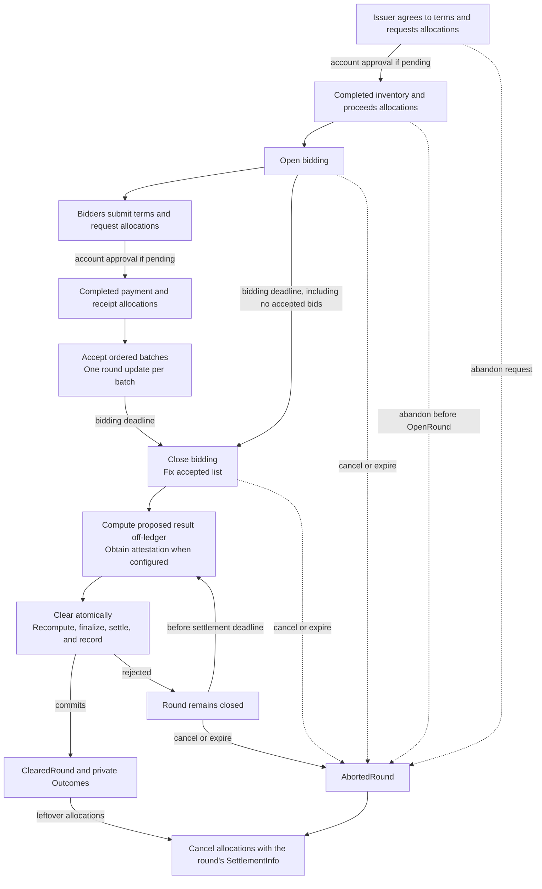

# Confidential auction reference architecture

This reference architecture defines a confidential, uniform-price auction for
distributing a fungible token in one sealed-bid round on Canton. The issuer
offers inventory, bidders authorize bounded payments, and an auction operator
coordinates bidding and settlement. A separate auction validation party, hosted
by the operator organization and independent validation organizations, holds
the authority used by the auction contracts.

## 1. Product Definition

The token seller, called the **issuer**, offers a fixed quantity in one round.
Bidders specify quantities and maximum unit prices under terms published before
bidding opens. After bidding closes, the clearing rule determines the quantities
awarded and the common unit price. Payments follow the published rounding rule.

Competing bidders never see each other's bids. The issuer, the operator, the
validation organizations, and each bid's account parties see what their roles
need, and the registries decide who sees the asset movements. The application
checks bidder eligibility when it accepts a bid and again before it awards
tokens.

The registries use [Token Standard V2](https://github.com/canton-foundation/cips/blob/6f37c896a5a76ec3bc1aa67bc045623ae5df41e5/cip-0112/cip-0112.md)
**allocations** to authorize movements and reserve holdings. The issuer
reserves the supply before `OpenRound`. Each bidder reserves its maximum payment
before acceptance. These **committed allocations** restrict account withdrawal
until their settlement deadline, subject to registry rules. They name the
validation party as their sole settlement executor. Each recipient account also
authorizes receipt through an unfunded iterated allocation. The issuer and each
bidder request their allocation pair in one transaction. Any account approvals
complete through the registries before `OpenRound` or bid acceptance.

The operator accepts prepared bids in batches, and each committed batch appends
its bids to the round's private list. A bid that is only prepared is not yet in
the auction. Closing fixes the list, and the clear has to account for every bid
on it. The operator can refuse or delay admission and chooses the order within
each batch. The contracts guarantee that no accepted bid is dropped, but they do
not guarantee that a request is admitted or ordered fairly.

The **clear** is one atomic transaction. It validates the complete result and
adds exact payment and delivery sides to the existing **iterated allocations**.
During settlement, the registries transfer the assets and return unused funding
to the original accounts. The round produces one result or ends without a sale.
The clear cancels the allocations of bids awarded no tokens. The issuer pays the
operator a fee from the proceeds.

See the [auction lifecycle](#22-auction-lifecycle) for the workflow and
[section 3](#3-target-design) for its transactions and authority.

### 1.1 Auction Mechanics

The issuer and validation party fix the terms before `OpenRound`. A **lot** is the
allowed quantity increment, a **price tick** is the allowed price increment, and
the **reserve price** is the minimum unit price the issuer accepts. A bid's
**fill** is the quantity it wins.

The round terms include:

- payment asset, offered token, issuer accounts, registries, and supported asset policies
- operator fee rate and fee account
- positive offered quantity, reserve price, price tick, and lot size
- payment quantum and rounding rule
- bidding and settlement deadlines, with preparation and clearing margins
- maximum accepted bids and maximum bids per acceptance batch
- eligibility provider, credential requirements, and permitted exclusions
- optional settlement attester, clearing-rule revision, and acceptance ordering

Quantities are whole lots. Reserve and bid prices align to the price tick, and
bids below the reserve are rejected. The rounding function is monotone and
produces a positive payment for one lot at reserve. Because the same rounding
applies to the maximum payment allocation and to the final payment, a smaller
fill at a price no higher than the bid's maximum can never exceed that
allocation. `OpenRound` and acceptance also check the arithmetic bounds of the
terms and the bid.

Every accepted bid receives a consecutive number, starting at zero. Numbers
follow the order in which batches commit and the order the operator chose within
each batch. A rejected batch assigns no numbers, and a retry keeps the numbers
already assigned. The number records acceptance order. It says nothing about
when the off-ledger request arrived or when the synchronizer recorded the bid.

Clearing includes every accepted bid. A bid with authenticated evidence that its
credential expired or was revoked receives zero fill and drops out of the demand
that sets the price. Missing evidence, a cancelled allocation, or an unavailable
participant does not make a bid ineligible. Instead, a required allocation with
no valid successor blocks the whole clear. The registry keeps enforcing its
own asset restrictions throughout.

Eligible bids are ordered by maximum unit price, with higher price bands filling
first. If a band's demand exceeds the remaining supply, that band
receives proportional fills rounded down to whole lots. Leftover lots are
assigned, one per bid in ascending acceptance order, to bids in that band with
remaining demand. This rule applies per bid, so deployments disclose their
multiple-bid and related-account policies. Splitting bids can affect leftover
lot allocation.

All winners pay the same **clearing price**. If eligible demand does not exceed
supply, it is the reserve price. Otherwise it is the lowest maximum unit price
among bids receiving a fill. With no eligible demand, the result reports zero
sales at reserve and releases the supply without an empty settlement call.

For example, consider 100 tokens, a reserve of 8, and a lot size of 10. All bids
remain eligible:

| Bid | Acceptance number | Quantity | Maximum price | Fill |
|---|---:|---:|---:|---:|
| A | 0 | 40 | 9 | 0 |
| B | 1 | 80 | 10 | 40 |
| C | 2 | 50 | 12 | 50 |
| D | 3 | 40 | 10 | 10 |

C receives its full 50 tokens because it offers the highest maximum price, even
though A and B were accepted earlier.

B and D share the remaining 50 tokens proportionally to their requested
quantities. Their shares are approximately 33.33 and 16.67 tokens. Rounding down
to whole lots gives B 30 and D 10, leaving one lot of 10 tokens. B receives that
lot because it was accepted before D.

A receives nothing because the higher-priced bids exhaust the supply, despite
A being accepted first. All winners pay 10 per token, the lowest maximum price
among bids receiving a fill.

A retried clear uses the same accepted set and applies the same rule to the
evidence current at that time. That means a credential change between attempts
can move the price and the fills. A timeout is never a reason to drop a bid or
change the price. If the whole round cannot settle in time, it ends without a
sale.

### 1.2 Scope

The design covers one primary distribution of existing fungible inventory,
permissioned eligibility, and one atomic clear on a compatible synchronizer.
Repeated auctions, secondary trading, mint-on-demand delivery, other pricing
rules, additional executors, and settlement across separately committed
transactions require separate designs.

The selected registries must support allocation requests initiated by issuers
and bidders, committed iterated funding, unfunded receipt allocations, net
settlement of each allocation's sides, synchronous final batch settlement, and
executor cancellation. Round funding and bid creation may return completed
allocations or pending `AllocationInstruction` contracts. `OpenRound` and
admission require both relevant allocations to be complete.

The bid limit bounds both the accepted list and the size of the largest clearing
transaction, zero-fill outcomes included. Measure capacity with concurrent
clients on the selected registries and participant topology. Partial settlement
is outside this design.

## 2. Architecture Overview

The application records auction consent, membership, and results. Issuers
agree to round terms and request funding, bidders submit through the published
terms, and the operator acts through grants signed by the validation party. The
registries collect account approvals and enforce asset policy through completed
allocations, which the auction contracts then validate together with the
complete result.

### 2.1 Personas and Components

In Token Standard terminology, each asset is an **instrument** governed by an
**instrument admin**. The admin's **allocation factory** creates allocations and
its **settlement factory** settles them. One registry may support both auction
assets, or each asset may live in a different registry.

| Persona | Responsibility |
|---|---|
| Bidder | Submits quantity, maximum price, accounts, and allocation requests. |
| Account parties | Approve registry account actions under the account policy. |
| Issuer | Agrees to round terms, requests inventory-send and proceeds-receipt allocations, and pays the operator fee. |
| Auction operator (`ao`) | Runs the backend, coordinates preparation and cleanup, proposes results, submits delegated operations, and receives the fee. |
| Auction validation party (`av`) | Signs auction state and grants. Its choices validate transitions. It is the sole allocation executor. |
| Instrument admins | Enforce account authority, settlement, and asset restrictions through registry code. |
| Eligibility provider | Authenticates bidder credentials, expiry, and revocation status. |
| Settlement attester, when configured | Attests the exact auction settlement through a separate application contract. |
| Auditor, when enabled | Records and checks the disclosed history through observation access to `av`. |

`av` and `ao` have the roles that the [DEX](dex.md) and [lending](lending.md)
reference architectures call `dvv` and `vo`.

The registry determines the **account parties** required for each action,
including any provider approval.
[Canton Coin supports basic accounts](https://github.com/canton-foundation/cips/blob/6f37c896a5a76ec3bc1aa67bc045623ae5df41e5/cip-0112/cip-0112.md#6-canton-coin-implementation)
without a provider or additional account identifier.

#### Hosting and Governance

The worked deployment has three participants hosting `av`: the operator's and
those of two independent validation organizations. Its confirmation threshold
is 2-of-3. The operator also hosts `ao` as a separate, single-hosted party.
The issuer, account parties, asset admins, and attesters use their own or
explicitly trusted participants.

Three controls are configured independently:

- **Confirmation:** two of the participants that host `av` must confirm its
  transaction views.
  Each independently vets the auction and dependency packages.
- **Topology governance:** a 2-of-3 decentralized namespace governs changes to
  `av`'s and `ao`'s hosting and topology. The operator cannot change them
  unilaterally.
- **Administrative submission:** separately configured 2-of-3 external signing
  authority controls direct submissions as `av`, including grant administration.
  Hosting and confirming `av` gives a participant
  neither these signatures nor any account's consent.

These are deployment choices using Canton's
[decentralization controls](https://docs.canton.network/overview/reference/decentralization)
and [multi-signature submission](https://docs.canton.network/global-synchronizer/production-operations/multi-sig).
A deployment can add more independent organizations or pick different thresholds
once it has weighed the trust, availability, and capacity consequences. Whatever
the confirmation threshold, a quorum that controls governance or signing still
has to be trusted. Every participant that hosts `av` receives all of the
party's disclosed data, and removing a participant cannot take back what it has
already seen.

The operator submits as `ao` through `av`-signed **grants**. Each grant instance
authorizes one category of operation, such as preparation or clearing, and each
grant choice runs one fixed workflow; none forwards arbitrary choices. The
operator's read access to `av` lets the operator see the party's contracts, not
submit as `av`.

#### Auction Contracts

Open and closed are states of `Round`. Each operation category has its own
operator grant contract, written as `Grant` in the flows below. Opening grants
use a separate template per release, as described in
[section 6.2](#62-smart-contract-upgrade-process).

| Contract | Purpose |
|---|---|
| `RoundPreparation` | Signed by `av`. Holds proposed terms. The issuer requests both allocations through `FundRound`, consuming it. Its ID is the stable round identity. |
| `FundedTerms` | Signed by issuer and `av`. Holds agreed terms, both completed issuer allocation bindings, and the sale authority reference. `OpenRound` or abandonment consumes it. |
| `RoundFundingRequest` | Signed by issuer and `av`. Holds fixed terms, round identity, and initial registry results when either account approval is pending. `OpenRound` binds completed allocations and consumes it. |
| `Grant` | Signed by `av`. Preparation governs round preparation, funding, and bid submission. Separate grants govern opening, admission, close, clear, termination, and recovery. |
| `PublishedTerms` | Signed by `av`. Terms and round identity, disclosed without the accepted list. Its bidder-controlled `SubmitBid` requests both allocations. |
| `Round` | Issuer- and `av`-signed private state, observed by `ao`. Holds terms, phase, issuer allocation bindings, sale authority, accepted bid IDs, bound allocation roots, and next number. |
| `PreparedBid` | Bidder- and `av`-signed terms and both allocation bindings when creation completes immediately. Acceptance or withdrawal consumes it. It has no acceptance number. |
| `BidRequest` | Bidder- and `av`-signed terms and initial registry results when either account approval is pending. Acceptance binds completed allocations and consumes it. |
| `AcceptedBid` | Issuer-, bidder-, and `av`-signed accepted terms, both allocation roots, number, and credential identity. Observed by `ao` and the bid's account parties. The clear or expiry consumes it. |
| `SaleAuthority` | Signed by `av` and issuer, observed by issuer account parties and `ao`. Binds both issuer allocations and the fee receipt allocation, and checks bounded payment, delivery, and fee legs. `OpenRound` binds it to the round. |
| `SettlementAttestation` | Optional attester-signed attestation of the round's `SettlementInfo`, exact movements, and validity period. |
| `Outcome` | Records one accepted bid's fill, payment, and any exclusion. Visible to that bid's parties, issuer, `av`, and operator. |
| `ClearedRound` | Terminal aggregate result for issuer, `av`, and operator. Offers `CancelRoundAllocation`. |
| `AbortedRound` | Signed by issuer and `av`. Terminal contract of abandonment, cancellation, or expiry, with the reason. Offers `CancelRoundAllocation`. |

Account consent lives in the completed registry allocations rather than in the
auction contracts, so account providers never have to sign an issuer's or a
bidder's auction contract. Recreating a contract gives it a new ID. Round
successors keep the stable round identity, and allocation successors are checked
against the original allocation's ID, called its **root**.

### 2.2 Auction Lifecycle



The issuer's funding submission and each bidder's submission record the terms
and request both allocations in one transaction, and any pending account
approvals then run as registry transactions. `OpenRound`, each acceptance batch,
close, and clear are separate atomic transactions. Bidding can close with any
number of accepted bids, including none. Neither bid submission nor account
approval touches the round; only a committed acceptance makes a bid a member.

The round and its allocations have separate lifecycles. A withdrawn or
unaccepted bid keeps its allocations until the round is terminal. Then the
operator cancels them as described in
[section 3.5](#35-cancel-leftover-allocations).

### 2.3 Privacy and Result Verification

A party's **transaction projection** is the set of branches it may see. A
participant operator can read the projections of every party it hosts. Two
customers who share a participant do not thereby see each other's data, because
Ledger API permissions still separate them. An organization that combines roles
receives the disclosures of each of those roles.

| Persona | Private auction contracts | Asset contracts |
|---|---|---|
| Bidder and bid account parties | Their request or prepared bid, accepted bid, number, and outcome | Their allocations and movements under registry disclosure rules |
| Operator and validation party | All submitted and accepted bids, accepted list, and complete clear | Funding inputs visible through bid submission and all clear movements, subject to their projections and API rights |
| Issuer | Accepted bids, accepted list, and complete clear | All clear movements, subject to its projections and API rights |
| Issuer account parties | Round preparation, funding request, and sale authority, including its winning payment and delivery branches, but no bid contracts | Issuer allocations and movements. Further visibility follows registry rules |
| Instrument admin | No bid contracts or private outcomes | Allocations, holdings, and movements governed by that admin |
| Account provider | Complete bids and outcomes involving its accounts, whether account approval is immediate or staged | Holdings and movements for its accounts |
| Eligibility provider | Its credentials and status, but no bids | No asset contracts |
| Settlement attester | Attestation terms, but no bid contracts or private outcomes | Exact attested movements, including accounts, instruments, and amounts |
| Auditor observing `av` | Full validation-party projection, including accepted bids and outcomes | All settlement branches visible to `av` |

Each bid is finalized in its own child branch, the factory settlement calls sit
outside the bid and sale branches, and the issuer, `av`, and the operator see
the enclosing clear. The bidder's submission runs on the `av`-signed
`PublishedTerms`. `av` sees the registry operations inside it, including the
input holdings and the change. The issuer does not. Verify the transaction
projections and the API access against these boundaries before deployment.

Allocation IDs and disclosure responses are sensitive, because a registry API
uses an allocation ID to look up settlement context and disclosed contracts.
Keep other bidders' allocation IDs out of the published terms, shared metadata,
and any choice argument or result a bidder can see. Disclosure services should
return only the account policies and current holdings that an operation needs,
and backend APIs and logs have to respect the same boundary.

Anyone who can see a payment allocation learns the bid's maximum payment.
[Canton Coin movements are public](https://github.com/canton-foundation/cips/blob/6f37c896a5a76ec3bc1aa67bc045623ae5df41e5/cip-0112/cip-0112.md#431-configurable-executors-and-batch-settlement-via-settlementfactory)
even when the bid contracts are private. Acceptance numbers reveal how many bids
were accepted earlier, and comparing several numbers and their timing shows
acceptance activity, batching included, though not when the off-ledger requests
arrived.

A bidder can verify its own acceptance and outcome, but recomputing the complete
result requires the private accepted set.
[Section 5](#5-security-and-auditability) describes the auditor's checks and
where this verification stops.

### 2.4 Institutional Controls

Before bidding opens, the round publishes which eligibility and attestation
policies apply and who is responsible for each. The registries publish their own
asset policies separately.

| Control | Enforcement |
|---|---|
| Optional settlement attestation | The configured attester signs `SettlementAttestation`. The auction clear checks and consumes it for the exact settlement. Registries independently enforce any approvals required by their own policies. |
| Bidder eligibility | The provider authenticates status for the common owner of the payment and delivery accounts. Acceptance and clear check that evidence. |
| Application governance | The organizations in section 2.1 govern `av`'s and `ao`'s topology, direct `av` signing, vetted code, and grants. |
| Registry restrictions | Registry code governs asset cancellation, withdrawal, and privileged movements. The auction cannot override these controls or treat a cancelled allocation as funded. |

Acceptance binds the credential's provider, owner, and identity. A revocable
credential needs a status contract signed by the provider. Each status update
consumes the previous version, so exactly one authenticated successor is active
at any time. The clear validates that successor and checks its expiry against
ledger time. Revocation has to be an explicit revoked status. The provider keeps
expired credentials and revoked status contracts active until the round's
settlement deadline. A missing or archived credential gives no evidence, so it
blocks the clear and does not count as excluded.

Even a nonrevocable credential needs authenticated ownership and an expiry.
Credential and status contracts, and every successor of them, name `av` as an
observer so that `av`'s choices can fetch them under their own authority. These
checks reveal no bid amounts and no accepted list to the provider. Any
related-party screening belongs in the fixed eligibility policy.

An auditor may also act as the attester through a separate party. This adds a
settlement condition, but gives the auditor no confirmation vote and no
authority to submit as `av`.

Grant choices are non-consuming in ordinary use, so governance pauses an
operation by consuming its grant. The preparation grant covers starting and
funding rounds and new bidder submissions, and the admission grant covers
acceptance. `FundRound` and `SubmitBid` both check for a live preparation grant.
Registry instructions already in flight can still complete. Once both
allocations exist, a funding request can still open under the opening grant and
a bid can still be accepted under the admission grant. So stopping new rounds
also means revoking the opening grant. The close, clear, termination, and
recovery grants stay in place for existing allocations.

Replacing the operator keeps the `ao` party. Governance revokes the old grants,
moves `ao` to the replacement participant, and then issues new grants. Revoking
grants does not remove observer rights, so the procedure discloses any access
that the former operator keeps.

## 3. Target Design

Each numbered submission below is a separate transaction, and the indented calls
run inside it. The auction service discloses the published terms and the active
preparation grant, and the wallet and registry services add scoped account
context and current holding disclosures. Disclosure only makes a contract
visible. Exercising a choice still needs its controllers' authority.

Users interact through an auction UI and wallet provider using
[CIP-0103](https://github.com/canton-foundation/cips/blob/6f37c896a5a76ec3bc1aa67bc045623ae5df41e5/cip-0103/cip-0103.md).
The UI displays authenticated terms and constructs allocation requests. The
wallet obtains user authorization and submits through the user's authorized
participant connection. Account providers submit their required account
approvals through their own services. The operator backend submits `ao` actions
through its participant.

### 3.1 Prepare and Open the Round

The issuer agrees to the section 1.1 terms and requests both allocations in one
submission. Both accounts have the issuer as their owner. Registries collect
any additional account approvals under their own policies.

```text
1. ao exercises preparation Grant.StartRound(terms)
   create RoundPreparation, signed by av

2. Issuer exercises RoundPreparation.FundRound(preparation grant, inventory holdings)
   controller = issuer, contract signatory = av
   check the live grant and bidding deadline
   request committed iterated inventory-send and proceeds-receipt allocations
     each factory call uses actors = [issuer]
   reject Failed results
   if both results are Completed:
     create FundedTerms and SaleAuthority with both allocation bindings
   otherwise:
     create RoundFundingRequest with fixed terms and initial registry results
   consume preparation
   both paths create contracts signed by issuer and av

3. If either result is Pending, its account parties complete the registry's
   AllocationInstruction workflow

4. ao exercises opening Grant.OpenRound(source, current issuer allocations)
   request the unfunded fee receipt allocation for the operator fee account
     actors = [ao], require a Completed result
   if the source is RoundFundingRequest:
     exercise CompleteFunding with av authority, consuming the request
       validate both completed allocations against fixed terms and round identity
       preserve the root of any side that completed in the initial submission
       create FundedTerms and SaleAuthority
   exercise FundedTerms.FundedTerms_Open with av authority, consuming FundedTerms
     validate both allocation bindings, the sale authority, terms, and timing
     exercise SaleAuthority.BindSale to bind its successor to the round and the fee allocation
     create Round(Open) and PublishedTerms, signed by av
```

The issuer's authority over the terms comes from exercising `FundRound`, account
consent comes from the completed registry allocations, and `av`'s authority to
bind and open comes from the opening grant. `PublishedTerms` carries only
`av`'s signature, and the issuer's agreement stays in `Round`. `OpenRound`
accepts either `FundedRound(fundedTerms)` or `RegistryPreparedRound(request)`.
In the second case, consuming the request, creating `FundedTerms`, and
`FundedTerms_Open` all commit in one transaction.

The `RoundPreparation` contract ID is the stable identity, `roundId`, fixed
before funding. All issuer, operator, and bidder allocations use one
`SettlementInfo`: `executors = [av]`, `id` set to the venue's constant
settlement label, `cid = Some roundId`, and fixed metadata without private bid
data. Settlement uses the same `SettlementInfo` unchanged.

Initial allocations have empty `transferLegSides`, `committed = True`, and the
round's settlement deadline. Their `nextIterationFunding` enables exact sides
to be supplied later:

| Allocation | Account | Initial `nextIterationFunding` |
|---|---|---|
| Inventory send | Issuer inventory | `Some {offered instrument: supply}` |
| Proceeds receipt | Issuer proceeds | `Some {}` |
| Fee receipt | Operator fee | `Some {}` |
| Payment send | Bidder payment | `Some {payment instrument: maximum payment}` |
| Token receipt | Bidder delivery | `Some {}` |

Sending allocations reserve holdings and receiving allocations authorize
receipt. An allocation created with `None` cannot take sides later. The
executors can add any sides that the restrictions on `av`'s authority and the
vetted code permit (section 5.2).

Both allocation requests and their auction contracts commit together, and a
failure leaves the preparation untouched. The registry workflow decides when the
inventory is actually reserved, so the inputs have to stay available until then.
A pending instruction is not enough to open. `OpenRound` validates the bindings
defined in section 3.4 and creates an empty accepted list, an empty set of bound
roots, and next number zero. Every round contract carries the stable identity
from then on.

`OpenRound` has to happen early enough to leave the published **preparation
margin** before the bidding deadline, and the deadline leaves the **clearing
margin** before settlement ends. `OpenRound` does not consume the opening grant.

A failed `OpenRound` leaves its source contract and any earlier registry effects
as they were. The issuer can then abandon the source through `AbandonFundedTerms`
or `AbandonRoundFunding`. Both create an `AbortedRound`, and the operator then
cancels the issuer allocations (section 3.5). `OpenRound` and abandonment
compete for the same source contract. Abandoning an unfunded preparation
consumes only that preparation.

### 3.2 Submit Bids and Accept Batches

#### Submit a Bid

The bidder reviews the published terms and its own quantity, maximum price,
accounts, maximum payment, and deadline. Both accounts are owned by the bidder,
and the supported account policies let the bidder request the allocations
itself.

```text
1. Bidder exercises PublishedTerms.SubmitBid(preparation grant, bid, holdings)
   controller = bidder, contract signatory = av
   check the live grant, exact terms, bid bounds, and bidding deadline
   request the rounded maximum-payment allocation from the payment registry
   request the unfunded receipt allocation from the offered-token registry
     each factory call uses actors = [bidder]
   reject Failed results
   if both results are Completed:
     create PreparedBid with both allocation bindings
   otherwise:
     create BidRequest with the initial registry results
   both bid contracts are signed by bidder and av

2. If either result is Pending, its account parties advance the registry's
   AllocationInstruction workflow until the allocation is Completed
```

`SubmitBid` is non-consuming. The published terms carry `av`'s signature, which
gives the bid contract `av`'s authority, while the registries collect any
missing account approvals. Providers observe the bid contracts but do not sign
them. Immediate allocations and the `PreparedBid` commit together, so a rejected
registry call or a failed result rolls back the whole submission. A pending
result commits an instruction and a `BidRequest` whose terms stay fixed while
the account approval completes.

Payment and receipt can complete at different times. The registry workflow
decides when the funds are reserved, and the inputs have to stay available until
then. Admission needs both allocations completed before the bidding deadline; a
pending instruction is not enough even if the registry has already reserved the
funds.

Each bid has its own application state and funding inputs. Neither submission
nor account approval updates the `Round` or makes the bid a member, and the
completed allocations of a `BidRequest` are bound only during acceptance.

#### Accept a Batch

The operator queues ready bids and submits ordered batches against the current
round. A batch can contain immediate `PreparedBid` contracts and `BidRequest`
contracts whose registry workflows have completed.

```text
ao exercises admission Grant.AcceptBatch(round, ordered bids, current evidence)
  exercise Round.Round_AcceptBatch with av authority, consuming Round
    check Open, deadline, batch size, capacity, and distinct bid IDs
    reject allocation roots already in the round's bound set or repeated within the batch
    for each bid in the supplied order:
      validate round, terms, both completed allocations, and eligibility
      exercise PreparedBid.Prepared_Accept or BidRequest.AcceptRegistryPrepared
        with issuer and av authority
        consume the source and create AcceptedBid with number n
      increment n
    create one Round successor with appended accepted IDs, the batch's roots
      added to the bound set, and the next number
```

In acceptance, the issuer's and `av`'s authority comes from the round, the
bidder's authority comes from the bid source, and account consent comes from the
completed allocations. A bidder sees its own `AcceptedBid` but not the private
round state. A batch fetches no earlier `AcceptedBid`, so earlier bidders do not
confirm later batches. The issuer allocations are committed, and `OpenRound`
and the clear validate them, so acceptance does not fetch them.

Acceptance checks the bid bounds from section 1.1 and both allocation bindings
as defined in section 3.4. The bidder's eligibility has to be valid at that
moment, and the credential's identity is stored in `AcceptedBid`.

A batch of `k` bids receives the consecutive numbers `n` through `n + k - 1`,
and the earlier entries keep their numbers and order. One invalid or
unconfirmable input rejects the entire batch and leaves its sources, their
allocations, and the previous round as they were. Competing batches, a close,
and a termination race for the round. A withdrawal races for its bid source, and
a lost race rejects the whole batch. The backend serializes batches, removes
withdrawn bids, and reads the current round ID before it retries. A batch needs
confirmation only from the issuer, `av`, and the batch's bidders and registries.
The round's size
grows with its accepted bids, up to the maximum in the terms. Batching reduces
how often the round is replaced, but it does not guarantee throughput.

`WithdrawPreparedBid` and `AbandonBidRequest` consume only the bid contract.
Both compete with acceptance. The allocations stay committed until the round is
terminal, and then the operator cancels them (section 3.5). A withdrawing bidder
therefore waits for its funds until the round ends, at most until the settlement
deadline. Once accepted, a bid
stays in the round until the complete clear or the termination.

### 3.3 Close Bidding and Compute the Result

At or after the bidding deadline, `ao` exercises the closing grant's
`CloseRound`. It calls `Round_Close`, which consumes the open round and creates
a closed successor with the same terms, accepted list, next number, and sale
authority. Acceptance needs an open round and a ledger time before the deadline.
Reaching capacity stops admission, but the round still closes only at the
deadline.

The operator reads the closed list, resolves the current allocation and
credential evidence, and computes a proposed price, fills, and payments under
section 1.1, and the fee. It also obtains the attestation if one is configured. The
clear then recomputes the result on its own from authenticated inputs and
rejects any mismatch.

### 3.4 Finalize Allocations and Settle

`Round_Clear` is one transaction, submitted by `ao` through the clearing grant
before settlement ends. It consumes the closed round, accepted bids, sale
authority, and any attestation while settling both assets.

```text
ao exercises clearing Grant.ClearRound(closed round, result, current evidence)
  exercise Round.Round_Clear with av authority, consuming Round
    validate the exact accepted list, allocations, credentials, and proposed result

    for every AcceptedBid, exercise FinalizeBid with av authority
      validate local quantity and payment bounds
      winner: return FinalizedAllocation values for payment and token receipt
      zero fill: cancel both allocations with Allocation_Cancel, actors = [av]
      consume AcceptedBid and create its private Outcome

    exercise SaleAuthority.FinalizeSale with av authority
      validate the aggregate payment, delivery, and fee legs
      return FinalizedAllocation values for issuer proceeds, inventory, and fee receipt
      consume SaleAuthority

    verify and consume any configured SettlementAttestation
    outside bid and sale branches, for each instrument admin:
      exercise SettlementFactory_SettleBatch
        settlement = the round's SettlementInfo, actors = [av]
        transferLegs = that admin's payment, fee, or delivery legs
        allocations = that admin's FinalizedAllocation values
      require AllocationResult_Settled with nextIterationAllocationCid = None
        for each allocation

    create ClearedRound with aggregate result and outcome references
```

Finalization only builds allocation references and the exact sides; the
settlement factories move the assets and return the unused funding. If any
branch or a later factory call fails, every movement and every consumed
application contract rolls back. Bidders do not sign again, although the
required participants still have to confirm their views.

#### Validate Allocations and Prevent Reuse

The round's `SettlementInfo` identifies the settlement and must match each
settlement batch. All bids share it, so it does not identify a bid. Acceptance
binds each payment and receipt allocation root to one bid. The round stores the
bound roots and rejects a root that repeats, so one allocation cannot back
several bids.

A registry has to keep exactly one active successor of each allocation.
Whenever a contract ID changes, the on-ledger checks authenticate the active
allocation against its recorded root. Where the selected registry carries the
original ID through its permitted updates, `originalAllocationCid` provides that
identity. Where it points only at a predecessor, a further update needs
authenticated lineage evidence or has to be rejected. Backend events help locate
the current IDs, but they prove nothing on ledger.

`OpenRound`, admission, and the clear check the expected account, admin,
`SettlementInfo`, `committed`, deadline, empty initial sides, `Some` funding
map, and `numIterations = 0`. Receiving allocations keep `Some {}`.
Registry-specific evidence establishes the allocation's status and confirms that
funds back it, without reading the account at large. A consumed allocation
without a valid successor blocks the clear, even for a zero-fill bid. No
registry restriction ever removes a bid from the accepted set.

#### Validate the Result and Authority

The clear's inputs have to match the closed round's IDs and numbers in their
stored order. The choice rejects any omitted, duplicate, substituted, or
foreign-round bid, recomputes eligibility, the section 1.1 result, and the fee,
and checks supply, demand, payment bounds, rounding, and deadlines against the
proposed result.

The authority chain is:

| Contract and choice | Contract signatories | Controller |
|---|---|---|
| `Grant.ClearRound` | `av` | `ao` |
| `Round.Round_Clear` | Issuer and `av` | `av` |
| `AcceptedBid.FinalizeBid` | Issuer, `av`, and bidder | `av` |
| `SaleAuthority.FinalizeSale` | `av` and issuer | `av` |
| `SettlementAttestation.VerifySettlement` | Attester | Settlement executors, fixed to `[av]` |
| `SettlementFactory.SettlementFactory_SettleBatch` | Instrument admin | `[av]`, the settlement executors |
| Other registry choices | Registry-defined signatories | Registry-validated actors with the required authority |

The bid and sale choices enforce their local bounds, and the enclosing round
enforces the global pricing and completeness. `ao` cannot exercise those
`av`-controlled choices directly, and its grant allows only the complete
workflow. A party that submits directly as `av` can bypass that workflow, so the
atomic clear depends on restricting that authority and on the vetted code.

#### Supply Exact Sides and Settle Batches

A **transfer leg** specifies an instrument, sender, receiver, amount, and
`transferLegId`. Every winner has two legs, and the round has one fee leg:

| Leg | Sender | Receiver | Amount |
|---|---|---|---:|
| Payment | Bidder payment account | Issuer proceeds account | Rounded `fill x clearing price` |
| Delivery | Issuer inventory account | Bidder delivery account | Fill quantity |
| Fee | Issuer proceeds account | Operator fee account | `fee rate x total payments`, rounded down to the payment quantum |

Each leg needs sending and receiving authorization. A winner's payment and
receipt allocations authorize its two sides. The issuer's inventory allocation
covers all delivery sender sides. The proceeds allocation covers all payment
receiver sides and the fee sender side, and the fee receipt allocation covers
the fee receiver side. A Token Standard V2 allocation authorizes the net amount
of its sides, so the incoming payments fund the fee and the proceeds allocation
needs no reserved funding. The fee is at most the total payments.

A `FinalizedAllocation` holds the current allocation ID, the exact
`extraTransferLegSides`, and `nextIterationFunding = None`. The `None` ends the
allocation after settlement and returns any excess payment or unsold inventory
to the original account.

Leg IDs are derived from the acceptance number and the movement, for example
`payment-7`. One registry can settle both assets in a single
`SettlementFactory_SettleBatch` call. The fee leg settles in the payment asset's
call. With separate registries, all factory calls still run inside the same
clear transaction and use the round's `SettlementInfo`.

Each bid choice receives only its own terms, fill, price, and allocations. The
shared factories enforce exact side coverage, unique leg IDs, and matching
accounts, instruments, amounts, and `SettlementInfo`. The clear rejects
incomplete results and any funding successor, and a registry that requires its
own approval adds one more condition.

When a `SettlementAttestation` is configured, it binds the round's
`SettlementInfo` and the exact payment, fee, and delivery legs for a limited
validity period. The clear verifies and consumes it in the same transaction.
Because `SettlementInfo` contains the round ID, the attestation is valid for
this round only.

#### Record Outcomes

Every accepted bid receives a private `Outcome` with its round, number, fill,
price, rounded payment, and exclusion evidence. `ClearedRound` records aggregate
price, sold quantity, payments, fee, unsold supply, and outcome references.
Payment totals sum the individually rounded amounts.

With no winners, the clear consumes the same application contracts, records
zero sales at the reserve price, and cancels both issuer allocations and the fee
receipt allocation. It does not call a settlement factory with an empty leg
list, although a configured attestation still has to cover the round's
`SettlementInfo` and the empty movement set. If the rounded fee is zero, the
clear adds no fee leg and cancels the fee receipt allocation.

### 3.5 Cancel Leftover Allocations

`ClearedRound` and `AbortedRound` are the terminal round contracts. Each offers
`CancelRoundAllocation`, which the operator exercises through the recovery
grant:

```text
ao exercises recovery Grant.CancelAllocation(terminal round contract, allocation)
  exercise CancelRoundAllocation with av authority
    check that the allocation's SettlementInfo is the round's SettlementInfo
    exercise Allocation_Cancel with actors = [av]
```

No membership or root check is necessary. Each round transition consumes its
predecessor, so a terminal contract and a live round never exist at the same
time, and no transaction can settle the round after it ends. The rule covers
withdrawn and unaccepted bids, abandoned registry workflows, and the accepted
bids and issuer allocations of an aborted round.

| Case | Effect |
|---|---|
| Abandoned before `OpenRound` | `AbandonFundedTerms` or `AbandonRoundFunding` creates `AbortedRound`. An unfunded preparation has no allocations. |
| Round cancelled or expired | `Grant.EndRound` creates `AbortedRound` with the reason. |
| Round cleared | The clear has cancelled zero-fill allocations. `ClearedRound` covers the allocations of withdrawn and unaccepted bids. |
| Settlement deadline passed | Account parties can withdraw any remaining allocation under registry rules. |

Before the round's deadline, the operator may cancel an uncleared round, giving
a reason; at or after the deadline, it may record the round as expired.
`Grant.EndRound` calls `Round_End`, which consumes the open or closed round and
creates an `AbortedRound`. Termination competes with acceptance and close while
the round is open and with the clear while it is closed, and it does not require
a prior clearing attempt.

Application contracts also expire. After the settlement deadline, each
signatory of a round's bid contracts and terminal contract can archive them
through `Expire`. Archiving moves no assets and is not evidence of a refund.
Pending instructions that complete after the round ends also name the round's
`SettlementInfo`, so the operator can cancel them while the terminal contract
is active. A cancellation and a withdrawal race for the same allocation, and
only one of them succeeds.

### 3.6 Manage Execution and Timing

Choices check ledger time: funding, `OpenRound`, bid submission, and acceptance
have to happen before the bidding deadline, close at or after it, and the clear
before settlement expires. Each allocation's registry deadline, storage expiry,
and holding-lock expiry have to cover the whole workflow, and a longer
allocation period means telling users about the later withdrawal time.

The preparation margin has to cover account approval, signing, submission,
confirmation, and retries. The clearing margin has to cover submission and
confirmation, plus the time to close, compute, and obtain the attestation. The
backend works to the earliest of the limits imposed by the round, the
registries, the attestation, and the transaction submission bounds. Cleanup
timelines are disclosed separately, because they depend on the infrastructure
and asset policies involved.

Reconcile a timed-out submission against completions and committed state before
a new attempt. Follow the
[deduplication](https://docs.canton.network/appdev/deep-dives/command-deduplication),
[time handling](https://docs.canton.network/appdev/modules/m3-working-with-time),
and [external signing](https://docs.canton.network/appdev/deep-dives/external-signing-transactions-part-1)
guidance.

The clear needs the confirming participants, or the confirming quorum, of every
issuer, account, registry, and `av` branch it touches. The credential fetches
and the consumption of the attestation need their confirmations too, and issuing
the attestation early does not remove the attester's participant from that list.
An offline wallet needs no new user interaction at clear, but if any required
confirming infrastructure is unavailable, the entire transaction blocks,
zero-fill branches included.

[CIP-0120](https://github.com/canton-foundation/cips/blob/6f37c896a5a76ec3bc1aa67bc045623ae5df41e5/cip-0120/cip-0120.md)
(proposed) rewards confirming participants for successful transactions only, so
an honest participant has a reason to confirm. A bidder that operates its own
participant can still withhold confirmation. The operator retries the complete
clear until the settlement deadline. The `MEDIATOR_SAYS_TX_TIMED_OUT` rejection
lists the unresponsive parties, and the operator keeps it. Under the published
admission policy, parties on a participant that did not confirm a clear cannot
bid in later rounds. The auditor checks each exclusion against the kept
rejection.

## 4. Failure Recovery

A rejected transaction commits none of its effects, and earlier transactions
keep theirs. Reconcile an uncertain submission before treating it as rejected.

| Failure or change | Consequence and response |
|---|---|
| Issuer preparation stops before funding | The issuer can request funding under a live preparation grant or abandon. No auction allocation exists. |
| Round funding fails | Preparation remains active. Correct inputs and retry before the bidding deadline or abandon. |
| Bid submission fails | Neither the bid contract nor its new registry allocations or instructions commit. Correct inputs and retry before the bidding deadline. |
| Account approval remains pending | Complete both registry workflows in time for `OpenRound` or bid admission, or abandon. |
| `OpenRound` fails | The source and prior registry effects remain. Retry with both completed allocations, or abandon (section 3.1). |
| Acceptance batch fails validation or loses a state race | No bid or number in the batch is accepted. Reconcile and retry eligible prepared bids before the deadline. |
| Bid remains unaccepted when admission closes | It has no fill entitlement. The operator cancels its allocations after the round ends. |
| Clear has wrong evidence or result, or an asset operation fails | Entire clear rolls back. Correct inputs and retry the complete accepted set before the earliest deadline. |
| Required attestation is missing, expired, or mismatched | Obtain an attestation for the exact current settlement or end without a sale. |
| Authenticated credential expiry or revocation | Retain the accepted bid with zero fill. Missing current evidence instead blocks validation. |
| Registry changes an allocation ID | Resolve and validate its successor. Finding the old ID archived does not mean the funding is lost. |
| Required allocation has no valid successor | The round cannot clear. Terminate, reconcile that asset outcome, and cancel the round's allocations from the terminal contract. |
| Required confirming participants or quorum unavailable | Retry the complete clear, including zero-fill branches. Do not omit bids or reprice for a timeout. Exclude the non-confirming participants from later rounds under the admission policy. |
| Settlement deadline passes | Clear is no longer permitted. Record expiry and cancel the round's allocations from the terminal contract. |
| Operator unavailable or grants revoked | Governance restores grants or transfers operation of `ao` under section 2.4. Account withdrawal remains subject to registry deadlines and policy. |
| Synchronizer, registry, or traffic unavailable | Restore the required infrastructure and reconcile state before resuming. |

Cleanup has dependencies of its own. It cannot guarantee a withdrawal while a
required party or registry is unavailable.

## 5. Security and Auditability

### 5.1 Ledger-Enforced Properties

These properties depend on vetted contract code, registry implementations,
and the authority boundaries in section 2.1:

| Property | Mechanism |
|---|---|
| Fixed terms and ordered admission | Issuer-signed `FundedTerms` or funding request, consuming `OpenRound` source, batch acceptance, and round transitions. |
| Complete accepted set | Append-only membership and bound roots, closed list, exact clear inputs, and one outcome per accepted bid. |
| Bounded payments and reserved supply | Completed account-authorized allocations and local and aggregate movement checks. Registry powers are unaffected. |
| Uniform-price result | Independent on-ledger computation under section 1.1. |
| Atomic settlement and replay prevention | Delegation restricted to the complete clear, consumed round and bids, complete allocation coverage, and transaction rollback. |
| Scoped authority and disclosure | Bid-specific finalization, separate factory calls, scoped registry context, and verified participant projections. |
| Controlled cleanup | Terminal-round cancellation restricted to allocations with the round's `SettlementInfo`, and registry authorization. |

### 5.2 Trust Boundaries

| Trusted party or system | Residual risk |
|---|---|
| Operator | Can censor or reorder requests before acceptance, cancel an uncleared round, delay submission, delay cancellation of leftover allocations, or exclude participants after a confirmation timeout. |
| Validation and governance organizations | A controlling quorum can change trusted code or topology or authorize direct `av` actions outside operator delegation. A signing quorum that submits directly as `av` can settle any committed auction allocation, up to its funding, to receivers it chooses. Every participant that hosts `av` can disclose the data it receives. |
| Issuer | Sees accepted bids and must protect them. Inventory and account consent must remain valid. |
| Account parties and hosting providers | Give consent, protect data, and stay available. A shared participant's operator can read its hosted parties' data, although customer API access is still permissioned. |
| Instrument admins and registries | Enforce authentic lineage, funding, side coverage, and asset policies. Privileged asset operations or malicious code can affect holdings independently of auction state. |
| Eligibility provider | Incorrect status can change eligible demand, price, and fills. Missing evidence can block clear. |
| Settlement attester | Can withhold the attestation or attest an inappropriate settlement. An affiliated attester provides no independent review. |
| Canton infrastructure | Atomicity does not guarantee admission, timely confirmation, or sufficient traffic. |
| Auditor | Has to retain the complete disclosed history and review it correctly. Observing gives it no veto and no way to force progress. |

An optional independent auditor observes `av` from a participant with
observation permission only, and users are told about it. It has no `av`
confirmation vote and no submission authority. Its audit checks:

- committed acceptance batches and numbers against the closed list
- credentials, permitted exclusions, price, fills, and rounded payments
- one private outcome per accepted bid and matching aggregate totals
- actual payments and deliveries against the result
- cancellation of the round's leftover allocations after the round ends
- the fee leg, and the exclusion of the operator, its affiliates, and
  non-confirming participants from bidding
- admission and timing against the published policy and retained submission evidence

Watching the ledger cannot show whether every off-ledger request was treated
fairly, so the operator keeps receipts, command IDs, completions, and timing for
that part of the review. A timeout the operator reports still needs its cause
established. Events from before the auditor joined need a verified historical
export. Account balances outside the observed transactions need separately
authorized account or registry evidence. An auditor that also acts as attester
can withhold its attestation.

A bidder's limited projection lets it check its own acceptance and outcome, not
recompute the complete auction. Direct `av` authority and malicious but
compatible upgrades are governance risks, addressed in section 6.2.

## 6. Deployment and Operations

Before onboarding, publish the relevant organizations, registries, factories,
account providers, credential and attestation policies, package inventory, and
topology. Each validation organization reviews and vets the code on its own.
Every workflow input has to be usable on the selected synchronizer. Validate
hosting, permissions, and outage recovery on an authenticated network with the
intended participant topology.

The auction UI presents the maximum payment, the accounts and required account
approvals, the deadlines, eligibility, registry restrictions, cleanup
conditions, and the organizations that receive bid data. The admission decision
is the ledger accepting the bid, nothing earlier: submitted terms, account
approval, and operator receipts entitle a bidder to no fill before acceptance.

The backend tracks round preparations, funding and bid requests, registry
instructions, current round and allocation IDs, acceptance batches, submission
outcomes, deadlines, credentials, attestations, participant health, and leftover
allocations of ended rounds. It separates auction assets from traffic funding
and application rewards.

### 6.1 Traffic and Application Rewards

Each participant operator funds its charged traffic, including retries and
cleanup. [Traffic balances are per participant](https://docs.sync.global/deployment/traffic.html),
shared by its parties. Service agreements assign top-up responsibility,
validation costs, and reimbursements. Any registry fees have to be disclosed and
budgeted so that they do not eat into the auction funding.

The operator receives a fee from the issuer's proceeds, at a rate fixed in the
round terms. The clear pays it as one extra leg (section 3.4). The fee grows
with the sale, so the operator earns from a good result and not from the bids it
sees. The eligibility policy excludes the operator and its affiliates from
bidding, and the auditor checks this.

Budget from measurements of preparation, batch admission, a maximum-size clear,
retries, and cleanup, and do not assume that batching lowers total traffic
until it has been measured. Under
[CIP-0104](https://github.com/canton-foundation/cips/blob/6f37c896a5a76ec3bc1aa67bc045623ae5df41e5/cip-0104/cip-0104.md),
conformant confirmation responses cost nothing net, but a node still needs
traffic to cover them until it is reimbursed, and duplicate responses can cost
more.

The designated application-provider party is `av`. Rewards are attributed to it
when it holds an active `FeaturedAppRight` and confirms views in successful
transactions. Merely observing a view earns nothing, and the three participants
that host `av` still count as one party for this purpose. Asset admins may earn
rewards for their own views. Issuance and collection follow whatever the network
rules are at the time. Governance decides how rewards are shared, and operations
have to be funded without assuming that rewards will cover the costs.

### 6.2 Smart Contract Upgrade Process

A release must not change the economics of an active round, its accepted
membership, any account consent, or the cleanup paths. Smart Contract Upgrade
compatibility allows choice bodies to change without proving any of that, so
each validation organization reviews an auction upgrade and its dependency
upgrades before vetting them.

A compatible package keeps its name, increases its version, and declares
`upgrades:` under the [SCU rules](https://docs.canton.network/appdev/deep-dives/smart-contract-upgrade).
Define what an absent optional field means for rounds that already exist.
Storing a rule revision or a package ID in the contract does not protect against
a malicious choice body. A change to pricing, ordering, authority, or any other
incompatible semantics needs a separate design and fresh consent.

Each release uses a new opening-grant template. At cutover, governance archives
the old opening grants and issues new ones.

Preparations, funding requests, and `FundedTerms` contracts that have not opened
under the retired terms are abandoned or prepared again with fresh consent.
Rounds that are already open keep their admission, close, clear, termination,
and cleanup paths, so keep the code behind their allocations vetted. A
replacement grant must not forward arbitrary exercises or bring back retired
opening authority.

Validate package compatibility in both upgrade directions where supported, and
test old-round operations and the grant cutover on the real dependencies and
topology. Release review and vetting have to reject a change that is
structurally compatible but unsafe. Direct submissions as `av`, authorized by
the quorum, stay an explicit governance responsibility.

## 7. Production Decisions

Record these decisions before the first `OpenRound`:

| Decision | Configuration |
|---|---|
| Organizations and authority | Participants, confirmation thresholds, topology governors, administrative signers, grants, and replacement procedures. |
| Admission and economics | Fixed terms, fee rate and fee account, measured bid and batch limits, maximum batch waiting time, admission policy, confirmation-failure exclusion policy, and related-account policy. |
| Assets and accounts | Instruments, admins, registries, factories, account authority, asset restrictions, deadlines, privacy, and upgrade controls. |
| Eligibility and attestation | Credential identities and status mechanism, optional attester, required account approvals, and review independence. |
| Audit | Observation access, user disclosure, historical retention, submission evidence, review responsibility, and data handling. |
| Operations and releases | Traffic funding, cleanup service, vetted package inventory, opening cutover, and support for existing allocations. |

Membership based on synchronizer record time would need a different inclusion
and audit model; this design uses explicit acceptance after the account
approvals have completed.

## 8. References

Standards and platform semantics:

- [CIP-0112 Token Standard V2](https://github.com/canton-foundation/cips/blob/6f37c896a5a76ec3bc1aa67bc045623ae5df41e5/cip-0112/cip-0112.md)
  and the [Allocation V2 interface](https://github.com/canton-network/splice/blob/69b43eb761e38695052c983715aa855c8cb207fc/token-standard/splice-api-token-allocation-v2/daml/Splice/Api/Token/AllocationV2.daml):
  account authority, iterated funding, exact sides, executors, lineage, and settlement.
- The [Allocation Instruction V2 interface](https://github.com/canton-network/splice/blob/69b43eb761e38695052c983715aa855c8cb207fc/token-standard/splice-api-token-allocation-instruction-v2/daml/Splice/Api/Token/AllocationInstructionV2.daml):
  issuer and bidder initiation, completed allocations, and account approval workflows.
- [CIP-0103 dApp API](https://github.com/canton-foundation/cips/blob/6f37c896a5a76ec3bc1aa67bc045623ae5df41e5/cip-0103/cip-0103.md):
  user authorization, wallet connectivity, and transaction submission.
- Canton [authorization](https://docs.canton.network/appdev/modules/m3-authorization)
  and [ledger model](https://docs.canton.network/overview/reference/ledger-model-detailed):
  choice authority, contract consumption, and projections.

Component references:

- Splice's pinned [Token V2 registry example](https://github.com/canton-network/splice/blob/69b43eb761e38695052c983715aa855c8cb207fc/token-standard/examples/splice-test-token-v2/daml/Splice/Testing/Tokens/TestTokenV2.daml)
  illustrates iterated funding, unfunded receipt, registry-managed account approval,
  and per-account context filtering during batch settlement. Selected production
  registries require their own integration and policy verification.
- The [credential-check module](../../experiments/identity/hook-shape-b/daml/OpenZeppelin/Experimental/Identity/ShapeB.daml)
  demonstrates typed eligibility checks. The deployment must supply its chosen
  current-status and revocation mechanism.
- The [SCU experiment](../../experiments/identity/upgrade/README.md) provides
  bounded compatibility evidence. Auction semantics and deployment cutover
  require the application checks in section 6.

The complete contracts, backend, UI, registry integration, and operational
evidence belong to the application repository. The references above only show
that the individual mechanisms work.
