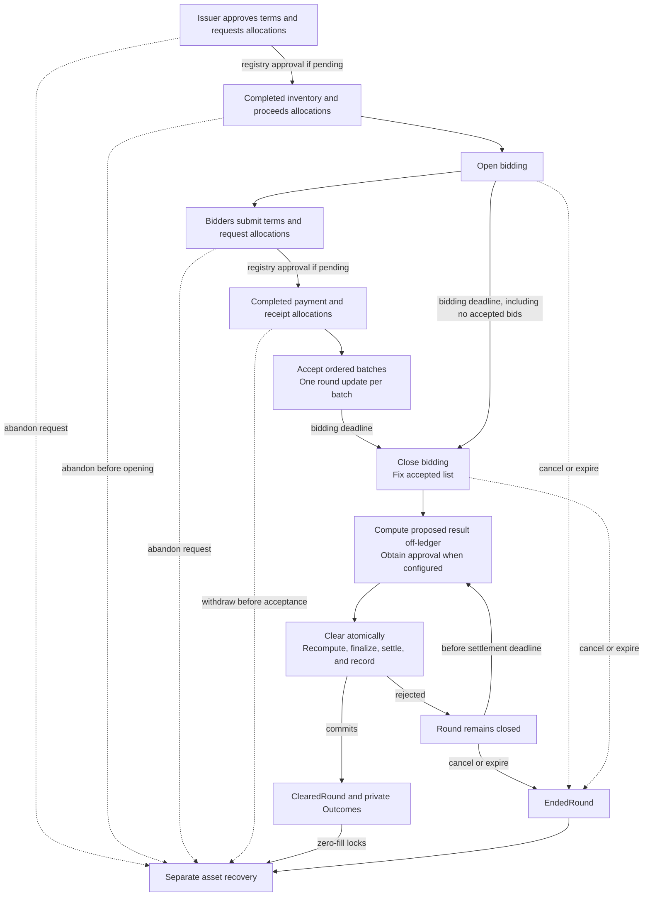

# Confidential auction reference architecture

This reference architecture defines a confidential, uniform-price auction for
distributing a fungible token in one sealed-bid round on Canton. The issuer
offers inventory, bidders authorize bounded payments, and an auction operator
coordinates bidding and settlement. A separate auction validation party, hosted
by the operator organization and independent validation organizations, holds
the authority used by the auction contracts.

## 1. Product Definition

The token seller, called the **issuer**, offers a fixed quantity in one round.
Bidders specify quantities and maximum unit prices under terms published before
bidding opens. After bidding closes, the clearing rule determines the quantities
awarded and the common unit price. Payments follow the published rounding rule.

Bids are private from competing bidders. The issuer, operator, validation
hosts, and each bid's account parties receive the disclosures needed for their
roles. Registry rules govern asset visibility. The application checks bidder
eligibility at acceptance and before awarding tokens.

The registries use [Token Standard V2](https://github.com/canton-foundation/cips/blob/6f37c896a5a76ec3bc1aa67bc045623ae5df41e5/cip-0112/cip-0112.md)
**allocations** to authorize movements and reserve holdings. The issuer
reserves the supply before opening. Each bidder reserves its maximum payment
before acceptance. These **committed allocations** restrict account withdrawal
until their settlement deadline, subject to registry rules. They name the
validation party as their sole settlement executor. Each recipient account also
authorizes receipt through an unfunded iterated allocation. The issuer and each
bidder request their allocation pair in one transaction. Any custodian approvals
complete through the registries before opening or bid acceptance.

The operator accepts prepared bids in batches. Each committed acceptance appends
the bids to the round's private list. Preparation alone does not enter a bid in
the auction. Closing fixes the list, and clearing must account for every bid on
it. The operator can refuse or delay admission and chooses the order within
each batch. Accepted-set validation prevents omission after acceptance, but does
not guarantee admission or fair ordering of requests.

The **clear** is one atomic transaction. It validates the complete result and
adds exact payment and delivery sides to the existing **iterated allocations**.
During settlement, the registries transfer the assets and return unused funding
to the original accounts. The round produces one result or ends without a sale.
Bids awarded no tokens retain their allocations for separate recovery.

See the [auction lifecycle](#22-auction-lifecycle) for the workflow and
[section 3](#3-target-design) for its transactions and authority.

### 1.1 Auction Mechanics

The issuer and validation party fix the terms before opening. A **lot** is the
allowed quantity increment, a **price tick** is the allowed price increment, and
the **reserve price** is the minimum unit price the issuer accepts. A bid's
**fill** is the quantity it wins.

The round terms include:

- payment asset, offered token, issuer accounts, registries, and supported asset policies
- positive offered quantity, reserve price, price tick, and lot size
- payment quantum and rounding rule
- bidding and settlement deadlines, with preparation and clearing margins
- maximum accepted bids and maximum bids per acceptance batch
- eligibility provider, credential requirements, and permitted exclusions
- optional settlement attester, clearing-rule revision, and acceptance ordering

Quantities are whole lots. Reserve and bid prices align to the price tick, and
bids below the reserve are rejected. The rounding function is monotone and
produces a positive payment for one lot at reserve. It rounds both the maximum
payment lock and the final payment. A smaller fill at a price no higher than
the bid's maximum therefore cannot exceed its lock. Opening and acceptance
check arithmetic bounds.

Every accepted bid receives a consecutive number, starting at zero. Numbers
follow committed batch order and the operator's chosen order within each batch.
Rejected transactions assign no numbers. This is acceptance order, not the
arrival time of an off-ledger request or a bid's synchronizer record time.
Retries retain the numbers already assigned.

Clearing includes every accepted bid. Authenticated credential expiry or
revocation gives a bid zero fill and excludes it from price-setting demand.
Missing evidence, registry cancellation, or an unavailable participant is not
proof of ineligibility. A required allocation with no valid continuation
prevents the complete clear. Asset restrictions remain enforced by the
registry.

Eligible bids are ordered by maximum unit price, with higher price bands filling
first. If a band's demand exceeds the remaining supply, that band
receives proportional fills rounded down to whole lots. Leftover lots are
assigned, one per bid in ascending acceptance order, to bids in that band with
remaining demand. This rule applies per bid, so deployments disclose their
multiple-bid and related-account policies. Splitting bids can affect leftover
lot allocation.

All winners pay the same **clearing price**. If eligible demand does not exceed
supply, it is the reserve price. Otherwise it is the lowest maximum unit price
among bids receiving a fill. With no eligible demand, the result reports zero
sales at reserve and releases the supply without an empty settlement call.

For example, consider 100 tokens, a reserve of 8, and a lot size of 10. All bids
remain eligible:

| Bid | Acceptance number | Quantity | Maximum price | Fill |
|---|---:|---:|---:|---:|
| A | 0 | 50 | 12 | 50 |
| B | 1 | 80 | 10 | 40 |
| C | 2 | 40 | 10 | 10 |

A receives 50 tokens. B and C share the remaining 50 proportionally, giving
approximately 33.33 and 16.67 before lot rounding. Rounding gives 30 and 10.
B receives the leftover lot because its acceptance number precedes C's. All
winners pay 10 per token.

Retries preserve the accepted set and apply the same rule to current evidence.
Credential changes can affect price and fills. A timeout alone never permits
omission or repricing. If the complete round cannot settle on time, it ends
without a sale.

### 1.2 Scope

The design covers one primary distribution of existing fungible inventory,
permissioned eligibility, and one atomic clear on a compatible synchronizer.
Repeated auctions, secondary trading, mint-on-demand delivery, other pricing
rules, additional executors, and settlement across separately committed
transactions require separate designs.

The selected registries must support allocation requests initiated by issuers
and bidders, committed iterated funding, unfunded receipt approvals, synchronous
final batch settlement, and executor cancellation for recovery. Round funding
and bid creation may return completed allocations or pending
`AllocationInstruction` contracts. Opening and admission require both relevant
allocations to be complete.

The bid limit bounds the accepted list and the largest clearing transaction,
including zero-fill outcomes. Capacity must be measured with concurrent clients
using the selected registries and participant topology. Partial settlement is
outside this design.

## 2. Architecture Overview

The application records auction consent, membership, and results. Issuers
approve round terms and request funding. Bidders submit through the published
terms, while the operator uses validation-party grants. Registries collect
account approvals and enforce asset policy through completed allocations.
Auction contracts validate those allocations and the complete result.

### 2.1 Personas and Components

In Token Standard terminology, each asset is an **instrument** governed by an
**instrument admin**. An **allocation factory** creates allocations. A
**settlement factory** settles compatible allocations for that admin. One
registry may support both auction assets, or each may use a different registry.

| Persona | Responsibility |
|---|---|
| Bidder | Submits quantity, maximum price, accounts, and allocation requests. |
| Account parties | Approve registry account actions under the account policy. |
| Issuer | Approves round terms and requests inventory-send and proceeds-receipt allocations. |
| Auction operator (`ao`) | Runs the backend, coordinates preparation and recovery, proposes results, and submits delegated operations. |
| Auction validation party (`av`) | Signs auction state and grants. Its approved choices validate transitions. It is the sole allocation executor. |
| Instrument admins | Enforce account authority, settlement, and asset restrictions through registry code. |
| Eligibility provider | Authenticates bidder credentials, expiry, and revocation status. |
| Settlement attester, when configured | Approves the exact auction settlement through a separate application contract. |
| Auditor, when enabled | Records and checks the disclosed history through observation access to `av`. |

The registry determines the **account parties** required for each action,
including any provider approval.
[Canton Coin supports basic accounts](https://github.com/canton-foundation/cips/blob/6f37c896a5a76ec3bc1aa67bc045623ae5df41e5/cip-0112/cip-0112.md#6-canton-coin-implementation)
without a provider or additional account identifier.

#### Hosting and Governance

The worked deployment has three participants hosting `av`: the operator's and
those of two independent validation organizations. Its confirmation threshold
is 2-of-3. The operator also hosts `ao` as a separate, single-hosted party.
The issuer, account parties, asset admins, and attesters use their own or
explicitly trusted participants.

Three controls are configured independently:

- **Confirmation:** two validation hosts must confirm `av`'s transaction views.
  Each independently vets the auction and dependency packages.
- **Topology governance:** a 2-of-3 decentralized namespace governs changes to
  `av`'s and `ao`'s hosting and topology. The operator cannot change them
  unilaterally.
- **Administrative submission:** separately configured 2-of-3 external signing
  authority controls direct submissions as `av`, including grant administration
  and recovery reconciliation. Confirmation does not supply these signatures
  or account consent.

These are deployment choices using Canton's
[decentralization controls](https://docs.canton.network/overview/reference/decentralization)
and [multi-signature submission](https://docs.canton.network/global-synchronizer/production-operations/multi-sig).
More independent organizations and different thresholds are possible, subject
to trust, availability, and capacity analysis. A controlling governance or
signing quorum remains trusted. Every `av` host receives its party's disclosed
data, regardless of the confirmation threshold.

The operator submits as `ao` through `av`-signed **grants**. Each grant instance
authorizes one category of operation, such as preparation or clearing. Choices
invoke fixed workflows and expose no arbitrary choice forwarding. Operator
read access to `av` supplies visibility, not authority to submit as `av`.

#### Auction Contracts

Open and closed are states of `Round`. Operator grants are separate contracts
for each operation category, referred to as `Grant` in the flows below. Opening
grants use release-specific templates as described in
[section 6.2](#62-smart-contract-upgrade-process).

| Contract | Purpose |
|---|---|
| `RoundPreparation` | Signed by `av`. Holds proposed terms. The issuer requests both allocations through `FundRound`, consuming it. Its ID is the stable round identity. |
| `Proposal` | Signed by issuer and `av`. Holds approved terms, both completed issuer allocation bindings, and the sale authority reference. Opening or abandonment consumes it. |
| `RoundFundingRequest` | Signed by issuer and `av`. Holds fixed terms, round identity, and initial registry results when either approval is pending. Opening binds completed allocations and consumes it. Abandonment leaves asset cleanup to the registries. |
| `Grant` | Signed by `av`. Preparation governs round preparation, funding, and bid submission. Separate grants govern opening, admission, close, clear, termination, and recovery. |
| `PublishedTerms` | Issuer- and `av`-signed terms and round identity, disclosed without the accepted list. Its bidder-controlled `SubmitBid` requests both allocations. |
| `Round` | Issuer- and `av`-signed private state, observed by `ao`. Holds terms, phase, issuer allocation bindings, sale authority, accepted bid IDs, and next number. |
| `PreparedBid` | Bidder- and `av`-signed terms and both allocation bindings when creation completes immediately. Acceptance or withdrawal consumes it. It has no acceptance number. |
| `BidRequest` | Bidder- and `av`-signed terms and initial registry results when either approval is pending. Acceptance binds completed allocations and consumes it. Abandonment leaves asset cleanup to the registries. |
| `AcceptedBid` | Issuer-, bidder-, and `av`-signed accepted terms, both allocation roots, number, and credential identity. Observed by `ao` and the bid's account parties. Finalization or termination consumes it. |
| `SaleAuthority` | Signed by `av` and issuer, observed by issuer account parties and `ao`. Binds both issuer allocations and checks bounded payment and delivery legs. Opening binds it to the round. |
| `BatchApproval` | Optional attester-signed approval of the full settlement reference, exact movements, and validity period. |
| `Outcome` | Records one accepted bid's fill, payment, and any exclusion or recovery obligation. Visible to that bid's parties, issuer, `av`, and operator. |
| `ClearedRound` | Terminal aggregate result for issuer, `av`, and operator. |
| `EndedRound` | Terminal record of cancellation or expiry, retaining accepted membership and sale authority for independent cleanup. |
| `RecoveryTicket` | `av`-signed binding of the sending and receiving allocations for recovery. Consumed after release or verified administrative reconciliation. |

Completed registry allocations carry account consent. Issuer and bidder auction
records authenticate terms without making account providers their signatories.
A contract's recreation produces a new ID. Round successors retain the stable
round identity, while allocation successors are checked against the original
allocation's ID, called its **root**.

### 2.2 Auction Lifecycle



The issuer's funding submission and each bidder submission record terms and
request both allocations atomically. Pending account approvals use registry
transactions. Opening, each acceptance batch, close, and clear are distinct
atomic transactions. Bidding can close with any accepted count, including zero.
Bid submission and registry approval do not update the round. Only committed
acceptance establishes membership.

The round and its allocations have separate lifecycles. Closing, cancellation,
expiry, or a zero-fill outcome does not itself release a retained payment lock.
Asset release follows [section 3.5](#35-release-locked-assets).

### 2.3 Privacy and Result Verification

A party's **transaction projection** contains the branches it may see. A
participant operator can access its hosted parties' projections. Sharing a
participant does not itself give one customer access to another customer's
data. Ledger API permissions still restrict customer access. Organizations
combining roles receive the disclosures of those roles.

| Persona | Private auction records | Asset records |
|---|---|---|
| Bidder and bid account parties | Their request or prepared bid, accepted bid, number, and outcome | Their allocations and movements under registry disclosure rules |
| Issuer, operator, and validation party | All submitted and accepted bids, accepted list, and complete clear | Funding inputs visible through bid submission and all clear movements, subject to their projections and API rights |
| Issuer account parties | Round preparation, funding request, and sale authority, including its winning payment and delivery branches. No bid contracts from this role alone | Issuer allocations and movements. Further visibility follows registry rules |
| Instrument admin | No bid contracts or private outcomes from this role alone | Allocations, holdings, and movements governed by that admin |
| Account provider | Complete bids and outcomes involving its accounts, whether approval is immediate or staged | Holdings and movements for its accounts |
| Eligibility provider | Its credentials and status. No bids from this role alone | No asset records from this role alone |
| Settlement attester | Approval terms. No bid contracts or private outcomes from this role alone | Exact approved movements, including accounts, instruments, and amounts |
| Auditor observing `av` | Full validation-party projection, including accepted bids and outcomes | All settlement branches visible to `av` |

Each bid's finalization occupies a separate child branch. Factory settlement
calls sit outside bid and sale branches. The issuer, `av`, and operator see the
enclosing clear. Bid submission on issuer- and `av`-signed terms exposes its
nested registry operations to both signatories, including selected input
holdings and change. Before deployment, verify transaction projections and API
access against these visibility boundaries.

Allocation IDs and disclosure responses are sensitive. Registry APIs can use an
allocation ID to provide settlement context and disclosed contracts. Keep other
bidders' allocation IDs out of published terms, shared metadata, and
bid-visible arguments or results. Disclosure services supply only the account
policies and current holdings needed for each operation. Backend APIs and logs
must preserve the same boundary.

A payment lock reveals its maximum payment amount to parties that can see it.
[Canton Coin movements are public](https://github.com/canton-foundation/cips/blob/6f37c896a5a76ec3bc1aa67bc045623ae5df41e5/cip-0112/cip-0112.md#431-configurable-executors-and-batch-settlement-via-settlementfactory)
even when bid contracts are private. Acceptance numbers also disclose prior
acceptance counts. Comparing several numbers and their timing can reveal
acceptance activity, including batching, but not off-ledger request arrival.

A bidder can verify its own acceptance and outcome. Recomputing the complete
result requires the private accepted set. The auditor's checks and the limits
of this verification are defined in [section 5](#5-security-and-auditability).

### 2.4 Institutional Controls

The round publishes the applicable eligibility and approval policies and their
responsible parties before bidding. Registry asset policies remain separate.

| Control | Enforcement |
|---|---|
| Optional settlement approval | The configured attester signs `BatchApproval`. The auction clear checks and consumes it for the exact settlement. Registries independently enforce any approvals required by their own policies. |
| Bidder eligibility | The provider authenticates status for the common owner of the payment and delivery accounts. Acceptance and clear check that evidence. |
| Application governance | The organizations in section 2.1 govern `av`'s and `ao`'s topology, direct `av` signing, approved code, and grants. |
| Registry restrictions | Registry code governs asset cancellation, withdrawal, and privileged movements. The auction cannot override these controls or treat a cancelled lock as funded. |

Acceptance binds the credential's provider, owner, and identity. A revocable
credential needs a provider-signed status whose update consumes the previous
version and preserves one authenticated active successor. Clear validates that
successor and its expiry against ledger time. Revocation requires explicit
revoked status. A missing or archived credential without current evidence
blocks validation rather than proving exclusion.

Nonrevocable credentials still require authenticated ownership and expiry.
Credential and status contracts include `av` as an observer, allowing its choices
to fetch them under their own authority. Successors preserve this observer.
The provider receives no bid amounts or accepted list from these checks. Any
related-party screening belongs in the fixed eligibility policy.

An auditor may also act as attester through a separate party. Observation access
to `av` provides the evidence for review. The attester party signs the approval.
This adds a settlement condition without giving the auditor a confirmation
vote or submission authority as `av`. Independent approval requires an
independent organization and the evidence needed for the promised review.

Grant choices are non-consuming during ordinary use. Governance pauses starting
and funding rounds, new bidder submissions, and admission by consuming the
corresponding grants. `FundRound` and `SubmitBid` check a live preparation
grant. Existing registry instructions can still complete. Once both allocations
complete, round funding requests may open under the opening grant and bids may
be accepted under the admission grant. Stopping new rounds also requires revoking
opening authority. Close, clear, termination, and recovery grants remain
available for existing commitments.

Operator replacement preserves the `ao` party used by existing contracts.
Governance revokes the old grants and transfers `ao` to the replacement host,
removing the former host from `ao`'s topology. It restores authorized access
to private records before issuing replacement grants. Changing the party
itself requires contract migration and any required consent. Grant revocation
does not remove observer rights, and replacement procedures disclose any
continuing access by the former operator.

## 3. Target Design

Each numbered submission below is a separate transaction. Indented calls occur
inside that transaction. The auction service discloses published terms and the
active preparation grant. Wallet and registry services supply scoped account
context and current holding disclosures. Disclosure supplies visibility, while
choices still require their controllers' authority.

Users interact through an auction UI and wallet provider using
[CIP-0103](https://github.com/canton-foundation/cips/blob/6f37c896a5a76ec3bc1aa67bc045623ae5df41e5/cip-0103/cip-0103.md).
The UI displays authenticated terms and constructs approval requests. The
wallet obtains user authorization and submits through the user's authorized
participant connection. Account providers submit their required approvals
through their own services. The operator backend submits `ao` actions through
its participant.

### 3.1 Prepare and Open the Round

The issuer approves the section 1.1 terms and requests both allocations in one
submission. Both accounts have the issuer as their owner. Registries collect
any additional account approvals under their own policies.

```text
1. ao exercises preparation Grant.StartRound(terms)
   create RoundPreparation, signed by av

2. Issuer exercises RoundPreparation.FundRound(preparation grant, inventory holdings)
   controller = issuer, contract signatory = av
   check the live grant and bidding deadline
   request committed iterated inventory-send and proceeds-receipt allocations
     each factory call uses actors = [issuer]
   reject Failed results
   if both results are Completed:
     create Proposal and SaleAuthority with both allocation bindings
   otherwise:
     create RoundFundingRequest with fixed terms and initial registry results
   consume preparation
   both paths create records signed by issuer and av

3. If either result is Pending, its account parties complete the registry's
   AllocationInstruction workflow

4. ao exercises opening Grant.OpenRound(source, current issuer allocations)
   if the source is RoundFundingRequest:
     exercise CompleteFunding with av authority, consuming the request
       validate both completed allocations against fixed terms and round identity
       preserve the root of any side that completed in the initial submission
       create Proposal and SaleAuthority
   exercise Proposal.Proposal_Open with av authority, consuming Proposal
     validate both allocation bindings, the sale authority, terms, and timing
     exercise SaleAuthority.BindSale to bind its successor to the round
     create Round(Open) and PublishedTerms
```

The issuer supplies terms authority through `FundRound`. Completed registry
allocations carry account consent. The opening grant supplies `av` authority
to bind and open. `OpenRound` accepts `FundedRound(proposal)` or
`RegistryPreparedRound(request)`. Request consumption, proposal creation, and
opening commit together in the latter path.

The `RoundPreparation` contract ID is the stable identity, `roundId`, fixed
before funding. All issuer and bidder allocations use one full
`SettlementInfo`: `executors = [av]`, a fixed `id`, `cid = Some roundId`, and
fixed metadata without private bid data. This reference remains identical at
settlement.

Initial allocations have empty `transferLegSides`, `committed = True`, and the
round's settlement deadline. Their `nextIterationFunding` enables exact sides
to be supplied later:

| Allocation | Account | Initial `nextIterationFunding` |
|---|---|---|
| Inventory send | Issuer inventory | `Some {offered instrument: supply}` |
| Proceeds receipt | Issuer proceeds | `Some {}` |
| Payment send | Bidder payment | `Some {payment instrument: maximum payment}` |
| Token receipt | Bidder delivery | `Some {}` |

Sending allocations reserve holdings and receiving allocations authorize
receipt. Creation with `None` would disable adding sides. Finalization uses
`None` so registries return unused funding during settlement (section 3.4).
Restricted `av` authority and approved code control which sides executors add.

Both allocation requests and their auction records commit atomically. Failure
preserves the preparation. Registry workflows determine when inventory is
reserved, so inputs must remain available until then. Pending instructions
cannot support opening. Opening validates the bindings defined in section 3.4
and creates an empty accepted list with next number zero. All round records
retain the stable identity.

Opening leaves the published **preparation margin** before the bidding
deadline. That deadline leaves the **clearing margin** before settlement ends.
The opening grant remains active when the transaction commits.

Failed opening preserves its source and prior registry effects. The issuer can
abandon a funded `Proposal` through `AbandonProposal`, creating a recovery
ticket for both allocations, or consume `RoundFundingRequest` through
`AbandonRoundFunding` and clean up through the registries (section 3.5).
Opening and abandonment compete for their source. Abandoning an unfunded
preparation consumes only that preparation.

### 3.2 Submit Bids and Accept Batches

#### Submit a Bid

The bidder reviews the published terms, quantity, maximum price, accounts,
maximum payment, and deadline. Both accounts have the bidder as their common
owner. Supported account policies allow bidder-initiated allocation requests.

```text
1. Bidder exercises PublishedTerms.SubmitBid(preparation grant, bid, holdings)
   controller = bidder, contract signatories = issuer and av
   check the live grant, exact terms, bid bounds, and bidding deadline
   request the rounded maximum-payment allocation from the cash registry
   request the unfunded receipt allocation from the token registry
     each factory call uses actors = [bidder]
   reject Failed results
   if both results are Completed:
     create PreparedBid with both allocation bindings
   otherwise:
     create BidRequest with the initial registry results
   both application records are signed by bidder and av

2. If either result is Pending, its account parties advance the registry's
   AllocationInstruction workflow until the allocation is Completed
```

`SubmitBid` is non-consuming. The published terms supply `av` authority to
record auction consent, while registries collect any remaining account
approvals. Providers observe the bid records but do not sign them. Immediate allocations and `PreparedBid` commit together. A
rejected registry call or failed result rolls back the entire submission. A
pending result commits an instruction and `BidRequest`, whose terms remain
fixed during registry approval.

Payment and receipt can complete at different times. Registry workflows
determine when funds are reserved, and inputs must remain available until then.
Admission requires both completed allocations before the bidding deadline.
Pending instructions are insufficient even if a registry has reserved funds.

Different bids use independent application state and funding inputs. Submission
and registry approval do not update `Round` or establish membership. Completed
allocations for a `BidRequest` are bound only inside acceptance. Abandoning an
unaccepted request creates no cancellation ticket for supplied allocations,
preventing duplicate requests from gaining recovery authority over accepted
funds.

#### Accept a Batch

The operator queues ready bids and submits ordered batches against the current
round. A batch can contain immediate `PreparedBid` records and `BidRequest`
records whose registry workflows have completed.

```text
ao exercises admission Grant.AcceptBatch(round, ordered bids, current evidence)
  exercise Round.Round_AcceptBatch with av authority, consuming Round
    check Open, deadline, batch size, capacity, and distinct bid IDs
    validate both issuer allocations
    reject allocation roots reused within the batch or by an accepted bid
    for each bid in the supplied order:
      validate round, terms, both completed allocations, and eligibility
      exercise PreparedBid.Prepared_Accept or BidRequest.AcceptRegistryPrepared
        with issuer and av authority
        consume the source and create AcceptedBid with number n
      increment n
    create one Round successor with appended accepted IDs and next number
```

The round supplies issuer and `av` authority to acceptance. The bid source
supplies bidder authority. Completed allocations carry account consent. Bidders
see their own acceptance record without receiving the private round state.

Acceptance checks the section 1.1 bid bounds and both completed allocation
bindings under section 3.4. Current eligibility must be valid, and its identity
is retained in `AcceptedBid`.

A batch of `k` bids receives consecutive numbers `n` through `n + k - 1`.
Earlier entries and order remain unchanged. One invalid or unconfirmable input
rejects the entire batch, preserving its sources, allocations, and prior round.
Competing batches, close, and withdrawal can race against that state. The
backend serializes batches and reconciles the current round ID before retrying.
Batching reduces round replacements without establishing a throughput
guarantee.

`WithdrawPreparedBid` consumes an unaccepted immediate bid and creates a ticket
for its allocation pair. `AbandonBidRequest` consumes only the request, leaving
registry cleanup as defined in section 3.5. Both compete with acceptance.
Accepted bids remain in the round until complete clear or termination.

### 3.3 Close Bidding and Compute the Result

At or after the bidding deadline, `ao` exercises the closing grant's `CloseRound`.
It calls `Round_Close`, consuming the open round and creating a closed successor
with the same terms, accepted list, next number, and sale authority. Acceptance
requires the open phase and time before the deadline. Reaching capacity stops
admission but does not advance close.

The operator reads the closed list, resolves current allocation and credential
evidence, and computes a proposed price, fills, and payments under section 1.1.
It obtains application approval when configured. The clear independently
recomputes the result from authenticated inputs and rejects any mismatch.

### 3.4 Finalize Allocations and Settle

`Round_Clear` is one transaction, submitted by `ao` through the clearing grant
before settlement ends. It consumes the closed round, accepted bids, sale
authority, and any application approval while settling both assets.

```text
ao exercises clearing Grant.ClearRound(closed round, result, current evidence)
  exercise Round.Round_Clear with av authority, consuming Round
    validate the exact accepted list, allocations, credentials, and proposed result

    for every AcceptedBid, exercise FinalizeBid with av authority
      validate local quantity and payment bounds
      winner: return FinalizedAllocation values for payment and token receipt
      zero fill: retain both allocations and create a recovery ticket
      consume AcceptedBid and create its private Outcome

    exercise SaleAuthority.FinalizeSale with av authority
      validate the aggregate payment and delivery legs
      return FinalizedAllocation values for issuer proceeds and inventory
      consume SaleAuthority

    verify and consume any configured BatchApproval
    outside bid and sale branches, call compatible SettlementFactory_SettleBatch
      choices with existing IDs, exact sides, and nextIterationFunding = None
      require completed settlement results and no retained funding successor

    create ClearedRound with aggregate result and outcome references
```

Finalization constructs allocation references and exact sides. The settlement
factories perform the transfers and return unused funding. No replacement
allocation or fresh account approval is needed during clear. A failure in any
branch or later factory rolls back all movements and application consumption.
Bidders do not sign again, but required participants still confirm their views.

#### Validate Allocations and Prevent Reuse

The full `SettlementInfo`, including `cid = Some roundId`, identifies the round
and must match the settlement batch. Bids in that round share this reference,
including identical bids from the same account.

Account parties complete any pending instructions through the registry's own
workflows. Opening and admission validate completed allocations from approved
registries and bind them to the issuer's sale or an accepted bid. Batch
acceptance rejects any payment or receipt root already bound to an accepted bid
or repeated within the batch. These bindings prevent counting one reservation
toward multiple bids and restrict each recovery ticket to its own allocations.

Registries must preserve one active continuation. After a contract ID changes,
on-ledger checks must authenticate the active allocation against its recorded
root. `originalAllocationCid` can supply that identity where the approved
registry preserves it through permitted updates.
If it identifies only a predecessor, further updates require authenticated
lineage evidence or must be rejected. Backend events locate current IDs but
do not prove that binding on ledger.

Opening, admission, clear, and recovery check the expected account, admin, full
settlement reference, commitment, deadline, empty initial sides, `Some` funding
map, and `numIterations = 0`. Receiving allocations retain `Some {}`.
Registry-specific evidence supplies required status and confirms backing funds
without unrestricted account reads. A consumed allocation without a valid
successor blocks clear, including for a zero-fill bid. Registry restrictions
never permit removing an accepted bid.

#### Validate the Result and Authority

Clear inputs match the closed round's IDs and numbers in stored order. The
choice rejects omitted, duplicate, substituted, or foreign-round bids and
recomputes eligibility and the section 1.1 result. It checks supply, demand,
payment bounds, rounding, and deadlines against the proposed result.

The authority chain is:

| Contract and choice | Contract signatories | Controller |
|---|---|---|
| `Grant.ClearRound` | `av` | `ao` |
| `Round.Round_Clear` | Issuer and `av` | `av` |
| `AcceptedBid.FinalizeBid` | Issuer, `av`, and bidder | `av` |
| `SaleAuthority.FinalizeSale` | `av` and issuer | `av` |
| `BatchApproval.VerifyBatch` | Attester | Settlement executors, fixed to `[av]` |
| Registry choices | Registry-defined signatories | Registry-validated actors with the required authority |

Under the [Daml authorization rule](https://docs.canton.network/appdev/modules/m3-authorization#daml%E2%80%99s-authorization-model),
the enclosing choice must have every nested choice controller's authority. The
nested choice body uses its own controllers and contract signatories as
authorizers. Account authority is carried by completed registry allocations,
whose settlement choices validate their actors. Naming a party in `actors`
still requires its authority.

Bid and sale choices enforce local bounds. The enclosing round enforces global
pricing and completeness. `ao` cannot directly exercise those `av`-controlled
choices, and its grant permits only the complete workflow. Unrestricted direct
submission as `av` can bypass that workflow. Restricting administrative authority
and approved code is therefore essential to the atomic-clear guarantee.

#### Supply Exact Sides and Settle Batches

A **transfer leg** specifies an instrument, sender, receiver, amount, and leg ID.
Every winner has two legs:

| Leg | Sender | Receiver | Amount |
|---|---|---|---:|
| Payment | Bidder payment account | Issuer proceeds account | Rounded `fill x clearing price` |
| Delivery | Issuer inventory account | Bidder delivery account | Fill quantity |

Each leg needs sending and receiving authorization. A winner's payment and
receipt allocations authorize its two sides. The issuer's inventory allocation
covers all delivery sender sides, and its proceeds allocation covers all
payment receiver sides, subject to registry limits.

A `FinalizedAllocation` value contains the current allocation ID, exact
`extraTransferLegSides`, and final `nextIterationFunding = None`. It creates no
contract. `None` here ends the allocation after settlement and returns excess
payment or unsold inventory to the original account. Creation with `Some {}`
and finalization with `None` have different purposes.

Leg IDs derive from acceptance number and movement, such as `payment-7`.
Compatible legs share an admin and settlement factory. One registry can settle
both assets in a batch. With separate registries, all factory calls still
execute inside the same clear transaction and use the identical full
`SettlementInfo` established during preparation.

Bid choices receive their own terms, fill, price, and allocations. Shared
factories enforce exact side coverage, unique leg IDs, accounts, instruments,
amounts, and full settlement references. Clear rejects incomplete results and
funding successors. Required registry approval is an additional condition.

`BatchApproval`, when configured, binds the full reference and exact payment
and delivery legs for an unexpired validity period. The clear verifies and
consumes it in the same transaction. This prevents one round's approval from
being applied to another with the same textual ID and movements.

#### Record Outcomes

Every accepted bid receives a private `Outcome` with its round, number, fill,
price, rounded payment, exclusion evidence, and any recovery ticket.
`ClearedRound` records aggregate price, sold quantity, payments, unsold supply,
and outcome references. Payment totals sum the individually rounded amounts.

Zero-fill outcomes retain both allocations for separate recovery. They do not
assert a refund, and their branches still need the required confirmations.

With no winners, clear consumes the same application records, records zero
sales at reserve, and cancels both issuer allocations. It calls no settlement
factory with an empty leg list. Configured application approval still covers
the settlement reference and empty movement set.

### 3.5 Release Locked Assets

`RecoveryTicket` binds both original allocation roots and their expected terms
to an authorized recovery event. It is signed by `av` and visible to the
operator and affected account parties. Release is a separate transaction:

```text
ao exercises recovery Grant.Release(ticket, current sending and receiving allocations)
  exercise RecoveryTicket.Recover with av authority
    validate both allocations and their root bindings
    cancel both through their registries in one transaction
    return released holdings and consume RecoveryTicket
```

| Recovery path | Evidence and effect |
|---|---|
| Unfunded round preparation abandoned | Consume `RoundPreparation`. No allocation exists to release. |
| Funded proposal abandoned | `AbandonProposal` consumes the proposal and unbound sale authority and creates a ticket for both issuer allocations. |
| Immediate bid withdrawn or left unaccepted | `WithdrawPreparedBid` consumes it and creates a ticket for payment and receipt allocations. Withdrawal remains possible after bidding closes. |
| Round funding request abandoned | `AbandonRoundFunding` consumes the request without a ticket. Account parties withdraw its instructions or completed allocations under registry policy and deadlines. |
| Bid registry workflow left unaccepted | `AbandonBidRequest` consumes the request without creating a ticket. Account parties withdraw pending instructions or completed allocations under registry policy and deadlines. |
| Zero-fill result | The outcome references a ticket for the retained payment and receipt allocations. |
| Round cancelled or expired | `EndedRound` retains membership and sale authority. Recovery choices close each accepted bid and the sale independently, creating outcomes and tickets. |
| Registry deadline passed | Required account parties may withdraw under registry rules, independently of operator bookkeeping. Reconcile any retained ticket as described below. |

Before its deadline, the operator may cancel an uncleared round with a reason.
At or after the deadline, it may record expiry. `Grant.EndRound` calls
`Round_End`, consuming the open or closed round and creating `EndedRound`.
Termination competes with acceptance or close while open, and with clear while
closed. It requires no prior clearing attempt.

Subsequent `CloseUnsettledBid` and `CloseUnsettledSupply` calls use the terminal
record to verify membership and close each commitment separately. One
unavailable bidder need not block recovery for other bidders. The accepted list
stays outside the individual bid branches.

Delegation permits allocation cancellation only for a no-sale clear or an
authorized recovery path. After a zero-fill result or abandonment of a funded
`Proposal` or immediate `PreparedBid`, `av` may cancel retained allocations
before their deadline if registry policy permits. A committed deadline
restricts account withdrawal, not every executor cancellation. Abandoning
`BidRequest` or `RoundFundingRequest` consumes only the auction request.
Account parties withdraw its registry instructions or allocations under registry
policy. Account withdrawal of completed allocations remains subject to their
committed deadline.

If an allocation was already consumed with no valid successor, close the bid or
sale through its applicable cleanup choice without fetching or cancelling the
allocation. Reconcile its ticket, or any existing ticket, against authenticated
registry events and holdings. Governance verifies the terminal asset outcome
and retains the supporting event references before exercising
`RecoveryTicket.Archive` through a direct `av` submission. Operator grants
expose no such archival path. This administrative cleanup transfers no assets
and does not itself prove a refund.

Recovery tracking distinguishes returned funds, other authorized destinations,
and unresolved outcomes. Missing evidence leaves the ticket unresolved and
active. Competing cancellation and withdrawal can consume a lock only once.
Required participants, registry controls, synchronizer availability, and traffic
still constrain asset recovery.

### 3.6 Manage Execution and Timing

Choices check ledger time: funding, opening, bid submission, and acceptance
precede the bidding deadline. Close occurs at or after it, and clear precedes
settlement expiry. Each lock's registry deadline, storage expiry, and
holding-lock expiry must
support the entire workflow. Longer lock periods disclose the later withdrawal
time to users.

The preparation margin includes registry account approval, signing, submission,
confirmation, and retries. The clearing margin includes submission and
confirmation. Clearing also needs time for close, computation, and approval.
The backend uses the earliest limit imposed by the round, registries,
approvals, and transaction submission bounds. Recovery expectations are
disclosed separately and depend on the relevant infrastructure and asset
policies.

A client timeout leaves the result uncertain. Persist command and change
identities, acting parties, Ledger API user, submitting participant, and
completion position. Reconcile completions and committed state before reporting
failure or issuing a different attempt. Retries use consistent change identity
and participant for the same change, with adequate deduplication coverage and
fresh submission IDs. A different attempt requires definitive rejection, or
expiry of the prior attempt's supported latest recording bound followed by
reconciliation.
Changed inputs or validity bounds require new transaction preparation and any
new signatures. Ledger time and recording-time bounds serve different purposes.
See [deduplication](https://docs.canton.network/appdev/deep-dives/command-deduplication),
[time handling](https://docs.canton.network/appdev/modules/m3-working-with-time),
and [external signing](https://docs.canton.network/appdev/deep-dives/external-signing-transactions-part-1).

Clear requires the confirming hosts or quorum for every relevant issuer,
account, registry, and `av` branch. Credential fetches and approval consumption
also require their corresponding confirmations. Issuing approval earlier does
not remove the attester's confirmation dependency. An offline wallet needs no
new user interaction at clear, but unavailable required confirming infrastructure
can still block the entire transaction, including zero-fill branches.

## 4. Failure Recovery

A rejected transaction commits none of its effects. Earlier transactions remain
effective. Reconcile an uncertain submission before treating it as rejected.

| Failure or change | Consequence and response |
|---|---|
| Issuer preparation stops before funding | The issuer can request funding under a live preparation grant or abandon. No auction allocation exists. |
| Round funding fails | Preparation remains active. Correct inputs and retry before the bidding deadline or abandon. |
| Bid submission fails | Neither the bid record nor its new registry allocations or instructions commit. Correct inputs and retry before the bidding deadline. |
| Account approval remains pending | Complete both registry workflows in time for opening or bid admission, or abandon and withdraw under registry policy. |
| Opening fails | The source and prior registry effects remain. Retry with both completed allocations, or abandon through the applicable section 3.5 path. |
| Acceptance batch fails validation or loses a state race | No bid or number in the batch is accepted. Reconcile and retry eligible prepared bids before the deadline. |
| Bid remains unaccepted when admission closes | It has no fill entitlement. Withdraw an immediate prepared bid through its ticket, or abandon a registry request and clean up its instructions and allocations. |
| Clear has wrong evidence or result, or an asset operation fails | Entire clear rolls back. Correct inputs and retry the complete accepted set before the earliest deadline. |
| Required approval is missing, expired, or mismatched | Obtain approval for the exact current settlement or end without a sale. |
| Authenticated credential expiry or revocation | Retain the accepted bid with zero fill. Missing current evidence instead blocks validation. |
| Registry changes an allocation ID | Resolve and validate its successor. An archived ID alone does not establish lost funding. |
| Required allocation has no valid successor | The round cannot clear. Terminate, reconcile that asset outcome, and recover remaining commitments. |
| Required confirming hosts or quorum unavailable | Retry the complete clear, including zero-fill branches. Do not omit bids or reprice for a timeout. |
| Settlement deadline passes | Clear is no longer permitted. Record expiry and recover each commitment independently. |
| Operator unavailable or grants revoked | Governance restores grants or transfers operation of `ao` under section 2.4. Account withdrawal remains subject to registry deadlines and policy. |
| Synchronizer, registry, or traffic unavailable | Restore the required infrastructure and reconcile state before resuming. |

Termination and recovery have their own dependencies. Independent cleanup limits
shared failure, but does not guarantee withdrawal while a required party or
registry is unavailable. Application closure alone is never evidence of refund.

## 5. Security and Auditability

### 5.1 Ledger-Enforced Properties

These properties depend on approved contract code, registry implementations,
and the authority boundaries in section 2.1:

| Property | Mechanism |
|---|---|
| Fixed terms and ordered admission | Issuer-signed proposal or funding request, consuming opening source, batch acceptance, and round transitions. |
| Complete accepted set | Append-only membership, closed list, exact clear inputs, and one outcome per accepted bid. |
| Bounded payments and reserved supply | Completed account-authorized allocations and local and aggregate movement checks. Registry powers remain effective. |
| Uniform-price result | Independent on-ledger computation under section 1.1. |
| Atomic settlement and replay prevention | Restricted complete-clear delegation, consumed round and bids, complete allocation coverage, and transaction rollback. |
| Scoped authority and disclosure | Bid-specific finalization, separate factory calls, scoped registry context, and verified participant projections. |
| Controlled recovery | Bound tickets, terminal membership checks, and registry authorization. |

### 5.2 Trust Boundaries

| Trusted party or system | Residual risk |
|---|---|
| Operator | Can censor or reorder requests before acceptance, cancel an uncleared round, delay submission, or fail to recover funds promptly. |
| Validation and governance organizations | A controlling quorum can change trusted code or topology or authorize direct `av` actions outside operator delegation. Every host can disclose the data it receives. |
| Issuer | Sees private demand and bid-submission funding inputs and must protect them. Inventory and account consent must remain valid. |
| Account parties and hosting providers | Supply consent, protect data, and maintain availability. A shared host's operator can access hosted-party data, while customer API access remains permissioned. |
| Instrument admins and registries | Enforce authentic lineage, funding, side coverage, and asset policies. Privileged asset operations or malicious code can affect holdings independently of auction state. |
| Eligibility provider | Incorrect status can change eligible demand, price, and fills. Missing evidence can block clear. |
| Settlement attester | Can withhold approval or approve an inappropriate settlement. An affiliated attester provides no independent review. |
| Canton infrastructure | Atomicity does not guarantee admission, timely confirmation, or sufficient traffic. |
| Auditor | Must retain complete disclosed history and review it correctly. Observation alone supplies neither a veto nor a progress guarantee. |

An optional independent auditor observes `av` through an observation-only host,
with disclosure to users. It receives no `av` confirmation vote or submission
authority. Its audit checks:

- committed acceptance batches and numbers against the closed list
- credentials, permitted exclusions, price, fills, and rounded payments
- one private outcome per accepted bid and matching aggregate totals
- actual payments and deliveries against the result
- recovery obligations against registry events and returned holdings
- admission and timing against the published policy and retained submission evidence

Ledger observation alone cannot prove fair treatment of every off-ledger
request. The operator retains receipts, command IDs, completions, and timing
for that review. A claimed timeout does not establish its cause. Auditing
events before the auditor joined requires a verified historical export. Account
balances outside observed transactions require separately authorized account or
registry evidence. An auditor acting as attester can withhold its application
approval.

A bidder's limited projection supports its own acceptance and outcome checks,
but not independent recomputation of the complete auction. Confirmation
thresholds provide no threshold confidentiality, and removing a host cannot
retract data already disclosed. Direct `av` authority and malicious compatible
upgrades remain governance risks, as addressed in section 6.2.

## 6. Deployment and Operations

Before onboarding, publish the relevant organizations, registries, factories,
account providers, credential and approval policies, package inventory, and
topology. Each validation organization independently approves its vetted code.
All workflow inputs must be usable on the selected synchronizer. Validate
hosting, permissions, and outage recovery on an authenticated network with the
intended participant topology.

The auction UI presents maximum payment, accounts and required registry
approvals, deadlines, eligibility, registry restrictions, recovery conditions,
and the organizations receiving bid data. Successful ledger acceptance is the
admission decision. Submitted terms, registry approval, and operator receipts
give no fill entitlement before acceptance.

The backend tracks round preparations, funding and bid requests, registry
instructions, current round and allocation IDs, acceptance batches, submission
outcomes, deadlines, credentials, approvals, participant health, and outstanding
recovery. It separates auction assets from traffic funding and application
rewards.

### 6.1 Traffic and Application Rewards

Each participant operator funds its charged traffic, including retries and
recovery. [Traffic balances are per participant](https://docs.sync.global/deployment/traffic.html), shared by its
parties. Service agreements assign top-up responsibility, validation costs, and
reimbursements. The specified auction flows deduct no application fee from
reserved funds or settlement amounts. Registry fees must be disclosed and
budgeted without reducing auction funding.

The operator sees private bids before clearing, giving it an information
advantage over bidders. Its compensation should provide revenue for operating
the venue without encouraging it to exploit that advantage through trading.

Budget using measured preparation, batch admission, maximum-size clear,
retries, and recovery. Batching alone is not proof of lower total traffic.
Under [CIP-0104](https://github.com/canton-foundation/cips/blob/6f37c896a5a76ec3bc1aa67bc045623ae5df41e5/cip-0104/cip-0104.md),
conformant confirmation responses are free in net cost, but traffic is still
needed pending reimbursement and duplicates can cost more.

The designated application-provider party is `av`. Attribution depends on its
active `FeaturedAppRight` and confirmation role in successful views. Observation
alone does not qualify, and three hosts still represent one party. Asset admins
may qualify independently for their views. Reward issuance and collection follow
active network rules. Governance defines sharing, and operations must be funded
without assuming rewards cover costs.

### 6.2 Smart Contract Upgrade Process

Releases preserve active-round economics, accepted membership, account consent,
and recovery. Smart Contract Upgrade compatibility permits choice-body changes
without proving those properties. Each validation organization reviews the
auction and its dependency upgrades before vetting them.

Compatible packages retain their name, increase their version, and declare
`upgrades:` under the [SCU rules](https://docs.canton.network/appdev/deep-dives/smart-contract-upgrade).
Define the meaning of absent optional fields for existing rounds. A stored
rule revision or package ID does not prevent malicious choice bodies. Changed
pricing, ordering, authority, or other incompatible semantics require a separate
design and fresh consent.

Opening is controlled by a separately revocable grant. Production releases need
distinct opening-grant templates so that an approved replacement cannot be
used through a retired template's view. At cutover, governance consumes every
grant exposing the retired opening workflow and issues the approved grant.
An in-flight opening either commits before revocation or conflicts with it.
Package preferences alone do not prevent an old-format opening.

Unopened preparations, funding requests, and proposals under retired terms
are abandoned or prepared again with fresh consent and appropriate asset
cleanup. Existing rounds retain their approved admission, close, clear,
termination, and recovery paths. Keep the code for unresolved commitments
vetted. Replacement grants must not forward arbitrary exercises or recreate
retired opening authority.

Validate package compatibility, including both upgrade directions where
supported, and test old-round operations and grant cutover on the actual
dependencies and topology. A structurally compatible but unsafe change must be
rejected by release review and vetting. Direct quorum-authorized submissions as
`av` remain an explicit governance responsibility.

## 7. Production Decisions

Uniform pricing, issuer-initiated funding, bidder-initiated submission,
iterated allocations, batch admission, complete accepted-set validation,
separate `ao` and `av`, and atomic clearing with sole `av` execution define this
design. Before opening, record:

| Decision | Configuration |
|---|---|
| Organizations and authority | Hosts, confirmation thresholds, topology governors, administrative signers, approved grants, and replacement procedures. |
| Admission and economics | Fixed terms, measured bid and batch limits, maximum batch waiting time, admission commitments, and related-account policy. |
| Assets and accounts | Instruments, admins, registries, factories, account authority, asset restrictions, deadlines, privacy, and upgrade controls. |
| Eligibility and approval | Credential identities and status mechanism, optional application attester, required registry approvals, and review independence. |
| Audit | Observation access, user disclosure, historical retention, submission evidence, review responsibility, and data handling. |
| Operations and releases | Traffic funding, recovery service, approved package inventory, vetting, opening cutover, and support for existing commitments. |

Record-time-based membership requires a different inclusion and audit model.
This design uses explicit acceptance after registry account approvals complete.

## 8. References

Standards and platform semantics:

- [CIP-0112 Token Standard V2](https://github.com/canton-foundation/cips/blob/6f37c896a5a76ec3bc1aa67bc045623ae5df41e5/cip-0112/cip-0112.md)
  and the [Allocation V2 interface](https://github.com/canton-network/splice/blob/69b43eb761e38695052c983715aa855c8cb207fc/token-standard/splice-api-token-allocation-v2/daml/Splice/Api/Token/AllocationV2.daml):
  account authority, iterated funding, exact sides, executors, lineage, and settlement.
- The [Allocation Instruction V2 interface](https://github.com/canton-network/splice/blob/69b43eb761e38695052c983715aa855c8cb207fc/token-standard/splice-api-token-allocation-instruction-v2/daml/Splice/Api/Token/AllocationInstructionV2.daml):
  issuer and bidder initiation, completed allocations, and registry approval workflows.
- [CIP-0103 dApp API](https://github.com/canton-foundation/cips/blob/6f37c896a5a76ec3bc1aa67bc045623ae5df41e5/cip-0103/cip-0103.md):
  user authorization, wallet connectivity, and transaction submission.
- Canton [authorization](https://docs.canton.network/appdev/modules/m3-authorization)
  and [ledger model](https://docs.canton.network/overview/reference/ledger-model-detailed):
  choice authority, contract consumption, and projections.

Component references:

- Splice's pinned [Token V2 registry example](https://github.com/canton-network/splice/blob/69b43eb761e38695052c983715aa855c8cb207fc/token-standard/examples/splice-test-token-v2/daml/Splice/Testing/Tokens/TestTokenV2.daml)
  illustrates iterated funding, unfunded receipt, registry-managed account approval,
  and per-account context filtering during batch settlement. Selected production
  registries require their own integration and policy verification.
- The [credential-check module](../../experiments/identity/hook-shape-b/daml/OpenZeppelin/Experimental/Identity/ShapeB.daml)
  demonstrates typed eligibility checks. The deployment must supply its chosen
  current-status and revocation mechanism.
- The [SCU experiment](../../experiments/identity/upgrade/README.md) provides
  bounded compatibility evidence. Auction semantics and deployment cutover
  require the application checks in section 6.

The application repository owns the complete contracts, backend, UI, registry
integration, and operational evidence. The component references establish only
their documented mechanisms.
