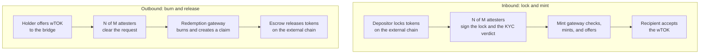
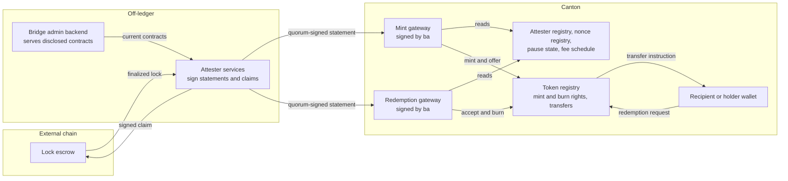
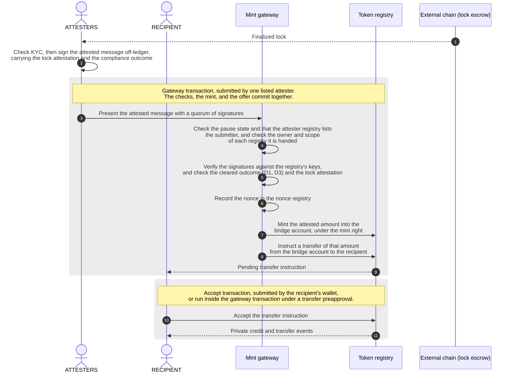
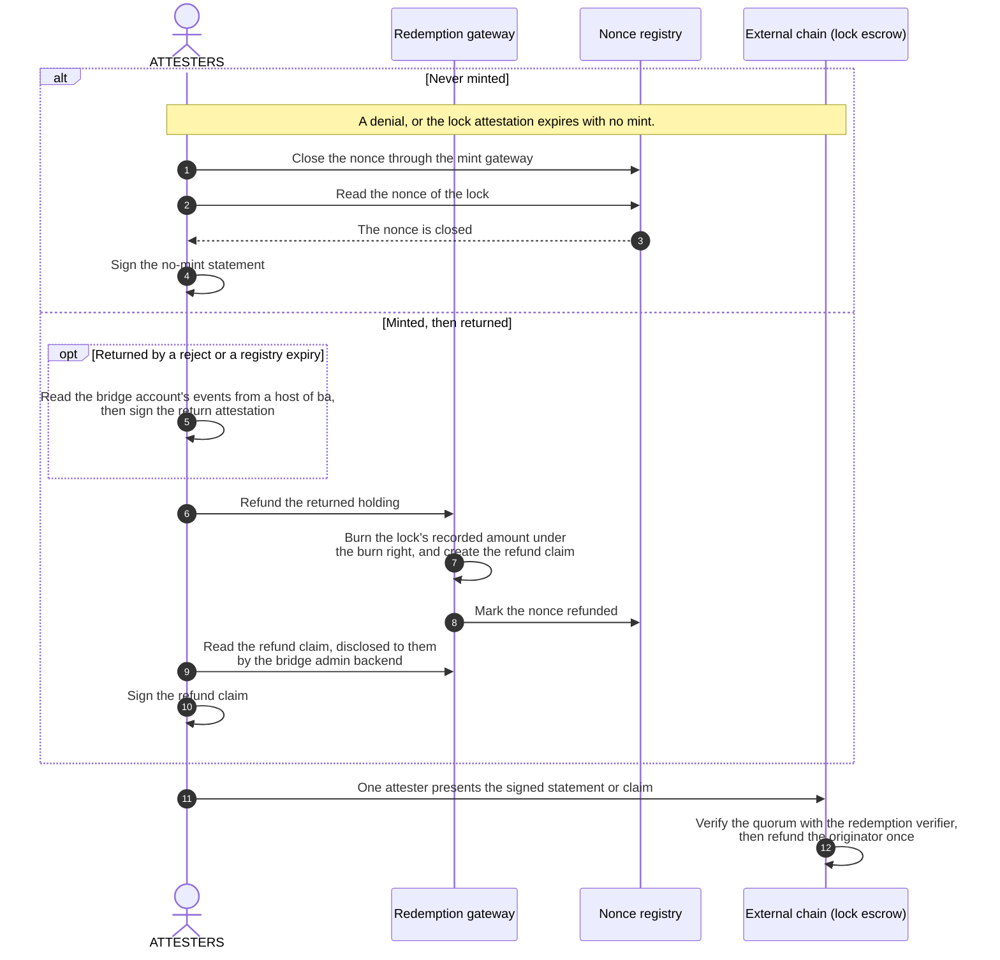
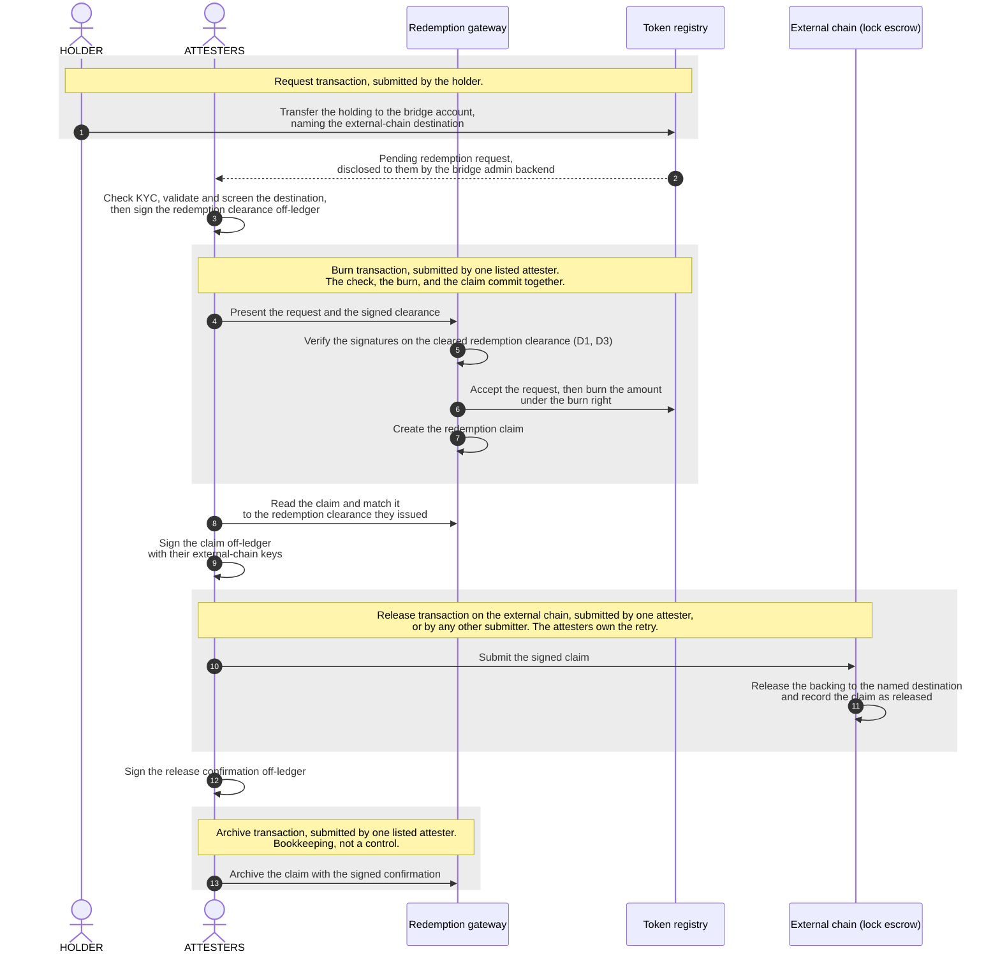

# Cross-Chain Stablecoin Payment Orchestration on Canton

This reference architecture defines the Canton side of a stablecoin bridge,
which this document calls the rail. An attested lock on an external chain mints
a wrapped instrument on Canton, and a burn on Canton releases the backing on
that chain. Sections 1 to 5 give the whole picture. Section 6 is the detailed
design, section 7 the threat model and failure recovery, and section 8 the
values a deployment sets.

> NOTE: This document calls the other chain the **external chain** in both
> directions, and the wrapped instrument **wTOK**. wTOK stands for any
> instrument whose Token Standard V2 registry grants the bridge a mint right
> and a burn right ([section 6.10](#610-registry-integration)).

## 1. Summary

This document describes how a stablecoin issued on another blockchain can be
used on Canton and moved back, without anyone being able to create unbacked
tokens or lose a payment.

**Inbound.** A depositor locks tokens in an escrow contract on the external
chain. A group of independent attesters, of which N out of M must agree,
confirms the lock and that the recipient has passed KYC. One attester submits
that confirmation to Canton. A bridge contract checks it and mints the locked
amount of wTOK. It keeps the bridge's fee and offers the rest to the recipient
as a standard Token Standard V2 transfer, which the recipient accepts.

**Outbound.** The holder offers wTOK back to the bridge and names a
destination on the external chain. The attesters clear the request, the
bridge burns the wTOK, and the attesters sign a claim that the escrow pays
out.

Only two things cross between the chains: the attesters' signatures and the
identifier of each lock. Everything else is Canton.

**What Canton enforces.** The bridge mints only against a quorum-signed
attestation. Each lock mints at most once. Every offered credit carries a
deadline and returns to the bridge if it is not accepted. Nothing burns
without clearance. Each payment is visible only to its recipient, the bridge
admin, the attester that submitted it, and the wTOK admin
([section 4](#4-what-the-ledger-enforces-and-who-is-trusted)).

**Who is trusted.** The attester quorum, for every fact about the other chain
and every compliance verdict. The bridge admin, a Canton party hosted by
several organizations with an N-of-M confirmation threshold, for the mint and
burn rights and the bridge account. The wTOK admin, which signs every holding
of its instrument and could mint outside the bridge
([section 4.2](#42-trust-boundaries)).

Two invariants hold the design together. **Reserve**: the wTOK the bridge
minted never exceeds the backing the escrow holds
([section 6.4](#64-reserve-replay-and-refunds)). **Bounded custody**: every
minted unit is credited, locked in an offer with a deadline, or back in the
bridge account with a refund path
([section 7.2](#72-failure-modes-and-recovery)).

**Not covered.** The escrow and the attester software on the other chain,
seizure, cross-synchronizer settlement, chains that cannot hold a payout back,
and Token Standard V1 wallets ([section 2.2](#22-scope),
[section 5](#5-limitations)).

---

## 2. Requirements

- **R1, no stuck or lost funds.** Every deposit locked on the external chain,
  and every holding offered for redemption, ends as value its owner holds on
  one of the two chains. That value is a credit on Canton, a refund to the
  originator, or a release to the holder's destination, less the bridge's fee.
  [Section 5](#5-limitations) lists the cases this does not cover.
- **R2, no unbacked credits.** The wTOK supply the bridge minted never exceeds
  the backing the escrow holds for it.
- **R3, compliance.** No value enters or leaves the rail without the controls
  of [section 2.1](#21-institutional-controls).
- **R4, privacy.** A payment's amount and parties reach only the parties of
  [section 6.1](#61-privacy-and-visibility). The external-chain side is
  public.

[Section 4](#4-what-the-ledger-enforces-and-who-is-trusted) states how the design meets each
requirement.

### 2.1 Institutional Controls

D1 through D4 are local shorthand for four institutional controls: clearance,
seizure, KYC, and role binding.

| ID | Control | Where enforced | Invariant |
|---|---|---|---|
| **D1**, clearance | Compliance clearance from an N-of-M attester quorum, in a single-use statement bound to the credit or the request | The gateways, before any transfer instruction or burn exists ([section 6.8](#68-attester-statements-and-control-enforcement)) | No clearance, no transfer instruction and no burn |
| **D2**, seizure | Seizure of a pending credit | The token registry, at its option. The bridge leaves seizure to the registry | Set by the registry that implements it |
| **D3**, KYC | KYC identity of the recipient, or outbound of the redeeming holder | The attester services, off-ledger, before they sign. The gateways enforce the result through D1 | No KYC, no clearance |
| **D4**, role binding | Operational privileges bind to a grant or a registry entry, not to one party. Submission binds to the attester registry and the pause to a role grant. The bridge admin's own authority is protected by multi-hosting, and moving it is a migration ([section 6.8](#68-attester-statements-and-control-enforcement)) | Each gateway choice, against a role grant or an attester registry entry | Submission and pause rights move without a redeploy |

### 2.2 Scope

| In scope | Out of scope |
|---|---|
| The Canton side of the bridge: attested mint, private transfer, attested burn | The attester services, the lock escrow, external oracles, external-chain validator sets, and light-client proofs |
| The mint and burn rights the bridge asks of a token registry | The token registry itself, its admin's key custody, and any mint path outside the bridge's grant |
| The gateway checks that deny a credit or a redemption without the attesters' clearance | The compliance and KYC checks the attester services run before they sign |
| CIP-0112 two-step transfers: the transfer instruction, its accept, and a transfer preapproval that automates the accept | Token Standard V1 (CIP-0056), and the CIP-0112 allocation and settlement-batch path |
| One Canton synchronizer, one external chain, one instrument | Cross-synchronizer settlement, and backing one instrument from several chains |
| The controls the bridge enforces itself: D1 and D4 | Seizure (D2), the KYC check itself (D3), and any control over a wTOK holding after it is credited |

### 2.3 Glossary

| Term | Meaning | Defined in |
|---|---|---|
| Rail | The Canton side of the bridge, which this document defines | Preamble |
| External chain | The other blockchain, in both directions | Preamble |
| wTOK | The wrapped instrument on Canton; any instrument whose registry grants the bridge a mint right and a burn right | Preamble |
| Lock, lock escrow | A deposit into the escrow contract on the external chain, and that contract, which holds the backing and pays releases and refunds | [Section 3.2](#32-roles) |
| Nonce | The escrow's sequence number for a lock. It identifies the lock on both chains | [Section 6.3](#63-inbound-credit) |
| Attesters, quorum | M independent organizations that watch the external chain and run compliance checks. N of them must sign every statement; N of M is the quorum | [Section 3.2](#32-roles) |
| Attester statement | A typed message the attesters sign off-ledger. It reaches the ledger only inside the transaction that uses it | [Section 6.8](#68-attester-statements-and-control-enforcement) |
| Attested message | The statement that attests a lock and carries its compliance outcome | [Section 6.3](#63-inbound-credit) |
| Bridge admin, `ba` | The Canton party that signs the gateways and the bridge registries, holds the mint and burn rights, and owns the bridge account | [Section 3.2](#32-roles) |
| Bridge account | The bridge admin's account at the token registry. The gateway mints into it and offers each credit from it | [Section 3.2](#32-roles) |
| Bridge admin backend | An off-ledger process that serves bridge contracts to the attesters as disclosed contracts. It submits nothing | [Section 3.2](#32-roles) |
| Mint gateway | The bridge contract that checks an attested message, mints, and offers the credit | [Section 6.3](#63-inbound-credit) |
| Redemption gateway | The bridge contract that checks a redemption clearance, burns, and creates a claim | [Section 6.5](#65-outbound-redemption) |
| Token registry | The Token Standard V2 implementation that issues wTOK and runs its transfers | [Section 3.1](#31-overview) |
| wTOK admin, instrument admin | The token registry's admin party. It signs every wTOK holding and grants the bridge its rights | [Section 3.2](#32-roles) |
| Example registry | The OpenZeppelin draft Token Standard V2 registry this document uses as its example | [Section 3.1](#31-overview) |
| Transfer instruction | A pending Token Standard V2 transfer. The receiver accepts or rejects it, or it expires | [Section 3.1](#31-overview) |
| Transfer preapproval | A contract the recipient signs that lets the bridge admin run the accept on its behalf | [Section 6.3](#63-inbound-credit) |
| Deferred offer | A bridge record of a credit whose recipient's participant could not process the offer. It is converted into a mint and an offer later | [Section 6.3](#63-inbound-credit) |
| Returned credit | A minted holding that came back to the bridge account because its offer was rejected, withdrawn, or expired | [Section 6.4](#64-reserve-replay-and-refunds) |
| Nonce registry, epoch, `E` | The bridge contract that records each nonce and its state. One registry covers one epoch of `E` consecutive nonces | [Section 6.4](#64-reserve-replay-and-refunds) |
| No-mint statement | The attesters' statement that a nonce is closed and never minted. The escrow refunds the lock against it | [Section 6.4](#64-reserve-replay-and-refunds) |
| Return attestation | The attesters' statement that binds a returned credit to its lock | [Section 6.4](#64-reserve-replay-and-refunds) |
| Re-offer attestation | The attesters' statement that lets a credit whose offer lapsed be offered once more | [Section 6.4](#64-reserve-replay-and-refunds) |
| Refund claim | The bridge contract that records the burn of a returned credit. The escrow refunds the lock against it | [Section 6.4](#64-reserve-replay-and-refunds) |
| Redemption request | The holder's transfer instruction to the bridge account, naming an external-chain destination | [Section 6.5](#65-outbound-redemption) |
| Redemption clearance | The attesters' statement that clears or denies a redemption request | [Section 6.5](#65-outbound-redemption) |
| Redemption claim | The bridge contract that records a burn. The attesters sign it and the escrow pays it | [Section 6.5](#65-outbound-redemption) |
| Release confirmation | The attesters' statement that the escrow paid a claim. It lets the claim be archived | [Section 6.5](#65-outbound-redemption) |
| Late denial | The attesters' statement that withdraws or closes a credit after its offer exists | [Section 6.8](#68-attester-statements-and-control-enforcement) |
| Attester registry, rotation | The bridge contract that lists the attesters, their keys, and the threshold N. A rotation replaces it with a new version | [Section 6.8](#68-attester-statements-and-control-enforcement) |
| Pause state, pause authority, `pa` | The bridge contract that stops the supply paths, and the party that flips it | [Section 6.8](#68-attester-statements-and-control-enforcement) |
| Fee schedule | The bridge contract that sets the fees and how the income is shared | [Section 6.12](#612-traffic-costs-app-rewards-and-fees) |
| Registry adapter | The module of the bridge package that calls the token registry's mint and burn | [Section 6.10](#610-registry-integration) |
| Disclosed contract | A Canton contract shared off-ledger with a party that is not one of its stakeholders, so that party can read it or use it in a transaction | Canton term |
| Reserve, bounded custody | The two invariants of the design | [Section 1](#1-summary) |

---

## 3. Architecture at a Glance

### 3.1 Overview

Each Canton step is its own transaction, and no transaction spans both chains.
Supply enters at the attested mint and leaves at the burn, each behind a
gateway check against an attester signature over an external-chain fact that
no Canton check can validate. Between the two, the token registry creates and
completes every wTOK transfer, and the accept that credits the recipient is the
registry's own choice. The attester services decide off-ledger which listed
attester submits each step ([section 7.2](#72-failure-modes-and-recovery)).

Each inbound credit is one
[CIP-0112](https://github.com/canton-foundation/cips/blob/main/cip-0112/cip-0112.md)
**transfer instruction** that its recipient accepts, so a credit lands with
the attested amount or not at all. The **example registry** of this document
is the [draft registry implementation](https://github.com/OpenZeppelin/canton-contracts/tree/6a916c174db7d6163ebeea4df1049044cefc7b3c/packages/token/token-cip112-v1/daml/OpenZeppelin/Token/Cip112/V1)
of the Token Standard V2 interfaces in `OpenZeppelin/canton-contracts`. Its
transfers are private through per-party projection, with one exception: the
**instrument admin** signs every holding and transfer instruction of its
instrument.

**Happy path.** Inbound, the escrow locks a deposit on the external chain. The
attesters sign one statement that attests the lock and clears it for
compliance, and one attester submits it to the mint gateway. The gateway
checks the signatures, mints the amount into the bridge account, and offers it,
less the fee, to the recipient as a transfer instruction, which the recipient
accepts. Outbound, the holder offers its holding to the bridge account and
names an external-chain destination. The attesters clear the request, and one
attester submits it to the redemption gateway, which burns the holding and
creates a claim. The attesters sign the claim, and the escrow releases the
backing to the destination.

### 3.2 Roles

Canton identifies an actor by a party and the external chain by an address,
and neither chain records that the two name the same actor. The lock
attestation therefore names the Canton recipient explicitly, and the attester
set carries the trust that it is correct. Each attester holds both credentials:
a Canton party, and an external-chain key that the escrow's verifier accepts.

**Attesters.** There are M of them, one per organization. Each signs every
attester statement off-ledger with its own key, which the attester registry
lists. One listed attester submits each gateway transaction with a quorum of
signatures and pays its traffic. No attester mints, denies, or freezes alone.
Every outcome needs a quorum-signed statement, a deadline, or the pause state.

**Bridge admin**, `ba`. The sole signatory of both gateways, the attester
registry, the nonce registry, the pause state, and the fee schedule. It holds
the mint and burn rights and owns the **bridge account**, where the gateway
mints and from which it offers each credit. It submits setup, rotations,
handovers, and payouts, and nothing on the payment path. It holds the rail's
Featured App status.

**wTOK admin.** The instrument admin of the token registry, a role the
registry defines. It grants the bridge admin the mint and burn rights, and it
signs every wTOK holding and transfer instruction. It holds wTOK's Featured
Asset status.

**Recipient**, or **holder** outbound. Accepts the transfer instruction that
offers its credit, live or through a transfer preapproval. Outbound, it offers
its holding to the bridge account.

**Pause authority**, `pa`. Holds the pause role grant and flips the pause
state.

| Role | Code | Sees |
|---|---|---|
| Attesters | - | The statements its quorum signs, the transfer instructions it submits, and the bridge account's transfer events ([section 6.4](#64-reserve-replay-and-refunds)) |
| Bridge admin | `ba` | Every inbound credit, as the sender's account owner, and every redemption request, as the receiver's |
| wTOK admin | - | Every wTOK payment |
| Recipient or holder | - | Its own transfers |
| Pause authority | `pa` | The pause state |

Off-ledger, the **lock escrow** is the external-chain contract that holds the
backing, releases against a verified claim that any submitter presents, and
refunds each lock once. The **attester services** are M independent operators
on M participants. Each watches the external chain, runs the compliance and
KYC checks against **KYC providers** that observe no transfer, and signs as its
own attester party. The **bridge admin backend** is a process on a participant
that hosts the bridge admin. It serves the attester services every bridge contract they
need as a disclosed contract, and the bridge account's transfer events
([section 6.4](#64-reserve-replay-and-refunds)), and it submits nothing.
The **recipient wallet** accepts pending transfer instructions and may create a
transfer preapproval.

The gateways and the registries are contracts. Each attester statement is a
typed message signed off-ledger that reaches the ledger only as an argument of
the gateway transaction that uses it
([section 6.8](#68-attester-statements-and-control-enforcement)).

---

## 4. What the Ledger Enforces and Who Is Trusted

This section states how the design meets each requirement of
[section 2](#2-requirements), which properties the ledger enforces, and which
rest on a trusted party.

- **R1.** Every minted unit has a deadline-bounded path back to an owner, and
  every lock that never mints has a refund path through the no-mint statement
  ([section 7.2](#72-failure-modes-and-recovery)).
- **R2.** The gateway mints only against a quorum-signed attestation and an
  unrecorded nonce, and a lock is refunded only after its nonce is closed or
  its returned credit is burned
  ([section 6.4](#64-reserve-replay-and-refunds)). R2 trusts the attester
  quorum, the bridge admin, and the wTOK admin.
- **R3.** The gateways enforce clearance (D1) and role binding (D4) on every
  credit and redemption, and KYC (D3) through clearance
  ([section 6.8](#68-attester-statements-and-control-enforcement)).
- **R4.** Per-party projection limits each payment to the parties of
  [section 6.1](#61-privacy-and-visibility).

### 4.1 Ledger-Enforced Properties

| Property | Enforcement |
|---|---|
| Conservation of funds | The gateway mints exactly the attested amount, pays exactly the scheduled fee, and offers exactly the rest, and a refund burns exactly the amount it claims. Conservation inside the accept is the registry's property |
| 1:1 reserve backing | The gateway exercises `ba`'s mint right only against a valid attestation, so no submitter mints without one. It does not bind `ba` or the wTOK admin |
| Redemption gated by compliance | No burn runs without a valid clearance for its request, and a denied or lapsed request returns the holding. That a claim has a burn behind it is not ledger-enforced |
| Replay protection | One lock mints at most once, provided the nonce registry is the one `ba` maintains |
| Privacy partitioning | A credited transfer projects only to its recipient, `ba`, the submitting attester, and the wTOK admin. No KYC provider observes a transfer |
| Non-custodial recipient binding | No credit lands without the recipient's signature, live or carried by a preapproval. Until then the amount sits locked in the bridge's outgoing instruction, and no instruction exists without a deadline |

The ledger does not enforce four things, and a trusted party stands in for
each:

- that a redemption claim has a burn behind it
  ([section 7.1](#71-threat-model));
- that a holding a reject or an expiry returned belongs to the lock the
  attesters bind it to ([section 6.4](#64-reserve-replay-and-refunds));
- a compliance denial reached after the offer exists, which leaves one
  instruction deadline of exposure
  ([section 6.8](#68-attester-statements-and-control-enforcement));
- one compliance policy across the attester set
  ([section 4.2](#42-trust-boundaries)).

### 4.2 Trust Boundaries

Each trusted party, what it must do, and what breaks if it does not.

**Attester set.** Attests only a finalized lock with the true amount,
recipient, and instrument. Clears only a recipient or holder that passed KYC.
Signs a claim only against a clearance it issued, and only once. Signs a
no-mint statement only after reading the nonce as closed, and a return
attestation only for a holding that the bridge account's events show returning
from that lock. A colluding quorum mints unbacked supply or releases live
backing, and whoever holds N listed keys is the quorum. This is the largest
trust surface in the design.

**Submitting attester.** Submits each step once. It cannot change an amount or
a recipient. Every outcome needs a quorum statement, a deadline, or the pause,
so a faulty submitter delays a step rather than misdirecting it. If it
withholds a cleared message until the attestation expires, the lock becomes a
refund. If it refunds a returned credit before the re-offer attestation
arrives, the second offer is skipped. Neither breaks the reserve.

**Bridge admin.** Exercises the mint and burn rights only through the
gateways, keeps one active version of each registry, and pays the attester
pool out each period. N compromised hosts mint unbacked supply, move a returned
holding, or create a claim with no burn, which is why the role is N-of-M. Its
hosts serve the transfer events that the attesters use to bind returned
credits. A withheld payout is visible on-ledger, but no contract forces it.

**wTOK admin.** Mints the instrument only through the bridge's rights. A
compromised key issues unbacked supply, because it signs every holding.

**KYC providers.** Report KYC status truthfully. The check is as strict as the
most permissive provider the attesters accept.

**Pause authority.** Pauses only for an incident. A malicious pause authority
stalls the rail until the bridge admin revokes its grant, and the locks stay
creditable or refundable meanwhile.

**Lock escrow.** Holds the backing, releases only against a verified claim,
and refunds each lock once. A broken escrow strands a redemption, and the burn
is already final.

**Canton infrastructure.** Keeps the parties hosted, the packages vetted, and
transactions confirmable inside each deadline.

---

## 5. Limitations

- **Exceptions to R1.** Value stays held or is lost in five cases:
  - a lock or a returned credit held under a freeze that a compliance denial
    requires, whose release is a decision outside the bridge;
  - a redemption whose destination becomes unpayable after the burn;
  - a pending credit that a registry seizes, under that registry's rules;
  - a credited holding whose holder's participant unvets the registry's
    packages;
  - a trusted party that fails or misbehaves
    ([section 4.2](#42-trust-boundaries)).
- **Late compliance denial.** A denial reached after the offer exists leaves
  one instruction deadline of exposure
  ([section 6.8](#68-attester-statements-and-control-enforcement)).
- **Claim without a burn.** The ledger does not enforce that a redemption
  claim has a burn behind it, and the attesters' match against the clearance
  they issued stands in ([section 7.1](#71-threat-model)).
- **Registry coupling.** The registry adapter calls the registry's own
  templates until a Token Standard V2 burn-mint interface exists
  ([section 6.10](#610-registry-integration)).
- **Alpha cryptography.** On-ledger verification of the attester signatures
  depends on functions the Daml standard library marks as alpha
  ([section 6.8](#68-attester-statements-and-control-enforcement)).
- **Token Standard V2 only.** Recipients and holders need a wallet that
  supports Token Standard V2 transfers. A wallet that supports only V1
  (CIP-0056) cannot accept a credit or redeem wTOK through this rail.
- **One synchronizer, one external chain, one instrument.**
- **Privacy on the external chain.** The lock is a public transaction that
  must carry enough data to route the transfer on Canton. Hiding the link to
  the Canton recipient is out of scope.

**Chains that cannot hold the payout back.** On some chains the release cannot
be made conditional on the claim: a UTXO chain without contracts, or a
permissioned release the holder cannot submit. There, a stalled quorum leaves
the redeemer holding neither asset under burn-first. Such chains need burn-last
ordering, with a reserve invariant that allows for the in-flight window. That
is a different trust model, and this design does not cover it.

---

## 6. Detailed Design

### 6.1 Privacy and Visibility

One row per contract. The first four rows are the token registry's, shown for
the example registry.

| Contract | Signatories | Observers |
|---|---|---|
| Inbound transfer instruction | The wTOK admin and `ba`, as the sender's account owner | The recipient |
| Redemption request, the holder's transfer instruction to the bridge account | The wTOK admin and the holder | `ba`, as the receiver's account owner |
| Event log contract, created and archived in one transaction | The wTOK admin | None as stakeholders. The parties of the transfer, the bridge admin among them as the bridge account's owner, see the event inside the transfer transaction, and that is how the bridge admin's hosts serve the transfer events the attesters read |
| wTOK holding | The wTOK admin and the account's parties | The lock's observers, while locked |
| Mint gateway, redemption gateway, attester registry, nonce registry, pause state, fee schedule, deferred offer, redemption claim, refund claim | `ba` | None. A listed attester reads or exercises them through disclosure ([section 6.6](#66-registry-identity-and-uniqueness)) |
| Pause role grant | `ba` | The current `pa` |
| Transfer preapproval | The recipient | `ba`, the party it names to exercise it |

Consequences:

- **No recipient sees another recipient's credit.** Each transfer instruction
  projects to its one recipient.
- **The wTOK admin sees every wTOK payment**, as any issuer sees its own
  instrument, and the design treats it as a trust assumption. Given what the
  attesters see ([section 3.2](#32-roles)), choosing them is a privacy decision
  as well as a compliance one.
- **Transfer outcomes arrive as events.** An integrator matches a holdings
  event to a lock through the nonce in the transfer's metadata, not through
  the instruction's contract id, because a re-offer creates a new instruction.
- **Only the KYC verdict reaches the ledger.** A statement carries the
  attesters' verdict, and the evidence stays in their compliance logs.

### 6.2 Decentralization and Trust Topology

The bridge admin holds everything that decides whether bridge-minted supply is legitimate.
The design protects the bridge admin with an N-of-M posture using a **multi-hosted party
with a confirmation threshold**.

| Role | Target posture | Trusted with | Who submits in its name |
|---|---|---|---|
| Attesters | M parties, one per organization, each on its own participant with its own key. Every check requires N of M signatures, never all M | As a quorum, every external-chain fact and every compliance and KYC verdict. One attester alone can only delay a step | Each attester service, as its own party |
| `ba` | Multi-hosted on M participants of independent organizations, confirmation threshold N. N and M are open | The mint and burn rights, the bridge account, both registries, the fee schedule, and the bridge's income | No one on the payment path: its authority enters each gateway transaction as the gateway's signatory, and N of its hosts confirm every one. One host submits its setup, rotations, and payouts, and N hosts confirm |
| wTOK admin | Set by the token registry | Every holding of its instrument, so it can mint outside the bridge | The registry |
| `pa` | One multi-hosted party, confirmation threshold 1, held by organizations outside the attester set | Stopping the supply paths at once, so a party outside the attester set can stop a compromised quorum. A malicious `pa` stalls the rail until `ba` revokes its grant | Any host |
| Recipients | None | Their own keys | The recipient's wallet, or the gateway under a transfer preapproval |

The attester set is the main lever. A larger M keeps the rail live through more
outages, and a larger N spreads the trust. Signatures travel off-ledger and
each statement costs one gateway transaction whatever N is, so M and N move
trust and coordination cost, not traffic.

### 6.3 Inbound Credit

Three steps carry a finalized lock to a credited holding. The attesters sign
step 1 off-ledger, one listed attester submits step 2 for a batch of locks, and
the recipient submits step 3, or step 2 runs it under a transfer preapproval.

1. **Attested message.** The attesters sign an **attested message** that
   carries the **lock attestation**: the locked amount, the Canton recipient,
   the instrument, the lock's nonce, and an expiry. The nonce is the escrow's
   sequence number, and the rail serves one chain and one instrument, so it
   alone identifies a lock. The same message carries the **compliance
   outcome**: cleared, or denied with a denial reference. Each attester
   service signs only after it has screened the lock's originator and checked
   the recipient's KYC off-ledger. One signature covers both records, so the
   outcome binds to the lock's content before any transfer instruction exists.
   That is clearance (D1) and KYC (D3). The attester services collect signatures until N listed
   attesters have signed
   ([section 6.8](#68-attester-statements-and-control-enforcement)).

2. **Gateway transaction.** A listed attester exercises the **mint
   gateway**, which runs every bridge check in one choice, each failing
   closed: the pause state is clear and the attester registry lists the
   submitter; N listed attesters signed the message and its outcome is
   cleared; the lock attestation passes the mint checks and the nonce registry
   does not hold its nonce ([section 6.4](#64-reserve-replay-and-refunds)). The
   choice then records the nonce, mints the attested amount into the bridge
   account under the mint right, pays the bridge's fee out of it
   ([section 6.12](#612-traffic-costs-app-rewards-and-fees)), and exercises
   the registry's `TransferFactory_Transfer`. The **transfer instruction**
   names the bridge account as sender, the recipient's account as receiver,
   and the attested amount less the fee, and its metadata carries the lock's
   nonce. The minted holding stays locked in the instruction until it
   resolves.

   The recipient's participant confirms nothing at this step, so an offline
   recipient sees the offer when it returns. The recipient is an observer of
   the instruction, though, so its participant must have vetted the packages
   even though it does not confirm. The batch rules below cover a participant
   that has not. A listed attester withdraws the
   instruction through a gateway choice, under the rules of
   [section 6.8](#68-attester-statements-and-control-enforcement).

3. **Accept.** The recipient's wallet exercises the registry's own
   `TransferInstruction_Accept`, which runs no bridge check. A rejected or
   withdrawn instruction returns the holding to the bridge account, and a
   lapsed one stays locked until an attester withdraws it.
   [Section 6.4](#64-reserve-replay-and-refunds) sets what happens to a
   returned holding.

**Transfer preapproval.** An offline treasury cannot accept interactively. Its
wallet may pre-establish a recipient-signed bridge contract that lets the bridge admin
exercise the standard accept with the recipient's authority. The gateway
exercises it with the bridge admin's authority it carries, so step 2 accepts the
instruction it creates and the credit lands in one attester-submitted
transaction. A preapproval that arrives after the offer runs through a gateway
choice of its own. The preapproval calls only the standard accept, so it works
with any registry. It bounds the instrument, an amount ceiling, an expiry, and
the party that may exercise it, and the recipient can archive it at any time.

**Batches and deferred offers.** The submitting attester takes the open locks
in nonce order and submits them in batches. One gateway transaction runs the
checks of step 2 for every message and writes the nonce registry once
([section 6.11](#611-throughput-and-contention)). A check that fails for one
message fails the batch, and the attester resubmits without that message. A
recipient's participant that has not vetted the packages fails the batch too.
The attester then resubmits the batch in a second form that creates a
**deferred offer** for each credit: a contract only the bridge admin signs that records
the nonce, the amount, the recipient, and a deadline. That form runs every
check, records each nonce as deferred, mints nothing, and no recipient sees
it. A listed attester later converts each deferred offer on its own, through a
gateway choice that mints and offers as step 2 does, so one recipient's
participant delays only its own credit. An offer still open at its deadline is
closed, and the never-minted refund of
[section 6.4](#64-reserve-replay-and-refunds) follows.

**Delivery and retry.** The attester set carries delivery: a credit executes
when a listed attester submits it, and the attesters resubmit a failed step,
safely, because the nonce registry records each nonce once
([section 7.2](#72-failure-modes-and-recovery)).

### 6.4 Reserve, Replay, and Refunds

[Section 6.3](#63-inbound-credit) credits the payment. This section ties it to
the backing on the external chain and sets what happens to a credit that
returns.

**Mint checks.** The lock attestation states that the escrow received a given
amount under a given nonce. No Canton contract can check that, so the attester
quorum carries the trust, and the submitting attester adds none: the gateway
counts the quorum's signatures, not the submitter's. The gateway mints only if
N distinct listed attesters signed the message, each signature verifying
against its registered key; the compliance outcome is cleared and the
attestation has not expired; the amount, the recipient, and the instrument of
the mint and the offer match it; and the nonce registry does not already hold
the nonce. A signer the registry no longer lists does not count. A failed check
rolls back the whole gateway transaction. For a deferred offer, the checks run
in the batch that creates it, and the conversion mints against the deferred
record without a second attestation.

**Nonce registry.** The gateway writes the lock's nonce in the transaction that
mints. A nonce is in one of six states: deferred, minted, returned, closed
without a mint, refunded, or held. The registry records the offered amount and
the recipient, and for a returned nonce the holding the withdraw brought back
and the late denial it carried, if any. The registry is scoped to one
instrument and one **epoch** of `E` consecutive nonces, so no registry holds
more than `E` nonces and the bytes of a mint stay bounded
([section 6.11](#611-throughput-and-contention)). The bridge admin creates the first
epoch's registry and fixes `E` there. The first write to a registry creates its
successor in the same exercise, so each epoch gets exactly one registry, and
`E` exceeds the locks that can be in flight, so a registry exists before its
first lock arrives. A settled epoch's registry stays active for later refunds
and closes. The gateway checks that the registry it is handed carries the epoch
of the nonce it processes
([section 6.6](#66-registry-identity-and-uniqueness)).

**Returned credits.** The registry records mints, not credits. A reject or a
registry expiry returns the holding to the bridge account and leaves the nonce
as minted. A gateway withdraw returns it the same way and records the nonce as
returned, with the holding. An attester refunds a returned holding by default,
through the redemption gateway ([section 6.5](#65-outbound-redemption)), so
returned value leaves the bridge account promptly.

The ledger binds a returned holding to its lock only when the gateway withdraws
the offer. After a reject or an expiry the binding exists only in the bridge
account's transfer events. The attester services read those events from
participants that host the bridge admin, match the holding to the instruction the gateway
created for the nonce, and a quorum signs the nonce, the holding's contract id,
and its amount as a **return attestation**. The attesters spread their reads
over hosts of the bridge admin that different organizations operate, so false events from
one host cannot reach a quorum. A refund or a hold of a minted nonce presents
the return attestation, checks that the holding carries the lock's recorded
amount, and consumes the holding. A wrong binding can therefore only swap two
locks of the same amount. It needs a colluding quorum or false events from
hosts that together serve N attesters, and the reserve still holds because
each refund burns its amount first.

**Re-offer.** The one exception to the prompt refund is an instruction whose
deadline lapsed while the rail could not deliver it, during a synchronizer
outage or a pause. An attester offers that holding once more to the same
recipient and refunds it if the offer returns again. The nonce registry already
holds the nonce, so the re-offer needs a fresh **re-offer attestation** that
binds the nonce, the recipient, the amount, the instrument, and the returned
holding. Signing it states that the rail caused the lapse and that the credit
still clears compliance, and a quorum that approves neither signs nothing. The
gateway checks that the nonce is recorded as returned with that holding and
was not re-offered before, and the re-offer consumes the holding. The ledger
does not record why a deadline lapsed, so whether a credit qualifies is the
attesters' decision. The exception exists so that one infrastructure incident
does not refund every payment in flight.

**Refund exclusivity.** A refund on the external chain must never pay out a
lock whose credit stands on Canton, and no mint may follow a refund. Both
refund paths reuse the signature verifier the escrow already runs for a
redemption release.

| Case | Condition | Path |
|---|---|---|
| Never minted | The attesters never signed, the message carries a denied outcome, the attestation expired, or a deferred offer was never converted | An attester presents the message to a close choice of the mint gateway, which records the nonce as closed: at once for a denied outcome, after expiry for a cleared one, and at its deadline or against a late denial for a deferred offer. For a lock with no message, the attesters sign one with a denied outcome. A closed nonce never mints. Each attester then reads the nonce as closed and signs a **no-mint statement**, against which the escrow refunds the whole deposit |
| Minted, then returned | The holding is back in the bridge account | The redemption gateway burns the lock's recorded amount, marks the nonce refunded, and creates a **refund claim** that names the nonce, in one transaction. The escrow pays it only to the address that funded the lock, and once |
| Held | A denial requires a freeze, for example a sanctions hit on the originator | The attesters withhold the no-mint statement or the refund claim, so the backing stays in the escrow. A returned credit under such a denial is still burned and the nonce marked held, with no claim. Releasing a held lock is a decision outside the bridge |

**Reserve invariant.** The backing is one balance: every deposit the bridge
minted against, less every redemption and refund the escrow released. The wTOK
supply the bridge minted never exceeds it. A mint adds one deposit amount to
both, and a redemption or a refund removes one burn amount from both. Supply in
the bridge account, locked in a pending offer or returned from one, counts like
any other supply. A held lock burns its supply and keeps its backing. A fee is
wTOK that a deposit already backs, so paying it changes neither balance, and a
refund of a returned credit releases the deposit less the fee. Because the
escrow holds the backing as one balance, the invariant means the escrow can pay
out every burn. It covers the whole instrument only if the bridge's mint right
is the instrument's only mint path
([section 6.10](#610-registry-integration)).

### 6.5 Outbound Redemption

Redemption mirrors the inbound flow. The holder offers its holding to the
bridge account, the bridge accepts and burns it once the attesters clear the
request, the quorum signs the claim, and the escrow releases the backing.

1. **Request.** The holder makes a standard `TransferFactory_Transfer` of the
   holding to the bridge account, with the external-chain destination in the
   transfer's metadata. The registry leaves it as a pending transfer
   instruction, the **redemption request**: the holding is locked and has not
   moved. The bridge account holds no preapproval, so no request completes
   before the bridge accepts it, and the holder can withdraw until then. The
   design assumes the holder's wallet renders the amount and the destination
   in clear before the holder signs.

2. **Redemption clearance.** The bridge admin observes each request as the receiver's
   account owner, and the bridge admin backend serves it to the attester
   services. Each service checks the holder's KYC and screens the destination
   off-ledger, then signs a **redemption clearance** that binds the holder,
   the amount, the instrument, the destination, and the request's contract
   id, with an outcome: cleared, or denied with a reference. That is clearance
   (D1) and KYC (D3) outbound. The burn is irreversible, so the destination must be payable
   before it, and the gateway cannot parse an external-chain address, so the
   attesters check that it is well formed and that neither the escrow nor the
   backing token refuses it. The escrow repeats the checks it can make on its
   own chain, so a release to a refused address reverts and the claim stands.
   A destination that becomes unpayable after the burn leaves a standing claim
   that no submitter can release, and the design has no path that redirects it
   ([section 5](#5-limitations)).

3. **Burn.** A listed attester exercises the **redemption gateway**, which
   checks the pause state and the submitter's listing, verifies the
   clearance's signatures, accepts the request as the receiver, pays the fee,
   burns the rest under the burn right, and creates the **redemption claim**,
   in one transaction. The claim carries the instrument, the burned amount,
   the holder, the destination, and the request id, so an auditor can match
   each release to one burn and one holder. On a denied clearance the attester
   rejects the request through the same gateway, with the denial reference in
   the rejection's metadata, and the holding returns to the holder. Nothing
   burns without a cleared request. The bridge admin alone signs the claim, so the ledger
   does not enforce a burn behind it, and [section 7.1](#71-threat-model)
   states what limits that. The refund claim of
   [section 6.4](#64-reserve-replay-and-refunds) runs through the same gateway
   without a request or a clearance.

4. **Release.** An N-of-M quorum signs the claim off-ledger with its
   external-chain keys. Each attester reads the claim as a disclosed
   contract, so it signs only an active one, and it signs a claim only if it
   matches a clearance it issued, and only once. One attester presents the
   signed claim to the escrow, and the attester services also give it to the
   holder, who can present it itself. The escrow releases the amount to the
   destination and decrements the reserve by the same amount. After the
   release the quorum signs a release confirmation, and an attester archives
   the claim with it, which is bookkeeping and not a control.

**Cross-chain atomicity.** The burn and the release are separate transactions
on separate chains, so the order is burn first and attested release second.
The burn is the irreversible commit, and the release needs the signed claim.
That order assumes an external chain where any submitter can claim the release
against escrow state committed before the burn. Under that assumption a
stalled release costs time and never a double-spend: the escrow records each
claim it releases, so replay protection for the outbound direction sits there,
as the nonce registry sits on Canton for the inbound one.
[Section 5](#5-limitations) covers chains that cannot hold the payout back.

### 6.6 Registry Identity and Uniqueness

The gateway reads four bridge contracts at execution time: the pause state, the
attester registry, the nonce registry, and the fee schedule. The submitting
attester is a stakeholder of none of them, so it attaches each as a disclosed
contract and passes its contract id into the gateway choice. A caller that
supplies the ids could substitute a registry that omits a nonce or lists an
extra attester.

**Decision.** Each of the four templates carries an owner field and its scope
fields, and the gateway validates every one against a value the caller does not
control: the owner against the gateway's own signatory, the bridge admin, the
instrument against the attested message, and the nonce registry's epoch against
the lock's nonce divided by the registry's own `E`. The owner signs the
contract, so only the bridge admin can create a version that passes. Each
gateway choice takes all four contract ids as required arguments and fetches
each one, so a caller cannot leave one out. A rotation or a pause flip archives
the version it replaces, so a stale version fails the fetch.

| Contract | Scope fields beyond the owner |
|---|---|
| Nonce registry | The instrument, the epoch, and the epoch size `E` |
| Attester registry | None |
| Pause state, fee schedule | The instrument |

The checks read required fields, and an upgrade adds only `Optional` fields, so
every scope field exists from the first deployment
([section 6.9](#69-smart-contract-upgrade-process)).

**Disclosure.** The bridge admin backend serves the current version of each
contract to the attester services, and an attester also relays each version
its own submissions create, so gateway transactions continue while the backend
is down. An attester reads a registry the same way, through a nonconsuming read
choice that only the bridge admin and that attester see.

The bridge admin is the only stakeholder of these contracts by design, so an attester's
participant that unvets the package fails only its own reads and submissions
and stalls no mint, refund, burn, or rotation. In exchange, the attesters learn
of a rotation or a second active version only through disclosure.

**Residual.** The bridge admin can hold two active versions of a registry and hand the
attesters either. No other party observes them, and the bridge admin already holds the
mint right, so the exposure adds nothing to the trust in the bridge admin.

### 6.7 Time and Deadlines

The gateway requests each instruction's `executeBefore` inside the registry's
maximum instruction lifetime, and stamps a maximum attestation validity of its
own, so no attester can issue a statement that never expires. The values are
set at deployment.

Each flow's deadline has a floor at the slowest required actor's service level
and a ceiling at the tighter of the registry's lifetime and how long the
originator accepts its deposit held without a credit or a refund. A minted
credit is refundable only once it returns to the bridge account, so a recipient
that never accepts holds back the originator's refund for the whole
instruction lifetime, unless a late denial or a pause lets the gateway withdraw
first. After the burn, a redemption claim is standing and replay-protected, so
a slow release costs latency only.

| Flow | Slowest actor | Window |
|---|---|---|
| Inbound credit | The recipient, when it accepts live. Under a preapproval no deadline runs | Instruction deadline, hours to days |
| Deferred offer | The operator of the recipient's participant | Deferred-offer deadline, days |
| Outbound redemption | Attester | Request deadline, then the release window, hours |
| Attester statements | Attester, then the submitting attester | Each statement's expiry, capped by the maximum attestation validity |

### 6.8 Attester Statements and Control Enforcement

**Attester registry.** The bridge contract that lists the attester parties,
each one's public signing key, and the threshold N. The bridge admin signs it and is its
only stakeholder, and every check that verifies a statement reads the signer
set, the keys, and the threshold from it. The bridge admin changes any of them by a
**rotation**: it archives the current version and creates the next. The bridge admin gains
nothing by rigging a list that only its own gateway reads, because it already
holds the mint right, and the escrow verifies attester signatures against its
own keys, so the Canton registry cannot weaken a release or a refund.

**Signed statements.** The attesters collect N signatures off-ledger, and the
submitter presents the statement and its signatures as arguments of a gateway
choice, which verifies each signature against the key the attester registry
holds and fails unless N distinct listed attesters signed. Each statement
carries its type, the deployment, the bridge admin, the instrument, and the escrow under
the signature, so a signature for one deployment or one statement type never
verifies for another. The gateway verifies each signature on-ledger with the
Daml standard library's signature-verification functions, which the library
marks as alpha ([section 5](#5-limitations)).

A signature can be presented any number of times, so each statement binds
ledger state that the transaction using it changes:

| Statement | Binds | Spent when |
|---|---|---|
| Attested message | The lock's nonce | The nonce registry records the nonce as minted, deferred, or closed |
| Re-offer attestation | The nonce and the returned holding | The re-offer consumes the holding |
| Redemption clearance | The redemption request | The burn or the reject consumes the request |
| Return attestation | The nonce and the returned holding | The refund or the hold consumes the holding |
| Late denial | The nonce, and the instruction, deferred offer, or holding it closes | The withdraw, the close, or the hold consumes that contract |
| Release confirmation | The redemption claim | The archive consumes the claim |

Two statements for the same lock are therefore safe, even with different
outcomes: the first to reach a gateway spends the nonce and the other fails. A
signed statement cannot be withdrawn before it is used, so the maximum
attestation validity bounds how long a statement the attesters no longer stand
behind stays usable. A statement reaches the ledger only inside the gateway
transaction that uses it, and no attester is a stakeholder of one
([section 6.6](#66-registry-identity-and-uniqueness)).

**D1, clearance, enforced by the bridge.** Every inbound credit requires the quorum's
compliance clearance, bound to the credit's full content so that a clearance
for one credit cannot be re-pointed at another: the cleared outcome of the
attested message for a first offer, and the re-offer attestation for a
re-offer. The gateway verifies it before any transfer instruction exists,
against the attester registry whose owner is the gateway's own signatory,
so no caller input decides which registry the statement is checked against.
Outbound, the redemption gateway runs the same check before the burn, against
the redemption clearance.

The check runs once, and the accept is the registry's own choice, which the
bridge cannot gate, so a denial reached after the offer exists does not block
the credit by itself. The quorum closes that gap with a **late denial**: a
statement that names the lock's nonce, the instruction it closes, the denial
reference, and whether the denial requires a freeze. A listed attester presents
it to a gateway withdraw, which exercises the standard's
`TransferInstruction_Withdraw` under the bridge admin's authority as the sender's account
owner, records the nonce as returned with the denial, and puts the reference in
the withdrawal's metadata. The withdraw needs no confirmation from the
recipient's participant. The exposure is one instruction deadline, and zero
under a transfer preapproval. The same statement closes a deferred offer, and a
hold of a credit that a reject or an expiry returned presents one that requires
a freeze.

The gateway withdraws a lapsed instruction at any time after its deadline, and
a pending one before it only against a late denial or while the pause state is
set. It closes a deferred offer before its deadline only against a late denial.
A single attester therefore cannot cancel, close, or freeze a credit on its own
word. A denial before the gateway leaves nothing to withdraw: the attesters
sign the attested message with a denied outcome, and an attester closes the
nonce with it ([section 6.4](#64-reserve-replay-and-refunds)). A registry may
add its own compliance check at the accept; the bridge requires none.

**D2, seizure, left to the registry.** A registry may implement seizure of a pending
credit on its own transfer instruction or not. For the bridge, a seized
credit is minted supply that never returns: the nonce stays minted, the lock is
neither credited nor refundable, and the reserve holds because the seized
holding is backed like any other.

**D3, KYC, enforced by the attester services.** Before it clears a credit or a
redemption, each attester service checks off-ledger that the recipient, or the
redeeming holder, passed KYC with a provider the attesters accept, and its
clearance asserts it. The gateways enforce KYC through clearance. The ledger holds the
verdict, and the evidence sits in the attesters' compliance logs. A revocation
after the gateway transaction has the same exposure as a late clearance denial. KYC
applies when value enters or leaves the rail, not to transfers in between.

**D4, role binding, enforced by the bridge for its own choices.** Submission binds to a
listing in the attester registry, the pause to the pause role grant, and the
attested mint, the refund, and both registries to the bridge admin. A permission whose
holder must move sits on a separate grant or registry entry, so a change of
holder recreates no gateway. A rotation changes who may submit and whose
signature counts, and a statement signed before it stays valid while N of its
signers are still listed with the same keys.

**Pause.** The pause stops every bridge path that creates supply or releases
backing: the mint and offer, the burn, and the refund. Paths that return value
still run: a withdraw, a reject, and the registry's accept and expiry. A set
pause also lets the gateway withdraw a pending instruction before its deadline.
The bridge admin signs a pause role grant that names the current pause authority, who flips the pause
state by presenting it. The gateways check only the pause state and never
record who the pause authority is, so handing the pause to another party is a revocation and a
new grant.

Moving the bridge admin to a new party is the one handover the bridge cannot complete
alone: the registry re-grants the mint and burn rights, the attesters withdraw
every pending offer at its deadline or under a pause, and the bridge account's
holdings move to the new party's account.

### 6.9 Smart Contract Upgrade Process

The rail uses Smart Contract Upgrade (SCU) for additive changes to its own
gateway and registry packages, under the rules of the
[Canton SCU guide](https://docs.canton.network/appdev/deep-dives/smart-contract-upgrade).
The token registry's packages follow the registry's own lineage. Two
consequences are specific to the rail. The identity checks of
[section 6.6](#66-registry-identity-and-uniqueness) read required fields, so
the nonce registry's epoch and `E` must exist from the first deployment. Each
statement's type is part of what the attesters sign, so a release that
changes a statement's fields keeps accepting the previous type until every
statement signed under it has expired, and a rollout alone never voids a signed
attestation or drains a lock.

Each release defines what each new `Optional` field means for v1 state, with
`None` meaning the feature is off until configured. A change to a mint or burn
authority, a key shape, the party set, the reserve invariant, or a message's
meaning gets a separately named package and a migration or drain window.

### 6.10 Registry Integration

The bridge works with any token registry that implements the Token Standard V2
transfer interfaces and grants two rights: a **mint right**, which lets the bridge admin
mint into the bridge account and which the mint gateway exercises only
after every bridge check passes, and a **burn right**, which lets the bridge admin burn
holdings in the bridge account for a redemption or for the refund of a
returned credit. It also asks for a **sender-side withdraw that works after the
deadline**, so that an attester can recover a lapsed credit under the bridge admin's
authority without the wTOK admin. CIP-0112 leaves the withdraw's timing to the
registry, so the bridge has to ask for it, and the example registry's withdraw
has no deadline check. The registry must **emit transfer events the sender's
account owner sees**, because the return attestation of
[section 6.4](#64-reserve-replay-and-refunds) is built from the bridge
account's events, and the example registry does. The registry must
also **keep the rights in force**: it re-grants both when the bridge admin moves to a new
party, and keeps the burn right while the bridge account holds value or an
offer is pending. Revoking the mint right fails closed, and revoking the burn
right early leaves returned credits with no refund path.

Each registry grants the rights in its own shape, for example a role grant or
a capability contract its admin signs. A **registry adapter** module calls them,
so the bridge package depends on the registry's package and follows its
upgrades. That coupling stays until a Token Standard V2 burn-mint interface
exists: Splice's
[splice-api-token-burn-mint-v1](https://github.com/canton-network/splice/tree/3568cba96925bf509defcd9078b292808b36a9e9/daml/splice-api-token-burn-mint-v1)
works on V1 holdings, and the example registry implements only V2 holdings. A
right scoped to the bridge account is narrower than one that mints into any
account, and the bridge needs no more.

The 1:1 backing covers the whole instrument only if the bridge's mint right is
the instrument's only mint path. The registry admin signs every holding and can
create one directly, and no bridge contract can check that it does not. The
example registry's [admin mint](https://github.com/OpenZeppelin/canton-contracts/blob/6a916c174db7d6163ebeea4df1049044cefc7b3c/packages/token/token-cip112-v1/daml/OpenZeppelin/Token/Cip112/V1/Registry.daml#L74-L86)
consumes no attestation, so a wTOK deployment must not use it. A registry that
also issues the instrument natively mixes bridged and native supply, and the
reserve claim then covers the bridged part only.

**Extension points.** The two gateways are the substitution points for the
bridge boundary: another bridge mode or proof scheme changes the lock
attestation check and the gateways and leaves the token, the transfer, and the
controls untouched. The registry adapter is the substitution point for a
registry. Substitution happens at compile time: an adopter replaces the module
in its own copy of the rail package and redeploys under its own package name.
The mint, refund, and burn paths call the registry adapter directly, and the
only interface-dispatched calls are the Token Standard's transfer factory and
transfer instruction. A recipient that holds an instrument credited here can
supply a [DEX](./dex.md) pool or collateralize a [lending](./lending.md) vault
over the standard interfaces.

### 6.11 Throughput and Contention

The nonce registry serializes every inbound mint, because each mint archives
and recreates the registry of its epoch, and consecutive locks land in the same
epoch. One contract at a time takes every mint of the instrument, so the
ceiling is one mint per commit latency of the registry write.

Two things raise it. A batch writes the registry once for all of its
messages ([section 6.3](#63-inbound-credit)). The epoch caps the registry at
`E` nonces, so a mint's write is bounded by `E` and not by the rail's history.
Without it each mint would cost more traffic than the last, and the registry
would eventually exceed the synchronizer's maximum request size. A smaller `E`
writes fewer bytes per mint, and a larger one creates fewer registries.

Accepts write no bridge contract, so they run in parallel with each other and
with new offers. Redemptions write no shared bridge contract either. A refund,
a gateway withdraw, a re-offer, and the conversion or close of a deferred offer
each write the nonce registry and contend like a mint, but each follows a
lapse, a denial, or a failed participant, so they are rare beside mints. A
rotation archives a registry that in-flight gateway transactions fetched, so
rotations are scheduled as an operational window, and two attesters that write
the same registry at once cost one rejected submission.

### 6.12 Traffic Costs, App Rewards, and Fees

**Traffic.** An inbound payment costs its share of one gateway batch and one
accept ([traffic accounting](https://docs.canton.network/overview/reference/tokenomics-of-gs)).
The gateway transaction is the heaviest: it carries the attested message with
its N signatures, the nonce registry write, the mint, and the offer. The
attesters pay for it and for every other transaction but a live accept and a
redemption request, each for the transactions it submits. Every attester
statement travels inside the transaction that uses it, so no statement costs a
transaction of its own.

**App rewards.** The rail earns traffic-based app rewards
([CIP-0104](https://github.com/canton-foundation/cips/blob/main/cip-0104/cip-0104.md)),
once the super validators vote them on. It holds two statuses, each on its own
party behind its own CC lock ([featured app guidance](https://lists.sync.global/g/tokenomics-announce/message/397),
[CIP-0116](https://github.com/canton-foundation/cips/blob/main/cip-0116/cip-0116.md)):
the bridge admin holds the Featured App status as the bridge protocol's party, and the
wTOK admin holds wTOK's Featured Asset status, applied for and funded by the
registry's operator. The submitting attester holds no right, so its share of
each gateway transaction goes to the bridge admin, and the mint and offer nested inside
pay the bridge admin and the wTOK admin. No attester holds a featured status, so a rotation
changes none. The fee, not the reward, carries the attesters' traffic.

**Fees.** The bridge charges a fee on each inbound credit and each redemption
and deducts it from the amount the payment carries, so neither the originator
nor the holder needs Canton Coin. The attesters deny a lock or a request that
does not exceed the fee. A lock that never minted is refunded in full, and a
credit that comes back keeps its inbound fee, because its gateway transaction
already ran. One **fee schedule** contract that the bridge admin maintains sets the values
and the income shares, and the gateways read it like the pause state. Each fee
has a **fixed part**, paid in the same transaction to the attester that submits
it, so the attester that paid the traffic is repaid without depending on the bridge admin.
Transactions that move no wTOK, such as a close or a withdraw, carry no fee, so
the fixed part covers them on average. The **percentage part**, together with
the bridge admin's app rewards, is the bridge's income, split between the bridge admin, an attester
pool, and the registry. The gateway pays the shares into accounts of the bridge admin kept
apart from the bridge account, so the pool's balance is visible on-ledger, and
the bridge admin pays the pool out each period in equal shares to the attesters listed
during it. The registry share defaults to zero, because the wTOK admin earns
its own app rewards, and exists for a third-party registry that carries wTOK's
issuer lock and asks to be paid. Fees are ordinary wTOK holdings that a deposit
backs, so the reserve invariant holds.

---

## 7. Threat Model and Failure Recovery

### 7.1 Threat Model

| Attack | Mitigation |
|---|---|
| The submitting attester routes a valid credit to a wrong or sanctioned account | The quorum-signed attestation pins the recipient and its compliance outcome |
| A mint with no lock behind it | The mint checks ([section 6.4](#64-reserve-replay-and-refunds)). Only the quorum, `ba`, and the wTOK admin can still mint unbacked supply ([section 4.2](#42-trust-boundaries)) |
| `ba` creates a redemption claim with no burn behind it | An attester signs a claim only against a clearance it issued, once, so such a claim pays only a real request's destination, and value leaves twice only if the holder colludes with `ba` |
| A used message is submitted again, or the attesters sign a second one for the same lock | The nonce registry rejects a recorded nonce, whatever the attesters sign |
| A signature is reused for another statement type, deployment, or use | The deployment and type binding and the single-use binding ([section 6.8](#68-attester-statements-and-control-enforcement)) |
| Two versions of a registry are active and the submitter picks one | The owner and scope checks ([section 6.6](#66-registry-identity-and-uniqueness)), and a rotation archives the version it replaces |
| The escrow refunds a lock whose credit stands on Canton | Refund exclusivity ([section 6.4](#64-reserve-replay-and-refunds)). The residual is a wrong return-attestation binding, which swaps value between two locks of the same amount and needs a colluding quorum or hosts of `ba` that serve N attesters false events |
| A credit is forced onto an unwilling recipient | No credit lands without the accept. Pending offers can fill a wallet, but each costs a quorum-signed message and the submitter's traffic |
| A single attester cancels, closes, holds, or rejects alone | Each needs a quorum-signed late denial or denied clearance, or the pause state |
| A deposit arrives with no attributable sender, for example from a privacy pool | The attesters withhold the attestation, the deposit stays locked, and the never-minted refund follows. The bridge stores no score for it |
| N compromised hosts of `ba` attempt expropriation | A credited holding sits beyond `ba`. `ba` reaches only the bridge account, and the confirmation threshold protects that |
| The attesters deny a credit after the offer, and the recipient accepts first | The accepted downside of D1 at the gateway. The late denial withdraws the offer as soon as the quorum signs it, and the exposure is one deadline |
| An upgrade changes how live gateway or instruction state is interpreted | The release rules of [section 6.9](#69-smart-contract-upgrade-process) |
| A new version in the gateway lineage adds a choice that mints without an attestation, and the hosts vet it. SCU checks a package's shape, not what a choice does | Vetting. Every host of `ba` vets only audited DARs under a published policy, and `ba` cannot use a package that fewer than N of its hosts have vetted |
| A stakeholder's participant unvets the rail's package | Unvetting freezes contracts rather than freeing them. No attester is a stakeholder of any bridge contract, so its unvetting fails only its own reads and submissions. A recipient whose participant has not vetted gets a deferred offer. Holder-side unvetting of a credited holding is inherent to Canton |

### 7.2 Failure Modes and Recovery

One invariant covers every liveness failure: **bounded custody**. Every unit
the gateway mints is credited to its recipient, locked in a pending instruction
with a deadline, or back in the bridge account, from which an attester refunds
it or re-offers it. Every lock that never mints keeps its refund path on the
external chain.

| Stage | Failure | Recovery | Keeps |
|---|---|---|---|
| Inbound: attestation | The attesters never sign, or the attestation expires with no mint | The attesters close the nonce and sign the no-mint statement, and the escrow refunds the whole deposit | R1, R2 |
| Inbound: attestation | The attesters deny compliance | The attesters close the nonce, and the escrow refunds the deposit unless the denial requires a freeze | R1, R3 |
| Inbound: attestation | A second message arrives for a lock that already minted | The gateway refuses the recorded nonce | R2 |
| Inbound: gateway | The submitting attester stalls or runs out of traffic | Another attester submits the same signatures after the off-ledger timeout | R1 |
| Inbound: gateway | A recipient's participant cannot process its transfer instruction | The batch is resubmitted with a deferred offer for that credit, which converts later or closes at its deadline | R1 |
| Inbound: accept | The recipient rejects, never accepts, or its participant stays down | The holding returns at once on a reject, or the gateway withdraws it at the deadline, and the attesters refund it | R1, R2 |
| Inbound: accept | The attesters deny the credit after the offer | The gateway withdraws the offer against the late denial, and the attesters refund or hold it | R1, R3 |
| Inbound: return | The offer lapsed during an outage or a pause | The attesters re-offer it once, and refund it if it returns again | R1 |
| Outbound: request | Nobody decides the request | The holder withdraws it, or it expires, and the holding returns to the holder | R1 |
| Outbound: clearance | The attesters deny the redemption | The gateway rejects the request, and the holding returns unburned | R1, R3 |
| Outbound: burn | The submitting attester stalls | Another attester submits after the timeout. Nothing burns until one does | R1 |
| Outbound: release | The release stalls | Any submitter, the holder included, presents the signed claim, and the escrow pays each claim once | R1, R2 |
| Outbound: release | The destination becomes unpayable after the burn | None. This is an exception to R1 ([section 5](#5-limitations)) | - |

Five failures cut across every stage. **The pause state is set**: new offers,
burns, and refunds stop, paths that return value still run, and clearing the
pause resumes the rail. **The synchronizer is down**: nothing commits, and an
offer that lapsed during the outage is re-offered before it is refunded. **The
wTOK admin's participant is down**: no mint, transfer, or burn commits, because
the wTOK admin signs every holding. **The bridge admin backend is down**: the
attesters receive no new registry versions, requests, or transfer events
through it. Gateway transactions continue until a rotation or a pause flip, and
the backend restarts on any participant that hosts the bridge admin. **Fewer
than N hosts of the bridge admin are available**: no gateway transaction
commits, because the bridge admin signs both gateways and every registry they
read. The registry's own accept, reject, and expiry still run, and an offer
that lapses meanwhile is re-offered before it is refunded, as after a
synchronizer outage.

**Submitter selection.** The gateway accepts any listed attester as the
submitter. The attester services coordinate off-ledger which attester submits
each step.

---

## 8. Parameters

The design leaves these values to the deployment.

| Parameter | Meaning | Section |
|---|---|---|
| M | The number of attesters | [6.2](#62-decentralization-and-trust-topology) |
| N | How many attesters must sign a statement, and how many of the bridge admin's hosts must confirm a transaction | [6.2](#62-decentralization-and-trust-topology) |
| `E` | How many consecutive nonces one nonce registry covers | [6.4](#64-reserve-replay-and-refunds) |
| Instruction deadline | How long a recipient has to accept an offer, within the registry's maximum instruction lifetime | [6.7](#67-time-and-deadlines) |
| Deferred-offer deadline | How long a deferred offer waits for the recipient's participant | [6.7](#67-time-and-deadlines) |
| Maximum attestation validity | The longest any attester statement stays usable | [6.8](#68-attester-statements-and-control-enforcement) |
| Request deadline and release window | How long a redemption request waits for clearance, and how long a release may take | [6.7](#67-time-and-deadlines) |
| Fees | The fixed part, the percentage part, and the income shares of the bridge admin, the attester pool, and the registry | [6.12](#612-traffic-costs-app-rewards-and-fees) |
| Pause authority | The party that holds the pause role grant | [6.8](#68-attester-statements-and-control-enforcement) |
