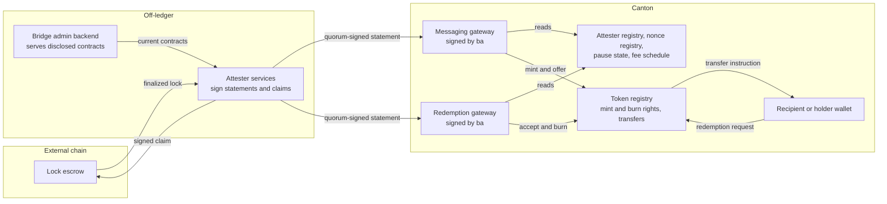
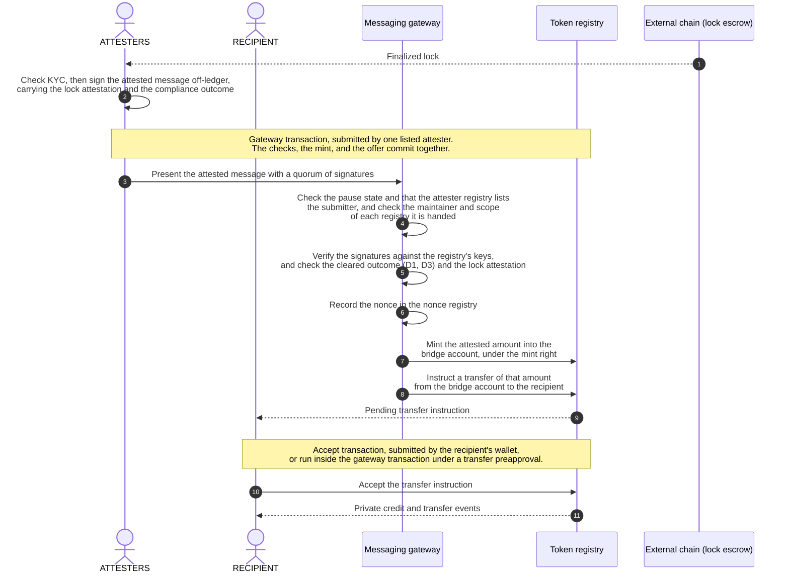
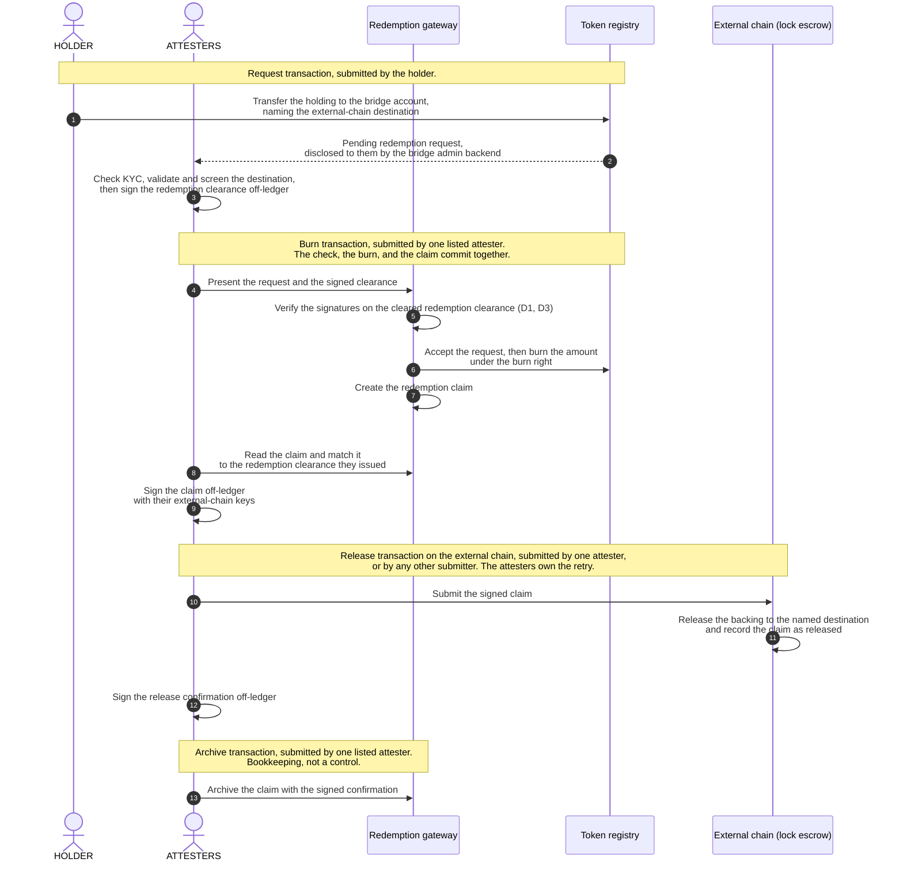

# Cross-Chain Stablecoin Payment Orchestration on Canton

This reference architecture defines the Canton side of a stablecoin bridge,
which this document calls the rail. An attested lock on an external chain mints
a wrapped instrument on Canton, and a burn on Canton releases the backing on
that chain. The document is written for a reader who knows Canton: parties and
participants, signatories and observers, disclosed contracts, package vetting,
and the Token Standard V2 (CIP-0112) two-step transfer.

> NOTE: This document calls the other chain the **external chain** in both
> directions, and the wrapped instrument **wTOK**. wTOK stands for any
> instrument whose Token Standard V2 registry grants the bridge a mint right
> and a burn right ([section 4.12](#412-registry-integration)).

## 1. Summary

**Inbound** moves value from the external chain to Canton by lock-and-mint,
and **outbound** moves it back by burn-and-release. An off-ledger **attester
set** attests each hop. Two things cross the boundary between the chains: a
quorum of attester signatures and the nonce of a lock. Everything else is
Canton.

Two contracts that the **bridge admin** `ba` signs carry the design. The
**messaging gateway** verifies an attested lock, mints into the bridge's own
account, and offers the credit to the recipient as a standard transfer
instruction. The **redemption gateway** verifies a cleared redemption request,
burns the holding, and creates a claim that the escrow pays. Each runs every
bridge check inside the transaction that mints or burns, and the token
registry's own accept credits the recipient with no bridge code in the path.

Three parties are trusted ([section 7.2](#72-trust-boundaries)): the attester
quorum, N of M independent organizations, for every external-chain fact and
every compliance and KYC verdict; `ba`, for the mint and burn rights, the
bridge account, and the registries every gateway check reads, under an N-of-M
posture ([section 4.4](#44-decentralization-and-trust-topology)); and the wTOK
admin, which signs every holding of its instrument and can mint outside the
bridge.

Two invariants hold the design together. **Reserve**: bridge-minted supply
never exceeds the backing the escrow holds
([section 4.6](#46-reserve-replay-and-refunds)). **Bounded custody**: every
minted unit is credited, locked in an offer with a deadline, or back in the
bridge account with a refund path
([section 7.4](#74-failure-modes-and-recovery)).

The ledger does not enforce four things, and a trusted party stands in for
each:

- that a redemption claim has a burn behind it
  ([section 7.3](#73-threat-model));
- that a holding a reject or an expiry returned belongs to the lock the
  attesters bind it to ([section 4.6](#46-reserve-replay-and-refunds));
- a compliance denial reached after the offer exists, which leaves one
  instruction deadline of exposure
  ([section 4.10](#410-attester-statements-and-control-enforcement));
- one compliance policy across the attester set
  ([section 8](#8-open-design-questions)).

---

## 2. Requirements

- **R1, no stuck or lost funds.** Every deposit locked on the external chain,
  and every holding offered for redemption, ends as value its owner holds on
  one of the two chains: a credit on Canton, a refund to the originator, or a
  release to the holder's destination, less the bridge's fee. The exceptions:
  - a lock or a returned credit held under a freeze that a compliance denial
    requires, whose release is a decision outside the bridge;
  - a redemption whose destination becomes unpayable after the burn;
  - a pending credit that a registry seizes, under that registry's rules;
  - a credited holding whose holder's participant unvets the registry's
    packages;
  - a trusted party that fails or misbehaves
    ([section 7.2](#72-trust-boundaries)).
- **R2, no unbacked credits.** The wTOK supply the bridge minted never exceeds
  the backing the escrow holds for it.
- **R3, compliance.** No value enters or leaves the rail without the controls
  of [section 2.1](#21-institutional-controls).
- **R4, privacy.** A payment's amount and parties reach only the parties of
  [section 4.3](#43-privacy-and-visibility). The external-chain side is
  public.

[Section 7](#7-requirements-analysis) states how the design meets each
requirement.

### 2.1 Institutional Controls

D1 through D4 are local shorthand for four institutional controls.

| ID | Control | Where enforced | Invariant |
|---|---|---|---|
| **D1** | Compliance clearance from an N-of-M attester quorum, in a single-use statement bound to the credit or the request | The gateways, before any transfer instruction or burn exists ([section 4.10](#410-attester-statements-and-control-enforcement)) | No clearance, no transfer instruction and no burn |
| **D2** | Seizure of a pending credit | The token registry, optionally. The bridge neither requires nor enforces it | Set by the registry that implements it |
| **D3** | KYC identity of the recipient, or outbound of the redeeming holder | The attester services, off-ledger, before they sign. The gateways enforce the result through D1 | No KYC, no clearance |
| **D4** | Every privileged bridge choice binds to a named role, not to one admin | Each privileged bridge choice, against a role grant or an attester registry entry | Privileges move without a redeploy |

### 2.2 Scope

| In scope | Out of scope |
|---|---|
| The Canton side of the bridge: attested mint, private transfer, attested burn | The attester services, the lock escrow, external oracles, external-chain validator sets, and light-client proofs |
| The mint and burn rights the bridge asks of a token registry | The token registry itself, its admin's key custody, and any mint path outside the bridge's grant |
| The gateway checks that deny a credit or a redemption without the attesters' clearance | The compliance and KYC checks the attester services run before they sign |
| CIP-0112 two-step transfers: the transfer instruction, its accept, and a transfer preapproval that automates the accept | Token Standard V1 (CIP-0056), and the CIP-0112 allocation and settlement-batch path ([section 6](#6-alternatives-considered)) |
| One Canton synchronizer, one external chain, one instrument | Cross-synchronizer settlement, and backing one instrument from several chains |
| The controls the bridge enforces itself: D1 and D4 | Seizure (D2), the KYC check itself (D3), and any control over a wTOK holding after it is credited |

---

## 3. Status Quo

A transfer must credit the recipient with the intended amount or with nothing.
The [CIP-0112](https://github.com/canton-foundation/cips/blob/main/cip-0112/cip-0112.md)
**transfer instruction** carries that property: it fixes the sender, the
recipient, the amount, and the instrument when it is created, and its accept
credits exactly that amount in one transaction or fails as a whole. Each
inbound credit is one transfer instruction that its recipient accepts.

`OpenZeppelin/canton-contracts` holds a [draft registry implementation](https://github.com/OpenZeppelin/canton-contracts/tree/6a916c174db7d6163ebeea4df1049044cefc7b3c/packages/token/token-cip112-v1/daml/OpenZeppelin/Token/Cip112/V1)
of the Token Standard V2 interfaces, which this document uses as the example
wTOK registry. Its transfers are private through per-party projection, with one
exception: the **instrument admin** signs every holding and transfer
instruction of its instrument.

### 3.1 Component Status

The cross-chain boundary exists only as the feasibility prototype in
[`experiments/cross-chain-bridge`](../../experiments/cross-chain-bridge/). Its
Daml Script tests run both flows end to end against the example registry, and
its [`README.md`](../../experiments/cross-chain-bridge/README.md) records where
the prototype departs from this design. The main departure: the prototype
co-signs each attester statement as a contract on Canton, where this design
signs it off-ledger. Every package below is experimental, apart from the
vendored Token Standard V2 interfaces, and each needs a full audit.

| Component | Status |
|---|---|
| Example wTOK registry, [`canton-contracts` `token-cip112-v1`](https://github.com/OpenZeppelin/canton-contracts/tree/6a916c174db7d6163ebeea4df1049044cefc7b3c/packages/token/token-cip112-v1) | Exists. It needs a mint right and a burn right granted to `ba` and scoped to the bridge account ([section 4.12](#412-registry-integration)) |
| Role grants, [`canton-contracts` `scoped-authorization-grant-v1`](https://github.com/OpenZeppelin/canton-contracts/tree/aeca01d043311d8ccc8ab7cda4d7c16e682429fa/packages/access/scoped-authorization-grant-v1), and pause state, [`canton-contracts` `pausable-v1`](https://github.com/OpenZeppelin/canton-contracts/tree/aeca01d043311d8ccc8ab7cda4d7c16e682429fa/packages/security/pausable-v1) | Exist. They need wiring into each privileged bridge choice and the pause state template |
| Token Standard V2 interfaces, Splice `splice-api-token-*` | Vendored as pinned DARs and consumed by interface |
| Messaging gateway, deferred offer, transfer preapproval, registry adapter, nonce registry, attested mint, redemption gateway, fee schedule, attester statements, and the identity checks on the registries | Design only, prototyped in the experiment |
| Validation tooling, [`daml-lint`](https://github.com/OpenZeppelin/daml-lint), [`daml-props`](https://github.com/OpenZeppelin/daml-props), [`daml-verify`](https://github.com/OpenZeppelin/daml-verify) | Exist. The pipeline is not built, and a negative Daml Script test for every fail-closed gateway path comes first |

---

## 4. Design

### 4.1 Overview

Each Canton step is its own transaction, and no transaction spans both chains.
Supply enters at the attested mint and leaves at the burn, each behind a
gateway check against an attester signature over an external-chain fact that
no Canton check can validate. Between the two, the token registry creates and
completes every wTOK transfer, and the accept that credits the recipient is the
registry's own choice. The attester services decide off-ledger which listed
attester submits each step ([section 7.4](#74-failure-modes-and-recovery)).

**Happy path.** Inbound, the escrow locks a deposit on the external chain. The
attesters sign one statement that attests the lock and clears it for
compliance, and one attester submits it to the messaging gateway. The gateway
checks the signatures, mints the amount into the bridge account, and offers it,
less the fee, to the recipient as a transfer instruction, which the recipient
accepts. Outbound, the holder offers its holding to the bridge account and
names an external-chain destination. The attesters clear the request, and one
attester submits it to the redemption gateway, which burns the holding and
creates a claim. The attesters sign the claim, and the escrow releases the
backing to the destination.

### 4.2 Roles

Canton identifies an actor by a party and the external chain by an address,
and neither chain records that the two name the same actor. The lock
attestation therefore names the Canton recipient explicitly, and the attester
set carries the trust that it is correct. Each attester holds both credentials:
a Canton party, and an external-chain key that the escrow's verifier accepts.

| Role | Code | Signs and submits | Sees |
|---|---|---|---|
| Attesters, M of them | - | Each signs every attester statement off-ledger with its own key, which the attester registry lists. One listed attester submits each gateway transaction with a quorum of signatures and pays its traffic. No attester mints, denies, or freezes alone: every outcome needs a quorum-signed statement, a deadline, or the pause state | The statements its quorum signs, the transfer instructions it creates as submitter, and the bridge account's transfer events ([section 4.6](#46-reserve-replay-and-refunds)) |
| Bridge admin | `ba` | Sole signatory of both gateways, the attester registry, the nonce registry, the pause state, and the fee schedule. Holds the mint and burn rights and owns the **bridge account**, where the gateway mints and from which it offers each credit. Submits setup, rotations, handovers, and payouts, and nothing on the payment path. Holds the rail's Featured App status | Every inbound credit, as the sender's account owner |
| wTOK admin | - | The instrument admin of the token registry, not a bridge role. Grants `ba` the mint and burn rights, and signs every wTOK holding and transfer instruction. Holds wTOK's Featured Asset status | Every wTOK payment |
| Recipient, or holder outbound | - | Accepts the transfer instruction that offers its credit, live or through a transfer preapproval. Outbound, offers its holding to the bridge account | Its own transfers |
| Pause authority | `pa` | Holds the pause role grant and flips the pause state | The pause state |

Off-ledger, the **lock escrow** is the external-chain contract that holds the
backing, releases against a verified claim that any submitter presents, and
refunds each lock once. The **attester services** are M independent operators
on M participants: each watches the external chain, runs the compliance and
KYC checks against **KYC providers** that observe no transfer, signs as its own
attester party, exchanges signatures with the others, and agrees with them
which attester submits each step. The **bridge admin backend** is a process on
a participant that hosts `ba`. It serves the attester services every bridge
contract they need as a disclosed contract, and the bridge account's transfer
events ([section 4.8](#48-registry-identity-and-uniqueness)), and it submits
nothing. The **recipient wallet** accepts pending transfer instructions and may
create a transfer preapproval.

The gateways and the registries are contracts. The attester statements are not:
each is a typed message signed off-ledger that reaches the ledger only as an
argument of the gateway transaction that uses it
([section 4.10](#410-attester-statements-and-control-enforcement)).

### 4.3 Privacy and Visibility

One row per contract. The first four rows are the token registry's, shown for
the example registry. A party a row does not name sees the contract only when a
transaction it witnesses divulges it.

| Contract | Signatories | Observers |
|---|---|---|
| Inbound transfer instruction | The wTOK admin and `ba`, as the sender's account owner | The recipient |
| Redemption request, the holder's transfer instruction to the bridge account | The wTOK admin and the holder | `ba`, as the receiver's account owner |
| Event log contract, created and archived in one transaction | The wTOK admin | None |
| wTOK holding | The wTOK admin and the account's parties | The lock's observers, while locked |
| Messaging gateway, redemption gateway, attester registry, nonce registry, pause state, fee schedule, deferred offer, redemption claim, refund claim | `ba` | None. A listed attester reads or exercises them through disclosure ([section 4.8](#48-registry-identity-and-uniqueness)) |
| Pause role grant | `ba` | The current `pa` |
| Transfer preapproval | The recipient | `ba`, the party it names to exercise it |

Consequences:

- **No recipient sees another recipient's credit.** Each transfer instruction
  projects to its one recipient.
- **The wTOK admin sees every wTOK payment**, as any issuer sees its own
  instrument, and the design treats it as a trust assumption. `ba` sees every
  inbound credit, the submitting attester sees the transfer instruction it
  creates and any preapproval it exercises, and the attesters read the bridge
  account's transfer events. Choosing the attesters is a privacy decision as
  well as a compliance one.
- **Transfer outcomes arrive as events.** The example registry reports each
  holdings change as a Token Standard V2 `EventLog_HoldingsChange` exercise on
  a contract it creates and archives in the same transaction, so the data
  reaches its observers on the update stream and never enters the active
  contract set. An integrator matches an event to a lock through the nonce in
  the transfer's metadata, not through the instruction's contract id, because
  a re-offer creates a new instruction.
- **No personal data on the ledger.** A statement carries the attesters' KYC
  verdict, not personal attributes.

### 4.4 Decentralization and Trust Topology

Canton offers three routes to an N-of-M party, and the choice is open
([section 8](#8-open-design-questions)): an **on-ledger approval workflow**, a
[Multiple Party Agreement](https://docs.canton.network/appdev/modules/m3-design-patterns#multiple-party-agreement)
in Daml whose approvals are auditable on-ledger; an **external party with
threshold signing keys**, where N of M keys held by independent organizations
sign each transaction and the Daml code never sees it, with the
[Bitsafe decentralization-manager](https://github.com/DLC-link/decentralization-manager)
as one candidate; and a **multi-hosted party with a confirmation threshold**,
where M participants host the party and N must confirm, so the trust sits with
the participant operators.

**Decision.** `ba` holds everything that decides whether bridge-minted supply
is legitimate: the mint right, the attester registry that every gateway check
reads, and the nonce registry that limits each lock to one mint. Moving either
registry to another party would add a second key that can break the reserve
without being able to mint, so the design keeps all three with `ba` and
protects `ba` with an N-of-M posture.

| Role | Target posture | Trusted with | Who submits in its name |
|---|---|---|---|
| Attesters | M parties, one per organization, each on its own participant with its own key. Every check requires N of M signatures, never all M | As a quorum, every external-chain fact and every compliance and KYC verdict. One attester alone can only delay a step | Each attester service, as its own party |
| `ba` | N-of-M across independent organizations, by one of the routes above. Route, N, and M are open | The mint and burn rights, the bridge account, both registries, the fee schedule, and the bridge's income | Nothing on the payment path: its authority enters each gateway transaction as the gateway's signatory. Setup, rotations, and payouts are its own transactions |
| wTOK admin | Set by the token registry | Every holding of its instrument, so it can mint outside the bridge | The registry |
| `pa` | One multi-hosted party, confirmation threshold 1, held by organizations outside the attester set | Stopping the supply paths at once, so a party outside the attester set can stop a compromised quorum. A malicious `pa` stalls the rail until `ba` revokes its grant | Any host |
| Recipients | None | Their own keys | The recipient's wallet, or the gateway under a transfer preapproval |

The attester set is the main lever. A larger M keeps the rail live through more
outages, and a larger N spreads the trust. Signatures travel off-ledger and
each statement costs one gateway transaction whatever N is, so M and N move
trust and coordination cost, not traffic.

### 4.5 Inbound Credit

Three steps carry a finalized lock to a credited holding. The attesters sign
step 1 off-ledger, one listed attester submits step 2 for a batch of locks, and
the recipient submits step 3, or step 2 runs it under a transfer preapproval.

1. **Attested message.** The attesters sign an **attested message** that
   carries the **lock attestation**: the locked amount, the Canton recipient,
   the instrument, the lock's nonce, and an expiry. The nonce is the escrow's
   sequence number, and the rail serves one chain and one instrument, so it
   alone identifies a lock. The same message carries the **compliance
   outcome**: cleared, or denied with a denial reference. Each attester
   service signs only after it has screened the lock's originator and checked
   the recipient's KYC off-ledger. One signature covers both records, so the
   outcome binds to the lock's content before any transfer instruction exists.
   That is D1 and D3. The attester services collect signatures until N listed
   attesters have signed
   ([section 4.10](#410-attester-statements-and-control-enforcement)).

2. **Gateway transaction.** A listed attester exercises the **messaging
   gateway**, which runs every bridge check in one choice, each failing
   closed: the pause state is clear and the attester registry lists the
   submitter; N listed attesters signed the message and its outcome is
   cleared; the lock attestation passes the mint checks and the nonce registry
   does not hold its nonce ([section 4.6](#46-reserve-replay-and-refunds)). The
   choice then records the nonce, mints the attested amount into the bridge
   account under the mint right, pays the bridge's fee out of it
   ([section 4.14](#414-traffic-costs-app-rewards-and-fees)), and exercises
   the registry's `TransferFactory_Transfer`. The **transfer instruction**
   names the bridge account as sender, the recipient's account as receiver,
   and the attested amount less the fee, and its metadata carries the lock's
   nonce. The minted holding stays locked in the instruction until it
   resolves.

   `ba`'s authority comes from the gateway it signs and covers both the mint
   and the sender's side of the transfer, so the recipient's participant
   confirms nothing at this step, and an offline recipient sees the offer when
   it returns. The standard's withdraw belongs to the sender, so a listed
   attester exercises it through a gateway choice, under the rules of
   [section 4.10](#410-attester-statements-and-control-enforcement).

3. **Accept.** The recipient's wallet exercises `TransferInstruction_Accept`,
   the one choice that credits. It is the registry's own code and runs no
   bridge check, so any wallet that speaks the standard accepts a bridge credit
   like any other pending transfer. A rejected or withdrawn instruction returns
   the locked holding to the bridge account by the standard's own semantics,
   and a lapsed one stays locked until an attester withdraws it.
   [Section 4.6](#46-reserve-replay-and-refunds) sets what happens to a
   returned holding.

**Transfer preapproval.** An offline treasury cannot accept interactively. Its
wallet may pre-establish a recipient-signed bridge contract that lets `ba`
exercise the standard accept with the recipient's authority. The gateway
exercises it with the `ba` authority it carries, so step 2 accepts the
instruction it creates and the credit lands in one attester-submitted
transaction. A preapproval that arrives after the offer runs through a gateway
choice of its own. It is an optimization: a recipient without one is credited
when it accepts. Canton Coin's preapproval covers Canton Coin only, so the
bridge defines its own, which calls only the standard accept and so works with
any registry. It bounds the instrument, an amount ceiling, an expiry, and the
party that may exercise it, and the recipient can archive it at any time.

**Batches and deferred offers.** The submitting attester takes the open locks
in nonce order and submits them in batches. One gateway transaction runs the
checks of step 2 for every message and writes the nonce registry once
([section 4.13](#413-throughput-and-contention)). A check that fails for one
message fails the batch, and the attester resubmits without that message. A
recipient's participant can fail a batch too, because a transfer instruction
makes the recipient an informee, and Canton rejects a transaction when an
informee's participant has not vetted its packages. The attester then
resubmits the batch in a second form that creates a **deferred offer** for each
credit: a contract only `ba` signs that records the nonce, the amount, the
recipient, and a deadline. That form runs every check, records each nonce as
deferred, mints nothing, and no recipient sees it. A listed attester later
converts each deferred offer on its own, through a gateway choice that mints
and offers as step 2 does, so one recipient's participant delays only its own
credit. An offer still open at its deadline is closed, and the never-minted
refund of [section 4.6](#46-reserve-replay-and-refunds) follows.

**Delivery and retry.** Nothing guarantees that the Canton credit of an
attested lock executes. Delivery depends on the attester set, and the design
adds no automatic cross-chain recovery protocol. An attester service keeps no
command-id state machine: it reads the next step from the statements the
quorum has signed and from the bridge's active contracts, keyed by nonce, and
after a restart it re-reads them and continues. Duplicate submissions are safe
because the nonce registry records each nonce once
([section 7.4](#74-failure-modes-and-recovery)).

### 4.6 Reserve, Replay, and Refunds

[Section 4.5](#45-inbound-credit) credits the payment. This section ties it to
the backing on the external chain and sets what happens to a credit that
returns.

**Mint checks.** The lock attestation states that the escrow received a given
amount under a given nonce. No Canton contract can check that, so the attester
quorum carries the trust, and the submitting attester adds none: the gateway
counts the quorum's signatures, not the submitter's. The gateway mints only if
N distinct listed attesters signed the message, each signature verifying
against its registered key; the compliance outcome is cleared and the
attestation has not expired; the amount, the recipient, and the instrument of
the mint and the offer match it; and the nonce registry does not already hold
the nonce. A signer the registry no longer lists does not count. A failed check
rolls back the whole gateway transaction. For a deferred offer, the checks run
in the batch that creates it, and the conversion mints against the deferred
record without a second attestation.

**Nonce registry.** The gateway writes the lock's nonce in the transaction that
mints. A nonce is in one of six states: deferred, minted, returned, closed
without a mint, refunded, or held. The registry records the offered amount and
the recipient, and for a returned nonce the holding the withdraw brought back
and the late denial it carried, if any. The registry is scoped to one
instrument and one **epoch** of `E` consecutive nonces, so no registry holds
more than `E` nonces and the bytes of a mint stay bounded
([section 4.13](#413-throughput-and-contention)). `ba` creates the first
epoch's registry and fixes `E` there. The first write to a registry creates its
successor in the same exercise, so each epoch gets exactly one registry, and
`E` exceeds the locks that can be in flight, so a registry exists before its
first lock arrives. A settled epoch's registry stays active for later refunds
and closes. The gateway checks that the registry it is handed carries the epoch
of the nonce it processes
([section 4.8](#48-registry-identity-and-uniqueness)). Attesters read the
registry before they sign and decline a nonce it holds, but the gateway's check
is the safety control, so an attester that cannot reach the registry still
signs.

**Returned credits.** The registry records mints, not credits. A reject or a
registry expiry returns the holding to the bridge account and leaves the nonce
as minted. A gateway withdraw returns it the same way and records the nonce as
returned, with the holding. An attester refunds a returned holding by default,
through the redemption gateway ([section 4.7](#47-outbound-redemption)), so
returned value leaves the bridge account promptly.

The ledger binds a returned holding to its lock only when the gateway withdraws
the offer. After a reject or an expiry the binding exists only in the bridge
account's transfer events. The attester services read those events from
participants that host `ba`, match the holding to the instruction the gateway
created for the nonce, and a quorum signs the nonce, the holding's contract id,
and its amount as a **return attestation**. The attesters spread their reads
over hosts of `ba` that different organizations operate, so false events from
one host cannot reach a quorum. A refund or a hold of a minted nonce presents
the return attestation, checks that the holding carries the lock's recorded
amount, and consumes the holding. A wrong binding can therefore only swap two
locks of the same amount. It needs a colluding quorum or false events from
hosts that together serve N attesters, and the reserve still holds because
each refund burns its amount first.

**Re-offer.** The one exception to the prompt refund is an instruction whose
deadline lapsed while the rail could not deliver it, during a synchronizer
outage or a pause. An attester offers that holding once more to the same
recipient and refunds it if the offer returns again. The nonce registry already
holds the nonce, so the re-offer needs a fresh **re-offer attestation** that
binds the nonce, the recipient, the amount, the instrument, and the returned
holding. Signing it states that the rail caused the lapse and that the credit
still clears compliance, and a quorum that approves neither signs nothing. The
gateway checks that the nonce is recorded as returned with that holding and
was not re-offered before, and the re-offer consumes the holding. The ledger
does not record why a deadline lapsed, so whether a credit qualifies is the
attesters' decision. The exception exists so that one infrastructure incident
does not refund every payment in flight.

**Refund exclusivity.** A refund on the external chain must never pay out a
lock whose credit stands on Canton, and no mint may follow a refund. Both
refund paths reuse the signature verifier the escrow already runs for a
redemption release.

| Case | Condition | Path |
|---|---|---|
| Never minted | The attesters never signed, the message carries a denied outcome, the attestation expired, or a deferred offer was never converted | An attester presents the message to a close choice of the messaging gateway, which records the nonce as closed: at once for a denied outcome, after expiry for a cleared one, and at its deadline or against a late denial for a deferred offer. For a lock with no message, the attesters sign one with a denied outcome. A closed nonce never mints. Each attester then reads the nonce as closed and signs a **no-mint statement**, against which the escrow refunds the whole deposit |
| Minted, then returned | The holding is back in the bridge account | The redemption gateway burns the lock's recorded amount, marks the nonce refunded, and creates a **refund claim** that names the nonce, in one transaction. The escrow pays it only to the address that funded the lock, and once |
| Held | A denial requires a freeze, for example a sanctions hit on the originator | The attesters withhold the no-mint statement or the refund claim, so the backing stays in the escrow. A returned credit under such a denial is still burned and the nonce marked held, with no claim. Releasing a held lock is a decision outside the bridge |

**Reserve invariant.** The backing is one balance: every deposit the bridge
minted against, less every redemption and refund the escrow released. The wTOK
supply the bridge minted never exceeds it. A mint adds one deposit amount to
both, and a redemption or a refund removes one burn amount from both. Supply in
the bridge account, locked in a pending offer or returned from one, counts like
any other supply. A held lock burns its supply and keeps its backing. A fee is
wTOK that a deposit already backs, so paying it changes neither balance, and a
refund of a returned credit releases the deposit less the fee. Because the
escrow holds the backing as one balance, the invariant means the escrow can pay
out every burn. It covers the whole instrument only if the bridge's mint right
is the instrument's only mint path
([section 4.12](#412-registry-integration)).

### 4.7 Outbound Redemption

Redemption mirrors the inbound flow. The holder offers its holding to the
bridge account, the bridge accepts and burns it once the attesters clear the
request, the quorum signs the claim, and the escrow releases the backing.

1. **Request.** The holder makes a standard `TransferFactory_Transfer` of the
   holding to the bridge account, with the external-chain destination in the
   transfer's metadata. The registry leaves it as a pending transfer
   instruction, the **redemption request**: the holding is locked and has not
   moved. The bridge account holds no preapproval, so no request completes
   before the bridge accepts it, and the holder can withdraw until then. The
   design assumes the holder's wallet renders the amount and the destination
   in clear before the holder signs.

2. **Redemption clearance.** `ba` observes each request as the receiver's
   account owner, and the bridge admin backend serves it to the attester
   services. Each service checks the holder's KYC and screens the destination
   off-ledger, then signs a **redemption clearance** that binds the holder,
   the amount, the instrument, the destination, and the request's contract
   id, with an outcome: cleared, or denied with a reference. That is D1 and D3
   outbound. The burn is irreversible, so the destination must be payable
   before it, and the gateway cannot parse an external-chain address, so the
   attesters check it. A destination fails if it is malformed for the external
   chain, one the escrow refuses such as the null address or the escrow
   itself, or one the backing token refuses to pay such as a blocklisted
   address. The escrow repeats the checks it can make on its own chain, so a
   release to a refused address reverts and the claim stands. A destination
   that becomes unpayable after the burn leaves a standing claim that no
   submitter can release, and the design has no path that redirects it
   ([section 8](#8-open-design-questions)).

3. **Burn.** A listed attester exercises the **redemption gateway**, which
   checks the pause state and the submitter's listing, verifies the
   clearance's signatures, accepts the request as the receiver, pays the fee,
   burns the rest under the burn right, and creates the **redemption claim**,
   in one transaction. The claim carries the instrument, the burned amount,
   the holder, the destination, and the request id, so an auditor can match
   each release to one burn and one holder. On a denied clearance the attester
   rejects the request through the same gateway, with the denial reference in
   the rejection's metadata, and the holding returns to the holder. A request
   nobody decides is withdrawn by the holder. Nothing burns without a cleared
   request. `ba` alone signs the claim, so the ledger does not enforce a burn
   behind it, and [section 7.3](#73-threat-model) states what limits that.
   The refund claim of [section 4.6](#46-reserve-replay-and-refunds) runs
   through the same gateway without a request or a clearance.

4. **Release.** An N-of-M quorum signs the claim off-ledger with its
   external-chain keys. Each attester reads the claim as a disclosed
   contract, so it signs only an active one, and it signs a claim only if it
   matches a clearance it issued, and only once. One attester presents the
   signed claim to the escrow, and the attester services also give it to the
   holder, who can present it itself. The escrow releases the amount to the
   destination and decrements the reserve by the same amount. After the
   release the quorum signs a release confirmation, and an attester archives
   the claim with it, which is bookkeeping and not a control.

**Cross-chain atomicity.** The release does not sit in the same transaction as
the burn, so the order is burn first and attested release second. The burn is
the irreversible commit, and the release needs the signed claim. That order
assumes an external chain where any submitter can claim the release against
escrow state committed before the burn. Under that assumption a stalled release
costs time and never a double-spend: the escrow records each claim it releases,
so replay protection for the outbound direction sits there, as the nonce
registry sits on Canton for the inbound one. [Section 5](#5-limitations)
covers chains that cannot hold the payout back.

### 4.8 Registry Identity and Uniqueness

The gateway reads four bridge contracts at execution time: the pause state, the
attester registry, the nonce registry, and the fee schedule. The submitting
attester is a stakeholder of none of them, so it attaches each as a disclosed
contract and passes its contract id into the gateway choice. A caller that
supplies the ids can substitute another contract for each: a second nonce
registry that omits a lock's nonce lets the gateway mint against that lock
again, and a second attester registry with an extra member passes a check the
real one refuses.

**Decision.** Each of the four templates carries its maintainer and its scope
fields, and the gateway validates every one against a value the caller does not
control: the maintainer against the gateway's own signatory `ba`, the
instrument against the attested message, and the nonce registry's epoch against
the lock's nonce divided by the registry's own `E`. The maintainer signs the
contract, so only `ba` can create a version that passes.

| Contract | Scope fields beyond the maintainer |
|---|---|
| Nonce registry | The instrument, the epoch, and the epoch size `E` |
| Attester registry | None |
| Pause state, fee schedule | The instrument |

The checks read required fields, and an upgrade adds only `Optional` fields, so
every scope field exists from the first deployment
([section 4.11](#411-smart-contract-upgrade-process)).

**Disclosure.** `ba` signs every version of every bridge contract, so the bridge
admin backend serves the current version of each to the attester services, as
the created-event blob a disclosed contract needs. An attester also witnesses
each version its own submissions create and passes the blob to the others, so
gateway transactions continue while the backend is down. The ledger rejects a
disclosed contract that is no longer active, so a stale blob cannot pass. An
attester reads a registry the same way, through a nonconsuming read choice that
only `ba` and that attester see.

The attesters are observers of none of these contracts by design. A
stakeholder's participant that unvets the package blocks every transaction on
the contract, while a reader's participant fails only its own reads and
submissions, so no single attester can stall a mint, a refund, a burn, or a
rotation. In exchange, the attesters do not see a rotation or a second active
version as observers would.

**Residual.** Nothing stops `ba` from holding two active versions of a registry
and handing the attesters either. No other party observes them, and `ba`
already holds the mint right, so the exposure adds nothing to the trust in `ba`.

### 4.9 Time and Deadlines

CIP-0112 defines the deadline fields and no values. A transfer instruction
carries an `executeBefore`, after which its accept fails, and each token
registry sets a maximum instruction lifetime; Canton Coin caps it at 90 days.
The bridge adds a maximum attestation validity on its gateway, so no attester
can issue a statement that never expires. The values are open
([section 8](#8-open-design-questions)).

Each flow's deadline has a floor at the slowest required actor's service level
and a ceiling at the tighter of the registry's lifetime and how long the
originator accepts its deposit held without a credit or a refund. A minted
credit is refundable only once it returns to the bridge account, so a recipient
that never accepts holds back the originator's refund for the whole
instruction lifetime, unless a late denial or a pause lets the gateway withdraw
first. After the burn, a redemption claim is standing and replay-protected, so
a slow release costs latency only. The tolerance between ledger time and record
time makes sub-minute deadlines meaningless.

| Flow | Slowest actor | Window |
|---|---|---|
| Inbound credit | The recipient, when it accepts live. Under a preapproval no deadline runs | Instruction deadline, hours to days |
| Deferred offer | The operator of the recipient's participant | Deferred-offer deadline, days |
| Outbound redemption | Attester | Request deadline, then the release window, hours |
| Attester statements | Attester, then the submitting attester | Each statement's expiry, capped by the maximum attestation validity |

### 4.10 Attester Statements and Control Enforcement

**Attester registry.** The bridge contract that lists the attester parties,
each one's public signing key, and the threshold N. `ba` signs it and is its
only stakeholder, and every check that verifies a statement reads the signer
set, the keys, and the threshold from it. `ba` changes any of them by a
**rotation**: it archives the current version and creates the next. `ba` gains
nothing by rigging a list that only its own gateway reads, because it already
holds the mint right, and the escrow verifies attester signatures against its
own keys, so the Canton registry cannot weaken a release or a refund.

**Signed statements.** Every attester statement is an
[EIP-712](https://eips.ethereum.org/EIPS/eip-712) typed message, not a
contract: the attested message, the re-offer attestation, the redemption
clearance, the return attestation, the late denial, and the release
confirmation. Each attester signs with its secp256k1 key, and the attester
services pass the signatures among themselves until N listed attesters have
signed. The submitter presents the statement and its signatures as arguments
of a gateway choice, and the gateway checks that the attester registry lists
the submitter, verifies each signature against the registered key, and fails
unless N distinct listed attesters signed. The EIP-712 domain names the
deployment, `ba`, the instrument, and the escrow, so a signature for one
deployment or one statement type never verifies for another. The gateway
verifies with the `keccak256` and secp256k1 functions of `DA.Crypto.Text`,
which the Daml standard library marks as alpha
([section 8](#8-open-design-questions)).

A signature can be presented any number of times, so each statement binds
ledger state that the transaction using it changes:

| Statement | Binds | Spent when |
|---|---|---|
| Attested message | The lock's nonce | The nonce registry records the nonce as minted, deferred, or closed |
| Re-offer attestation | The nonce and the returned holding | The re-offer consumes the holding |
| Redemption clearance | The redemption request | The burn or the reject consumes the request |
| Return attestation | The nonce and the returned holding | The refund or the hold consumes the holding |
| Late denial | The nonce, and the instruction, deferred offer, or holding it closes | The withdraw, the close, or the hold consumes that contract |
| Release confirmation | The redemption claim | The archive consumes the claim |

Two statements for the same lock are therefore safe, even with different
outcomes: the first to reach a gateway spends the nonce and the other fails. A
signed statement cannot be withdrawn before it is used, so the maximum
attestation validity bounds how long a statement the attesters no longer stand
behind stays usable. A statement reaches the ledger only inside the gateway
transaction that uses it, and no attester is a stakeholder of one
([section 4.8](#48-registry-identity-and-uniqueness)).

**D1, enforced by the bridge.** Every inbound credit requires the quorum's
compliance clearance, bound to the credit's full content so that a clearance
for one credit cannot be re-pointed at another: the cleared outcome of the
attested message for a first offer, and the re-offer attestation for a
re-offer. The gateway verifies it before any transfer instruction exists,
against the attester registry whose maintainer is the gateway's own signatory,
so no caller input decides which registry the statement is checked against.
Outbound, the redemption gateway runs the same check before the burn, against
the redemption clearance.

The check runs once, and the accept is the registry's own choice, which the
bridge cannot gate, so a denial reached after the offer exists does not block
the credit by itself. The quorum closes that gap with a **late denial**: a
statement that names the lock's nonce, the instruction it closes, the denial
reference, and whether the denial requires a freeze. A listed attester presents
it to a gateway withdraw, which exercises the standard's
`TransferInstruction_Withdraw` under `ba`'s authority as the sender's account
owner, records the nonce as returned with the denial, and puts the reference in
the withdrawal's metadata under the Token Standard reason key. The withdraw
needs no confirmation from the recipient's participant. The exposure is one
instruction deadline, and zero under a transfer preapproval. The same statement
closes a deferred offer, and a hold of a credit that a reject or an expiry
returned presents one that requires a freeze.

The gateway withdraws a lapsed instruction at any time after its deadline, and
a pending one before it only against a late denial or while the pause state is
set. It closes a deferred offer before its deadline only against a late denial.
A single attester therefore cannot cancel, close, or freeze a credit on its own
word. A denial before the gateway leaves nothing to withdraw: the attesters
sign the attested message with a denied outcome, and an attester closes the
nonce with it ([section 4.6](#46-reserve-replay-and-refunds)). The denial is
recorded on the ledger because an organization reads its own ledger projection
more easily than an off-ledger compliance log, which holds the reasoning. A
registry may add its own compliance check at the accept; the bridge requires
none.

**D2, left to the registry.** Seizure of a pending credit needs authority over
the registry's own transfer instruction, and CIP-0112 defines no seizure
mechanism, so a registry may implement one or not. For the bridge, a seized
credit is minted supply that never returns: the nonce stays minted, the lock is
neither credited nor refundable, and the reserve holds because the seized
holding is backed like any other.

**D3, enforced by the attester services.** Before it clears a credit or a
redemption, each attester service checks off-ledger that the recipient, or the
redeeming holder, passed KYC with a provider the attesters accept, and its
clearance asserts it. The gateways enforce D3 through D1. The ledger holds the
verdict, and the evidence sits in the attesters' compliance logs. A revocation
after the gateway transaction has the same exposure as a late D1 denial. D3
applies when value enters or leaves the rail, not to transfers in between.

**D4, enforced by the bridge for its own choices.** Submission binds to a
listing in the attester registry, the pause to the pause role grant, and the
attested mint, the refund, and both registries to `ba`. A permission whose
holder must move sits on a separate grant or registry entry, so a change of
holder recreates no gateway. A rotation changes who may submit and whose
signature counts, and a statement signed before it stays valid while N of its
signers are still listed with the same keys.

**Pause.** The pause stops every bridge path that creates supply or releases
backing: the mint and offer, the burn, and the refund. Paths that return value
still run: a withdraw, a reject, and the registry's accept and expiry. A set
pause also lets the gateway withdraw a pending instruction before its deadline.
`ba` signs a pause role grant that names the current `pa`, who flips the pause
state by presenting it. The gateways check only the pause state and never
record who `pa` is, so handing the pause to another party is a revocation and a
new grant.

Moving `ba` to a new party is the one handover the bridge cannot complete
alone: the registry re-grants the mint and burn rights, the attesters withdraw
every pending offer at its deadline or under a pause, and the bridge account's
holdings move to the new party's account.

### 4.11 Smart Contract Upgrade Process

The rail uses Smart Contract Upgrade (SCU) for additive changes to its own
gateway and registry packages, under the rules of the
[Canton SCU guide](https://docs.canton.network/appdev/deep-dives/smart-contract-upgrade):
the same package name, a higher version, `upgrades:` set to the prior DAR, and
only appended `Optional` fields. The token registry's packages follow the
registry's own lineage. Two consequences are specific to the rail. The identity
checks of [section 4.8](#48-registry-identity-and-uniqueness) read required
fields, so the nonce registry's epoch and `E` must exist from the first
deployment. Each statement's EIP-712 type is part of what the attesters sign,
so a release that changes a statement's fields keeps accepting the previous
type until every statement signed under it has expired, and a rollout alone
never voids a signed attestation or drains a lock.

Each release defines what each new `Optional` field means for v1 state, with
`None` meaning the feature is off until configured, and tests v1 state under
the v2 implementation. Before release the operators run `dpm build` with the
`upgrades:` lineage and `dpm upgrade-check --both`, vet the DARs at every
affected participant, and switch wallets, attesters, and gateways together. A
change to a mint or burn authority, a key shape, the party set, the reserve
invariant, or a message's meaning gets a separately named package and a
migration or drain window.

### 4.12 Registry Integration

The bridge works with any token registry that implements the Token Standard V2
transfer interfaces and grants two rights: a **mint right**, which lets `ba`
mint into the bridge account and which the messaging gateway exercises only
after every bridge check passes, and a **burn right**, which lets `ba` burn
holdings in the bridge account for a redemption or for the refund of a
returned credit. It also asks for a **sender-side withdraw that works after the
deadline**, so that an attester can recover a lapsed credit under `ba`'s
authority without the wTOK admin. CIP-0112 forbids the accept after
`executeBefore`, leaves the withdraw without a time condition, and makes the
registry's expiry optional, and that expiry runs only when the wTOK admin runs
it. The example registry's withdraw has no deadline check. The registry must
also **keep the rights in force**: it re-grants both when `ba` moves to a new
party, and keeps the burn right while the bridge account holds value or an
offer is pending. Revoking the mint right fails closed, and revoking the burn
right early leaves returned credits with no refund path.

Each registry grants the rights in its own shape, for example a role grant or
a capability contract its admin signs. A **registry adapter** module calls them,
so the bridge package depends on the registry's package and follows its
upgrades. That coupling stays until a Token Standard V2 burn-mint interface
exists: Splice's
[splice-api-token-burn-mint-v1](https://github.com/canton-network/splice/tree/3568cba96925bf509defcd9078b292808b36a9e9/daml/splice-api-token-burn-mint-v1)
works on V1 holdings, and the example registry implements only V2 holdings. A
right scoped to the bridge account is narrower than one that mints into any
account, and the bridge needs no more.

The 1:1 backing covers the whole instrument only if the bridge's mint right is
the instrument's only mint path. The registry admin signs every holding and can
create one directly, and no bridge contract can check that it does not. The
example registry's [admin mint](https://github.com/OpenZeppelin/canton-contracts/blob/6a916c174db7d6163ebeea4df1049044cefc7b3c/packages/token/token-cip112-v1/daml/OpenZeppelin/Token/Cip112/V1/Registry.daml#L74-L86)
consumes no attestation, so a wTOK deployment must not use it. A registry that
also issues the instrument natively mixes bridged and native supply, and the
reserve claim then covers the bridged part only.

**Extension points.** The two gateways are the substitution points for the
bridge boundary: another bridge mode or proof scheme changes the lock
attestation check and the gateways and leaves the token, the transfer, and the
controls untouched. The registry adapter is the substitution point for a
registry. Substitution happens at compile time: an adopter replaces the module
in its own copy of the rail package and redeploys under its own package name.
The mint, refund, and burn paths carry no interface-dispatched hooks, and the
only interface calls are the Token Standard's transfer factory and transfer
instruction. A recipient that holds an instrument credited here can supply a
[DEX](./dex.md) pool or collateralize a [lending](./lending.md) vault over the
standard interfaces.

### 4.13 Throughput and Contention

The nonce registry serializes every inbound mint, because each mint archives
and recreates the registry of its epoch, and consecutive locks land in the same
epoch. One contract at a time takes every mint of the instrument, so the
ceiling is one mint per commit latency of the registry write.

Two things raise it. A batch writes the registry once for all of its
messages ([section 4.5](#45-inbound-credit)). The epoch caps the registry at
`E` nonces, so a mint's write is bounded by `E` and not by the rail's history.
Without it each mint would cost more traffic than the last, and the registry
would eventually exceed the synchronizer's maximum request size. A smaller `E`
writes fewer bytes per mint, and a larger one creates fewer registries.

Accepts write no bridge contract, so they run in parallel with each other and
with new offers. Redemptions write no shared bridge contract either. A refund,
a gateway withdraw, a re-offer, and the conversion or close of a deferred offer
each write the nonce registry and contend like a mint, but each follows a
lapse, a denial, or a failed participant, so they are rare beside mints. A
rotation archives a registry that in-flight gateway transactions fetched, so
rotations are scheduled as an operational window. The off-ledger submitter
agreement keeps two attesters from writing the same registry at once, and the
loser of a race retries against the new version at the cost of one rejected
submission.

### 4.14 Traffic Costs, App Rewards, and Fees

**Traffic.** Cost scales with the serialized bytes of each sequenced message
plus a per-recipient delivery surcharge
([traffic accounting](https://docs.canton.network/overview/reference/tokenomics-of-gs)).
An inbound payment costs its share of one gateway batch and one accept. The
gateway transaction is the heaviest: it carries the attested message with its
N signatures, the nonce registry write, the mint, and the offer. A live accept
is the registry's plain transfer, paid by the recipient's validator, and a
delegated accept runs inside the gateway transaction. Every attester statement
travels inside the transaction that uses it, so no statement costs a
transaction of its own. The attesters pay for everything but a live accept and
a redemption request, each for the transactions it submits. A failed
transaction burns traffic and earns no reward, because
[CIP-0104](https://github.com/canton-foundation/cips/blob/main/cip-0104/cip-0104.md)
credits only a successful confirmation. Each attester's validator needs
configured top-up and balance monitoring, because auto-top-up is off by
default.

**App rewards.** The rail earns traffic-based app rewards under CIP-0104, once
the super validators vote them on. It holds two statuses, each on its own party
behind its own CC lock ([featured app guidance](https://lists.sync.global/g/tokenomics-announce/message/397),
[CIP-0116](https://github.com/canton-foundation/cips/blob/main/cip-0116/cip-0116.md)):
`ba` holds the Featured App status as the bridge protocol's party, and the
wTOK admin holds wTOK's Featured Asset status, applied for and funded by the
registry's operator. Rewards accrue to the parties that confirm a successful
request and hold an active right, so the submitting attester, which holds
none, earns nothing, and its share goes to `ba`. The mint, the factory call,
and the offer nested in the gateway exercise carry `ba`'s and the wTOK admin's
authority, so those nodes pay them. Measured on Canton LocalNet with
`scripts/localnet-bridge-app-rewards.sh`, with the submitter also featured,
one round paid `ba` 65%, the wTOK admin 21%, and the submitter 14% of its
app-reward pool. No attester holds a featured status, so a rotation changes
none. Network issuance parameters decide how much of the traffic cost the
reward returns, so the fee carries the attesters' traffic and the reward is
income on top.

**Fees.** The bridge charges a fee on each inbound credit and each redemption
and deducts it from the amount the payment carries, as Circle's
[CCTP](https://developers.circle.com/cctp/concepts/fees) and
[Axelar](https://docs.axelar.dev/dev/reference/pricing) do, so neither the
originator nor the holder needs Canton Coin. The attesters deny a lock or a
request that does not exceed the fee. A lock that never minted is refunded in
full, and a credit that comes back keeps its inbound fee, because its gateway
transaction already ran. One **fee schedule** contract that `ba` maintains sets
the values and the income shares, and the gateways read it like the pause
state. Each fee has a **fixed part**, paid in the same transaction to the
attester that submits it, so the attester that paid the traffic is repaid
without depending on `ba`, as LayerZero pays its verifiers. Transactions that
move no wTOK, such as a close or a withdraw, carry no fee, so the fixed part
covers them on average. The **percentage part**, together with `ba`'s app
rewards, is the bridge's income, split between `ba`, an attester pool, and the
registry. The gateway pays the shares into accounts of `ba` kept apart from the
bridge account, so the pool's balance is visible on-ledger, and `ba` pays the
pool out each period in equal shares to the attesters listed during it. The
registry share defaults to zero, because the wTOK admin earns its own app
rewards, and exists for a third-party registry that carries wTOK's issuer lock
and asks to be paid. Fees are ordinary wTOK holdings that a deposit backs, so
the reserve invariant holds.

---

## 5. Limitations

- **The exceptions to R1.** [Section 2](#2-requirements) lists the cases in
  which value stays held or lost.
- **A late compliance denial** leaves one instruction deadline of exposure
  ([section 4.10](#410-attester-statements-and-control-enforcement)).
- **A claim without a burn** is not ledger-enforced
  ([section 7.3](#73-threat-model)).
- **Registry coupling.** The registry adapter calls the registry's own
  templates until a Token Standard V2 burn-mint interface exists
  ([section 4.12](#412-registry-integration)).
- **One synchronizer, one external chain, one instrument.**
- **Privacy on the external chain.** The lock is a public transaction that
  must carry enough data to route the transfer on Canton. Hiding the link to
  the Canton recipient is out of scope.

**Chains that cannot hold the payout back.** Some chains cannot make the payout
conditional on the attestation. On a UTXO chain without contracts the release
is a plain threshold-signed transaction, so a quorum that stalls looks the same
as a loss, and under burn-first the redeemer holds neither asset. A
permissioned release on a contract chain fails the same way, because the holder
cannot submit the claim itself. The sound ordering there is burn-last: lock the
wrapped holding, authorize the payout on-ledger, broadcast, confirm, and burn
last. The reserve invariant then has to allow for the in-flight window, because
the backing is spent while the wrapped holding still exists. Burn-last is a
different trust model, and this design does not cover it.

---

## 6. Alternatives Considered

- **Lock-and-unlock.** It pays the recipient from liquidity held on the
  destination side, which adds a liquidity-provider role and an inventory
  imbalance that a reference rail does not need.
- **Allocation and settlement batch.** A settlement batch makes several legs
  all-or-nothing, which an exchange needs. An inbound credit has no
  counter-leg, so a batch only binds unrelated payments together: one
  timed-out recipient fails every payment in it, an offline recipient needs a
  preapproval before it can receive at all, and the wallet shows a settlement
  to assemble instead of a transfer to accept. A credit that funds one leg of
  an atomic exchange settles that exchange over the allocation path.
- **Direct mint into the recipient's account.** Minting into the bridge's own
  account and offering the credit as a transfer keeps the recipient's
  signature on every credit, narrows the registry's grant to one account the
  bridge owns, returns a failed offer to the bridge account where the bridge
  sees it, lets any standard wallet accept without rail-specific code, and
  lets a registry implement seizure on the pending state. The cost is that
  supply exists while an offer is pending, which the reserve invariant counts.
- **Attester statements co-signed on Canton.** Each statement could be a
  contract that each attester signs in its own transaction. That costs N
  transactions per statement and makes each attester a stakeholder of every
  statement, so one unvetting participant blocks them. Signing off-ledger
  costs no transaction beyond the gateway's, and the quorum check is the same.
- **A separate compliance statement.** It would need a second signing round
  for no binding the attested message does not already carry, and one message
  keeps a denial attributable because the quorum signs the denied outcome.
  The cost is that no lock attestation exists until the compliance checks
  finish. The re-offer and the redemption each get a statement of their own
  because no existing statement carries their content.
- **Contract keys for registry identity.** Canton 3 offers contract keys from
  Daml-LF 2.3, but keys are not unique, and a lookup resolves only against
  contracts the submitting participant holds or receives as disclosed, so the
  attester needs the disclosed contract either way. A key built from the
  maintainer, the instrument, and the epoch would use the values the identity
  checks already validate. The bridge targets Daml-LF 2.1 and uses no keys.
- **A fee outside the payment.** CCIP and LayerZero charge a separate fee in
  the source chain's gas token. An inbound originator has no Canton account and
  the escrow is out of scope, so such a fee needs fee logic in every escrow.
- **Paying every signer in the gateway transaction.** Each signing attester's
  participant would take part in every credit, so one attester that is down
  would block it.
- **Mint at the accept.** The bridge could offer each credit as a transfer
  from the registry's `cip-112/mint` account, so that the registry's accept
  mints into the recipient's account. The mint right then runs at the accept
  and reaches the recipient's account, not only an account the bridge owns. A
  mint offer has no sender account, so `ba` sees an offer that closes without
  an accept only as the mint account's provider, which departs from the
  CIP-0112 guidance that the mint account has no provider.
- **KYC proven on-ledger.** The gateway could also check an issuer-signed KYC
  credential, which adds a check that the attesters cannot override. It needs
  a trusted-issuer list, a credential format that every KYC issuer adopts, and
  `ba` observing every credential. The KYC check itself is out of scope
  ([section 2.2](#22-scope)), so the attesters' clearance asserts it.
- **A `FeaturedAppRight` for each attester.** Each needs its own application
  and CC lock, every rotation repeats both, and the featured app guidance
  treats one bridging protocol as one Featured App.

---

## 7. Requirements Analysis

- **R1.** Every minted unit has a deadline-bounded path back to an owner, and
  every lock that never mints has a refund path through the no-mint statement
  ([section 7.4](#74-failure-modes-and-recovery)).
- **R2.** The gateway mints only against a quorum-signed attestation and an
  unrecorded nonce, and a lock is refunded only after its nonce is closed or
  its returned credit is burned
  ([section 4.6](#46-reserve-replay-and-refunds)). R2 trusts the attester
  quorum, `ba`, and the wTOK admin.
- **R3.** The gateways enforce D1 and D4 on every credit and redemption, and
  D3 through D1
  ([section 4.10](#410-attester-statements-and-control-enforcement)).
- **R4.** Per-party projection limits each payment to the parties of
  [section 4.3](#43-privacy-and-visibility).

### 7.1 Ledger-Enforced Properties

| Property | Enforcement |
|---|---|
| Conservation of funds | The gateway mints exactly the attested amount, pays exactly the scheduled fee, and offers exactly the rest, and a refund burns exactly the amount it claims. Conservation inside the accept is the registry's property |
| 1:1 reserve backing | The gateway exercises `ba`'s mint right only against a valid attestation, so no submitter mints without one. It does not bind `ba` or the wTOK admin |
| Redemption gated by compliance | No burn runs without a valid clearance for its request, and a denied or lapsed request returns the holding. That a claim has a burn behind it is not ledger-enforced |
| Replay protection | One lock mints at most once, provided the nonce registry is the one `ba` maintains |
| Privacy partitioning | A credited transfer projects only to its recipient, `ba`, the submitting attester, and the wTOK admin. No KYC provider observes a transfer |
| Non-custodial recipient binding | No credit lands without the recipient's signature, live or carried by a preapproval. Until then the amount sits locked in the bridge's outgoing instruction, and no instruction exists without a deadline |

### 7.2 Trust Boundaries

| Trusted party | Required behavior, and what breaks otherwise |
|---|---|
| Attester set | Attests only a finalized lock with the true amount, recipient, and instrument. Clears only a recipient or holder that passed KYC. Signs a claim only against a clearance it issued, once; a no-mint statement only after reading the nonce as closed; a return attestation only for a holding the bridge account's events show returning from that lock. A colluding quorum mints unbacked supply or releases live backing, and whoever holds N listed keys is the quorum. This is the largest trust surface in the design |
| Submitting attester | Submits each step once. It cannot change an amount or a recipient, and every outcome needs a quorum statement, a deadline, or the pause, so a faulty submitter delays a step rather than misdirecting it. Withholding a cleared message until its attestation expires turns the lock into a refund, and refunding a returned credit before the re-offer attestation arrives skips the second offer. Neither breaks the reserve |
| `ba` | Exercises the mint and burn rights only through the gateways, keeps one active version of each registry, and pays the attester pool out each period. A compromised quorum of its keys mints unbacked supply, moves a returned holding, or creates a claim with no burn, which is why the role is N-of-M. Its hosts serve the transfer events the attesters bind returned credits with. A withheld payout is visible on-ledger, but no contract forces it |
| wTOK admin | Mints the instrument only through the bridge's rights. A compromised key issues unbacked supply, because it signs every holding |
| KYC providers | Report KYC status truthfully. The check is as strict as the most permissive provider the attesters accept |
| `pa` | Pauses only for an incident. A malicious `pa` stalls the rail until `ba` revokes its grant, and the locks stay creditable or refundable meanwhile |
| Lock escrow | Holds the backing, releases only against a verified claim, and refunds each lock once. A broken escrow strands a redemption, and the burn is already final |
| Canton infrastructure | Keeps the parties hosted, the packages vetted, and transactions confirmable inside each deadline |

### 7.3 Threat Model

| Attack | Mitigation |
|---|---|
| The submitting attester routes a valid credit to a wrong or sanctioned account | The quorum-signed attestation pins the recipient and its compliance outcome |
| A mint with no lock behind it | The mint checks ([section 4.6](#46-reserve-replay-and-refunds)). Only the quorum, `ba`, and the wTOK admin can still mint unbacked supply ([section 7.2](#72-trust-boundaries)) |
| `ba` creates a redemption claim with no burn behind it | An attester signs a claim only against a clearance it issued, once, so such a claim pays only a real request's destination, and value leaves twice only if the holder colludes with `ba` |
| A used message is submitted again, or the attesters sign a second one for the same lock | The nonce registry rejects a recorded nonce, whatever the attesters sign |
| A signature is reused for another statement type, deployment, or use | The EIP-712 domain and the single-use binding ([section 4.10](#410-attester-statements-and-control-enforcement)) |
| Two versions of a registry are active and the submitter picks one | The maintainer and scope checks ([section 4.8](#48-registry-identity-and-uniqueness)), and a rotation archives the version it replaces |
| The escrow refunds a lock whose credit stands on Canton | Refund exclusivity ([section 4.6](#46-reserve-replay-and-refunds)). The residual is a wrong return-attestation binding, which swaps value between two locks of the same amount and needs a colluding quorum or hosts of `ba` that serve N attesters false events |
| A credit is forced onto an unwilling recipient | No credit lands without the accept. Pending offers can fill a wallet, but each costs a quorum-signed message and the submitter's traffic |
| A single attester cancels, closes, holds, or rejects alone | Each needs a quorum-signed late denial or denied clearance, or the pause state |
| A deposit arrives with no attributable sender, for example from a privacy pool | The attesters withhold the attestation, the deposit stays locked, and the never-minted refund follows. The bridge stores no score for it |
| A compromised `ba` key attempts expropriation | A credited holding sits beyond `ba`. `ba` reaches only the bridge account, and its N-of-M posture protects that |
| The attesters deny a credit after the offer, and the recipient accepts first | The accepted downside of D1 at the gateway. The late denial withdraws the offer as soon as the quorum signs it, and the exposure is one deadline |
| An upgrade changes how live gateway or instruction state is interpreted | The release rules of [section 4.11](#411-smart-contract-upgrade-process) |
| A new version in the gateway lineage adds a choice that mints without an attestation, and the hosts vet it. SCU checks a package's shape, not what a choice does | Vetting. Every host of `ba` vets only audited DARs under a published policy, a multi-hosted `ba` cannot use a package fewer than N hosts vetted, and under the key-based routes the key holders approve each upgrade |
| A stakeholder's participant unvets the rail's package | Unvetting freezes contracts rather than freeing them. No attester is a stakeholder of any bridge contract, so its unvetting fails only its own reads and submissions. A recipient whose participant has not vetted gets a deferred offer. Holder-side unvetting of a credited holding is inherent to Canton |

### 7.4 Failure Modes and Recovery

One invariant covers every liveness failure: **bounded custody**. Every unit
the gateway mints is credited to its recipient, locked in a pending instruction
with a deadline, or back in the bridge account, from which an attester refunds
it or re-offers it. Every lock that never mints keeps its refund path on the
external chain.

| Stage | Failure | Recovery | Keeps |
|---|---|---|---|
| Inbound: attestation | The attesters never sign, or the attestation expires with no mint | The attesters close the nonce and sign the no-mint statement, and the escrow refunds the whole deposit | R1, R2 |
| Inbound: attestation | The attesters deny compliance | The attesters close the nonce, and the escrow refunds the deposit unless the denial requires a freeze | R1, R3 |
| Inbound: attestation | A second message arrives for a lock that already minted | The gateway refuses the recorded nonce | R2 |
| Inbound: gateway | The submitting attester stalls or runs out of traffic | Another attester submits the same signatures after the off-ledger timeout | R1 |
| Inbound: gateway | A recipient's participant cannot process its transfer instruction | The batch is resubmitted with a deferred offer for that credit, which converts later or closes at its deadline | R1 |
| Inbound: accept | The recipient rejects, never accepts, or its participant stays down | The holding returns at once on a reject, or the gateway withdraws it at the deadline, and the attesters refund it | R1, R2 |
| Inbound: accept | The attesters deny the credit after the offer | The gateway withdraws the offer against the late denial, and the attesters refund or hold it | R1, R3 |
| Inbound: return | The offer lapsed during an outage or a pause | The attesters re-offer it once, and refund it if it returns again | R1 |
| Outbound: request | Nobody decides the request | The holder withdraws it, or it expires, and the holding returns to the holder | R1 |
| Outbound: clearance | The attesters deny the redemption | The gateway rejects the request, and the holding returns unburned | R1, R3 |
| Outbound: burn | The submitting attester stalls | Another attester submits after the timeout. Nothing burns until one does | R1 |
| Outbound: release | The release stalls | Any submitter, the holder included, presents the signed claim, and the escrow pays each claim once | R1, R2 |
| Outbound: release | The destination becomes unpayable after the burn | None. This is an exception to R1 ([section 8](#8-open-design-questions)) | - |

Four failures cut across every stage. **The pause state is set**: new offers,
burns, and refunds stop, paths that return value still run, and clearing the
pause resumes the rail. **The synchronizer is down**: nothing commits, and an
offer that lapsed during the outage is re-offered before it is refunded. **The
wTOK admin's participant is down**: no mint, transfer, or burn commits, because
the wTOK admin signs every holding. **The bridge admin backend is down**: the
attesters receive no new registry versions, requests, or transfer events
through it, gateway transactions continue until a rotation or a pause flip, and
the backend restarts on any participant that hosts `ba`.

**Submitter selection.** The gateway accepts any listed attester as the
submitter, and command deduplication is scoped to the submitting participant,
so two attesters share no deduplication state. The attester services therefore
agree off-ledger which attester submits each step, for example by nonce or by a
rotating leader, and another takes over a step that stays open past a timeout.
That agreement saves traffic and is not a control: the first gateway
transaction records the nonce, a second one for the same lock fails the nonce
check, and the loser treats the rejection as a no-op.

---

## 8. Open Design Questions

Each question is a decision to settle before implementation starts. The
default is what the design above assumes, and the severity is how much of the
design the answer moves. The internal team owns every question, and the super
validators own the app-reward activation vote.

| Question | Design default | Severity |
|---|---|---|
| **Attester set and quorum shape.** M, N, and how each attester keeps its signing key | N secp256k1 signatures over one EIP-712 statement, checked against the attester registry. M and N are unset | **High**, the largest trust surface in the design |
| **Signature verification on an alpha library.** Whether a production deployment waits for `DA.Crypto.Text` to stabilize, and how a change to it reaches the gateway package | Verification with `DA.Crypto.Text` ([section 4.10](#410-attester-statements-and-control-enforcement)) | **High**, every statement check depends on it |
| **Multisig for `ba`.** Which of the three routes of [section 4.4](#44-decentralization-and-trust-topology), and its N, M, and confirmation threshold | N-of-M across independent organizations, route unset | **High**, it sets the key custody of the role that can break the reserve |
| **Shape of the registry's mint and burn rights.** The grant shape that `token-cip112-v1` adds, and whether it bounds the mint per transaction or per period | A role grant the registry admin signs, naming `ba` and scoped to the bridge account, with no bound ([section 4.12](#412-registry-integration)) | **High**, the 1:1 backing claim rests on the sole mint path |
| **Ownership of the compliance policy.** Which KYC providers count, which lists apply, which denials require a freeze, who sets that, how attesters adopt a change, and what record each keeps. Nothing makes the quorum apply one policy or lets an auditor check it | Each attester applies its own policy and keeps its own log | **High**, D1 and D3 are only as consistent as the policy behind them |
| **Redirect of an unpayable claim.** Whether the holder can name a new destination after the burn, who signs that change, and how the old destination is kept from being paid too | No redirect. The attesters deny a destination that is invalid at the request ([section 4.7](#47-outbound-redemption)) | Medium, it bounds a loss to the redeeming holder |
| **Deadline values.** The instruction lifetime, the deferred-offer lifetime, the attestation validity, the margin between external-chain finality and ledger time, and the attester turnaround | The gateway stamps its ceilings at creation ([section 4.9](#49-time-and-deadlines)) | Medium, the ceilings are stamped once |
| **Fee and income values.** The fixed fee and the percentage in each direction, the income shares, the payout period, and how far ahead `ba` announces a change | A fixed fee to the submitting attester, a percentage split between `ba`, the attester pool, and a registry share of zero ([section 4.14](#414-traffic-costs-app-rewards-and-fees)) | Medium, an economic decision that moves no control |
| **Submitter selection.** How the attester services pick the submitter of each step, and the takeover timeout | One submitter per step, chosen off-ledger ([section 7.4](#74-failure-modes-and-recovery)) | Low |
| **Expiry of stale instructions.** One withdraw per lapsed instruction, or a batched gateway choice | One withdraw per instruction | Low |
| **Throughput parameters.** How many messages one gateway transaction processes, and the epoch size `E`. A larger batch writes the nonce registry less often, and a failure delays more credits. A smaller `E` writes fewer bytes per mint, and a larger one creates fewer registries ([section 4.13](#413-throughput-and-contention)) | Unset. The first nonce registry fixes `E` | Low, it moves throughput and traffic and no control |
