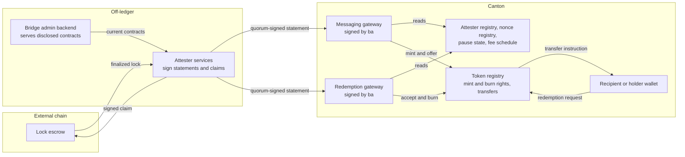
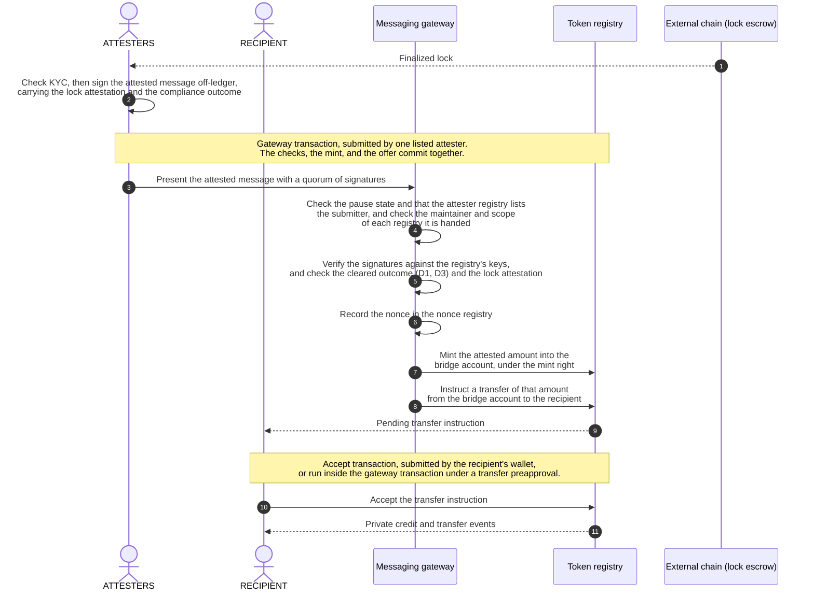
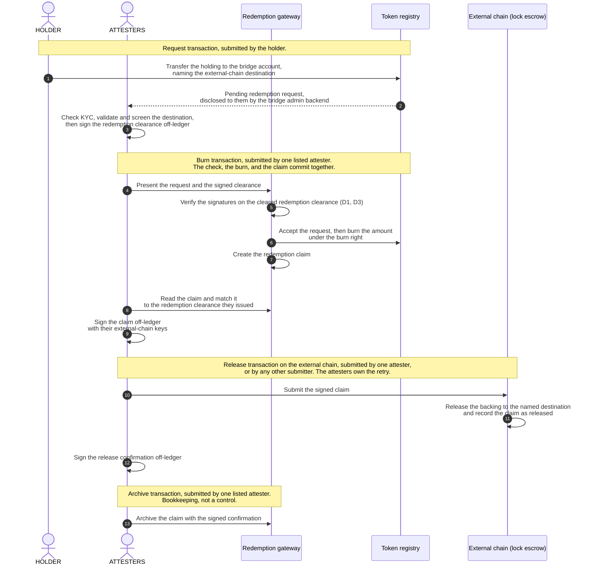

# Cross-Chain Stablecoin Payment Orchestration on Canton

This reference architecture defines the Canton side of a stablecoin bridge,
which this document also calls the "rail". An attested lock on an external
chain mints a wrapped instrument on Canton, and a burn on Canton releases the
backing on that chain. Each inbound credit passes compliance checks before it
is offered, and it lands as a private transfer that the recipient accepts.

## 1. Motivation

Holders accept a wrapped instrument, written wTOK, that the bridge
mints against an attested lock that passed compliance checks. The bridge mints
and burns under a mint right and a burn right that the instrument's token
registry grants it, and it runs every bridge check in its own contracts. wTOK
stands for any instrument whose Token Standard V2 registry grants those two
rights. [Section 4.13](#413-registry-integration) defines everything the bridge
requires of a registry.
The credited amount, the payer and payee identities, and the compliance markers
project only to the authorized parties.

[Section 4.2](#42-business-roles) defines the rail's parties. This document
writes the **bridge admin** as `ba` and the **pause authority** as `pa`.

**Inbound** moves value from the external chain to Canton, by **lock-and-mint**.
**Outbound** moves it back, by **burn-and-release**, with each cross-chain
hop attested by an off-chain attester set ([section 4.6](#46-reserve-and-lock-attestation)).

> NOTE: This document calls the other chain the **external chain** in both directions.

---

## 2. Requirements

- **R1, no stuck or lost funds.** Every deposit locked on the external chain,
  and every holding offered for redemption, eventually ends as value its owner
  holds on one of the two chains: a credit on Canton, a refund to the
  originator, or a release to the holder's destination, less the bridge's fee
  ([section 4.18](#418-fees-and-income)). The exceptions are:
  - a lock or a returned credit held under a freeze that a compliance denial
    requires, whose release is a decision outside the bridge;
  - a redemption whose destination becomes unpayable after the burn
    ([section 8](#8-open-design-questions));
  - a pending credit that a registry seizes, under that registry's rules;
  - a credited holding whose holder's participant unvets the registry's
    packages;
  - a trusted party that fails or misbehaves: the attester quorum, `ba`, the
    wTOK admin, or the escrow ([section 7.2](#72-trust-boundaries)).
- **R2, no unbacked credits.** The wTOK supply the bridge minted never exceeds
  the backing the escrow holds for it
  ([section 4.6](#46-reserve-and-lock-attestation)).
- **R3, compliance.** No value enters or leaves the rail without the controls
  of [section 2.1](#21-institutional-controls).
- **R4, privacy.** A payment's amount and parties reach only the parties of
  [section 4.3](#43-privacy-and-visibility). The external-chain side is public.

[Section 7](#7-requirements-analysis) states how the design meets each
requirement, and [section 7.4](#74-failure-modes-and-recovery) walks R1
through every stage of both flows.

### 2.1 Institutional Controls

We use D1 through D4 as local shorthand for four institutional controls.

| ID | Control | Mechanism | Where enforced | Invariant |
|---|---|---|---|---|
| **D1** | Compliance | Compliance clearance from an N-of-M quorum of listed attesters, in a single-use statement bound to the credit or the request: the cleared compliance outcome of the attested message for a first offer, the re-offer attestation for a re-offer, and the redemption clearance outbound ([section 4.10](#410-control-enforcement)). | The bridge: the messaging gateway before any transfer instruction exists, and the redemption gateway before any burn. | No clearance, no transfer instruction and no burn. |
| **D2** | Seizure | Seizure of a pending credit, implemented by a registry that offers it. | The token registry, optionally ([section 4.13](#413-registry-integration)). The bridge neither requires nor enforces it ([section 4.10](#410-control-enforcement)). | Set by the registry that implements it. |
| **D3** | KYC identity | Each attester service checks off-ledger that the recipient, or outbound the redeeming holder, passed KYC, and the attesters' clearance asserts it. | The attester services, before they sign. The gateways enforce the result through D1. | No KYC, no clearance, no transfer instruction and no burn. |
| **D4** | Authority | Every privileged bridge choice binds to a named role rather than to one admin. | The bridge: each privileged bridge choice, against the role grant or the attester registry entry that carries the privilege. The registry governs its own privileged choices. | Privileges are granted, transferred, and revoked without a redeploy. |

### 2.2 Scope

| Bridge scope | Out of scope |
|---|---|
| The Canton side of the bridge: attested mint, private transfer, and attested burn | The deployment and operation of the attester services, the external-chain lock escrow, external oracles, external-chain validator sets, and light-client proofs |
| The mint and burn rights the bridge asks of a token registry ([section 4.13](#413-registry-integration)) | The token registry itself, its admin's key custody, and any mint path of the registry outside the bridge's grant |
| The gateway checks that deny a credit or a redemption without the attesters' compliance clearance | Compliance and KYC checks that the attester services run before they sign |
| Token Standard V2 (CIP-0112) two-step transfers: the transfer instruction, its accept, and the transfer preapproval that automates the accept | Token Standard V1 (CIP-0056), and the CIP-0112 allocation and settlement-batch path, which the rail does not use ([section 4.5](#45-inbound-credit)) |
| One Canton synchronizer, with a cross-chain boundary outside it | Cross-synchronizer settlement, and parties hosted on another synchronizer |
| One external chain behind the wrapped instrument | Backing one instrument from several external chains, and the per-chain reserve accounting and routing it needs |
| The controls the bridge enforces itself: D1 and D4 ([section 4.10](#410-control-enforcement)) | Seizure (D2), the KYC check itself (D3), registry-side compliance and identity checks, and any control over a wTOK holding after it is credited |

---

## 3. Status Quo

The transfer must credit the recipient with the intended amount or with
nothing. On Canton, the
[CIP-0112](https://github.com/canton-foundation/cips/blob/main/cip-0112/cip-0112.md)
two-step transfer carries that property. A **transfer instruction** fixes the
sender, the recipient, the amount, and the instrument on-ledger when it is
created, and its accept credits exactly that amount in one transaction or fails
as a whole. Each inbound credit is one transfer instruction that its recipient
accepts.

`OpenZeppelin/canton-contracts` holds a [draft registry
implementation](https://github.com/OpenZeppelin/canton-contracts/tree/6a916c174db7d6163ebeea4df1049044cefc7b3c/packages/token/token-cip112-v1/daml/OpenZeppelin/Token/Cip112/V1)
of the Token Standard V2 interfaces, including the transfer instruction. This
document uses it as the example wTOK registry. Its transfers are private
through per-party projection: a counterparty sees only the transfers it sends
or receives. The one deliberate exception is the **instrument admin**, which
signs every holding and transfer instruction of its instrument
([section 4.3](#43-privacy-and-visibility)).

### 3.1 Component Status

An experimental registry package exists in `canton-contracts`, and it serves as
the example wTOK registry. The cross-chain boundary - the messaging gateway,
the redemption gateway, the attested message, and the attested mint - exists
only as the feasibility prototype in
[`experiments/cross-chain-bridge`](../../experiments/cross-chain-bridge/). Its
Daml Script tests run both flows end to end against the registry package, and
its [`README.md`](../../experiments/cross-chain-bridge/README.md) records
where the prototype goes beyond or departs from this design. The prototype
co-signs each attester statement as a contract on Canton, where this design
signs it off-ledger ([section 4.10](#410-control-enforcement)).

Every package below is experimental, apart from the vendored Token Standard V2
interfaces. Each one came out of research for this proposal, so each needs
further analysis and a full audit.

The "Remaining work" column lists only the work this design adds on top of a
component. The prototype has no release path, so the column still counts
every component it covers as remaining work. "Nothing" means the component
already does what this design needs. It does not mean that the component is
complete or audited.

| Component | Location | Remaining work |
|---|---|---|
| Example wTOK registry: the `TokenRules` template, the transfer factory and transfer instruction, holdings, and the event log contract | [`canton-contracts` `token-cip112-v1`](https://github.com/OpenZeppelin/canton-contracts/tree/6a916c174db7d6163ebeea4df1049044cefc7b3c/packages/token/token-cip112-v1) | A mint right and a burn right that the registry grants to `ba` and scopes to the bridge account ([section 4.13](#413-registry-integration)) |
| Compliance path (D1) | [Section 4.10](#410-control-enforcement) | The whole implementation: the EIP-712 types of the attested message, the re-offer attestation, the redemption clearance, and the late denial, the signature check against the keys in the attester registry, and the gateway checks that use them |
| Role grants (D4) | [`canton-contracts` `scoped-authorization-grant-v1`](https://github.com/OpenZeppelin/canton-contracts/tree/aeca01d043311d8ccc8ab7cda4d7c16e682429fa/packages/access/scoped-authorization-grant-v1) | The wiring into each privileged bridge choice |
| Pause state | [`canton-contracts` `pausable-v1`](https://github.com/OpenZeppelin/canton-contracts/tree/aeca01d043311d8ccc8ab7cda4d7c16e682429fa/packages/security/pausable-v1) | The pause state template and its set and clear choices ([section 4.10](#410-control-enforcement)) |
| Transfer preapproval and delegated accept | [Section 4.5](#45-inbound-credit) | The whole implementation |
| Messaging gateway, including batch processing, the deferred offer, and the registry adapter that calls a registry's mint right | [Section 4.5](#45-inbound-credit) | The whole implementation |
| Attested message and nonce registry | [Section 4.6](#46-reserve-and-lock-attestation) | The whole implementation |
| Attested mint, in the gateway transaction | [Section 4.6](#46-reserve-and-lock-attestation) | The whole implementation |
| Redemption gateway, the burn it drives, and the refund of a returned credit, with the return attestation it checks | [Section 4.7](#47-outbound-redemption) | The whole implementation |
| Fee schedule, the fee transfers in both gateways, and the payout of the attester pool | [Section 4.18](#418-fees-and-income) | The whole implementation |
| Identity checks on the pause state, the nonce registry, and the attester registry | [Section 4.8](#48-registry-identity-and-uniqueness) | The maintainer and scope fields of each template, and the gateway checks that validate them |
| Token Standard V2 interfaces | Splice `splice-api-token-*`, vendored as pinned DARs | Nothing. They are consumed by interface |
| Validation tooling | [`daml-lint`](https://github.com/OpenZeppelin/daml-lint), [`daml-props`](https://github.com/OpenZeppelin/daml-props), [`daml-verify`](https://github.com/OpenZeppelin/daml-verify) | The whole validation pipeline. Negative Daml Script tests for every fail-closed path come first: a missing, expired, or unlisted attestation, a signature that does not verify against the registered key, a statement signed for another deployment or another statement type, a replayed nonce, a refund of a nonce already refunded, a refund of a rejected credit without a return attestation, a burn without a cleared redemption request, a submitter the attester registry does not list, and a withdraw, a deferred-offer close, a hold, or a reject without the quorum-signed denial it needs |

---

## 4. Design

### 4.1 Overview

Two things cross the boundary between the chains: a signature from the
attester set, and the nonce of a lock ([section 4.5](#45-inbound-credit)).
Everything else in this design is specific to Canton.

At the center of the rail is the Token Standard V2 transfer instruction, which
moves wTOK privately between accounts. The token registry creates and
completes every wTOK transfer, and the accept that credits the recipient is
the registry's own choice. Supply enters at the attested mint and leaves at
the burn. Both run behind a gateway check
([section 4.10](#410-control-enforcement)), against an attester signature over
an external-chain fact that no Canton check can validate.

Each Canton step below is its own transaction, and no transaction spans both
chains. The attester services orchestrate their submissions off-ledger: they
agree which listed attester submits each step, and another takes over when
the chosen one stays silent past a timeout
([section 7.4](#74-failure-modes-and-recovery)).

**Happy path.** Inbound, the escrow locks a deposit on the external chain. The
attesters sign one statement that attests the lock and clears it for
compliance, and one attester submits it to the messaging gateway. The gateway
checks the signatures, mints the amount into the bridge account, and offers it,
less the bridge's fee, to the recipient as a transfer instruction, which the
recipient accepts. Outbound, the holder offers its holding to the bridge
account and names an external-chain destination. The attesters clear the
request, and one attester submits it to the redemption gateway, which burns
the holding and creates a claim. The attesters sign the claim, and the escrow
releases the backing to the destination.

**Components**

The attesters are M independent organizations that watch the external chain,
check compliance, and sign off-ledger. `ba`, the bridge admin, signs both
gateways and the bridge registries, and holds the mint and burn rights that
the token registry grants the bridge. The gateways run every bridge check in
the transaction that mints or burns. The subsections below define each
component and mechanism.

### 4.2 Business Roles

Canton identifies an actor by a party. The external chain identifies it by an
address. Neither chain records that one address and one party are the same
actor, so no on-ledger check can validate the pairing. An operator that acts on
both chains holds both credentials, and configuration is what keeps them
aligned. The lock attestation ([section 4.5](#45-inbound-credit)) therefore
names the Canton recipient explicitly, and the attester set carries the trust
that the recipient is correct.

"The attesters sign" means two different things. Inbound, the attester party
signs on Canton, and the external chain never sees that signature. Outbound,
the escrow cannot read Canton, so each attester also holds an external-chain
key that the escrow's own verifier accepts.

**Canton parties.** Each one signs a contract or submits a command on Canton. The Code column repeats the short codes that [section 1](#1-motivation) introduces.

| Role | Code | Responsibility and visibility |
|---|---|---|
| Attesters, M of them | - | The trust role, and the rail's submitters. Each holds a wTOK account, where it receives the fixed fee of each transaction it submits and its share of the bridge's income ([section 4.18](#418-fees-and-income)). They sign the attested message, which carries the lock attestation and its compliance outcome. They also sign the re-offer attestation, the redemption clearance, the return attestation, the late denial, each claim, and the no-mint statement. Each attester signs off-ledger with its own signing key ([section 4.10](#410-control-enforcement)). The attester registry lists each attester with its public key. One listed attester, chosen off-ledger, submits each gateway transaction with a quorum of signatures, and the gateway accepts any listed attester as the submitter ([section 7.4](#74-failure-modes-and-recovery)). No attester mints, denies, or freezes alone: each gateway choice that decides an outcome requires a quorum-signed statement, or waits for a deadline or the pause state. They are stakeholders of no transfer instruction. The attester that submits a gateway transaction sees the transfer instruction it creates, and the attesters read the bridge account's transfer events from `ba`'s participants only to bind a returned credit to its lock ([section 4.5](#45-inbound-credit)). |
| Bridge admin | `ba` | The bridge's own admin, and the sole signatory of the messaging gateway and the redemption gateway. It holds the mint right and the burn right that the token registry grants the bridge. It owns the **bridge account**, the registry account where the gateway mints and from which it offers each credit. It maintains the attester registry and the nonce registry that the gateways read ([section 4.10](#410-control-enforcement), [section 4.6](#46-reserve-and-lock-attestation)). Its own transactions are the setup, each registry rotation, and each handover ([section 4.4](#44-decentralization-and-trust-topology)), and it submits nothing on the payment path. It holds the rail's Featured App status as the bridge protocol's party, receives the protocol's app rewards, and shares them with the attesters as the fee schedule sets ([section 4.18](#418-fees-and-income)). It sees every inbound credit as the sender's account owner. |
| wTOK admin | - | The instrument admin of the token registry, and not a bridge role. It grants `ba` the mint and burn rights, signs wTOK holdings and transfer instructions as the registry defines them, and therefore sees every wTOK payment. It holds wTOK's Featured Asset status as the instrument's party ([section 4.17](#417-app-rewards)). Its key custody and its own mint paths are the registry's ([section 4.13](#413-registry-integration)). |
| Recipient, or Holder outbound | - | Inbound, accepts the transfer instruction that offers its credit, live from its wallet or through a transfer preapproval it signed earlier ([section 4.5](#45-inbound-credit)). Outbound, offers its holding to the bridge account with a standard transfer that names the external-chain destination ([section 4.7](#47-outbound-redemption)). |
| Pause authority | `pa` | Holds the pause role grant, and through it sets and clears the pause state. A set pause stops new offers, burns, and refunds ([section 4.10](#410-control-enforcement), [section 7.4](#74-failure-modes-and-recovery)). |

**Off-ledger actors and the external chain.** Each of these submits as one of
the parties above, or it lives on the external chain.

| Role | Responsibility and visibility |
|---|---|
| Lock escrow | External-chain contract that holds the backing for the bridged funds. It releases against a verified redemption or refund claim, presented by any submitter ([section 4.7](#47-outbound-redemption)). |
| Bridge admin backend | Off-Canton process on a participant that hosts `ba`. It serves the attester services, as disclosed contracts, every bridge contract a submission or a read needs: the first version of each bridge contract, the current attester registry, nonce registry, and pause state, each deferred offer, redemption request, and claim, each pending transfer instruction of the bridge account, and each transfer preapproval. It serves the bridge account's transfer events to each attester that reads them through it ([section 4.8](#48-registry-identity-and-uniqueness)). It serves the active pause state to `pa` as a disclosed contract. It submits nothing. |
| Attester services | M independent operators on M participants. Each watches the external chain, runs the compliance and KYC checks before it signs an attested message, a re-offer attestation, a redemption clearance, or a late denial, and submits as its own attester party ([section 4.10](#410-control-enforcement)). They exchange their signatures off-ledger, and they agree off-ledger which one submits each gateway transaction and each external-chain release, and which one takes over when the chosen one stays silent ([section 7.4](#74-failure-modes-and-recovery)). Before it signs a return attestation, each reads the bridge account's transfer events from a participant that hosts `ba`: the bridge admin backend, or another participant that hosts `ba`, operated by a different organization ([section 4.5](#45-inbound-credit)). |
| KYC providers | Off-ledger services that the attester services consult for D3. They observe no transfer. |
| Recipient wallet | Off-Canton process. It accepts pending transfer instructions as the recipient, and it may create a transfer preapproval so that the gateway can complete a credit without a live accept. |

The gateways and the registries are contracts, not services. The messaging
gateway and the redemption gateway have the choices that a listed attester exercises
([section 4.5](#45-inbound-credit), [section 4.7](#47-outbound-redemption)).
The pause state, the attester registry, and the nonce registry reach the
gateway as disclosed contracts
([section 4.8](#48-registry-identity-and-uniqueness)). The attester statements
are not contracts: each is a typed message that the attesters sign off-ledger,
and the gateway transaction that uses it carries it with its signatures
([section 4.10](#410-control-enforcement)). The lock attestation and its
compliance outcome are records inside the attested message, so an attester
signs the message rather than a standalone attestation.

### 4.3 Privacy and Visibility

The table below gives one row per contract. The signatories and the observers of
a contract are the only parties that see it. The first four rows are the token
registry's contracts, and the registry decides their exact stakeholders; the
rows show the example registry. Every other contract belongs to the bridge. A
party that a row does not name sees the contract only transiently, when a
transaction it witnesses divulges it. The attester statements are not
contracts, so they have no row: each reaches the ledger only as an argument of
the gateway transaction that uses it, which `ba` and the submitting attester
see ([section 4.10](#410-control-enforcement)).

| Contract | Signatories | Observers |
|---|---|---|
| Inbound transfer instruction, and the factory call that creates it | The wTOK admin and `ba`, as the owner of the sender's account | The recipient |
| Redemption request, the holder's transfer instruction to the bridge account | The wTOK admin and the holder | `ba`, as the owner of the receiver's account |
| Event log contract, created and archived in one transaction | The wTOK admin | None |
| wTOK holding, in the bridge account, a fee account, or the recipient's | The wTOK admin and the account's parties | The lock's observers, while locked |
| Attester registry | `ba` | None. A listed attester reads it through disclosure ([section 4.10](#410-control-enforcement)) |
| Pause state | `ba` | None |
| Fee schedule | `ba` | None. A listed attester reads it through disclosure |
| Pause role grant | `ba` | The current `pa` |
| Redemption claim, and the refund claim | `ba` | None. An attester reads it through disclosure ([section 4.7](#47-outbound-redemption)) |
| Messaging gateway | `ba` | None. A listed attester exercises its choices through disclosure |
| Deferred offer | `ba` | None. A listed attester converts or closes it through the messaging gateway ([section 4.5](#45-inbound-credit)) |
| Redemption gateway | `ba` | None. A listed attester exercises its choices through disclosure |
| Transfer preapproval, when the recipient creates one | The recipient | `ba`, the party it names to exercise it inside the gateway ([section 4.5](#45-inbound-credit)) |
| Nonce registry | `ba` | None. An attester reads it through disclosure ([section 4.10](#410-control-enforcement)) |

Consequences:

- **No recipient sees another recipient's credit.** Each transfer instruction
  names one recipient and projects to that recipient alone, so concurrent
  inbound payments disclose nothing to each other.
- **The wTOK admin sees every wTOK payment.** It signs every transfer
  instruction and every holding of its instrument, so the amounts, the
  accounts, and the transfer metadata of every payment reach it in the update
  stream. Any issued instrument gives its issuer the same view, so the design
  treats it as a trust assumption, not as a leak to close. `ba` sees every
  inbound credit as the owner of the sending account. The attesters see what
  they handle. The attester that submits a gateway transaction sees the mint,
  the transfer instruction, and the terms of any preapproval the transaction
  exercises, and the attesters that sign a statement see its content
  off-ledger. The
  attesters also read the bridge account's transfer events, so they learn how
  each credit ended. Choosing the attesters is
  therefore a privacy decision as well as a compliance one.
- **Transfer outcomes arrive as events, not as active contracts.** The
  example registry reports each holdings change by exercising the Token
  Standard V2 `EventLog_HoldingsChange` choice on a short-lived `EventLog`
  contract that it creates and archives in the same transaction. The event data
  is the choice's argument, so it reaches its observers as an exercised event on
  the Ledger API update stream and never appears in the active contract set.
  Integrators read that stream ([section 4.15](#415-off-ledger-reconciliation)).
  The durable evidence of a credited payment is the recipient's holding.
- **No personal data on the ledger.** An attester statement carries the
  attesters' KYC verdict and not personal attributes. The KYC data stays with
  the KYC providers and the attester services.

### 4.4 Decentralization and Trust Topology

Each posture below states how many independent organizations stand behind one
party. Canton offers three routes to an N-of-M posture, and the choice between them is
open ([section 8](#8-open-design-questions)):

- **On-ledger approval workflow.** The multisig is written in Daml, as a
  [Multiple Party
  Agreement](https://docs.canton.network/appdev/modules/m3-design-patterns#multiple-party-agreement).
  The approvals are durable, named, and auditable on-ledger.
- **External party with threshold signing keys.** The role party's transactions
  require N of M keys held by independent organizations. The Daml code never
  sees this, and each action costs one ledger transaction. The [Bitsafe
  decentralization-manager](https://github.com/DLC-link/decentralization-manager)
  is one candidate implementation.
- **Multi-hosted party with a confirmation threshold.** The role party is
  hosted on M participants that independent organizations operate, and N of
  them must confirm each transaction. The trust sits with the participant
  operators rather than with key holders, and the party needs another party's
  submission or external signing to act.

**Decision.** `ba` creates wTOK supply at the attested mint, through the mint
right the registry grants it, and it owns the bridge account where minted and
returned credits sit. No single key may therefore exercise the role. `ba` also
holds everything that decides whether bridge-minted supply is legitimate: the
mint right, the attester registry that every gateway check reads, and the
nonce registry that limits each lock to one mint
([section 4.6](#46-reserve-and-lock-attestation)). Moving either registry to
another party would add a second key that can break the reserve without being
able to mint. The design therefore keeps all three with `ba`, and protects
`ba` with the N-of-M posture in the table below.

The table sets each role's posture, the organizations behind it, and who
submits in its name. A party with a threshold above 1 submits nothing itself
on the payment path, so the third column shows who submits for it in the
flows of [section 4](#4-design).

| Role | Target posture | Who submits in its name |
|---|---|---|
| Attesters | M parties, one per independent attester organization, each on its own participant and with its own signing key. The attester registry lists them with their keys, and every check requires N of M signatures, never all of M | Each attester service submits as its own party. The attester services agree off-ledger which one submits each gateway transaction, and another takes over after a timeout |
| `ba` | N-of-M across independent organizations, by one of the three routes above. The route, N, and M are open ([section 8](#8-open-design-questions)) | Nothing on the payment path: its authority enters each gateway transaction as the gateway's signatory ([section 4.5](#45-inbound-credit)). Registry rotations and the creation of the gateways are its own transactions, externally signed or run through the approval workflow |
| wTOK admin | Set by the token registry, not by the bridge | The registry's own operations |
| `pa` | One party, multi-hosted, confirmation threshold 1, held by organizations other than the attester organizations | Any host submits a pause or an unpause directly |
| Recipients | No rail-side decentralization | The recipient's wallet, live or through the transfer preapproval that the gateway exercises |

**Role setup.** Each role's setup decides what it is trusted with, what traffic
it pays, and what it costs to deploy.

| Role | Trusted with | Traffic it pays | Deployment cost |
|---|---|---|---|
| Attesters | As a quorum, every external-chain fact, compliance verdict, and KYC verdict, so a colluding quorum can mint unbacked supply or release live backing. One attester alone can only delay a step | Nearly every Canton transaction, each paid by the attester that submits it and repaid by the fixed fee ([section 4.18](#418-fees-and-income)) | Per attester, a participant, a signing key, and an external-chain key that the escrow accepts. Across the set, the off-ledger channel for signatures and submitter selection |
| `ba` | The mint and burn rights, the bridge account, both registries, the fee schedule, and the bridge's income, so a compromised quorum of its keys can mint unbacked supply | Its own setup, rotations, and payouts, which are rare | The N-of-M setup across organizations, the participants that host it, the bridge admin backend, and the Featured App CC lock ([section 4.17](#417-app-rewards)) |
| wTOK admin | Every holding of its instrument, so it can mint outside the bridge | Its own registry operations | The registry, the mint and burn grant to `ba`, and wTOK's Featured Asset CC lock |
| `pa` | Stopping the supply paths at once, with no quorum in front of it, so a party outside the attester set can stop a compromised quorum. A malicious `pa` stalls the rail until `ba` revokes its grant | Pause flips only | One multi-hosted party held by organizations outside the attester set |
| Recipient or holder | Its own keys and participant | A live accept, or a redemption request | A wallet that speaks the Token Standard, and optionally a transfer preapproval |

The attester set is the main lever. A larger M keeps the rail live through
more attester outages, and a larger N spreads the trust over more
organizations. Signatures travel off-ledger, and each statement costs one
gateway transaction whatever N is, so M and N move trust and coordination
cost, not traffic. Each added attester adds a participant, keys, and a share of
the attester pool.

### 4.5 Inbound Credit

Three steps carry a finalized external-chain lock to a credited wTOK holding.
The attesters sign step 1 off-ledger. One listed attester submits step 2, for a batch of
locks at once. The recipient submits step 3, or the gateway transaction of
step 2 runs it under a transfer preapproval the recipient signed earlier.

**Inbound credit**

1. **Attested message.** The external chain finalizes a locked deposit. The
   attesters sign an **attested message**, the typed statement that carries
   the **lock attestation**: the
   locked amount, the Canton recipient, the target instrument, the lock's
   nonce, and an expiry. The nonce is the escrow's sequence number, which
   increases by one per lock. The rail serves one chain
   ([section 2.2](#22-scope)) and the nonce registry is scoped to one
   instrument ([section 4.8](#48-registry-identity-and-uniqueness)), so the
   nonce alone identifies a lock.

   The same message carries the **compliance outcome** for the credit that
   the lock will become: cleared, or denied with a denial reference. Each
   attester service signs only after its off-ledger checks reach that
   outcome: it screens the lock's originator on the external chain and checks
   the recipient's KYC. The outcome binds to the lock's content, the
   recipient, the amount, the instrument, and the nonce, because one
   signature covers both records. The lock attestation fixes all four before
   any transfer instruction exists, so the outcome needs no contract id to
   bind to. That is D1 and D3 ([section 4.10](#410-control-enforcement)). Each
   attester signs the message off-ledger, and the attester services collect
   the signatures until N listed attesters have signed
   ([section 4.10](#410-control-enforcement)). One listed attester presents the
   message with those signatures at step 2.
2. **Gateway transaction.** The **messaging gateway**, the contract whose
   choices a listed attester exercises to bring a message onto the rail, runs
   every bridge check in one choice, and each check fails closed:

   - the pause state is clear, and the attester registry lists the submitter;
   - at least N listed attesters signed the message, each signature verifying
     against the key the attester registry lists, and its compliance outcome
     is cleared, which is D1 and D3;
   - the lock attestation passes the mint checks, and the nonce registry does
     not hold its nonce ([section 4.6](#46-reserve-and-lock-attestation)).

   The choice then records the nonce in the nonce registry, so the message
   cannot be replayed. It mints the attested amount
   into the bridge account under the mint right that the registry grants
   `ba`, and pays the bridge's fee out of it
   ([section 4.18](#418-fees-and-income)). It then exercises the registry's
   `TransferFactory_Transfer` to create a **transfer instruction**: the Token
   Standard V2 contract that offers a pending transfer to its receiver. The
   sender is the bridge account, the receiver is the recipient's account, the
   recipient and the instrument bind to the lock attestation, and the amount
   is the attested amount less the fee. The
   instruction's metadata carries the lock's nonce under the key
   `bridge.reference.openzeppelin.com/lock-nonce`, which is the value a
   recipient later matches its transfer events against
   ([section 4.15](#415-off-ledger-reconciliation)). The minted holding stays
   locked in the instruction until the instruction resolves.

   `ba`'s authority comes from the gateway it signs, and it covers both the
   mint and the sender's side of the transfer. The recipient's participant
   therefore confirms nothing at this step, and a recipient that is offline
   sees the offer when it returns. The bridge account is the sender, so the
   standard's withdraw belongs to `ba`, and a listed attester exercises it
   through a gateway choice that carries `ba`'s authority. The gateway
   withdraws any instruction after its deadline, and before the deadline only
   against a quorum-signed late denial or while the pause state is set
   ([section 4.10](#410-control-enforcement),
   [section 7.4](#74-failure-modes-and-recovery)).
3. **Accept.** The recipient's wallet exercises the standard's
   `TransferInstruction_Accept`, the one choice that credits. The accept is
   the registry's own code and runs no bridge check, because every bridge
   check ran at step 2. A wallet that speaks the standard accepts a bridge
   credit as it accepts any other pending transfer, and the registry's
   choice-context endpoint supplies whatever its own accept needs. The accept
   moves the locked holding into the recipient's account in one transaction,
   or fails as a whole, and the registry's transfer events report the credit.

   An offline corporate treasury cannot accept interactively. Its wallet may
   pre-establish a **transfer preapproval**: a recipient-signed bridge
   contract that lets `ba` exercise the standard accept with the recipient's
   authority. The gateway exercises it with the `ba` authority it carries, so
   any listed attester that submits a gateway transaction runs the accept,
   and a rotation of the attester set leaves the preapproval valid. When a
   preapproval exists, the gateway transaction of step 2 accepts the
   instruction it creates in the same transaction, so the credit takes one
   attester-submitted transaction. A preapproval that arrives after the offer
   runs through a gateway choice of its own. The preapproval is an
   optimization and not a prerequisite: a recipient without one is credited
   when it accepts, and the instruction waits for it until its deadline.
   Canton Coin's transfer preapproval is the reference shape, and it covers
   Canton Coin only, so the bridge defines its own. It calls only the
   standard accept, so it works with any registry. The preapproval bounds
   what it authorizes: the instrument, an amount ceiling, an expiry, and the
   party that may exercise it, which is `ba`. The recipient signs it, so it can
   archive it at any time.

   The recipient can also reject. A rejected or withdrawn instruction
   returns the locked holding to the bridge account in the same transaction,
   by the standard's own semantics, and a lapsed one stays locked inside the
   instruction until an attester withdraws it through the gateway
   ([section 7.4](#74-failure-modes-and-recovery)).
   [Section 4.6](#46-reserve-and-lock-attestation) sets what happens to a
   returned holding.

**One attester statement per lock.** The compliance outcome binds the same
content as the lock attestation, so the attesters sign both in one attested
message ([section 6](#6-alternatives-considered)). The re-offer of a
returned credit ([section 4.6](#46-reserve-and-lock-attestation)) and the
redemption request ([section 4.7](#47-outbound-redemption)) each get a
statement of their own, because no attester statement already carries their
content. The re-offer attestation has no outcome field: the quorum signing it
approves the re-offer, and a quorum that does not approve signs nothing, so
the refund follows. The redemption clearance carries an outcome like the
attested message, because a denied request must be rejected, and the gateway
rejects only against a quorum-signed denial.

**Delivery and retry.** Nothing guarantees that the Canton credit of an
attested lock executes. Delivery depends on the attester set, and this
design adds no automatic cross-chain recovery protocol: re-driving a credit
from the external chain would need multi-round message passing, with its own
delay, cost, and failure modes. The attester services agree off-ledger which
attester submits each step, so two attesters rarely submit the same one. When
they do, the gateway records each nonce once, so the duplicate fails and
changes nothing ([section 7.4](#74-failure-modes-and-recovery)). An attester
service needs no command-id state machine. It reads the next step from the
statements the quorum has signed and from the bridge's active contracts, which
its participant holds or the bridge admin backend serves by disclosure, keyed
by the lock's nonce:

- a quorum-signed attested message for a nonce the registry does not hold
  calls for the gateway transaction when its outcome is cleared, and for a
  close when it is denied;
- a deferred offer calls for its conversion, or for a close at its deadline;
- a pending instruction and a transfer preapproval call for the delegated
  accept;
- a returned holding in the bridge account calls for a refund or a re-offer.

An instruction without a preapproval waits for its recipient and needs nothing
from the attesters until its deadline. After a restart an attester service
re-reads the set and continues, as Splice's own trigger-based automation does. A timeout that refunds the
external-chain lock is the escrow's own path, and the escrow is out of scope
([section 2.2](#22-scope)). The condition for that refund is in scope, because
it decides whether one lock pays out twice.

**Batches and deferred offers.** The submitting attester takes the open locks
in nonce order and submits them in batches. One gateway transaction runs the
checks of step 2 for every message in its batch and writes the nonce registry
once ([section 4.14](#414-throughput-and-contention)). A check that fails for one
message fails the whole batch, and the attester resubmits the batch without
that message. A recipient's participant can fail a batch too. A transfer
instruction makes its recipient an informee, and Canton rejects a transaction
when an informee's participant has not vetted the packages it uses. A
delegated accept also needs the recipient's participant to confirm. The
attester then resubmits the same batch in a second form, which creates a
**deferred offer**
for each credit in place of a transfer instruction. A deferred offer is a
bridge contract that only `ba` signs, and it records the lock's nonce, amount,
recipient, and a deadline. The second form runs every check and records each
nonce as deferred. It mints nothing, and no
recipient sees it. A listed attester later converts each deferred offer on its
own, through a gateway choice that mints the amount and creates the transfer
instruction as step 2 does, so a recipient's participant delays only its own
credit. An attester closes a deferred offer that is still open at its
deadline, and the never-minted refund below follows.

**Refund exclusivity.** A refund on the external chain must never pay out a
lock whose credit stands on Canton, and no mint may follow a refund. A lock
reaches a refund from one of two states, each with its own rule. A third case
holds the lock instead of refunding it.

- **Never minted.** The attesters never signed, the attested message carries
  a denied outcome, the lock attestation expired before a gateway
  transaction, or a deferred offer was never converted. The
  escrow refunds only against a **no-mint statement**, signed by an attester
  quorum, that the bridge never minted against the lock. An expired
  attestation does not settle that, because the attesters can still issue a
  fresh one that mints. The nonce must therefore first be recorded as closed
  on Canton. An attester presents the attested message to a close choice of
  the messaging gateway, which records the nonce as closed. The
  gateway closes against a message with a denied outcome at once, and one with a
  cleared outcome only after its lock attestation expires. It closes a
  deferred offer at once against a quorum-signed late denial
  ([section 4.10](#410-control-enforcement)), and otherwise only at the
  offer's deadline, which records the nonce as closed the same way. For a lock that has no attested message, the attesters sign one
  with a denied outcome for the close. A nonce that the registry already holds keeps its
  record, so a close never overwrites a mint. The gateway refuses any nonce
  the registry holds, so a closed nonce never mints, and the attesters issue
  no new lock attestation for it. Each attester signs the no-mint statement
  only after it reads the nonce as closed in the nonce registry, through
  disclosure ([section 4.10](#410-control-enforcement)), and none signs it when
  the denial requires a freeze.
- **Minted, then returned.** The recipient rejected the offer, the gateway
  withdrew it, or the registry expired it, so the minted holding is back in the bridge
  account. The bridge refunds it through the redemption gateway, which burns
  the lock's recorded amount under the burn right, marks the nonce refunded in the
  nonce registry, and creates a **refund claim** that names the lock's nonce,
  all in one transaction ([section 4.7](#47-outbound-redemption)). The escrow
  releases a refund claim only to the address that funded that lock, and only
  once per lock. A refunded nonce never mints again, because the gateway
  refuses any nonce the nonce registry holds.
- **Held.** A denial that requires a freeze, for example a sanctions hit on
  the originator, must not refund the denied party. The attesters withhold the
  no-mint statement or the refund claim, so the backing stays in the escrow. A
  minted credit that returns under such a denial is still burned: an attester
  burns the returned holding through the redemption gateway and marks the
  nonce held, with no claim. The hold runs only against a quorum-signed late
  denial that requires a freeze ([section 4.10](#410-control-enforcement)).
  Supply then stays below the backing. Releasing a held lock is a decision
  outside the bridge.

The escrow already verifies attester signatures for a redemption release
([section 4.2](#42-business-roles)), so both refund paths reuse that verifier.

The ledger binds a returned holding to its lock only when the gateway withdraws
the offer. The withdraw records the returned holding against
the lock's nonce ([section 4.6](#46-reserve-and-lock-attestation)), and a
refund or a re-offer of that nonce must name that holding. When the recipient
rejects or the registry expires the instruction, no bridge contract sees the
return. The binding then exists only in the bridge account's transfer events
on the update stream ([section 4.3](#43-privacy-and-visibility)), so the
attester services read it there and an attester quorum signs it as a **return
attestation**. Each attester service reads the events from a
participant that hosts `ba`, matches the holding that the reject or the expiry
returned to the instruction the gateway created for the lock's nonce, and
signs the nonce, the holding's contract id, and its amount. The attesters
spread their reads over participants that host `ba` and that different
organizations operate, and no one host should serve N of them, so false events from one host cannot reach a quorum.
A refund or a hold of a nonce recorded as minted presents a return attestation
for the holding it names, checks that the holding carries the lock's recorded
amount, and consumes the holding, so the attestation serves once. A wrong binding can therefore only swap
two locks of the same amount. It refunds one lock with value that the other
lock returned, and it can refund a lock whose credit stands. It needs a
colluding quorum, or false events from hosts of `ba` that together serve N
attesters, so it rests on the trust in the attester set and in `ba`
([section 7.2](#72-trust-boundaries)). The reserve still holds, because each
refund burns its amount before the escrow releases it, so the loss falls on
the originator whose returned value was spent.

**Inbound refund**

### 4.6 Reserve and Lock Attestation

[Section 4.5](#45-inbound-credit) credits the payment. This section ties that
payment to the backing on the external chain.

**Attestation.** The lock attestation states that the escrow received a given
amount under a given nonce, and that only one mint of the same amount on Canton
may credit that deposit. No Canton contract can check either fact, so the
attester set carries the trust in both. An N-of-M quorum signs the attestation
([section 4.4](#44-decentralization-and-trust-topology)), and the attester
that presents it adds no trust of its own: the gateway counts the quorum's
signatures, not the submitter's.

**Mint checks.** The gateway runs the mint on-ledger and rejects the attestation
unless:

- at least N distinct attesters that the attester registry lists signed it,
  and each of those signatures verifies against the key the registry lists
  for its signer. A signer it does not list, such as an attester a rotation
  removed after it signed, does not count, and the statement stays valid
  while N listed signatures remain;
- the message's compliance outcome is cleared;
- the attestation has not expired;
- the amount, recipient, and instrument of the mint and the offer match it;
- the nonce registry does not already hold the lock's nonce.

The mint runs inside the gateway transaction of
[section 4.5](#45-inbound-credit), so a failed check rolls back the whole
gateway transaction. Nothing is minted and nothing is offered. For a deferred
offer, the checks run in the batch that creates it, and the conversion mints
against the deferred record without a second attestation.

**Nonce registry.** The gateway fetches the registry on-ledger and writes the
lock's nonce ([section 4.5](#45-inbound-credit)) in the transaction that mints.
A nonce is in one of six states: deferred, minted, returned, closed without a
mint, refunded, or held. Deferred, minted, and returned record the amount
offered to the recipient, which is the locked amount less the fee, and the
recipient. Minted and returned also record whether the credit was
already offered once more. Returned also records
the holding that a gateway withdraw brought back to the bridge account, the
ledger time of that withdraw, and the late denial it carried, if any.
Each registry version carries every nonce of the one it replaces. The
registry's scope fields name one instrument, one **epoch**, and the epoch
size `E`: an epoch is a fixed range of `E` consecutive nonces. The registry
records a nonce only if the nonce divided by its own `E` gives its epoch, and
the gateway checks that the registry it is handed carries the epoch of the
nonce it processes ([section 4.8](#48-registry-identity-and-uniqueness)).
Every writer therefore maps a nonce to its epoch with the same `E`, and no
gateway carries a value of its own. No registry holds more than `E` nonces,
which is what keeps the bytes of a mint bounded
([section 4.14](#414-throughput-and-contention)).

`ba` creates the registry of the first epoch and fixes `E` there. Each later
epoch's registry is created by the first transaction that writes its
predecessor, in the same consuming exercise and with the same `E`, and the
predecessor records that its successor exists.
Each registry version is consumed once, so each epoch gets exactly one
registry. A nonce whose epoch has no registry yet has nothing to check against and is
rejected, and the submitting attester retries after a write to the
predecessor creates it. `E`
exceeds the number of locks that can be in flight at once, so an epoch's
registry exists before its first lock reaches the gateway. A settled epoch's
registry stays active, because a later refund or close of one of its nonces
writes it.

**Returned credits.** The nonce registry records mints, not credits. An
instruction that is rejected, or that the registry expires, returns its
holding to the bridge account, and the nonce stays recorded as minted. An
instruction that the gateway withdraws, before or after its deadline, returns
its holding the same way, and the withdraw records the nonce as returned with
that holding. A refund or a hold accepts a minted or a returned nonce. It
checks that the holding carries the lock's recorded amount. For a returned
nonce it checks that the holding is the recorded one, and for a minted nonce
it requires a return attestation that binds the holding to the nonce
([section 4.5](#45-inbound-credit)). A hold also needs a quorum-signed freeze:
either the returned record carries a late denial that requires a freeze, or
the hold presents such a late denial itself
([section 4.10](#410-control-enforcement)). An attester refunds the holding by
default ([section 4.5](#45-inbound-credit)). A reject, a compliance denial,
and an ordinary expiry all end in a refund, or in a hold when a denial
requires a freeze. Returned value therefore leaves the bridge account
promptly, and no credit cycles through repeated offers.

**Re-offer.** The one exception to the prompt refund is an instruction that
expired while the rail could not deliver it: its deadline lapsed during a
synchronizer outage or while the pause state was set. An attester offers that
holding once more to the same recipient, and refunds it if that offer also
returns.
The gateway choice checks that the nonce is recorded as returned with that
holding and was not offered once more before. The nonce registry already holds
the nonce, so the attested message cannot carry a second offer, and the
re-offer needs a fresh **re-offer attestation**, which the attesters sign for
the returned credit alone. Signing it states both that the rail caused the
lapse and that the credit still clears compliance, and a quorum that approves
neither signs nothing, so the refund follows. It binds the nonce, the
recipient, the amount, the instrument, and the returned holding. The gateway
checks that it names the recorded recipient, amount, and holding. The returned
holding does not exist before the withdraw, so an attestation signed before
the withdraw cannot carry the re-offer, and the re-offer consumes the holding,
so the attestation carries one re-offer
([section 4.10](#410-control-enforcement)). The
re-offer records the nonce as minted again and as offered once more, so a
second return ends in a refund or a hold. The ledger does not record that a
deadline lapsed during an outage or a pause, so whether a returned credit
qualifies is the attesters' decision when they issue that attestation. The
exception exists so that one infrastructure incident does not refund every
payment in flight. It applies
only to a lapse the rail caused, and never to a guess about what the recipient
wanted.

Attesters read the nonce registry before they sign a lock attestation, and
they decline a nonce that the registry already holds. The gateway's check is
the safety control, so an attester that cannot reach the registry still
signs.

**Reserve invariant.** The backing is one balance: every deposit the bridge
minted against, less every redemption and every refund the escrow released.
The wTOK supply that the bridge minted never exceeds it. A mint adds one
deposit amount to both, and a redemption or a refund of a returned credit
removes one burn amount from both. Supply in the bridge account, locked in a
pending offer or returned from one, counts like any other supply. A held lock
burns its supply and keeps its backing, so the backing exceeds the supply by
every held amount. A fee is wTOK that a deposit already backs, so paying it
moves supply between accounts and changes neither balance. A refund of a
returned credit therefore releases less than the deposit, and the difference
keeps backing the fee holdings ([section 4.18](#418-fees-and-income)). **Because
the escrow holds the backing as one balance, the invariant means the escrow
can pay out every burn.** The invariant covers the whole instrument only if
the bridge's mint right is the instrument's only mint path, which the registry
decides ([section 4.13](#413-registry-integration)).

### 4.7 Outbound Redemption

Redemption mirrors the inbound flow. Inbound, the bridge offers a credit and
the recipient accepts it. Outbound, the holder offers its holding to the bridge
account, and the bridge accepts and burns it once the attesters clear the
request. The attester quorum then signs the claim, and the escrow releases the
backing on the external chain.

Four steps carry a redemption request to a release of the backing. The holder
submits step 1, a Canton transaction. The attesters sign step 2 off-ledger, and
one listed attester submits step 3, a Canton transaction. Step 4 is an
external-chain transaction that one attester makes, or any other submitter,
with the claim the attesters sign off-ledger. After the release, the attesters
sign a release confirmation, and one of them archives the claim with it, which
is bookkeeping and not a control.

**Outbound redemption**

1. **Request.** The holder makes a standard `TransferFactory_Transfer` of the
   holding to the bridge account, with the external-chain destination in the
   transfer's metadata under the key
   `bridge.reference.openzeppelin.com/redeem-destination`. The registry leaves
   it as a pending transfer instruction, the **redemption request**: the
   holding is locked and has not moved. The bridge account holds no transfer
   preapproval, so no request completes before the bridge accepts it, and the
   holder can withdraw its request until then. The destination is the field
   the escrow acts on, so this design assumes the holder's wallet renders the
   amount and the destination in clear before the holder signs.
2. **Redemption clearance.** `ba` observes each request as the receiver's
   account owner, and the bridge admin backend serves it to the attester
   services by disclosure. Each attester service checks the holder's KYC,
   validates and screens the destination off-ledger, and only then signs.
   The attesters sign a **redemption clearance** off-ledger, as they sign
   every attester statement ([section 4.10](#410-control-enforcement)), until a
   quorum has signed it.
   The clearance binds the request: the holder, the amount, the instrument,
   the destination, and the request's contract id. It carries an outcome:
   cleared, or denied with a denial reference. One listed attester presents
   it at step 3. That is D1 and D3 outbound
   ([section 4.10](#410-control-enforcement)).

   **An invalid destination.** The burn is irreversible, so the destination
   has to be payable before it. The gateway cannot parse an external-chain
   address, so each attester service checks it before it signs the
   redemption clearance, and the gateway enforces the result through D1,
   because the clearance binds the destination the request names. A
   destination fails the check if it is:

   - malformed for the external chain: the wrong encoding, length, or
     checksum, or an address format of another chain;
   - an address the escrow refuses: the null address, the escrow itself, or
     the backing token's contract;
   - an address the backing token refuses to pay, such as one on the token
     issuer's blocklist.

   A destination that fails gets a clearance with a denied outcome, and the
   rejection of step 3 returns the holding to the holder. The escrow repeats the checks it can
   make on its own chain, so a release to a refused address reverts and the
   claim stands. A destination that becomes unpayable after the burn, for
   example one the token issuer blocklists later, leaves a standing claim
   that no submitter can release. This design has no path that redirects
   such a claim ([section 8](#8-open-design-questions)).
3. **Burn.** Once a quorum has signed a cleared redemption clearance, a
   listed attester exercises the **redemption gateway**, the outbound
   counterpart of the messaging gateway, which carries `ba`'s authority. In
   one transaction of its own it checks that the pause state is clear and
   that the attester registry lists the submitter, verifies the redemption
   clearance's signatures, accepts the request as the receiver, pays the
   bridge's fee out of it ([section 4.18](#418-fees-and-income)), burns the rest under the
   burn right that the registry grants `ba`, and creates the
   **redemption claim**, which carries:

   - the instrument the burn removed supply from;
   - the amount the burn destroyed, which is the amount the escrow releases;
   - the Canton holder whose request the burn consumed;
   - the external-chain destination the holder named;
   - the **request id**, which is the contract id of the redemption request
     the burn consumed, as the redemption clearance binds it.

   The instrument and the amount bind the reserve arithmetic. The other three
   identify the redemption, as the lock attestation identifies a deposit
   ([section 4.5](#45-inbound-credit)). The escrow records the request id when
   it releases the claim, so an auditor can match each release to one Canton
   burn and one holder.

   On a denial, a listed attester rejects the request through the same
   gateway, which verifies a clearance with the denied outcome and puts its
   denial reference in the rejection's metadata, and the holding returns to
   the holder. The gateway rejects a request only against such a clearance. A request that nobody decides is withdrawn by the holder, who
   signs it as the sender, which also returns the holding. Nothing burns
   without a cleared request.

   **A claim without a burn.** The escrow relies on a burn behind every claim,
   and the ledger does not enforce it. `ba` alone signs the claim, because the
   holder's authority does not reach the transaction that accepts its request.
   `ba` could therefore create a claim directly, with no burn behind it, and
   the escrow, which sees only a signed message, could not tell. The attester
   backend limits that: an attester signs a claim only if it matches a
   redemption clearance the attester issued, and only once per clearance.
   A claim with no burn therefore needs a real, cleared request, and it pays
   only the destination the holder named. The holder's holding stays
   unburned, so value leaves twice only if the holder colludes with `ba`. The
   rest is the trust in `ba` ([section 7.2](#72-trust-boundaries)).

   **Refund of a returned credit.** The refund claim of
   [section 4.5](#45-inbound-credit) runs through the same gateway without a
   request and without a redemption clearance: the attesters sign it against
   the nonce registry. A holding that a reject or a registry expiry returned also needs the return attestation that binds it to the lock.

4. **Release on the external chain.** The release is one external-chain
   transaction, and it needs the attesters' signatures on the claim, which
   they give off-ledger and not in a transaction on either chain:

   - **Attest.** An N-of-M quorum of listed attesters signs the claim
     off-ledger, as it signs every attester statement. The escrow verifies that quorum with its own verifier
     ([section 4.2](#42-business-roles)). No attester is a stakeholder of the
     claim. The bridge admin backend hands each new claim to the attester
     services as a disclosed contract, and each attester reads it as it reads
     the registries ([section 4.10](#410-control-enforcement)). An attester
     therefore signs only an active claim, and the burn never waits on an
     attester's participant.
   - **Release.** One attester, chosen off-ledger as for Canton submissions,
     presents the signed claim to the escrow. The attester services also make
     each signed claim available to the holder, so the holder can present it
     itself when no attester does. The escrow releases the amount to the
     external-chain destination and
     decrements the reserve by the same amount, so the backing and the supply
     move together. A redemption burns any amount up to the holder's holding,
     so the escrow releases any part of the pooled backing. A refund releases
     the burned amount, which is the deposit less the inbound fee, to the
     address that funded the lock, and a no-mint statement releases the whole
     deposit.

**Cross-chain atomicity.** The external-chain release does not sit in the same
Daml transaction as the Canton burn, so the order is burn first and attested
release second. The Canton burn is the irreversible commit, and the release
needs the signed attestation. That order assumes an external chain where any
submitter can claim the release, against escrow state that the escrow committed
before the burn.

Under that assumption, a stalled release is safe. The burn stays final, the
reserve accounting stays sound, and the redemption becomes a standing claim that
nobody can replay. The escrow records each claim it releases, so replay
protection for the outbound direction sits there, as the nonce registry
sits on Canton for the inbound one. The attesters own the retry, and the claim
is permissionless, so the holder or any other submitter can present it until
the escrow releases. A stalled release therefore costs time, but it never
causes a double-spend or unbacked supply.

The claim contract stays active on Canton until a listed attester archives it
through the redemption gateway, under the authority of an attester quorum that
confirms the escrow released it. The release confirmation is an attester
statement like the others ([section 4.10](#410-control-enforcement)). The
archive is bookkeeping, not a control, because the escrow refuses a second
release either way.

### 4.8 Registry Identity and Uniqueness

The gateway reads four bridge contracts at execution time: the pause state,
the attester registry, the nonce registry, and the fee schedule. The submitting attester is a
stakeholder of none of them, so its participant does not hold them. It
attaches each one as a disclosed contract and passes its contract id into the
gateway choice. A disclosed contract needs its created-event blob, and a
contract id alone does not let a participant use it. `ba` signs every version
of every bridge contract, so the bridge admin backend serves the current
version of each to the attester services: the first version of every bridge
contract, each rotation of the attester registry, each flip of the pause
state, each new version of the nonce registry, and each claim and deferred
offer. An attester also witnesses each version that its own submissions
create, and it passes the blob to the other attester services, so gateway
transactions continue while the backend is down. The ledger checks a
disclosed contract against its contract id and rejects one that is no longer
active, so a blob from another attester cannot pass a false or stale version.

The caller supplies these contract ids, so it can substitute another contract
for each of them. A second nonce registry that omits the nonce of a lock lets
the gateway mint against that lock a second time, because the gateway reads
the copy and finds no record of the first mint. A second attester registry
with an extra member passes a compliance or mint check that the real attester
registry refuses.

**Decision.** Each of the four templates carries the party that maintains it
and the fields that scope it, and the gateway validates every one of them
against a value the caller does not control: the maintainer against the
gateway's own signatory `ba`, the instrument against the attested message, and
the nonce registry's epoch against the lock's nonce divided by the registry's
own `E`. A contract that fails one check fails the transaction.

The maintainer signs the contract, so only `ba` can create a version that
passes the maintainer check, and an attester can present only a contract that
`ba` created. For the nonce registry, this check decides who can inflate supply,
which is why `ba`, the holder of the mint right, maintains it.

**Scope fields.** Each template holds its maintainer and the scope of the
contract.

| Contract | Scope fields beyond the maintainer | Maintainer |
|---|---|---|
| Nonce registry | The instrument, the epoch, and the epoch size `E` | `ba` |
| Attester registry | None | `ba` |
| Pause state | The instrument | `ba` |
| Fee schedule | The instrument | `ba` |

An upgrade adds only `Optional` fields, and every check above reads a required
field, so each template carries every scope field the rail can ever need from
its first deployment ([section 4.11](#411-smart-contract-upgrade-process)).

**Visibility.** `ba` signs every contract the gateway reads, and the gateway
choices run with `ba`'s authority, so none of the four needs an observer for
authorization. Disclosure is what lets the attesters' participants resolve
them, both to submit and to read ([section 4.10](#410-control-enforcement)).

**Residual.** Nothing stops `ba` from holding two active versions of a
registry or the pause state and handing the attesters either at its
discretion. No
other party observes them, so the duplicate is visible only to `ba`, and `ba`
already holds the mint right, so the exposure adds nothing to the trust in
`ba` ([section 7.2](#72-trust-boundaries)).

### 4.9 Time and Deadlines

CIP-0112 defines the deadline fields and no values. A transfer instruction
carries an `executeBefore`, after which its accept fails and the instruction
expires, and a registry-set maximum lifetime handles hygiene. Enforcement sits
in each token registry, so with a third-party token the policy is that
registry's. Canton Coin, for one, caps a pending transfer's lifetime at 90
days.

Two ceilings limit any value this design sets. The token registry's own
maximum instruction lifetime limits the `executeBefore` the gateway may
request. The bridge stamps its own ceiling on its gateway: a maximum
attestation validity, which stops an attester issuing an attestation that
never expires. The bridge's values are open
([section 8](#8-open-design-questions)).

Each flow derives its own deadline. The floor is the slowest required actor's
service level. The ceiling is the tighter of two bounds: the registry's
instruction-lifetime ceiling, and how long the originator accepts its deposit
held on the external chain without a credit or a refund. Waiting for a live
accept is what stretches the second bound. A minted credit is refundable only
once it returns to the bridge account ([section 4.5](#45-inbound-credit)), so a
recipient that never accepts holds back the originator's refund for the whole
instruction lifetime, unless a late denial or a pause lets the gateway
withdraw the offer first ([section 4.10](#410-control-enforcement)). The tolerance
between ledger time and record time makes sub-minute deadlines meaningless.
The prepared-transaction window limits each submission, not the instruction,
so a multi-day deadline still lets every submission be signed inside its own
window.

| Flow | Slowest actor | Window | Rationale |
|---|---|---|---|
| Inbound credit | The recipient, when it accepts live | Instruction deadline, hours to days | Not price-sensitive: a lapse costs latency and delays the originator's refund ([section 4.6](#46-reserve-and-lock-attestation)). The deadline spans the recipient's expected response, and under a transfer preapproval no deadline runs |
| Deferred offer | The operator of the recipient's participant, which vets the packages or restores the participant | Deferred-offer deadline, days | The originator's deposit stays held until the offer converts or closes, so the deadline bounds how long one recipient's participant delays that refund ([section 4.5](#45-inbound-credit)) |
| Outbound redemption | Attester | Request deadline, then the release window, hours | The holding stays locked in the request until the attesters decide, and a denial or a lapse returns it. After the burn, the external-chain claim is standing and replay-protected, so a slow release costs latency and not funds |
| Attested message, re-offer attestation, and redemption clearance | Attester, then the submitting attester | Each statement's own expiry, capped by the bridge's maximum attestation validity | Each is verified at a gateway, so the window spans issuance through the gateway transaction only |

### 4.10 Control Enforcement

[Section 2.1](#21-institutional-controls) states the four controls. This section
states where each one is enforced, the authority each enforcement needs, and
where each one can fail.

**Attester registry.** The bridge contract that lists the attester parties,
the public signing key of each, and the threshold N a quorum must reach. `ba` signs it and is its only
stakeholder ([section 4.3](#43-privacy-and-visibility)), and its maintainer
field names `ba`, which the gateway checks ([section 4.8](#48-registry-identity-and-uniqueness)).
Every check that verifies an attestation, the D1 gateway check below, the
attested mint ([section 4.6](#46-reserve-and-lock-attestation)), and the
redemption and refund paths ([section 4.7](#47-outbound-redemption)), reads
the signer set, the keys, and the threshold from this one contract.

`ba` changes the set, a key, or the threshold by a **rotation**: it archives the
current version and creates the next one, and the bridge admin backend hands
the new contract to the attester services
([section 4.8](#48-registry-identity-and-uniqueness)). The bridge trusts `ba`
with both registries. `ba` already holds the mint right, so it gains nothing
by rigging a list that only its own gateway reads. The escrow verifies
attester signatures against its own keys on the external chain, so the Canton
attester registry cannot weaken a release or a refund there.

**Attester reads through disclosure.** An attester reads either registry
without being its stakeholder. The bridge admin backend hands it the registry
as a disclosed contract, and the attester exercises a nonconsuming read choice
on it as the controller. The choice returns what the attester checks before it
signs: its own listing on the attester registry, or a nonce's status on the
nonce registry. The ledger rejects a disclosed contract that is no longer
active, so the attester always reads the current registry. Only `ba` and that
attester see the read.

Keeping the attesters out of the registries' stakeholders protects liveness. A
participant that unvets the package fails only its own reads, while a
stakeholder's participant that unvets the package blocks every transaction
that creates or archives the contract ([section 7.3](#73-threat-model)). With
no attester as a stakeholder, no single attester can stall a mint, a refund, a
burn, or a rotation. In exchange, the attesters do not see each rotation or a
second active version, which they would see as observers.

**Signed attester statements.** Every attester statement is an
[EIP-712](https://eips.ethereum.org/EIPS/eip-712) typed message, not a
contract: the attested message, the re-offer attestation, the redemption
clearance, the return attestation, the late denial, and the release
confirmation. Each attester signs a statement off-ledger with its secp256k1
key, and the attester services pass the signatures among themselves until N
listed attesters have signed. They also agree off-ledger which attester
submits the statement, and which one takes over when the chosen one stays
silent ([section 7.4](#74-failure-modes-and-recovery)). The submitter presents
the statement and its signatures as arguments of a gateway choice. The gateway
checks that the attester registry lists the submitter, verifies each signature
against the key the registry lists for its signer, and fails unless at least N
distinct listed attesters signed. A signature from a party the registry does
not list does not count.

The EIP-712 domain names the deployment: `ba`, the instrument, and the
escrow. A signature for one deployment or one statement type therefore never
verifies for another. An attester that is an external party with a secp256k1
key may register that key or a separate one, and whether the same key also
signs claims for the escrow is the integrator's choice. The gateway verifies
with the `keccak256` and secp256k1 functions of `DA.Crypto.Text`, which the
Daml standard library marks as alpha ([section 8](#8-open-design-questions)).

**Single use.** A signature can be presented any number of times, so each
statement binds ledger state that the transaction using it changes:

| Statement | Binds | Spent when |
|---|---|---|
| Attested message | The lock's nonce | The nonce registry records the nonce as minted, deferred, or closed |
| Re-offer attestation | The nonce and the returned holding | The re-offer consumes the holding and records the nonce as offered once more |
| Redemption clearance | The redemption request | The burn or the reject consumes the request |
| Return attestation | The nonce and the returned holding | The refund or the hold consumes the holding |
| Late denial | The nonce, and the instruction, deferred offer, or holding it closes | The withdraw, the close, or the hold consumes that contract |
| Release confirmation | The redemption claim | The archive consumes the claim |

Two statements for the same lock are therefore safe, even with different
outcomes: the first that reaches a gateway mints, defers, or closes the nonce,
and the other fails the nonce check. A signed statement cannot be withdrawn
before it is used. It stays valid until its expiry or until the state it binds
changes, so the bridge's maximum attestation validity bounds how long a
statement the attesters no longer stand behind stays usable
([section 4.9](#49-time-and-deadlines)).

**Visibility and liveness.** A statement reaches the ledger only as an
argument of the gateway transaction that uses it, so `ba` and the submitting
attester see it there, and each attester keeps the statements it signed in
its own log. No attester is a stakeholder of a statement, so an attester whose
participant is down or unvets the package fails only its own submissions and
reads, and the others sign and submit without it.

**D1, enforced by the bridge.** Every inbound credit requires the attesters'
compliance clearance, bound to the credit's full content so that a clearance
issued for one credit cannot be re-pointed at another. A first offer reads it
as the cleared **compliance outcome** of the attested message of
[section 4.5](#45-inbound-credit), and a re-offer as the **re-offer
attestation** ([section 4.6](#46-reserve-and-lock-attestation)). The gateway
verifies the statement's signatures before any transfer instruction exists, against the
attester registry whose maintainer is the gateway's own signatory, so no
caller input decides which registry the statement is checked against
([section 4.8](#48-registry-identity-and-uniqueness)). The check sits on
every path that offers a credit, so a gateway transaction without that
clearance fails, whoever submits it: no clearance, no transfer instruction.

The check runs once, at the gateway, and the accept is the registry's own
choice, which the bridge cannot gate. That is an accepted downside: a denial
that the attesters reach after the offer exists does not block the credit by
itself. The quorum closes that gap with a **late denial**: an attester
statement that names the lock's nonce, the instruction it closes, the denial
reference, and whether the denial requires a freeze. A listed attester
presents it to a gateway withdraw, which verifies it and exercises the standard's
`TransferInstruction_Withdraw` under `ba`'s authority as the sender's account
owner. The withdraw records the nonce as returned with the late denial, so a
hold can later check the freeze ([section 4.6](#46-reserve-and-lock-attestation)).
The withdrawal carries the denial reference in its metadata, under the Token
Standard reason key `splice.lfdecentralizedtrust.org/reason`. It needs no
confirmation from the recipient's participant, so it lands while the
recipient is down. The exposure is one instruction deadline, and it is zero
under a transfer preapproval, where the credit lands in the gateway
transaction itself. A late denial closes a deferred offer the same way, and a
hold of a credit that a reject or a registry expiry returned presents one
that requires a freeze.

The gateway withdraws a lapsed instruction at any time after its deadline,
and a pending one before its deadline only against a late denial or while the
pause state is set for an incident. It closes a deferred offer before its deadline
only against a late denial. A single attester therefore cannot cancel, close,
or freeze a credit on its own word.

A registry may add its own compliance check at the accept. That check is the
registry's to implement, and the bridge requires none of it.

Outbound, the redemption gateway runs the same check before the burn, against
the redemption clearance bound to the redemption request
([section 4.7](#47-outbound-redemption)). A request whose clearance carries a
denied outcome is rejected against that clearance, and the holding returns to
its holder unburned.

A denial before the gateway leaves no instruction to withdraw. The attesters
sign the attested message with a denied outcome and the denial reference, and
an attester presents it to a gateway choice that records the lock's nonce as
closed ([section 4.5](#45-inbound-credit)). The quorum signed the denial, so
the gateway closes the nonce at once, while it closes against a message with a
cleared outcome only after the lock attestation expires. The attesters'
off-ledger compliance log holds the reasoning behind the denial. The denial
is recorded on the ledger because most organizations can read their own
projection of the ledger more easily than they can get access to an
off-ledger compliance log.

**D2, left to the registry.** Seizure of a pending credit needs authority over
the registry's own transfer instruction, because accept, reject, and withdraw
are that instruction's choices. CIP-0112 defines no seizure mechanism, so a
registry may implement one on its own instruction or not, and the bridge
requires nothing of it. For the bridge, a seized credit is minted supply that
never returns to the bridge account. The nonce registry keeps its nonce as
minted, so the lock is neither credited nor refundable. The reserve invariant
still holds, because the seized holding is backed like any other
([section 4.6](#46-reserve-and-lock-attestation)). Any control over a holding
that is already credited is the registry's as well, so the bridge runs on any
registry that grants the mint and burn rights
([section 4.13](#413-registry-integration)).

**D3, enforced by the bridge's attester backend.** Before it clears a credit
or a redemption, each attester service checks off-ledger that the recipient,
or outbound the redeeming holder, passed KYC with a provider the attesters
accept, and its clearance asserts it. The gateways enforce D3
through D1, so no submitter can route a credit to a recipient without KYC,
and a holder without KYC cannot redeem. The attester quorum alone decides KYC: the ledger
holds the attesters' verdict, and the evidence sits in their compliance logs.
A revocation after the gateway transaction does not stop the accept, with the
same exposure as a late D1 denial. A registry may add its own identity check
at the accept.

D3 applies when value enters or leaves the rail, not to transfers in between.
A credited wTOK holding moves over the standard's own transfer path, and that
move checks no KYC.

**D4, enforced by the bridge for its own choices.** Each bridge choice sits
with the role responsible for it: submission with a listing in the attester
registry, the pause with the pause role grant, and the attested mint, the
refund, and both registries with `ba`. A permission whose holder must move or
be revoked sits on a separate role grant or registry entry, so a change of
holder recreates no gateway. A rotation of the attester registry changes who
may submit and whose signature counts. A statement signed before a rotation
stays valid while N of its signers are still listed with the same keys, and
any listed attester may present it. The registry's own privileged choices follow
the registry's own authority model.

**Pause.** The pause stops every bridge path that creates supply or releases
backing: the messaging gateway's mint and offer, and the redemption gateway's
burn and refund. Paths that return value still run: a withdraw, a reject, and
the registry's accept and expiry. A set pause also lets the gateway withdraw
a pending instruction before its deadline, so an incident can stop offers
already made. `ba` signs a pause role grant that names the
current pause holder, and the holder flips the pause state by presenting that
grant. The gateways check only the pause state, which `ba` signs, and never
record who `pa` is, so handing the pause to another party is a revocation and
a new grant, and no gateway or pause state changes.

Moving `ba` to a new party is the one handover the bridge cannot complete
alone. The registry re-grants the mint and burn rights to the new party, the
attesters withdraw every pending offer at its deadline or while the pause
state is set, and the bridge account's
holdings move to the new party's account
([section 4.13](#413-registry-integration)).

### 4.11 Smart Contract Upgrade Process

The rail will use Smart Contract Upgrade (SCU) for additive changes to its own
gateway and registry packages. The token registry's packages follow the
registry's own upgrade lineage. An additive release will keep the package name,
raise the version, set `upgrades:` to the prior deployed DAR, and only append
`Optional` fields to existing templates, records, and action arguments; the
[Canton SCU guide](https://docs.canton.network/appdev/deep-dives/smart-contract-upgrade)
defines the remaining compatibility rules. A choice body may change, so
compatibility does not by itself preserve the meaning of an attestation, a
mint, or a redemption.

An upgrade adds only `Optional` fields, and the identity checks of
[section 4.8](#48-registry-identity-and-uniqueness) read required fields, so a
scope field must exist from first deployment: neither the nonce registry's
epoch nor `E` can be added later ([section 4.14](#414-throughput-and-contention)).

Each release will first define what each new `Optional` field means for a v1
gateway, registry, or attestation record, and will test v1 state under the v2
implementation, including the expected rejection of an old workflow facing v2
data. The gateways will also keep a protocol-level message revision: v1
statements signed before a rollout and v1 nonces stay valid and reconcile
with v2, and a package rollout alone does not drain an external-chain lock or
void a signed attestation. Each statement's EIP-712 type is part of what the
attesters sign, so a release that changes a statement's fields keeps accepting
the previous type until every statement signed under it has expired.

As a worked example, take a new compliance requirement on every mint: the v2
release changes the existing mint action to require a mint policy record,
stored as a new `Optional` field on the messaging gateway, with `None` meaning
"minting disabled until configured". A vetted v1 DAR stays callable, so
deprecating v1 does not stop anyone from calling it. The cutoff is recreating
the gateway with `Some policy`: that data no longer downgrades to a v1 view,
so the old mint action cannot execute against it. The policy is a data record,
not an interface-dispatched hook ([section 4.12](#412-extension-points)).

Before release, the operators will run `dpm build` with the `upgrades:`
lineage and `dpm upgrade-check --both`, vet the DARs at every affected
participant, and switch wallets, attesters, and gateways together to
the target package preference. If a mint/burn authority, key shape, party set,
reserve invariant, or message interpretation must cease to be usable, the rail
will deploy a separately named package and template and migrate or drain
affected state during a maintenance window.

### 4.12 Extension Points

- The messaging gateway and the redemption gateway are the substitution points
  for the bridge boundary, inbound and outbound. Another bridge mode, or a
  different external-chain proof scheme, changes the lock attestation check
  and the two gateways and leaves the token, the transfer, and the compliance
  and identity checks untouched.
- The registry adapter, the module through which the gateways exercise a
  registry's mint and burn rights, is the substitution point for a token
  registry. Each registry grants those rights in its own shape, so a new
  registry needs its own adapter ([section 4.13](#413-registry-integration)).

Substitution happens at compile time. An adopter replaces the module in its own
copy of the rail package and redeploys under its own package name. The bridge's
mint, refund, and burn paths carry no interface-dispatched hooks. The only
interface calls are the Token Standard's transfer factory and transfer
instruction, and runtime configuration lives in data records on the gateways
and the registries.

**Composability with the other reference architectures** needs no new mechanism.
A recipient that holds an instrument credited here can supply a
[DEX](./dex.md) pool, or collateralize a [lending](./lending.md) vault, over the
standard transfer and allocation interfaces.

### 4.13 Registry Integration

The bridge works with any token registry that implements the Token Standard V2
transfer interfaces and grants two rights. wTOK and the example registry stand
for such a registry throughout this document.

**What the bridge asks of a registry.**

- **A mint right**, which lets `ba` mint into the bridge account. The gateway
  exercises it only after every bridge check passes
  ([section 4.5](#45-inbound-credit)).
- **A burn right**, which lets `ba` burn holdings in the bridge account. The
  redemption gateway exercises it for a redemption and for the refund of a
  returned credit ([section 4.7](#47-outbound-redemption)).
- **The Token Standard V2 transfer factory and transfer instruction**, which
  the gateways and the recipient's wallet already use.
- **A sender-side withdraw that works after the deadline.** An attester
  recovers a lapsed credit by withdrawing it under `ba`'s authority, without the wTOK
  admin ([section 7.4](#74-failure-modes-and-recovery)). CIP-0112 forbids the
  accept after `executeBefore`, leaves the withdraw without a time condition,
  and makes the registry's expiry optional, so a registry may restrict the
  withdraw and the bridge has to ask for it. The example registry's withdraw
  has no deadline check.
- **Continuity of the rights.** The registry re-grants both rights when `ba`
  moves to a new party ([section 4.10](#410-control-enforcement)), and it keeps
  the burn right in force while the bridge account holds value or an offer is
  pending. Revoking the mint right stops new credits and fails closed.
  Revoking the burn right early leaves returned credits with no refund path.

Each registry decides how it grants the two rights, for example a role grant or
a capability contract that its admin signs and that names `ba`. The registry
adapter calls them ([section 4.12](#412-extension-points)). The adapter calls
the registry's own templates, so the bridge package depends on the registry's
package and has to follow its upgrades. That coupling stays until a Token
Standard V2 burn-mint interface exists for the adapter to call instead.
Splice's
[splice-api-token-burn-mint-v1](https://github.com/canton-network/splice/tree/3568cba96925bf509defcd9078b292808b36a9e9/daml/splice-api-token-burn-mint-v1)
works on V1 holdings, and the example registry implements only V2 holdings. A
right scoped to the bridge account is narrower than one that mints into any
account, and the bridge needs no more.

**What the reserve claim asks of a registry.** The 1:1 backing covers the whole
instrument only if the bridge's mint right is the instrument's only mint path.
The registry admin signs every holding of its instrument and can create one
directly, and no bridge contract can check that it does not. A registry that
also issues the instrument natively on Canton mixes bridged and native supply,
and the reserve claim then covers the bridged part only
([section 7.2](#72-trust-boundaries)).

The example registry implements the transfer interfaces and has no mint or
burn right that names another party, so a wTOK deployment of it needs one
([section 3.1](#31-component-status)). Its
[admin mint](https://github.com/OpenZeppelin/canton-contracts/blob/6a916c174db7d6163ebeea4df1049044cefc7b3c/packages/token/token-cip112-v1/daml/OpenZeppelin/Token/Cip112/V1/Registry.daml#L74-L86)
is the admin's own and consumes no attestation, so a wTOK deployment must not
use it, or the 1:1 backing fails.

### 4.14 Throughput and Contention

The nonce registry serializes every inbound mint of the rail, because each mint
archives and recreates the registry of its epoch. Consecutive locks carry
consecutive nonces and land in the same epoch
([section 4.6](#46-reserve-and-lock-attestation)), so one contract at a time
takes every mint of the instrument, and that contract sets the throughput
ceiling of the rail.

**Registry growth.** A mint recreates the registry with its whole nonce map in
the create, so the bytes of each gateway transaction grow with the number of
nonces that registry holds. A single registry per instrument would hold every
nonce the rail has ever recorded: each mint would cost more traffic
([section 4.16](#416-traffic-costs)) and take longer to confirm than the one
before it, and the registry would eventually exceed the synchronizer's maximum
request size, at which point no mint could commit. The epoch caps the map at
`E` nonces, so a mint's write is bounded by `E` and not by the rail's history.
What grows with history is the active contract set of `ba`'s participant, by
one registry of at most `E` nonces per epoch, which no transaction reads in
bulk. `E` sets the trade-off: a smaller `E` writes fewer bytes per mint, and a
larger one creates fewer registries and keeps more locks in flight inside one
epoch.

The mint runs inside the gateway transaction, so the ceiling is one mint per
commit latency of the registry write. The attester services agree off-ledger
which attester submits each step ([section 7.4](#74-failure-modes-and-recovery)),
so two attesters rarely write the same registry at once. A gateway transaction
that loses fails on the archived registry and retries against the new version,
at the cost of one rejected submission to its attester
([section 4.16](#416-traffic-costs)). The gateway processes messages in batches
([section 4.5](#45-inbound-credit)), and a batch writes the registry once for
all of its messages, which raises the ceiling without the allocation path.

The accept writes no bridge contract, so accepts run in parallel with each
other and with new offers. Rotations contend with the gateway: a gateway
transaction fetches the attester registry and the nonce registry, and a
rotation archives the version it fetched, so a rotation that lands while
gateway transactions are in flight fails them or is failed by them. Rotations
are rare and scheduled, so the rail treats them as an operational window, not
as a throughput limit. A redemption accepts its own request, burns it, and
creates a claim, and it writes no shared bridge contract, so redemptions run
in parallel with each other and with inbound credits. A refund, a gateway
withdraw, a re-offer, and the conversion or close of a deferred offer each
write the nonce registry, and they contend with the gateway like a mint.
Withdraws, re-offers, and deferred offers follow a lapse, a denial, or a
recipient's participant that cannot process an instruction, so they are rare
beside mints.

### 4.15 Off-Ledger Reconciliation

The Token Standard V2 `EventLog` interface reports each change to a holding. The
recipient matches an event to the lock's nonce, which the transfer's metadata
carries under the key named in [section 4.5](#45-inbound-credit), so one
external lock or burn maps to one Canton credit. The instruction's contract id
is not the match key, because a lock that is offered again after an expiry
gets a new instruction. The interface is upstream and not vendored here. This
match is a reference pattern for integrators, and the rail does not enforce
it.

### 4.16 Traffic Costs

Who pays for the rail and who earns from it both follow from which parties
submit and sign each transaction.

Cost scales with the serialized byte size of each sequenced message, plus a
per-recipient delivery surcharge ([traffic
accounting](https://docs.canton.network/overview/reference/tokenomics-of-gs)).
The projection choices of this design therefore set its costs.

- An inbound payment is its share of one attester-submitted gateway batch and
  one accept. The attesters sign the message off-ledger, so it costs no
  transaction of its own, and the gateway transaction carries it with its N
  signatures ([section 4.10](#410-control-enforcement)). A deferred
  offer adds one attester-submitted conversion. The gateway transaction is the
  heaviest. It verifies the attested message's signatures and the nonce
  registry, and the attested mint and the offer run inside it
  rather than costing transactions of their own. The accept is the registry's
  plain transfer. A live accept is submitted by the recipient's wallet, so the
  recipient's validator pays for it. A delegated accept under a preapproval
  runs inside the gateway transaction and is paid by the submitting attester.
- The attesters pay for everything but a live accept and a redemption request,
  which the holder submits, each attester for the transactions it submits.
  Their purchases mint validator reward coupons to their validator operators,
  which is a partial rebate. The fixed fee repays the attester that submits
  each transaction, and the attester pool pays every attester for its service
  ([section 4.18](#418-fees-and-income)).
- A failed transaction burns traffic and earns no reward, because
  [CIP-0104](https://github.com/canton-foundation/cips/blob/main/cip-0104/cip-0104.md)
  credits only a successful confirmation request. The loser of two concurrent
  gateway transactions retries and pays twice, and a message for a lock that
  already minted fails at the gateway, the heaviest transaction of the flow
  ([section 4.6](#46-reserve-and-lock-attestation)). A batch that one
  recipient's participant fails costs the whole batch once before its
  deferred form commits ([section 4.5](#45-inbound-credit)).
- Every attester statement travels inside the transaction that uses it, so a
  re-offer attestation, a redemption clearance, a return attestation, a late
  denial, and a release confirmation cost no transaction of their own
  ([section 4.10](#410-control-enforcement)).
- Each credit is its own accept, so no two credits share a confirmation
  round-trip.
- The nonce registry write in each gateway transaction grows with the epoch's
  nonce count, up to `E`, and the epoch keeps the per-mint cost flat over the
  rail's lifetime ([section 4.14](#414-throughput-and-contention)).
- Validator auto-top-up is off by default, and the validator's reserved-traffic
  floor protects its own automation rather than this app. Running the rail
  requires configured top-up plus balance monitoring on each attester's
  validator.

### 4.17 App Rewards

This rail earns through traffic-based app rewards
([CIP-0104](https://github.com/canton-foundation/cips/blob/main/cip-0104/cip-0104.md)).
The super validators must vote them on first, so the rail earns nothing before
that vote.

**Featured status.** The rail holds two statuses, each on its own party and
behind its own CC lock ([featured app
guidance](https://lists.sync.global/g/tokenomics-announce/message/397),
[CIP-0116](https://github.com/canton-foundation/cips/blob/main/cip-0116/cip-0116.md)).
`ba` holds the Featured App status as the bridge protocol's party, and `ba`'s
operators fund its lock. The wTOK admin holds wTOK's Featured Asset status as
the instrument's party, and the organization that runs the wTOK registry
applies for that status and funds its lock. Each further instrument the bridge
emits needs its own Featured Asset status. Both locks are a cost of running the
rail, alongside the attesters' traffic ([section 4.16](#416-traffic-costs)).

Rewards accrue to the parties
that confirm a successful request: the signatories of a create node, and the
input contract signatories and actors of an exercise node. CIP-0104 divides
each request's traffic only among the confirmers that hold an active right, so
a confirmer without one earns nothing, and its share goes to the featured
confirmers of the same request. Submitting alone earns nothing. The submitting
attester is the controller of every gateway choice, so it is an actor on the
root exercise of each transaction it submits, and `ba`, which signs the
gateway, confirms the same exercise. The attester holds no right, so that
share goes to `ba`. An external party needs an active minting delegation to
mint its share, so a `ba` that is an external party mints through one, and
its share is minted each round without a quorum signature.

The split follows from who confirms each node. `ba` signs the gateway, so it
and the submitter share the root gateway exercise. The attested mint, the
factory call, and the offer nested inside it carry `ba`'s and the wTOK admin's
authority and not the submitter's, so those nodes pay `ba` and the wTOK admin.
The recipient earns nothing, because it holds no right. Without its Featured
Asset status, the wTOK admin's share would go to `ba`. The exact share
depends on how Canton splits the gateway transaction into views. Measured on
Canton LocalNet with `scripts/localnet-bridge-app-rewards.sh`, which also
features the party that submits the gateway transactions and runs one credit
with a live accept and one under a preapproval, the round that holds the two
credits paid `ba` 65.1%, the wTOK admin 20.6%, and the submitter 14.3% of its
app-reward pool, and the SV minted a `RewardCouponV2` for each of the three.
Under this design the submitter holds no right, so by the CIP-0104 split its
share goes to `ba`. The gate has not measured that configuration. The setup
transactions, measured in a separate round, paid `ba` and the wTOK admin and
nothing to the submitter, which submitted none of them.

`ba` splits its rewards with the attesters by the shares the fee schedule
sets ([section 4.18](#418-fees-and-income)). No attester holds a featured status
of its own, so a rotation of the attester set changes no featured status.

Network issuance parameters that the super validators set decide how much of
the traffic cost the reward returns, and a round below the reward minimum
returns nothing. The fee of [section 4.18](#418-fees-and-income) therefore carries the
attesters' traffic, and the reward is income on top of it.

### 4.18 Fees and Income

The bridge charges a fee on each inbound credit and each redemption, and
deducts it from the amount the payment carries, as Circle's
[CCTP](https://developers.circle.com/cctp/concepts/fees) and
[Axelar](https://docs.axelar.dev/dev/reference/pricing) do. The originator and
the holder pay in the instrument they move, so neither needs Canton Coin or a
second asset. The attesters deny a lock or a request that does not exceed the
fee. A lock that never minted is refunded in full, and a credit that comes back
keeps its inbound fee, because its gateway transaction already ran.

**Fee schedule.** One bridge contract that `ba` maintains sets the fees and the
income shares. The gateways read it as they read the pause state
([section 4.8](#48-registry-identity-and-uniqueness)), and `ba` changes it by
replacing it.

**Fixed fee: traffic.** Each fee has a fixed part, which the gateway pays to the
attester that submits the transaction. The attester that pays a transaction's
traffic is therefore repaid in that transaction, without depending on `ba`, as
LayerZero pays its verifiers and executors. Transactions that move no wTOK,
such as a close or a withdraw, carry no fee, so the fixed part is set to cover
them on average.

**Bridge income: service.** The percentage part of each fee, together with
`ba`'s app rewards ([section 4.17](#417-app-rewards)), is the bridge's income.
The fee schedule splits it into three shares: `ba`'s, an attester pool's, and
the registry's. The gateway pays the fee shares into accounts of `ba` that are
kept apart from the bridge account, so the pool's balance is visible on-ledger,
and `ba` splits its app rewards the same way. Each period, `ba` pays the pool
out in equal shares to the attesters listed during that period. The service the
rail buys is M attesters ready to sign, whichever of them signed a given
payment, and an attester that stops signing is rotated out.

The traffic of a payment does not grow with its amount, so a fixed part covers
it. The compliance and trust risk does, so a percentage covers it. Chainlink
[CCIP](https://docs.chain.link/ccip/billing) likewise charges a flat fee on
mint and burn lanes.

**Registry share.** The wTOK admin earns its own app rewards through wTOK's
Featured Asset status ([section 4.17](#417-app-rewards)) and can charge fees in
its own transfer path, so its share defaults to zero. The share exists for a
third-party registry that carries wTOK's issuer lock and asks to be paid for
it.

**Reserve.** Fees are ordinary wTOK holdings that a deposit backs, so the
reserve invariant holds ([section 4.6](#46-reserve-and-lock-attestation)), and
their owners redeem them like any holder.

---

## 5. Limitations

The design leaves these gaps open. Each one is stated where the design meets
it, and the open questions of [section 8](#8-open-design-questions) track the
ones a decision could close.

- **The exceptions to R1.** [Section 2](#2-requirements) lists the cases in
  which value stays held or lost.
- **A late compliance denial.** The gateway checks compliance once, so a
  denial reached after the offer leaves one instruction deadline of exposure
  ([section 4.10](#410-control-enforcement)).
- **A claim without a burn.** The ledger does not enforce that a redemption
  claim has a burn behind it. The attesters' matching rule limits it
  ([section 4.7](#47-outbound-redemption)).
- **Registry coupling.** The registry adapter calls the registry's own
  templates until a Token Standard V2 burn-mint interface exists
  ([section 4.13](#413-registry-integration)).
- **One synchronizer and one external chain.** Both are fixed by the scope of
  [section 2.2](#22-scope).

**Privacy on the external chain.** The privacy guarantee covers the Canton side
only. The external-chain lock is a public transaction, and it must carry enough
data to route the transfer on Canton. Hiding the link to the Canton recipient (hashed
commitments, shielded payloads, etc.) is out of scope.

**Chains that cannot hold the payout back.** Some chains cannot make the payout
conditional on the attestation. On a UTXO chain without contracts, the release
is a plain threshold-signed transaction, so the payout exists only if the signer
quorum produces it. A quorum that stalls or refuses then looks the same as a
loss, and under burn-first the redeemer holds neither asset. A permissioned
release on a chain with contracts fails the same way, because the holder cannot
submit the claim itself.

The sound ordering there is burn-last. Lock the wrapped holding, authorize
on-ledger against the pinned input and output sets of the payout, sign,
broadcast, confirm the payout, and burn last. The reserve invariant then has to
allow for the in-flight window, because the backing is spent while the wrapped
holding still exists. Without that allowance, 1:1 monitoring reads an honest
redemption as under-collateralized.

Burn-last is a different trust model, not a variant of burn-first. It needs an
attested claim that the payout confirmed, and it needs the unlock path and the
burn path to exclude each other. This design does not cover it. A bridge to a
chain that cannot hold the payout back must not rely on the burn-first safety
argument above.

---

## 6. Alternatives Considered

Each alternative below was considered and rejected for the design above.

**Lock-and-unlock.** It pays the recipient from liquidity held on the
destination side, which adds a liquidity-provider role and an
inventory-imbalance surface that a reference rail does not need.

**Allocation and settlement batch.** A settlement batch makes several legs
all-or-nothing, which an exchange needs. An inbound credit has no counter-leg
on Canton, so a batch only binds unrelated payments together, and a pending
transfer instruction already gives one credit the recipient's signature, a
fixed amount and recipient, and a deadline. The allocation route also costs
more. An offline recipient needs a preapproval before it can receive at all.
The recipient's participant must confirm the batch, so one timed-out recipient
fails every payment in it. The wallet shows a settlement to assemble instead of
a transfer to accept. A credit that funds one leg of an atomic exchange settles
that exchange over the allocation path, with the transfer instruction here as
the funding leg.

**Direct mint into the recipient's account.** A mint right that names the
recipient's account would credit it just as well. Minting into the bridge's own
account and offering the credit as a transfer keeps the recipient's signature
on every credit, and it narrows the registry's grant to one account the bridge
owns ([section 4.13](#413-registry-integration)). A returned credit lands back in
the bridge account, so the bridge sees how each offer ended without extra
visibility from the registry. The offer is a standard transfer instruction, so
the recipient's wallet accepts it without rail-specific code, a custody
provider can run its own approval before the accept, and a registry can
implement seizure on the pending state
([section 4.10](#410-control-enforcement)).

The cost is that supply exists while an offer is pending, locked in the
bridge's outgoing instruction or returned to the bridge account. The reserve
invariant counts it ([section 4.6](#46-reserve-and-lock-attestation)).

**Mint at the accept.** The bridge could offer each credit as a transfer from
the registry's `cip-112/mint` account, so that the registry's accept mints into
the recipient's account. The mint right then runs at the accept and reaches the
recipient's account, not only an account the bridge owns. A mint offer has no
sender account, so `ba` sees an offer that closes without an accept only as the
mint account's provider, which departs from the CIP-0112 guidance that the mint
account has no provider.

**Attester statements co-signed on Canton.** Each statement could be a
contract that one attester creates and each further attester signs in its own
transaction, until a quorum has signed it. That costs N transactions per
statement before the gateway transaction, and each one reaches every attester
that observes the statement. It also makes each attester a stakeholder of
every statement it observes, so an attester whose participant unvets the
package blocks those statements until the others recreate them without it.
Signing off-ledger costs no transaction beyond the gateway's, and the
gateway's check is the same quorum check
([section 4.10](#410-control-enforcement)).

**A separate compliance statement.** The compliance outcome could be its own
attester statement beside the lock attestation. It would need a second signing
round, and the gateway would verify a second quorum, for no binding the
attested message does not already carry. One message keeps a denial
attributable, because the quorum signs the denied outcome and its reference,
and the gateway can tell it apart from a cleared credit when an attester closes
the nonce. The cost of one message is that no lock attestation exists until the
compliance checks finish, and nothing on Canton can use one before then.

**KYC proven on-ledger.** The gateway could also check an issuer-signed KYC
credential, which adds a check that the attesters cannot override. It needs a
trusted-issuer list, a credential format that every KYC issuer adopts, and `ba`
observing every credential. The KYC check itself is out of scope
([section 2.2](#22-scope)), so the attesters' clearance asserts it
([section 4.10](#410-control-enforcement)).

**Contract keys for registry identity.** Canton 3 offers contract keys from
Daml-LF 2.3, but keys are not unique: two contracts can share one. A key lookup
also resolves only against contracts the submitting participant holds or
receives as disclosed contracts, so the submitting attester needs the disclosed
contract whether the gateway reads it by key or by id. A key built from the maintainer, the instrument, and
the epoch would use the same values that the identity checks of
[section 4.8](#48-registry-identity-and-uniqueness) validate, so it adds
nothing the ledger enforces. The bridge packages target Daml-LF 2.1, the
version the Token Standard V2 interfaces and the example registry are built
for, and use no contract keys.

**A fee outside the payment.** CCIP and LayerZero charge a separate fee in
the source chain's gas token. An inbound originator has no Canton account,
and the escrow is out of scope, so such a fee needs fee logic in every
escrow, and it leaves Canton's record of each payment.

**Paying every signer in the gateway transaction.** Each signing attester's
participant would take part in every credit, so one attester that is down
would block it.

**A `FeaturedAppRight` for each attester.** Each needs its own application and
its own CC lock, every rotation repeats both, and the featured app guidance
treats one bridging protocol as one Featured App.

---

## 7. Requirements Analysis

Security rests on Daml's authorization model and on per-party projection.
This section separates what the ledger enforces from what stays trusted.

**How the requirements are met.**

- **R1.** Every minted unit has a deadline-bounded path back to an owner
  (bounded custody), and every lock that never mints has a refund path through
  the no-mint statement. [Section 7.4](#74-failure-modes-and-recovery) shows the
  recovery at each stage.
- **R2.** The gateway mints only against a quorum-signed lock attestation and a
  nonce the nonce registry does not hold, and a lock is refunded only after its
  nonce is closed or its returned credit is burned
  ([section 4.6](#46-reserve-and-lock-attestation),
  [section 4.5](#45-inbound-credit)). R2 trusts the attester quorum, `ba`, and
  the wTOK admin ([section 7.2](#72-trust-boundaries)).
- **R3.** The gateways enforce D1 and D4 on every credit and redemption, and D3
  through D1 ([section 4.10](#410-control-enforcement)).
- **R4.** Per-party projection limits each payment to the parties of
  [section 4.3](#43-privacy-and-visibility).

### 7.1 Ledger-Enforced Properties

| Property | Enforcement |
|---|---|
| Conservation of funds | The gateway mints exactly the attested amount into the bridge account, pays exactly the scheduled fee out of it, and offers exactly the rest, and a refund burns exactly the amount it claims. Conservation inside the accept and every other transfer is the registry's own property: the standard's accept cannot output more value than its instruction states. |
| 1:1 reserve backing | Bridge-minted supply never exceeds the escrow's balance ([section 4.6](#46-reserve-and-lock-attestation)). The gateway exercises `ba`'s mint right only against a valid attestation, so no submitting attester or operator mints without one. It does not bind `ba` or the wTOK admin ([section 7.2](#72-trust-boundaries)). |
| Redemption gated by compliance | No burn runs without a valid redemption clearance for its request, and a denied or lapsed request returns the holding to its holder. That a claim stands only with a burn behind it is not ledger-enforced ([section 4.7](#47-outbound-redemption)). |
| Replay protection | One external-chain lock mints on Canton at most once: the gateway records the nonce in the transaction that mints and refuses one the nonce registry already holds ([section 4.6](#46-reserve-and-lock-attestation)), provided the registry is the one `ba` maintains ([section 4.8](#48-registry-identity-and-uniqueness)). |
| Privacy partitioning | The amount, payer, and the metadata of a credited transfer project only to its recipient, `ba` as the sender's account owner, the attester that submitted the gateway transaction, and the wTOK admin. The attesters see the statements of their quorum, and they read the bridge account's transfer events through `ba`'s participants to bind a returned credit. No KYC provider observes a transfer. |
| Non-custodial recipient binding | No credit lands in the recipient's account without the recipient's signature, live or carried by a transfer preapproval. Until then the minted amount sits locked in the bridge's outgoing instruction, and a rejected or withdrawn instruction returns it to the bridge account. No instruction can be created without a deadline. |

### 7.2 Trust Boundaries

| Trusted party or system | Required behavior and consequence |
|---|---|
| Attester set | Attests only a finalized lock, with the true amount, recipient, and instrument, and never attests a nonce that the nonce registry already holds. It clears compliance only for a recipient or a redeeming holder that passed KYC. It signs a redemption claim only if it matches a redemption clearance it issued, and only once ([section 4.7](#47-outbound-redemption)). It signs a no-mint statement only after it reads the nonce as closed in the nonce registry, and a refund claim only after reading it on Canton. It signs a return attestation only for a holding that the bridge account's transfer events show returning from that lock's instruction ([section 4.5](#45-inbound-credit)). A quorum that attests a lock which does not exist mints unbacked supply, and one that signs a no-mint statement for a minted lock releases backing that live supply still stands on. Each attester's signing key signs as that attester, so whoever holds N listed keys acts as the quorum. This is the largest trust surface in the design. |
| Submitting attester | Submits each step the attester services assign it, and submits it once. It cannot change the amount or the recipient, and every choice that decides an outcome requires a quorum-signed statement or waits for a deadline or the pause state ([section 4.10](#410-control-enforcement)), so a faulty submitter delays a step rather than misdirecting, cancelling, or freezing a credit. Another attester takes over after the off-ledger timeout. A faulty submitter that withholds a cleared message until its lock attestation expires, while no other attester takes over, turns that lock into a refund. One that refunds a returned credit before the attesters' re-offer attestation reaches the gateway skips the second offer, and the originator is refunded. None of these breaks the reserve or moves value between users. |
| `ba` | Holds the mint and burn rights, owns the bridge account, and keeps one active version of the attester registry and of the nonce registry it maintains. Exercises the rights only through the gateways. A compromised key can mint unbacked supply, move a returned holding out of the bridge account, or create a claim with no burn behind it, which is why the role is N-of-M ([section 4.4](#44-decentralization-and-trust-topology)). The participants that host it serve the transfer events from which the attesters bind a returned credit, and hosts that together serve N attesters can bind one falsely ([section 4.5](#45-inbound-credit)). It sets the fee schedule, receives the bridge's income, and pays the attester pool out each period. The schedule and the pool's balance are on-ledger, so a withheld payout is visible, but no contract forces it. The fixed fee reaches the submitting attester without it ([section 4.18](#418-fees-and-income)). |
| wTOK admin | Grants the bridge its rights and mints the instrument only through them ([section 4.13](#413-registry-integration)). A compromised key can issue unbacked supply, because it signs every holding of its own instrument. Its key custody is the registry's. |
| KYC providers | Report a recipient's KYC status truthfully to the attester services. The KYC check is only as strict as the most permissive provider the attesters accept. |
| `pa` | Sets the pause state only for an incident, never to grief. A malicious `pa` stops new offers, burns, and refunds until it unpauses or `ba` revokes its grant, and the locks stay creditable or refundable in the meantime. |
| Lock escrow | Holds the backing, releases only against a verified redemption claim, and refunds each lock once, only against a verified no-mint statement or refund claim. A broken escrow strands a redemption, and the Canton burn is already final. |
| Canton infrastructure | Keeps the required parties hosted, the packages vetted, and transactions confirmable inside each deadline ([section 7.3](#73-threat-model)). |

### 7.3 Threat Model

| Vector | Attack | Mitigation |
|---|---|---|
| Malicious submitter routing | The submitting attester routes valid inbound funds to an unauthorized or sanctioned account. | The quorum-signed lock attestation pins the Canton recipient, and the compliance outcome in the same message carries the KYC check for that recipient. The submitter cannot spoof the destination. |
| Unbacked mint | A single attester, or anyone without a quorum's authorization, mints wTOK with no real external-chain lock. | The gateway exercises `ba`'s mint right only after the mint checks ([section 4.6](#46-reserve-and-lock-attestation)), so a submitter alone cannot mint at all. The three parties that can still mint unbacked supply, the attester quorum, `ba`, and the wTOK admin, are the trust boundaries of [section 7.2](#72-trust-boundaries). |
| Fabricated redemption claim | `ba` creates a redemption claim with no burn behind it and drains the backing on the external chain while Canton supply stays untouched. | The attester backend signs a claim only against a redemption clearance it issued, once, so a claim with no burn pays only the destination of a real request, and value leaves twice only if the holder colludes with `ba` ([section 4.7](#47-outbound-redemption)). The rest is the trust in `ba` ([section 7.2](#72-trust-boundaries)). |
| Replay of a used lock | A signed message is submitted again, or the attesters sign a second message for the same lock, to mint twice. | The nonce registry that the gateway writes as it mints. A nonce the registry already holds is rejected even if the attesters misbehave. |
| Reuse of a signature | A signature over one statement is presented for another statement type, another deployment, or a second use of the same statement. | The EIP-712 domain and type separate deployments and statement types, and each statement binds the ledger state that its use changes, so it is spent once ([section 4.10](#410-control-enforcement)). |
| Shadowing registry duplicate | Two versions of one registry contract are active, and the submitter presents whichever suits it. The contract may be a nonce registry, an attester registry, or the pause state. | The gateway checks the maintainer and the scope of every registry it is handed, so no party but `ba` can create a version that passes, and a rotation archives the version it replaces ([section 4.8](#48-registry-identity-and-uniqueness)). |
| Refund of a credited lock | The escrow refunds a lock whose credit stands on Canton, so the same value stands on both chains. | Refund exclusivity ([section 4.5](#45-inbound-credit)): a lock that never minted is refunded only against a no-mint statement, which the attesters sign only after the nonce registry records the nonce as closed, so no mint can follow. A lock that minted is refunded only after its returned amount is burned, and the escrow refunds each lock once. The residual is a wrong binding of a returned holding, which moves value between the originators of two locks of the same amount. It needs a colluding attester quorum, or false transfer events from hosts of `ba` that together serve N attesters ([section 7.2](#72-trust-boundaries)). |
| Toxic or spam inflow | A sender forces a credit onto an unwilling recipient. | No credit lands without the recipient's accept, live or bounded by its own transfer preapproval ([section 4.5](#45-inbound-credit)). A spammer can still fill a recipient's wallet with pending offers, but each one costs the submitting attester's traffic and a quorum-signed attested message, so attestation issuance limits the rate. |
| Unilateral denial | A single attester cancels a pending credit, closes a deferred offer, holds a returned credit, or rejects a redemption on a denial the quorum never signed. | A withdraw before the deadline, a deferred-offer close before the deadline, and a hold each need a quorum-signed late denial, or for a withdraw the pause state, and a reject needs a redemption clearance with a denied outcome ([section 4.10](#410-control-enforcement)). |
| Unattributable inbound origin | A deposit arrives over a privacy pool or a shielded-provenance path, so no sender can be attributed to it. | Nothing mints without an attestation, so an unresolved origin means the attesters withhold the signature, the deposit stays locked on the external chain, and a refund follows the never-minted rule of [section 4.5](#45-inbound-credit). Resolving the origin is a precondition for issuing the attestation. The bridge stores no flag, score, or threshold for it ([section 2.2](#22-scope)). |
| Compromised bridge admin key | A compromised `ba` key attempts arbitrary expropriation. | A credited holding sits in its recipient's account and stays beyond `ba`. `ba` can reach only the bridge account: a pending credit through its own withdraw, and a returned credit directly. The N-of-M posture of `ba` protects that account and the authority to change supply ([section 4.4](#44-decentralization-and-trust-topology)). |
| Late compliance denial | The attesters deny a credit after the gateway offered it, and the recipient accepts before anyone acts. | The accepted downside of D1 at the gateway ([section 4.10](#410-control-enforcement)). An attester withdraws the instruction against the quorum's late denial as soon as the quorum signs it, and the exposure is one instruction deadline. A registry may close it with its own check at the accept. |
| Failed SCU rollout | An upgrade changes how live gateway, registry, or transfer instruction state is interpreted, leaving a pending instruction or bridge message stranded. | The release preserves the SCU-compatible surface, specifies `None` and message-revision semantics, validates the full DAR lineage, and tests v1 pending instructions and redemption claims through the selected v2 workflow. Source and target DARs are vetted wherever affected transactions are visible; breaking authority, key, reserve, or message changes use an explicit migration or drain plan. |
| Malicious package upgrade | A new version in the gateway lineage adds or changes a choice that exercises `ba`'s mint right without an attestation, and the hosting participants vet it. SCU compatibility checks the shape of a package and not what a choice body does. | Vetting is the control. Every participant that hosts `ba` vets only DARs that an independent audit has passed, under a published vetting policy, and under a multi-hosted posture a package that fewer than N hosts have vetted cannot be used in that party's transactions. Under the other two routes of [section 4.4](#44-decentralization-and-trust-topology), the gate is the key holders' approval of the upgrade. The registry's own lineage is the registry's to vet. |
| Package unvetting | A participant that hosts a stakeholder party unvets the rail's package, which blocks every action on the contracts that party is a stakeholder of. | Unvetting freezes contracts rather than freeing them: the holder cannot move the asset either, and a pending credit stays acceptable once re-vetted. No attester is a stakeholder of the registries, a claim, or a statement, so an attester's unvetting fails only its own reads and submissions, and the rest of the quorum signs without it ([section 4.10](#410-control-enforcement)). No attester is a stakeholder of either gateway, so a submitting attester's unvetting fails only its own submissions, and another attester takes them over. A recipient whose participant has not vetted the packages when its credit arrives gets a deferred offer instead of a transfer instruction, and fails no other credit ([section 4.5](#45-inbound-credit)). Holder-side unvetting of a credited holding is an inherent Canton vetting property with no protocol-level bypass. |

### 7.4 Failure Modes and Recovery

This section covers liveness failures: parties that crash, stall, or never
appear, and failures of the infrastructure they depend on.

One invariant covers all of them, **bounded custody**. Every unit the gateway
mints sits in one of three places: credited to its recipient, locked in a
pending instruction that has a deadline, or back in the bridge account, from
which an attester refunds it or offers it once more after an outage or a
pause. Every lock that never mints keeps its refund path on the external chain.
The table follows each flow stage by stage, and the last column names the
requirement each recovery keeps ([section 2](#2-requirements)).

| Stage | Failure | Recovery | Keeps |
|---|---|---|---|
| Inbound: attestation | The attesters never sign, or the lock attestation expires with no mint | The attesters close the nonce, sign the no-mint statement, and the escrow refunds the whole deposit ([section 4.5](#45-inbound-credit)) | R1, R2 |
| Inbound: attestation | The attesters deny compliance | The attesters close the nonce, and the escrow refunds the deposit, unless the denial requires a freeze ([section 4.10](#410-control-enforcement)) | R1, R3 |
| Inbound: attestation | A second message arrives for a lock that already minted | The gateway refuses the recorded nonce ([section 4.6](#46-reserve-and-lock-attestation)) | R2 |
| Inbound: gateway | The submitting attester stalls or runs out of traffic | Another attester submits the same signatures after the off-ledger timeout | R1 |
| Inbound: gateway | A recipient's participant cannot process its transfer instruction | The batch is resubmitted with a deferred offer for that credit, which converts later or is closed at its deadline and refunded ([section 4.5](#45-inbound-credit)) | R1 |
| Inbound: accept | The recipient rejects, never accepts, or its participant stays down | The holding returns at once on a reject, or the gateway withdraws it at the deadline, and the attesters refund it ([section 4.6](#46-reserve-and-lock-attestation)) | R1, R2 |
| Inbound: accept | The attesters deny the credit after the offer | The gateway withdraws the offer against the quorum's late denial, and the attesters refund or hold it ([section 4.10](#410-control-enforcement)) | R1, R3 |
| Inbound: return | The offer lapsed during an outage or a pause | The attesters offer it once more, and refund it if it returns again ([section 4.6](#46-reserve-and-lock-attestation)) | R1 |
| Outbound: request | Nobody decides the request | The holder withdraws it, or it expires, and the holding returns to the holder | R1 |
| Outbound: clearance | The attesters deny the redemption | The gateway rejects the request, and the holding returns to the holder unburned ([section 4.7](#47-outbound-redemption)) | R1, R3 |
| Outbound: burn | The submitting attester stalls | Another attester submits after the off-ledger timeout. Nothing burns until one does | R1 |
| Outbound: release | The release stalls | Any submitter, the holder included, presents the signed claim, and the escrow pays each claim once ([section 4.7](#47-outbound-redemption)) | R1, R2 |
| Outbound: release | The destination becomes unpayable after the burn | None. This is an exception to R1 ([section 8](#8-open-design-questions)) | - |

Four failures cut across every stage:

- **The pause state is set.** New offers, burns, and refunds stop, and paths
  that return value still run. Clearing the pause resumes the rail
  ([section 4.10](#410-control-enforcement)).
- **The synchronizer is down.** Nothing commits. When it resumes, an offer that
  lapsed during the outage is offered once more before it is refunded.
- **The wTOK admin's participant is down.** No mint, transfer, or burn commits,
  because the wTOK admin signs every holding. The registry operator restores
  it.
- **The bridge admin backend is down.** The attesters receive no new registry
  versions, redemption requests, or transfer events through it. Gateway
  transactions continue until a rotation or a pause flip, and the backend
  restarts on any participant that hosts `ba`
  ([section 4.8](#48-registry-identity-and-uniqueness)).

**Withdrawing an offer.** The gateway withdraw of
[section 4.10](#410-control-enforcement) serves two cases. A credit that should
not land is withdrawn at once, against the quorum's late denial or while the
pause state is set for an incident, and the recipient's wallet sees a closed
offer with a stated cause rather than a lapsed one. A lapsed instruction is withdrawn at its deadline, because the
standard's accept fails after `executeBefore` but the locked holding stays
inside the instruction until a party archives it, and the registry's own
expiry runs only when the wTOK admin runs it. The bridge treats that expiry as
a fallback it does not depend on, which is why it asks the registry for a
withdraw that works after the deadline
([section 4.13](#413-registry-integration)).

**Submitter selection and duplicate submission.** The gateway accepts any
listed attester as the submitter, and command deduplication is scoped to the
participant that submits, so two attesters that submit the same lock share no
deduplication state. The attester services therefore agree off-ledger which
attester submits each step, for example by nonce or by a rotating leader, and
another attester takes over a step that stays open past a timeout. That
agreement saves traffic and is not a control. The nonce registry decides: the
first gateway transaction records the nonce, and a second one for the same
lock fails the nonce check, whether it carries the same message or another.
Safety does not depend on the
attesters agreeing. A duplicate costs one rejected submission, and an attester
that loses a race treats the rejection as a no-op.

---

## 8. Open Design Questions

Each question below is a design decision to settle before implementation
starts. The **design default** is what the architecture above assumes.
**Blocks** names what cannot be built or deployed until the question is
answered, and **severity** is how much of the design the answer moves. The
internal team owns every question, and the super validators own the app-reward
activation vote.

| Question | Design default | Blocks | Severity |
|---|---|---|---|
| **Attester set and quorum shape.** The set size M, the threshold N, and how each attester keeps its signing key. | N separate secp256k1 signatures over one EIP-712 statement, checked against the keys in the attester registry, with M and N unset ([section 4.10](#410-control-enforcement)) | Any production attester set | **High**, the largest trust surface in the design |
| **Signature verification on an alpha library.** The gateway verifies signatures with `DA.Crypto.Text`, which the Daml standard library marks as alpha, so its functions can change without notice. Open: whether a production deployment waits for it to stabilize, and how a change to it reaches the gateway package. | Verification with `DA.Crypto.Text` ([section 4.10](#410-control-enforcement)) | A production deployment of both gateways | **High**, every statement check depends on it |
| **Multisig for `ba`.** Which of the three N-of-M routes of [section 4.4](#44-decentralization-and-trust-topology) `ba` uses, and its N, M, and confirmation threshold. | N-of-M across independent organizations, with the route, N, and M unset | Party onboarding for `ba` | **High**, the answer sets the key custody of the bridge role that can break the reserve |
| **Shape of the registry's mint and burn rights.** The grant shape that `token-cip112-v1` adds ([section 4.13](#413-registry-integration)), and whether it bounds the mint per transaction or per period. | A role grant that the registry admin signs, names `ba`, and scopes to the bridge account, with no bound | The registry adapter, and with it the mint and the refund | **High**, the 1:1 backing claim rests on the sole mint path |
| **Ownership of the compliance policy.** D1 and D3 rest on each attester's off-ledger policy: which KYC providers count, which screening lists apply, and which denials require a freeze. Nothing makes the quorum apply one policy, and nothing lets an auditor check that it was applied. Open: who sets the policy, how attesters adopt a change, and what record each attester keeps per attestation and per denial. | Each attester applies its own policy and keeps its own compliance log ([section 4.10](#410-control-enforcement)) | A production attester set, and any audit of D1 and D3 | **High**, the compliance and KYC controls are only as consistent as the policy behind them |
| **Redirect of an unpayable claim.** A destination can pass the redemption clearance and become unpayable before the release, for example when the backing token's issuer blocklists it. The burn is final, so the claim stands with no submitter able to release it. Open: whether the holder can name a new destination, who signs that change, and how the escrow and the attesters keep the old destination from being paid too. | No redirect. The attesters deny a destination that is invalid at the request ([section 4.7](#47-outbound-redemption)) | A deployment whose backing token can refuse an address | Medium, it bounds a loss to the redeeming holder and moves no control |
| **Deadline values.** The instruction lifetime the gateway requests within the registry's ceiling, the lifetime of a deferred offer, the attestation validity, the margin between external-chain finality and Canton ledger time, and the attester turnaround. | The gateway stamps its ceilings at creation ([section 4.9](#49-time-and-deadlines)) | Every deployment, because those ceilings are stamped once | Medium |
| **Submitter selection.** How the attester services agree which attester submits each gateway transaction and each external-chain release, and the timeout after which another attester takes over ([section 7.4](#74-failure-modes-and-recovery)). | One submitter per step, chosen off-ledger, for example by nonce or by a rotating leader | The attester services' submission automation | Low, it moves traffic and latency and no control |
| **Expiry of stale instructions.** Whether an attester withdraws each lapsed instruction one by one or batches the withdrawals in one gateway choice ([section 7.4](#74-failure-modes-and-recovery)). | One withdraw per lapsed instruction | The attester services' cleanup automation | Low |
| **Throughput parameters.** How many messages one gateway transaction processes, and the epoch size `E` of the nonce registry. A larger batch writes the nonce registry less often, and a failure delays more credits, because the whole batch resubmits ([section 4.5](#45-inbound-credit)). A smaller `E` writes fewer bytes per mint, and a larger one creates fewer registries ([section 4.14](#414-throughput-and-contention)). | Unset | The attester services' batching, and the first nonce registry, which fixes `E` | Low, it moves throughput and traffic and no control |
| **Fee and income values.** The fixed fee and the percentage in each direction, the three income shares, the payout period, the registry share for a third-party registry, and how far ahead `ba` announces a change of the fee schedule. | A fixed fee to the submitting attester, a percentage split between `ba`, the attester pool, and a registry share of zero, with the values unset ([section 4.18](#418-fees-and-income)) | Every deployment | Medium, an economic decision that moves no control |
