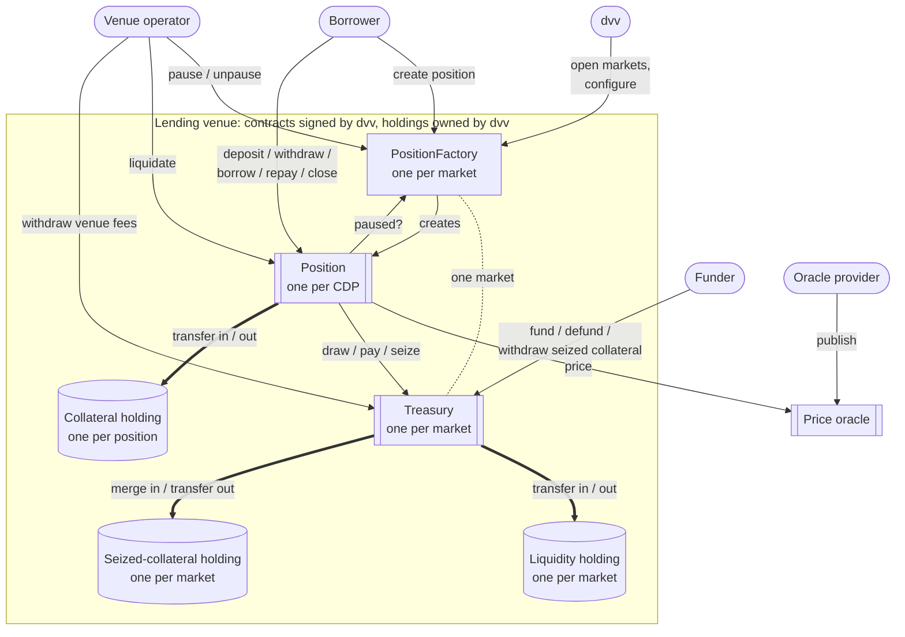
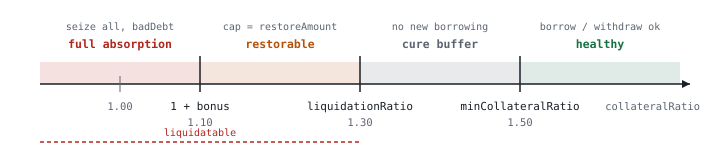
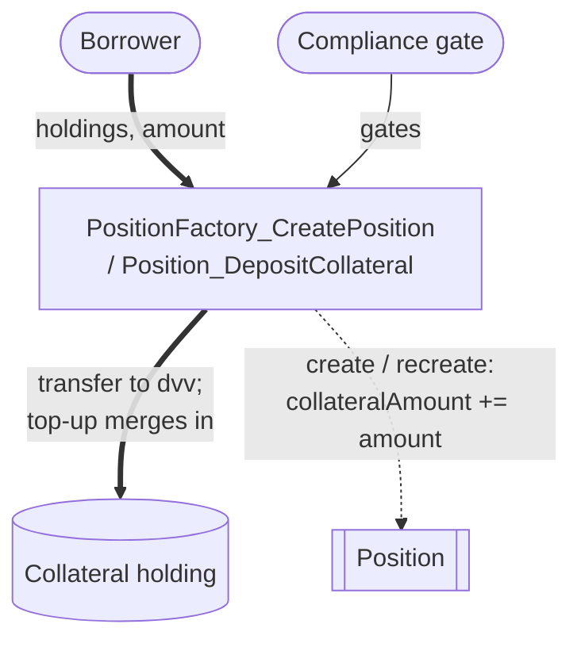
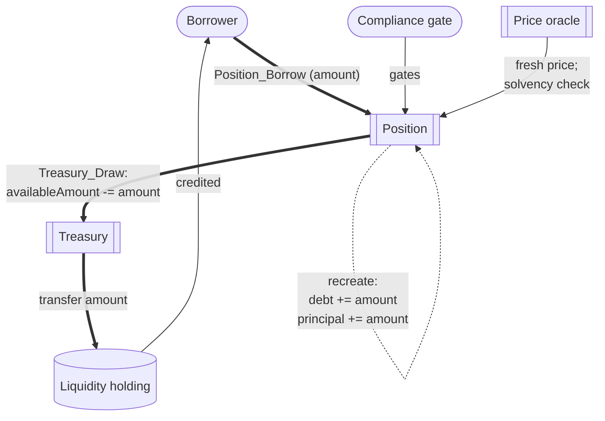
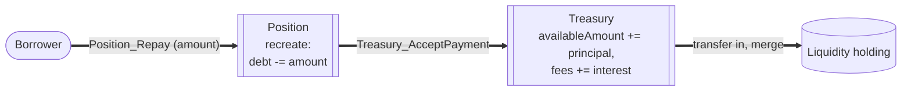
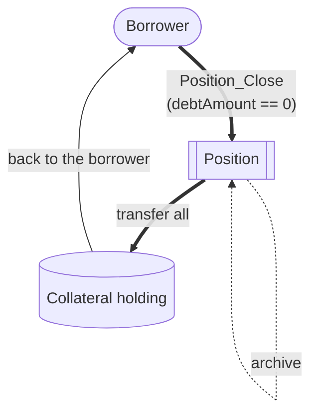
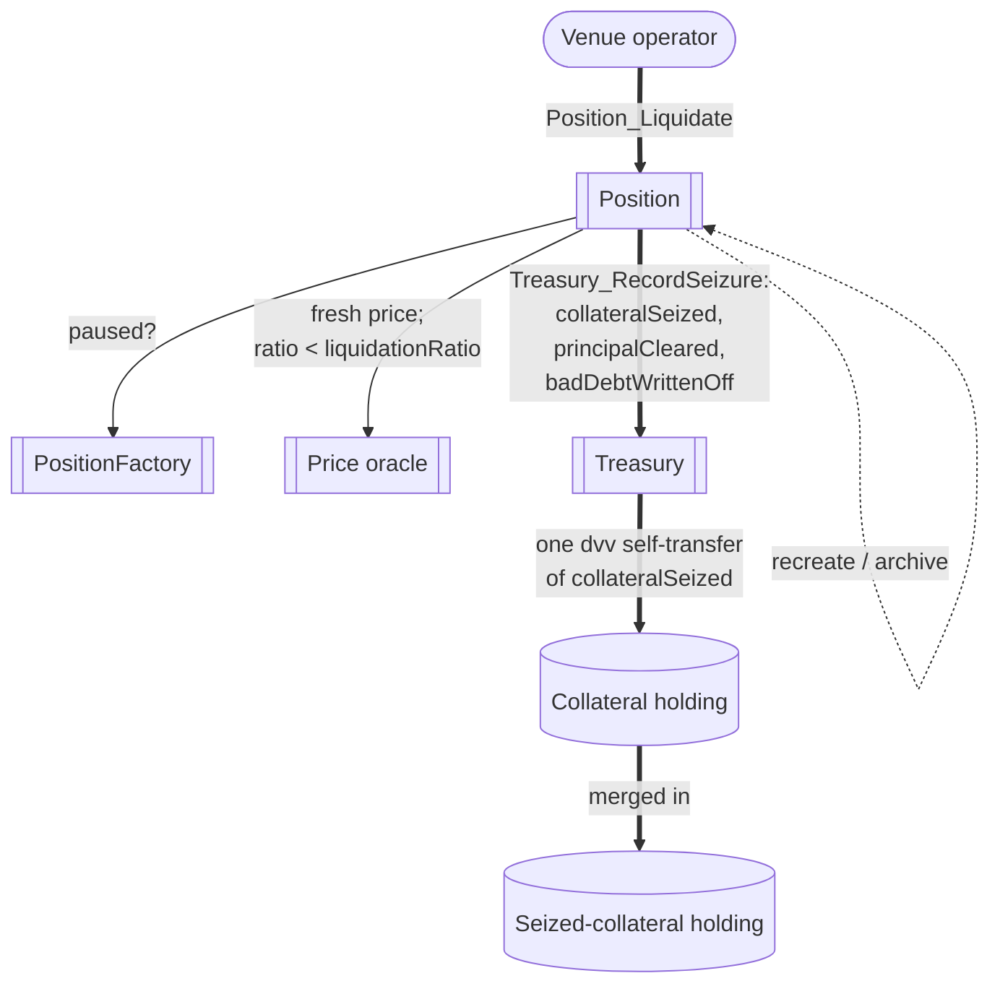
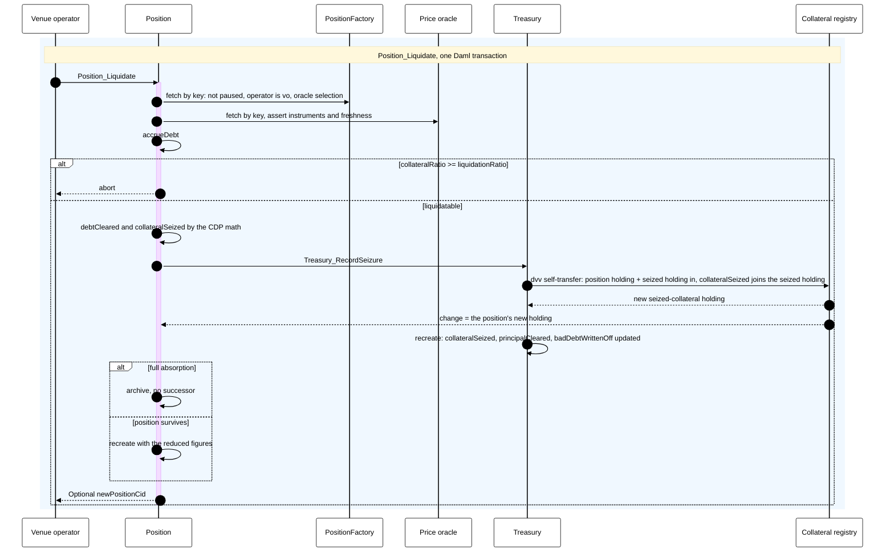

# Architectural Overview Report: Canton Reference Lending Venue

This report is the target architecture for a vault-based, overcollateralized
lending venue on Canton: the on-ledger contract shapes, the borrower wallet
requirements, the operator's off-ledger services, and the deployment
topology. It composes the reusable OpenZeppelin pause and access control components with on-chain
identity and compliance checks into one application that settles through the
Canton Network Token Standard V2 (TSv2).

## 1. Product Definition

The venue is an application that matches a funder's liquidity with
borrowers and then enforces the terms of each resulting debt position. Its
core object is the **Position**: an isolated collateralized debt position
(CDP) held as its own Daml contract. Four properties define a position:

- **Fixed-rate.** The `interestRate` is immutable for the life of a position.
- **Open-term.** A position has no maturity: it stays open until repaid and
  closed, or liquidated.
- **Permissioned.** Borrowers are identified on-chain by a KYC claim from an
  issuer the venue trusts, and value movements can additionally be gated by
  per-operation compliance attestations.
- **Overcollateralized.** Borrowing and withdrawal must keep
  `collateralRatio` at or above `minCollateralRatio`; a position under
  `liquidationRatio` is liquidatable. The gap between the two is the
  borrower's cure buffer.

Assets settle through [CIP-0112, the Canton Network Token Standard V2](https://github.com/canton-foundation/cips/blob/6f37c896a5a76ec3bc1aa67bc045623ae5df41e5/cip-0112/cip-0112.md):
every asset is a holding co-signed by its own registry, and the venue moves
assets only through the TSv2 interfaces, so any conformant registry works.
The collateral and the **debt token** may both be issued by third parties.
The venue opens a **market** for each funder and instrument pair: a
`PositionFactory` carrying the funder's terms and a **treasury** the funder
fills with debt tokens. Borrows draw from it, repayments flow back, an
exhausted treasury blocks new borrows, and the funder earns interest only on
the principal borrowers draw.

### Operational Scope and Boundaries

The core is deliberately small: multiple markets per venue, one treasury per market, one price
dependency per instrument pair, one `Position` contract per CDP. Funds move through direct
transfers under authorities carried in choices. Deployment-specific
conditions are contract parameters ([consumption and customization](#consumption-and-customization)).

| Feature Category | In-Scope Architectural Components |
|---|---|
| Interest Model | Fixed `interestRate`, open term, **simple (non-compounding) interest** on the tracked principal ([the CDP math](#the-cdp-math)). |
| Core Flows | Create a market; Create a position; Deposit and withdraw collateral; Borrow; Repay debt; Liquidate an underwater position; Close a position; Fund and defund the treasury; Withdraw seized collateral or operator/funder fees. |
| Asset Representation | CIP-0112 TSv2 holdings owned by the decentralized venue validation party (`dvv`): one collateral holding per position, one liquidity holding and one seized-collateral holding per market; nothing is minted or burned ([custody](#custody)). |
| Pricing | Every price-dependent choice fetches the selected provider's price contract and enforces the instrument and staleness guards ([section 4.4](#44-dependency-price-oracle)). |
| Fees | Interest accrues to the funder, meant as a reward but also to absorb bad debt; a configurable share of interest goes to the venue operator ([the treasury](#the-treasury)). The `liquidationBonus` is the premium the operator takes in collateral on a restoring liquidation. |
| Compliance & Control | On-chain **KYC claims** from trusted issuers and optional per-operation **compliance attestations**; both lists are configured by the `dvv`. |
| Trust Topology | Every venue contract is signed, and every venue holding owned, by the `dvv`. The `dvv` is hosted across independent participant nodes at a confirmation threshold above 1; solvency and seizure bounds are enforced by Daml code ([party topology](#party-and-role-model-topology)). |
| Component Integration | OpenZeppelin packages and the CIP-0112 Splice interfaces ([section 2](#core-components-and-library-mapping)). |

<br/>

| Feature Category | Out-of-Scope Features or Components |
|---|---|
| Interest Models | Dynamic or algorithmic rates, utilization curves, fixed maturities. |
| Leverage Facilities | Undercollateralized loans, flash loans, recursive leverage, rehypothecation. |
| Liquidation Mechanics | Auctions, third-party keepers ([extension points](#extension-points)), and whole-position close-out ([section 7](#7-open-design-questions-for-the-implementation-phase)). |
| Price Oracle | The oracle contract, its update mechanism, and producing a price for the pair at all are consumed as-is from a provider meeting [section 4.4](#44-dependency-price-oracle). |
| Token Standard | Defining or extending TSv2; CIP-0056 and V1 paths. |
| Cross-Synchronizer Operation | The architecture assumes one synchronizer. |

### Target Ecosystem Participants

- **Institutional asset managers and tokenized-fund issuers**: collateralized credit with deterministic outcomes and no private data leakage.
- **Asset issuers and large token holders**: idle debt-token inventory earns interest as a market's liquidity against overcollateralized debt, on terms the funder sets.
- **Wallet and client integrators**: borrower flows built on the position choices, exposed to venue UIs over the [CIP-0103](https://github.com/canton-foundation/cips/blob/6f37c896a5a76ec3bc1aa67bc045623ae5df41e5/cip-0103/cip-0103.md) dApp API.

### Background: How to Think About Building a Lending Protocol on Canton

In the [ERC-4626](https://docs.openzeppelin.com/contracts/5.x/erc4626) lineage one globally visible contract manages pooled liquidity, debt shares, and accrual for every party, broadcasting each one's balance and liquidation threshold. Canton changes three assumptions.

**Privacy by default.** A contract is visible only to its signatories and observers (per-party projection), so each **position is its own contract** rather than a share in a pool, visible only to the borrower and `dvv`. A party that is an informee of a choice also sees everything the choice does, so the venue keeps one holding per position: a borrower's flows never touch another borrower's position ([privacy model](#privacy-and-visibility-model)).

**No in-place mutation.** State changes by archive-and-recreate, so contract ids change. The design resolves the `PositionFactory`, the `Treasury`, the `Position`, and the price oracle by **contract key**. Keys are not unique, so the venue will enforce uniqueness.

**A bounded operator, not no operator.** Canton does not remove the operator from the trust equation; it bounds it. The operator is paid, through the venue fee, to enforce the funder's and the borrower's terms against each other, and the `dvv` hosting consortium exists so that its custody of collateral and liquidity is bounded by code and confirmed by organizations it does not control. The trust question therefore moves from contracts to parties. 

Canton decentralizes a party on three independent axes: **party governance** (whose signatures can re-home it), **validation** (how many participant nodes must confirm its transactions; above 1, the party can no longer submit Ledger API commands directly and acts through externally signed submissions or through choices submitted by others), and **authorization** (what the Daml signatory and controller topology requires). Guarantees are only as strong as the organizations behind the nodes: a party confirmed at threshold `f + 1` holds until `f + 1` nodes of distinct organizations collude ([trust topology](#decentralization-and-trust-topology)).

**New versus existing components.** The venue adds one organization, the operator, and its own contracts: `PositionFactory`, `Treasury`, and `Position`. KYC claims and compliance attestations come from issuers and attesters `dvv` trusts; the debt token and the collateral are administered by their issuers' own **registries**, which must implement the TSv2 interfaces and meet the [instrument listing policy](#instrument-listing-policy); the price oracle is a provider's contract selected by `dvv`.

---

## 2. Architecture Overview

The diagram shows the actors, the venue's core contracts, and the external components they touch; the table that follows maps each component to its source.



### Core Components and Library Mapping

Tags mark each component's source: `[PACKAGE]` for OpenZeppelin packages in
[`OpenZeppelin/canton-contracts`](https://github.com/OpenZeppelin/canton-contracts)
and `[STANDARD]` for upstream Splice Token Standard V2 interfaces consumed as
pinned dependencies.

| Component Suite | Applied Templates and Libraries | Architectural Function |
|---|---|---|
| Venue Constraints `[PACKAGE]` | `openzeppelin-api-pausable-v1`: [`Pausable`](https://github.com/OpenZeppelin/canton-contracts/blob/a2d576344fe96d49751b276e8c638e02ef682c57/packages/security/api-pausable-v1/daml/OpenZeppelin/Api/PausableV1.daml#L42); `openzeppelin-pausable-v1`: [`whenNotPaused`](https://github.com/OpenZeppelin/canton-contracts/blob/a2d576344fe96d49751b276e8c638e02ef682c57/packages/security/pausable-v1/daml/OpenZeppelin/PausableV1.daml#L46) | Emergency circuit breaker: each market's `PositionFactory` carries the `paused` flag, creation and every price-dependent choice call `whenNotPaused` on it, and `vo` pauses and unpauses. |
| Asset Rails `[STANDARD]` | [CIP-0112 / Splice Token Standard V2](https://github.com/canton-foundation/cips/blob/6f37c896a5a76ec3bc1aa67bc045623ae5df41e5/cip-0112/cip-0112.md) interfaces: `Holding`, `Account`, `InstrumentId` (`Splice.Api.Token.HoldingV2`); `TransferFactory`, `TransferInstruction` (`Splice.Api.Token.TransferInstructionV2`); `EventLog` (`Splice.Api.Token.TransferEventsV2`) | The interoperability boundary: every collateral and liquidity movement is one `TransferFactory_Transfer` whose `actors` carry both account parties' authority, so it completes in one step against any registry meeting the [listing policy](#instrument-listing-policy). |

---

## 3. Target Design

### Party and Role Model Topology

The venue introduces two parties, `dvv` and `vo`; the registries, the oracle
provider, funders, and borrowers are pre-existing network structure.

- **Decentralized Venue Validation (`dvv`)**: signs all venue state (every
  `PositionFactory`, `Treasury`, and `Position`) and owns every holding the
  venue custodies. It acts only through consortium-approved, externally
  signed transactions: opening markets and setting each market's
  configuration (the oracle, `maxStaleness`, the venue fee share, the
  minimum amounts, the trusted issuers and attesters). Multi-hosted at a
  confirmation threshold above 1 ([trust topology](#decentralization-and-trust-topology)).
- **Venue Operator (`vo`)**: the organization running the off-ledger backend,
  single-hosted on its own node. It pauses markets, liquidates, withdraws
  the venue fee, serves the disclosed market terms and capacity to
  prospective borrowers, and monitors positions and the oracles.
  Liquidating in time is a service-level obligation of the operator.
- **Funder**: admitted by the consortium when its market is opened; fills
  and defunds the treasury on its own terms, earns the interest net of the
  venue fee, absorbs bad debt, and withdraws seized collateral; typically
  the debt token's issuer or a large holder, possibly the operator itself.
  It brings liquidity and terms: the consortium opens
  its market under the venue's existing `dvv` and `vo`.
- **Borrower**: locks collateral and draws debt.
- **Oracle Provider**: the external organization publishing the price
  contract the positions read, selected by `dvv` against
  [section 4.4](#44-dependency-price-oracle).
- **Instrument Registrars**: the TSv2 registries of the debt token and the
  collateral, generally different organizations.

Who sees what is set out in the [privacy model](#privacy-and-visibility-model).

### Decentralization and Trust Topology

Two questions decide each party's security posture: how it is hosted and
validated, and who submits in its name.

| Party | Hosting and validation | Who submits in its name |
|---|---|---|
| `dvv` | multi-hosted on several participant nodes, confirmation threshold above 1; optionally also hosted on a regulator's or auditor's node, observing or confirming | only consortium-approved, externally signed transactions: market creation and configuration, issuer and attester lists; in every flow its authority is exercised inside choices on contracts it signs, submitted by the party driving the flow |
| `vo` | single-hosted on the operator's node, which also hosts a `dvv` replica; the backend reads as `dvv` and submits as `vo` | pauses and unpauses markets, liquidates, withdraws the venue fee; discloses and monitors off-ledger |
| Funder | its own node and keys; hosting and threshold are its own choice, since it confirms only its own choices | submits by itself |
| Oracle provider | external organization, selected against [section 4.4](#44-dependency-price-oracle) | publishes its own price contract |
| Borrowers | hosted on a reputable wallet provider's or validator operator's participant node, their own keys ([custody](#custody)) | creation, deposits, withdrawals, borrows, repayments, and closes from their wallet (CIP-0103) |
| Instrument registrars | external organizations, vetted by the [listing policy](#instrument-listing-policy) | their own registry operations |

`dvv` is decentralized because **custody is signatory trust**: whoever holds
its authority can transfer every holding it owns at the registry level,
outside the solvency-coupled choices. Multi-hosting makes that authority
reachable only through the venue's choices or through externally signed
transactions that `f + 1` hosting organizations approve. One hosting
candidate is the
[covalidation service provider](https://docs.digitalasset.com/covalidation/overview).
Each flow is confirmed by its submitter, the `dvv` threshold, the registry of
every instrument it moves, and the signatory of every contract it fetches:
the price provider on price-dependent flows, the KYC issuer and the attester
on gated flows.

**A minimal viable deployment.** `dvv` is hosted on three confirming
participant nodes, one per organization, with a confirmation threshold of 2
of 3:

| Organization | Role for `dvv` | Other responsibilities |
|---|---|---|
| Venue operator | confirming node | hosts `vo`; runs the backend and the disclosure API; pauses and liquidates |
| Venue validator A (covalidation offering) | confirming node | - |
| Venue validator B (covalidation offering) | confirming node | - |
| Oracle provider | - | publishes the price contract the positions read |
| Regulator or auditor (optional) | observing node | independent monitoring of every market, position, and price |

Breaking the guarantees `dvv` checks, or changing venue configuration, takes
two colluding organizations. Funders, borrowers, the oracle provider, and
the registrars stay outside the consortium on their own organizations'
nodes. Larger deployments add covalidation organizations and raise the
threshold.

**The pause authority** sits with `vo`, single-hosted, so an emergency stop
is instant. It gates creation and the price-dependent flows, borrow,
withdrawal, and liquidation; deposit, repay, and close never pause, so a
borrower can always cure or exit ([section 5.3](#53-threat-model)).

### The CDP Math

Two figures track a position: `principalAmount` is the debt tokens drawn and not yet repaid, and `debtAmount` is that principal plus accrued interest, so `principalAmount <= debtAmount` always. Health is the **collateral ratio** `collateralRatio = (collateralAmount · price) / debtAmount` at the oracle price. Borrowing and withdrawal must keep it at or above `PositionParams.minCollateralRatio`; below `liquidationRatio` the position is liquidatable.

Interest is simple: `accrueDebt` computes `newDebt = oldDebt + principalAmount · interestRate · elapsedYears` from `now - lastAccrualTime`, runs inside every state-changing choice before the solvency check, and resets `lastAccrualTime` on recreation. Charging on the principal makes accrual frequency irrelevant: two accruals over `t₁` and `t₂` add exactly what one over `t₁+t₂` would. A payment or a clearance settles accrued interest first and principal with the remainder.

**Liquidation arithmetic (debt-proportional, health-restoring).** A liquidation clears debt against collateral at the oracle price: the collateral seized is proportional to the debt cleared, and the debt cleared is what returns the position to health.

```text
-- Seizure is proportional to the debt cleared:
collateralSeized = min(collateralAmount, debtCleared · (1 + liquidationBonus) / price)

-- The smallest clearance that lifts the ratio back to minCollateralRatio:
restoreAmount = (minCollateralRatio · debtAmount - collateralAmount · price)
                / (minCollateralRatio - 1 - liquidationBonus)

-- The debt a liquidation clears, by regime:
debtCleared = if collateralRatio > 1 + liquidationBonus
              then restoreAmount                               -- restorable
              else min(debtAmount, collateralAmount · price)   -- full absorption
```



- **Proportional seizure.** `debtCleared` is the debt the funder gives up, computed by the choice rather than chosen by the caller, so the venue can never take more collateral than the debt it clears plus the bonus buys.
- **Restorable position (`collateralRatio > 1 + liquidationBonus`).** Clearing `x` lowers the debt by `x` and the collateral value by `x · (1 + liquidationBonus)`, which raises the ratio while it sits above `1 + liquidationBonus`. `restoreAmount` is the exact `x` that returns the ratio to `minCollateralRatio`, so a cured position lands inside the cure buffer rather than on the liquidation boundary; a position that falls again can be liquidated again.
- **Underwater position (`collateralRatio <= 1 + liquidationBonus`).** No clearance can restore health, so the pass seizes all remaining collateral, clears the whole debt or as much of it as the collateral is worth at the oracle price, writes the uncovered remainder off as bad debt, and closes the position.
- **Well-definedness.** Configuration requires `minCollateralRatio > liquidationRatio > 1 + liquidationBonus`: the first gap is the cure buffer, the second keeps a newly liquidatable position curable and `restoreAmount`'s denominator positive. Splits compute one side as the remainder, and transfer amounts are rounded down to the instrument's precision before they are moved and recorded.

### The Position Flows

Each flow is one ledger transaction: the position choices compute the
amounts and instructs the transfers ([custody](#custody)), the registries'
own implementations move the holdings and emit the events. `Compliance gate` stands for the on-chain identity and
attestation checks on creation, deposit, borrow, and withdrawal.

**A. Position creation, collateral deposit, and withdrawal.** The first deposit goes through `PositionFactory_CreatePosition`: the borrower presents holdings, and the choice transfers the collateral to `dvv` and creates the `Position` referencing the new holding ([section 4.1](#41-component-positionfactory-and-position-creation)). `Position_DepositCollateral` transfers a top-up and merges it into the position's holding. `Position_WithdrawCollateral` returns `withdrawAmount` while the solvency check passes at a fresh price and the remainder stays above the market's `minCollateralAmount`.



**B. Borrow.** `Position_Borrow` reads a fresh price, requires `availableAmount` to cover the request and the collateral to cover the new debt at `minCollateralRatio`, then transfers the amount from the liquidity holding to the borrower through `Treasury_Draw` and records the higher debt.



**C. Repay.** `Position_Repay` transfers the payment from the borrower's holdings to `dvv`, merges it into the liquidity holding, and records the lower debt. The borrower presents holdings and an amount. Change is returned to the borrower.



**D. Close.** `Position_Close` winds down a fully repaid position: it transfers the whole collateral holding back to the borrower and archives the `Position`. A one-shot exit submits repay and close in one command.



**E. Liquidation.** Below `liquidationRatio`, `vo` clears debt against collateral: the choice computes `debtCleared` and `collateralSeized` from the fresh price ([the CDP math](#the-cdp-math)), moves the seized collateral from the position's holding into the market's seized-collateral holding, and reduces the debt. No debt tokens change hands; the funder takes the collateral with `Treasury_WithdrawCollateral`. The residual `Position` is recreated, or, on full absorption, the shortfall is written off and the position closed.





### Time Model

Time plays two roles: interest accrual off `lastAccrualTime` and the oracle
staleness guard. Ledger time is accurate only to
`ledgerTimeRecordTimeTolerance` (60s default), so `maxStaleness` is measured
in ledger time and must exceed the tolerance by a wide margin. Externally
signed transactions must be submitted within 24h by default
([CIP-0107](https://github.com/canton-foundation/cips/blob/6f37c896a5a76ec3bc1aa67bc045623ae5df41e5/cip-0107/cip-0107.md)),
which bounds any flow signed through a custodian. Attestations, where
enabled, are single-use with a short validity window that must cover the
client's submission time.

### Custody

Both instruments are only transferred, never minted or burned, so
third-party-issued assets are compatible. The venue custodies what it
enforces against: every position's collateral and every market's liquidity
and seized collateral are TSv2 `Holding`s **owned by `dvv`**, moved only
inside venue choices through transfers.

**One holding per position, two per market.** A `Position` references its
collateral holding (`collateralHoldingCid`), whose amount equals
`collateralAmount`. A `Treasury` references the market's liquidity holding
(`liquidityHoldingCid`), whose amount equals
`availableAmount + feesAccrued + venueFeesAccrued`, and its seized-collateral
holding (`seizedCollateralHoldingCid`), whose amount equals
`collateralSeized`. Inbound transfers merge into the referenced holding
through a `dvv` self-transfer; outbound transfers spend it, and the change
holding becomes the successor. Every flow asserts the resulting holding
amounts against the figures it records and stores the new contract ids, so
the accounting always equals the holdings
([section 5.1](#51-security-invariants)) and a deviating registry aborts the
flow. No holding is shared across positions or markets.

**Custody assumptions.** `dvv` uses these holdings only inside venue
choices; its hosting nodes submit no externally signed transaction against
them. The
registries meet the [listing policy](#instrument-listing-policy). Every
informee's participant keeps the venue packages vetted: the venue should only accept borrowers that are hosted
on reputable wallet providers' or validator operators' nodes. Funders accept the
same obligation.

**Alternative considered: committed iterated allocations.** Collateral and
liquidity could instead stay in their owners' accounts as committed iterated
allocations ([CIP-0112](https://github.com/canton-foundation/cips/blob/6f37c896a5a76ec3bc1aa67bc045623ae5df41e5/cip-0112/cip-0112.md#436-committed-allocations-and-iterated-settlement))
naming `dvv` as executor, so that the venue never holds client assets and a
registry freeze reaches one customer. The design does not adopt it: every
settlement then needs the owner's node, so liquidation depends on the
borrower; allocations expire and must be refreshed for open-term positions;
and both registries must support iterated settlement with reserved funding.

### Privacy and Visibility Model

Target visibility per contract:

| Contract | Signatories | Observers |
|---|---|---|
| `PositionFactory`, `Treasury` | `dvv` | the market's funder; disclosed to prospective borrowers by `vo` |
| `Position` | `dvv` | its borrower |
| Collateral, liquidity, and seized-collateral holdings | the registry admin, `dvv` | none |
| Price contract | the provider | disclosed to venue parties by `vo` and read through the provider's public fetch choice ([section 4.4](#44-dependency-price-oracle)) |

Consequences:

- **A borrower sees its own positions and nothing of another's.** On its own flows it witnesses the `dvv` holding backing its position and, on borrow, repay, and liquidation, the market's `Treasury` record and the holdings those flows touch ([section 7](#7-open-design-questions-for-the-implementation-phase)).
- **The funder sees its market's configuration and treasury, never a position.** Its outstanding exposure follows from the `Treasury` figures.
- **`vo` sees everything** through the `dvv` replica on its node; the optional auditor sees what `dvv` sees.
- **Disclosure.** A submission carries the contracts it exercises or fetches without seeing them: the market's factory and treasury, the `dvv` holdings it consumes, the price contract, and the registries' transfer factories with their choice contexts, served by `vo`'s backend.

### Instrument Listing Policy

Before the consortium opens a market on an instrument pair, it verifies at
both registries:

- **One-step transfers.** transfers complete in one step when `actors` cover the sender and the receiver, with no provider or pending step, `dvv` self-transfers included, and returns one receiver holding plus at most one change holding. The standard only recommends this, so the venue verifies it.
- **Exact amounts.** A transfer deducts nothing from its inputs, the holding view's `amount` is what a transfer honors, and the registry never merges, splits, or expires a holding on its own, except dust whose accrued holding fees exceed its amount; the market's minimum amounts keep every holding clear of that bound.
- **Context service.** The registry's API serves its transfer factory and choice context to any venue submitter.
- **Disclosed powers.** Audited TSv2 code, bounded admin powers, disclosed freeze and seizure capabilities, SCU-conformant upgrades. A freeze of `dvv`'s account halts every market in that instrument and cannot be attributed to one borrower ([section 5.3](#53-threat-model)).

### The Treasury

Each market's borrow liquidity lives in its **treasury**, a `Treasury`
contract ([section 4.3](#43-component-treasury)) that references the
market's liquidity and seized-collateral holdings and tracks:

- `availableAmount`: un-borrowed liquidity. Borrow asserts it covers the request, so **an exhausted treasury blocks new borrows**.
- `feesAccrued` and `venueFeesAccrued`: interest received, split by the market's `venueFeeShare`; `vo` withdraws the venue's share with `Treasury_WithdrawVenueFees`.
- `collateralSeized`: collateral liquidations took for the funder, who withdraws it with `Treasury_WithdrawCollateral`.
- `principalCleared`: principal liquidations removed from positions, covered by collateral or written off.
- `badDebtWrittenOff`: debt no collateral covered, absorbed by the funder, whose interest is the compensation for that risk.

The `dvv`` creates the treasury with the market; the funder fills it with
`Treasury_Fund` and reclaims un-borrowed liquidity and revenue with
`Treasury_Defund`. Every repayment is principal plus accrued interest: the
principal is immediately borrowable again and the interest goes to the fee
balances. Borrowers buy the debt tokens they owe as interest on the open market, so
repayment capacity is never bounded by the market's own liquidity.

### Oracle Handling

A single trusted price feed would be the largest live attack surface, so the
design hardens the price path on the consumer side and places the rest on
the dependency ([section 4.4](#44-dependency-price-oracle)):

- **Named quote instrument.** The price contract carries `debtInstrumentId` and `collateralInstrumentId`, so `price` is unambiguously "units of the debt token per unit of collateral"; consumers assert both ids match the position's.
- **Max-staleness guard.** Every price-dependent choice rejects when `now - updatedAt > maxStaleness`.
- **Operator monitoring.** The backend watches each feed for staleness and out-of-band moves, and `vo` pauses the affected markets on a suspect feed.

### Authority and Privilege Transfer

Every privileged action traces to the named authority in the
[trust topology](#decentralization-and-trust-topology) table, and no single
admin holds them all. Every holder is fixed for the life of its contract and
bound by direct controllership: the funder on its market, the borrower on
its position, `dvv` through the choices on the contracts it signs, and `vo`
on pause, liquidation, and fee withdrawal, checked by each choice against
the market's `PositionFactory`, the only contract that names it, so
replacing the operator recreates factories only. Changing the organizations
behind `dvv` is a hosting change at the party layer. There is no
ownership-handover contract and no role registry.

### Smart Contract Upgrade Process

The application uses Smart Contract Upgrade (SCU) for additive changes to
its own packages: a release keeps the package name, raises the version, sets
`upgrades:` to the prior deployed DAR, and only appends `Optional` fields to
templates, records, and choice arguments; the
[Canton SCU guide](https://docs.canton.network/appdev/deep-dives/smart-contract-upgrade)
defines the remaining rules. SCU preserves a representable data shape, not
loan economics.

Upgrades are a `dvv`-authority concern: a new package version changes what
the contracts carrying `dvv`'s authority can do. Protection sits at the
**vetting layer**: each `dvv` hosting node decides which package versions it
vets, and a transaction on an upgraded package confirms only once the
confirmation threshold of those nodes accepts it. Deploying an upgrade is an
explicit act of the hosting consortium, effectively a multi-sig over code.

Every release defines what each new `Optional` field means for a v1
`Position`, `PositionParams`, or `Treasury` record (v1 contracts read as
`None` under v2 code, while a v2 record carrying `Some` is unusable by an
exact-version v1 workflow) and tests both directions. Worked example, a
per-position debt ceiling: adding a new hardened borrow choice is not enough,
because the existing `Position_Borrow` stays callable, so the v2 release
changes its body to enforce `debtCeiling : Optional Decimal` on
`PositionParams` and states what `None` means for grandfathered positions: an
uncapped position, a conservative default cap, or a position that must
migrate before borrowing again. The populated field is also what retires the
old code path: SCU does not delete the v1 DAR and a caller can pin the old
package id, but once `PositionParams` carries `Some ceiling` its data no
longer downgrades to a v1 view. Liquidation fixes follow the same principle.

Changes to accrual, fee allocation, collateral valuation, or liquidation
terms are a separate economic decision: new positions carry revised terms
and existing borrowers keep theirs unless they consent to migrate. A change
to parties, keys, custody, or a policy that must bind every caller is
breaking: a separately named package and template, with active positions
migrated during a maintenance window. Before release, the operators run
`dpm build` with the `upgrades:` lineage and `dpm upgrade-check --both`, vet
the DARs at the affected participants, switch services and wallets together
to the target package preference, and exercise every flow and the emergency
paths on LocalNet against live v1 positions.

### Extension Points

Extensions use SCU only when they preserve the data and economics of live
positions:

- **Debt ceilings.** A per-position `Optional` cap in `PositionParams` and an aggregate ceiling on the `PositionFactory`, enforced in `Position_Borrow`.
- **Compounding interest variant.** A new immutable terms revision for positions that select discrete compounding, never retroactive.
- **Keeper liquidation.** Third-party liquidators designated by `dvv` whose debt-token payment into the treasury replenishes liquidity instead of converting it into collateral.
- **Pooled markets.** Several funders sharing one treasury, each with its own share of `feesAccrued` and of the risk.

### Consumption and Customization

Adopters consume the lending packages in one of two ways:

- **Import the published DAR**, keeping the OpenZeppelin name and upgrade lineage: fixes arrive as ordinary dependency upgrades, but only as OpenZeppelin releases.
- **Vendor and rename** at a pinned, audited release, owning the lineage and the fork.

Package names are global and SCU is scoped to them, so two applications
sharing a library DAR share its lineage. Either way, deployment-specific
behavior is configuration on each market's `PositionFactory`, changed
through governed `dvv` transactions rather than code changes.

A position resolves the operational configuration live, by key, so a
configuration change migrates no position. Beyond the TSv2 asset interfaces
and the OpenZeppelin `Pausable` view, the design defines no Daml interfaces
or hook contracts of its own: every market, position, and oracle reference
is a statically linked template resolved by key, which keeps the reachable
transaction shapes fixed and auditable.

---

## 4. Sample Component Structure

These sketches show the **shape** of each component: fields, signatories,
keys, and choice declarations, with bodies summarized in comments. They are
not yet implemented in any end-to-end Daml Script; `accrueDebt`,
`collateralRatio`, `restoreAmount`, and `debtCleared` are the formulas of
[the CDP math](#the-cdp-math).

### 4.1 Component: PositionFactory and Position Creation

A market is one `PositionFactory` and one `Treasury`, both keyed by `dvv`,
the funder, and the instrument pair, created together by a `dvv` transaction. The `PositionFactory` is the market's
standing offer to borrowers; a borrower creates a position unilaterally, and
creation transfers the presented holdings to `dvv`, so a position is never
created empty and no holding is accepted from outside.

```daml
data PositionParams = PositionParams with   -- fixed for the life of a position
  interestRate : Decimal
  minCollateralRatio : Decimal
  liquidationRatio : Decimal
  liquidationBonus : Decimal

template PositionFactory
  with
    dvv : Party
    vo : Party                      -- the venue's operator, the same in every market
    funder : Party
    collateralInstrumentId : InstrumentId
    debtInstrumentId : InstrumentId
    params : PositionParams
    oracleProvider : Party
    maxStaleness : RelTime
    venueFeeShare : Decimal
    minCollateralAmount : Decimal
    minLiquidityAmount : Decimal
    trustedIssuers : [Party]
    trustedAttesters : [Party]      -- empty disables attestations
    paused : Bool
  where
    signatory dvv
    observer funder
    key (dvv, funder, collateralInstrumentId, debtInstrumentId) : (Party, Party, InstrumentId, InstrumentId)
    maintainer key._1
```

### 4.2 Component: Position and Liquidation

The `Position` holds one borrower's CDP state; its consuming choices archive it and recreate the successor with updated figures. `dvv` is its only signatory and the borrower an observer. The borrower's own choices run under their controller authority, and their protection is the choice logic plus the `dvv` threshold.

```daml
template Position
  with
    dvv : Party
    funder : Party
    borrower : Party
    positionId : Text
    collateralInstrumentId : InstrumentId
    debtInstrumentId : InstrumentId
    collateralHoldingCid : ContractId Holding   -- owned by dvv, one per position
    collateralAmount : Decimal
    debtAmount : Decimal
    principalAmount : Decimal
    params : PositionParams
    lastAccrualTime : Time
  where
    signatory dvv
    observer borrower
    key (dvv, borrower, positionId) : (Party, Party, Text)
    maintainer key._1
```

### 4.3 Component: Treasury

The `Treasury` holds the market's liquidity, its seized collateral, and its
accounting ([the treasury](#the-treasury)); each choice updates the figures
and the holding references in the transaction that moves the holdings.

```daml
template Treasury
  with
    dvv : Party
    funder : Party
    collateralInstrumentId : InstrumentId
    debtInstrumentId : InstrumentId
    liquidityHoldingCid : Optional (ContractId Holding)          -- owned by dvv
    seizedCollateralHoldingCid : Optional (ContractId Holding)   -- owned by dvv
    availableAmount : Decimal
    feesAccrued : Decimal
    venueFeesAccrued : Decimal
    collateralSeized : Decimal
    principalCleared : Decimal
    badDebtWrittenOff : Decimal
  where
    signatory dvv
    observer funder
    key (dvv, funder, collateralInstrumentId, debtInstrumentId) : (Party, Party, InstrumentId, InstrumentId)
    maintainer key._1
```
### 4.4 Dependency: Price Oracle

The price oracle is not a venue component but a **pinned dependency**, like the token registries: an external provider publishes a price contract carrying `price` and `updatedAt`, keyed by `(provider, collateralInstrumentId, debtInstrumentId)`; the lending package depends on the provider's package as a pinned DAR, and the market's `PositionFactory` names the provider, so every price-dependent choice fetches the current price by key across the provider's archive-and-recreate cycle. `dvv` selects the provider as a configuration decision, and the position choices enforce only the consumer-side guards ([oracle handling](#oracle-handling)). A fallback provider must publish the same pinned template; one on another package is a new lending release. Before selection, a provider must satisfy:

- **No single writer.** No single party may publish a price alone, so a lone compromised party cannot manufacture liquidations.
- **No single staller.** Update liveness must not hinge on any one party's per-update cooperation; an all-of-M quorum stalls on one offline member.
- **Bounded moves.** A per-update deviation bound aborts out-of-band publishes, so the last in-band price stands.
- **Auditable updates.** Every published price traces to the parties that authorized it.
- **Public fetch.** The contract exposes a nonconsuming fetch choice any party may exercise, as TSv2 factories do, since a fetch is authorized only by a stakeholder and the venue is none.
- **Read liveness.** The participants hosting the contract's signatory confirm every fetch, so a single-node publisher stalls every price-dependent flow and an all-of-M signatory set stalls on one member; the publishing party is hosted on several nodes at threshold 1.

Providers may run an N-of-M committee through the [Multiple Party Agreement](https://docs.canton.network/appdev/modules/m3-design-patterns#multiple-party-agreement) pattern, multi-hosted parties, medianized per-member submissions, or pull-style signed price attestations verified inside the publish choice; which provider to consume, and the quorum to demand, is left to the adopter.

---

## 5. Security & Auditability

### 5.1 Security Invariants

- **Solvency conservation**:
  - Collateral can never be withdrawn, and a borrow can never succeed, if it would push `collateralRatio` below `PositionParams.minCollateralRatio`.
  - Liquidation is reachable only below `liquidationRatio`.
- **Lending conservation (no unbacked lending)**:
  - Debt tokens leave the liquidity holding only with a solvency-checked `debtAmount` increment gated by `availableAmount`, through the funder's own defund, or as the venue's withdrawn fee share; repayments return against a matching decrement.
  - Per market, what the funder provisioned less what it defunded from liquidity equals `availableAmount` plus the outstanding principal of its open positions plus `principalCleared`.
- **Custody**:
  - Every holding the venue owns moves only through a venue choice; `dvv` never transfers one otherwise. The residual is custodial: an externally signed transaction approved by `f + 1` of `dvv`'s hosting organizations could move them outside the choices.
  - No holding is shared across positions or markets.
- **Seizure is debt-bound**:
  - Liquidation seizes collateral exactly proportional to the debt the funder gives up: `collateralSeized = debtCleared · (1 + liquidationBonus) / price`, capped at the position's collateral, with `debtCleared` computed by the choice.
- **Fee integrity**:
  - A repayment transfers principal plus accrued interest into the liquidity holding, split between principal and the fee balances; a liquidation converts the cleared debt into collateral for the funder. Value is neither destroyed nor leaked.
- **Accounting equals holdings**:
  - A transfer never delivers more than the presented holdings cover, and every flow asserts the resulting holding amounts before recording them.
  - Per position, `collateralAmount` equals the amount of its collateral holding; per market, `availableAmount + feesAccrued + venueFeesAccrued` equals the amount of the liquidity holding and `collateralSeized` the amount of the seized-collateral holding.
- **Price integrity**:
  - Price-dependent choices reject a stale oracle, and the selected provider meets the dependency requirements ([section 4.4](#44-dependency-price-oracle)), so solvency is never evaluated against a dead, manipulated, or unilaterally-set price.
- **Privacy**:
  - Visibility is exactly the [privacy model](#privacy-and-visibility-model): no borrower sees another's position, and no market sees another's holdings.

### 5.2 Validation Strategy

A lending implementation needs unit and integration tests for accrual, the
collateral-ratio and liquidation formulas, treasury accounting, the oracle
staleness guard, and every authority failure path, with **negative tests**
for each in the style of the token standard's
[negative tests](https://github.com/canton-network/splice/blob/main/daml/splice-amulet-test/daml/Splice/Scripts/TokenStandard/TestAmuletAllocationNegative.daml).
[daml-lint](https://github.com/OpenZeppelin/daml-lint) covers static
analysis, and the high-value invariants of
[section 5.1](#51-security-invariants) (solvency and lending conservation,
division safety in the liquidation formulas) can receive symbolic
verification with [daml-verify](https://github.com/OpenZeppelin/daml-verify).

### 5.3 Threat Model

| Vector | Attack | Mitigation |
|---|---|---|
| Oracle manipulation by a compromised publisher | A single oracle party sets the price near zero and `vo` seizes every position for the funder. | The provider must meet the no-single-writer and bounded-moves requirements before selection ([section 4.4](#44-dependency-price-oracle)); the operator monitors the feed and pauses on a suspect one. |
| Oracle staleness | A stalled feed drives liquidations or borrows against a dead price. | Every price-dependent choice rejects when `now - updatedAt > maxStaleness`. |
| Wrongful liquidation | `vo` liquidates a healthy position, or at a bad price. | Liquidation is gated on-ledger by `collateralRatio < liquidationRatio` at a fresh price, and the choice computes the debt cleared and the collateral seized itself ([the CDP math](#the-cdp-math)); the borrower witnesses every liquidation of its position. |
| Liquidation racing the borrower's top-up | A liquidation lands before the borrower can top up. | The buffer between `minCollateralRatio` and `liquidationRatio` is the borrower's warning zone; there is no public mempool to front-run in, and a top-up and a liquidation on the same position serialize on the ledger, the loser retrying against the new state. |
| Operator pause | `vo` pauses a market, freezing its borrows and liquidations, or lets collateral reprice and then unpauses to liquidate. | No funds are stranded, and deposit, repay, and close never pause, so cures stay open throughout; the pause blocks the operator's own liquidations too, exists for a suspect price, and everything resumes when it lifts or `dvv` switches the market's oracle. |
| Borrower blocks liquidation | The borrower tries to stall the liquidation of its own position. | The borrower only observes its `Position`, so its node confirms nothing; the sole lever is its hosting node unvetting the venue package, excluded by the hosting assumption ([custody](#custody)). A node that unvets anyway freezes that one position while interest accrues. |
| Funder or operator node unvets | A participant hosting an observer of venue contracts unvets the venue DAR. | The funder observes the `Treasury`, so its unvetting stalls its market's borrows, repayments, and liquidations while deposits, withdrawals, and closes continue; `vo`'s node hosts a `dvv` replica, so its unvetting stalls everything. Both are organizations whose own business the stall halts. |
| Under-funded transfer | An under-funded deposit, repayment, or funding exercise attempts a broken operation. | Daml atomicity: the whole transaction reverts, holdings stay where they were, no debt is cleared. |
| Bad debt on a deeply under-water position | Collateral is worth less than debt, creating a shortfall. | The final liquidation pass seizes all remaining collateral, records the shortfall in `badDebtWrittenOff`, and closes the position; the funder's capital absorbs the loss. |
| Compliance evasion, including post-open drift | A borrower bypasses KYC, or becomes non-compliant after opening. | The compliance gate runs on creation, deposit, borrow, and withdrawal, fail-closed; repay, close, and liquidation stay open so a position is never trapped. |
| Unauthorized `dvv` or operator action | An attacker controlling one `dvv` hosting node, or the operator backend, tries to move the venue's holdings. | `dvv` confirms at a threshold above 1, so a single node moves nothing; an `f + 1` collusion can transfer the holdings `dvv` owns, which is the custody residual ([section 5.1](#51-security-invariants)); `vo` alone can only pause, liquidate under the on-ledger gates, and withdraw the venue fee. |
| Malicious or buggy token registry | A registry freezes or seizes `dvv`'s holdings, deducts fees, decays or merges holdings, or breaks transfers with an upgrade. | Listing is a trust decision gated by the [listing policy](#instrument-listing-policy), and every flow asserts the holding amounts it records, so a deviating registry aborts flows rather than corrupting the books. A freeze halts every market in that instrument without singling out one borrower; the allocation alternative ([custody](#custody)) is the shape where per-customer attribution is mandatory. |
| Failed SCU rollout | A poorly executed upgrade renders an active position, treasury, holding, or a client workflow unusable. | The release defines `None` semantics and the economic treatment of live positions and tests v1 positions under the v2 workflow; breaking changes use an explicit migration ([SCU process](#smart-contract-upgrade-process)). |
| Malicious venue package upgrade | An SCU release deploys choices that abuse the `dvv` authority: a callable transfer out of a holding, a weakened liquidation formula. | Upgrades bind at the vetting layer of the `dvv` hosting nodes ([SCU process](#smart-contract-upgrade-process)). |

### 5.4 Failure Modes and Recovery

Liveness failures complement the adversarial vectors above. The design
handles them under one invariant, **bounded custody**: every flow either
commits atomically or leaves holdings where they were. Repay and close stay
open in every state but a `dvv`, registry, or disclosure outage; deposit
additionally needs the borrower's compliance, and withdraw a healthy
position, a fresh price, an unpaused market, and the borrower's compliance.

| Failure | Effect while pending | Recovery path | Funds locked at most |
|---|---|---|---|
| Attester never attests, or attestation expires | creation, deposits, borrows, and withdrawals blocked (fail closed) | re-request an attestation and retry | nothing locked |
| Oracle goes stale | borrows, withdrawals, and liquidations blocked by the staleness guard; deposits, repayments, and closes unaffected | the provider publishes, or `dvv` switches the market to a fallback provider on the same pinned template | nothing locked; risk-increasing flows and liquidation paused |
| Oracle provider's or KYC issuer's participant unavailable | fetches of their contracts cannot be confirmed: borrows, withdrawals, and liquidations wait on the provider; creation, deposits, borrows, and withdrawals wait on the issuer | the node returns, or `dvv` switches the market's provider | nothing locked |
| Treasury exhausted or defunded | new borrows blocked; repay, close, withdraw, and liquidation unaffected | the funder tops up via `Treasury_Fund` | nothing locked |
| Registry admin unavailable or unvetted | no holding in that instrument moves: with the collateral registry down, deposits, withdrawals, closes, liquidations, and collateral withdrawals wait; with the debt-token registry down, borrows, repayments, funding, and defunding wait, while interest accrues | the registry returns | nothing locked; positions wait |
| Funder's participant unavailable | funding, defunding, and collateral withdrawal wait; every other flow is unaffected, since the funder only observes | the funder's node returns | nothing locked |
| Borrower's participant unavailable, or its party no longer hosted | the borrower's own flows wait; liquidation is unaffected while the party stays hosted, since the borrower only observes; a party removed from the network strands its position | the borrower's node returns or the party is re-hosted | the borrower's collateral, until its node returns |
| `vo` unavailable or out of traffic | pauses, liquidations, fee withdrawal, and the disclosure API wait, so the funder's exposure grows unliquidated meanwhile, a breach of the operator's service-level obligation; deposit, withdrawal, and close are unaffected, while creation, borrow, and repay wait for a disclosure source | backend recovery and traffic top-up ([section 6](#6-network-economics-traffic-costs-and-app-rewards)) | nothing locked |
| `dvv` nodes below the confirmation threshold | every venue flow stalls | the consortium restores or re-homes `dvv` at the party layer; nothing expires or returns on its own, which is the custody trade-off | every venue holding, until `dvv` is restored |
| Pause in a falling market | borrows, withdrawals, and liquidations blocked while collateral keeps repricing; positions can sink underwater unliquidated, though borrowers can still cure | unpause, or `dvv` switches the oracle | nothing locked |
| Synchronizer outage | ledger halted: no one can transfer, deposit, or withdraw, while market prices keep moving off-ledger | service resumes; positions may resume underwater, liquidatable at the first fresh price | outage duration |

Each row becomes a Daml Script test in the reference implementation test
suite.

### 5.5 Throughput and Contention

Operations against the same position serialize, since each archives and
recreates that `Position` and its collateral holding; operations on
different positions run in parallel, up to two shared contracts per market.
The `Treasury` is the market's serialization point: every one of its
choices recreates it and one of its holdings, so borrows, repayments,
liquidations, funding, defunding, and fee and collateral withdrawals
serialize, while deposits, withdrawals, and closes never touch it. The
price oracle is the other: each provider publish recreates it and contends
with in-flight price-dependent choices. The `PositionFactory` is only
fetched by key and contends only with its own recreation on a pause or a
configuration change. A submission that loses a race re-resolves the
contract by key and retries against the successor, with no client-side
rewiring. Against pooled EVM lending there is no global interest-index
update serializing every action, and no public mempool, so no liquidation
gas race.

---

## 6. Network Economics: Traffic Costs and App Rewards

Canton meters every ledger transaction as synchronizer traffic and pays apps
back through Splice rewards.

### 6.1 Traffic costs

Traffic beyond a small free base rate is bought in Canton Coin and burned by
the submitting participant's validator, priced per serialized view byte with
read amplification per recipient
([CIP-0042](https://github.com/canton-foundation/cips/blob/6f37c896a5a76ec3bc1aa67bc045623ae5df41e5/cip-0042/cip-0042.pdf));
the current 60 USD/MB is set by the Tokenomics Committee under
[CIP-0084](https://github.com/canton-foundation/cips/blob/6f37c896a5a76ec3bc1aa67bc045623ae5df41e5/cip-0084/cip-0084.md).
Consequences:

- A creation, a borrow, a withdrawal, a close, a liquidation, a defund, and
  a fee or collateral withdrawal are one transfer at one registry; a
  deposit, a repayment, and a funding are two, the transfer in and the
  merge. A borrow is the heaviest position flow: `Position_Borrow` touches
  the pause flag, the KYC claim, the oracle, the treasury, the liquidity
  transfer, and the position, with an informee set spanning the borrower,
  the funder, `dvv`, the issuer, the provider, and the debt token's registry
  admin.
- Accrual is free: it runs inside every state-changing choice. Liquidation
  traffic is paid by `vo`.
- Failed transactions burn traffic and earn nothing. Choices that lose a
  race against an oracle publish or on the shared `Treasury` retry and pay
  twice ([section 5.5](#55-throughput-and-contention)). One holding per
  position and two per market keep each flow's holding count at one or two.
- Validator auto-top-up is off by default and the reserved-traffic floor
  protects the validator's own automation, so running the venue requires
  configured top-up and balance monitoring.

### 6.2 App rewards

Since CIP-0078 only featured apps earn rewards; the natural holder of the
`FeaturedAppRight` (granted by the super validators, on application to the
Global Synchronizer Foundation) is `dvv`, the signatory of every venue
contract. Rewards are traffic-based
([CIP-0104](https://github.com/canton-foundation/cips/blob/6f37c896a5a76ec3bc1aa67bc045623ae5df41e5/cip-0104/cip-0104.md),
rolling out on MainNet since April 2026): the traffic cost of every
successful confirmation request is credited to its **app confirmers**,
parties holding an active `FeaturedAppRight` that sign created contracts or
sign or act on exercised ones; observers earn nothing, and each envelope's
cost splits equally among its app confirmers. Super-validator automation
measures activity from sequencer and mediator data, issues one
`AppRewardCoupon` per party per round (allowances below
`appRewardCouponThreshold` are burned), and the provider's wallet mints CC
against it within `appRewardCouponLifetime`. Any sharing with the funder or
the operator happens at collection through CIP-0073 minting delegations,
computed off Scan's activity records. Per-transaction beneficiary
attribution is not supported.

Applying the earn rule to the [position flows](#the-position-flows):

| Transaction | Who pays traffic | Confirms, so earns (if featured) |
| --- | --- | --- |
| `Treasury_Fund`, `Treasury_Defund`, `Treasury_WithdrawCollateral` | funder | `dvv` (successor `Treasury` and its holding), the funder as actor, and the registry admin |
| Creation, deposit, withdrawal, close | borrower | `dvv` (successor `Position` and its holding), the borrower as actor, the issuer on gated flows, and the collateral registry admin |
| `Position_Borrow`, `Position_Repay` | borrower | `dvv` (successor `Position`, `Treasury`, and the liquidity holding), the borrower as actor, the issuer and the provider on borrow, and the debt token's registry admin |
| `Position_Liquidate` | `vo` | `dvv` (successor `Position`, `Treasury`, and both collateral holdings), `vo` as actor, the provider, and the collateral registry admin |
| `Treasury_WithdrawVenueFees` | `vo` | `dvv` (successor `Treasury` and the liquidity holding), `vo` as actor, and the debt token's registry admin |

The borrower pays for most flows and, unfeatured, earns nothing; the funder
confirms only what it submits; `dvv` earns on transactions other parties pay
for, and the venue's own traffic purchases mint `ValidatorRewardCoupon`s to
its validator operator. The credit is an issuance-scaled fraction of each
transaction's own burn, so rewards are a rebate: the funder's interest and
the venue's fee share ([the treasury](#the-treasury)) carry the two business
models. A precise CIP-0104 accounting is deferred until the implementation
can be simulated against DevNet.
